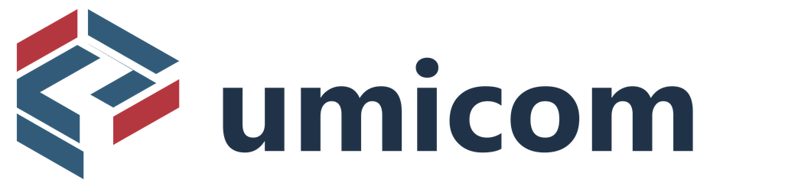

# Bits to Banking

## A starting point for every learner

Begin with [Computing from the Beginning](lessons/00-getting-started/index.md) if files, programs or commands are unfamiliar. No installation or previous coding is required. Use the [connected learning map](start/systems-learning.md) to continue into existing chapters and courses.

Learn how computers work, how software is built, and how technology can serve people.

Start with computer hardware and binary numbers. Progress to programming, operating systems, building real applications and contributing to open-source projects. Continue into accounting, banking, treasury management and trading systems when you are ready.

You can follow the chapters in order, return to any topic for revision, or use the [learning paths](start/index.md) to find a particular subject.

## Begin learning

1. [Inside a computer](lessons/01-computers/01-inside-a-computer.md)
2. [How information becomes bits and bytes](lessons/01-computers/02-bits-and-logic.md)
3. [How the CPU and memory work together](lessons/01-computers/03-cpu-and-memory.md)
4. [Turn an idea into a program](lessons/02-programming/04-problems-and-algorithms.md)
5. [Try your first PowerShell commands](lessons/02-programming/05-powershell.md)

## Explore Islam, purpose and service

[Volume 1 — Islam: Blueprint for Life](v001_islam_blueprint_for_life/index.md) introduces faith, purpose, ethical trade, money, banking and the responsibility to use knowledge for good. The original chapters and artwork remain available beside the computing and technology courses. [Faith, service and technology](v001_islam_blueprint_for_life/faith-service-and-technology.md) connects these values to practical engineering.

## Build something useful

The [practical source-code exercises](labs/index.md) include a notes application, a web task board, an example accounting journal, and other projects. Each exercise shows the instructions and files needed to try it yourself.

## Explore Umicom

[Umicom development](lessons/06-umicom/index.md) connects these skills to Umicom Framework, Umicom Kernel, Umicom OS and applications. The lessons link to the [Umicom repositories and source documentation](umicom/repositories.md) so you can inspect actual implementations.

## Join the community

Learn [how to contribute](contributing/index.md), from a small documentation correction to a reviewed code change. Follow our [community values](values.md) and help other people learn what you have learned.

> **We Value Each Other and Together Everyone Achieves More.**
>
> **Service to Many Leads to Greatness.**

## More technical workshops

Continue through the [complete learning roadmap](roadmap.md), which links hands-on Assembly, safer C23, CMake, package management, native web servers and Umicom Kernel boot experiments. The [native Umicom education command](umicom/native-education-tools.md) can prepare and serve the published website without running a Python HTTP server.
