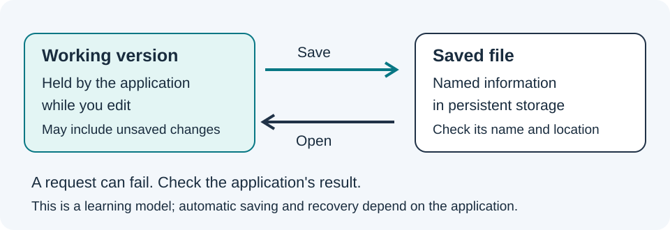

# What the computer keeps while it works

Distinguish working memory from storage and explain a bit and a byte.

**Before you begin:** read [Keep something you can find again](03-files-folders-and-saving.md), or use it for a refresher.

## Working space and a saved record

Memory is a general word for information-holding resources. Here, working memory means RAM, short for random-access memory. Applications commonly keep their current working information in RAM. Persistent storage, such as an SSD, keeps information across normal power-off. SSD means solid-state drive. Not every kind of memory behaves the same way, so we name the kind when it matters.

Think of a table where you arrange a puzzle and a cupboard where you keep a photograph of the arrangement. The table helps explain working space; the saved photograph helps explain a lasting record. This is an analogy, a comparison that illustrates one idea. A computer does not literally have a table or take a photograph of every program.

## Saving connects the two

When you type a sentence, the application keeps working information that may differ from the saved file. Saving asks for a stored record. Closing without saving can lose work. Automatic saving and recovery files can change that behaviour, but they are features to check, not promises to assume.

More RAM may let a computer hold more working information at once. More storage may let it keep more files. Neither number alone tells us how quickly a particular program will finish. The kind of work, processor, storage speed and other running programs can all matter.

## Two choices can represent information

A bit is a unit with two possible values, conventionally written 0 and 1. These symbols are labels for two states. One bit can answer a yes-or-no question if we agree that 1 means yes and 0 means no. Without that agreement, a 1 has no built-in meaning such as yes, red or ready.

Two bits give four patterns: 00, 01, 10 and 11. We could agree that they mean stop, wait, go and unknown. Eight bits form a byte. Eight independent two-way choices give 256 possible patterns. You need not memorise that calculation now. Practise noticing that adding one independent bit doubles the number of available patterns.

## Numbers need an interpretation

A group of bytes can represent text, a number or part of a picture. An encoding is an agreed way to represent information. Text encodings tell software how numbers represent characters. One visible character does not always take one byte; different encodings and characters use different amounts.

Later the Kernel lessons use memory addresses. An address identifies a location in a particular memory system; it is not the information stored at that location. For now, think of numbered spaces on paper. The space numbered 3 can contain the value 9. The location and the value answer different questions.

## Try it step by step

1. Draw four numbered spaces, 0 through 3, and put a different word in each.
2. Ask a partner, or ask yourself, for the contents of space 2. Give the word rather than the number 2.
3. Write the four two-bit patterns and assign each a different instruction.
4. Change one assignment and explain why everyone using the code needs to know the new agreement.

## Check your understanding

Does adding more storage necessarily let an application keep more unsaved working information in RAM?

**Explanation:** No. Storage and RAM have different roles. Some systems use storage to support memory management, but that does not make their capacities or speeds interchangeable.

## Before you continue

Continue when you can distinguish a location from its contents and a working copy from a saved record.

[Course contents](index.md) · [Words explained](../../courses/learning-computer-architecture/glossary.html) · [Connected learning routes](../../start/systems-learning.md)

**Previous:** [Keep something you can find again](03-files-folders-and-saving.md).

**Next:** [Give instructions and check what happens](05-instructions-and-checking.md).

Sammy Hegab · Umicom Foundation · MIT. Original learning material.
