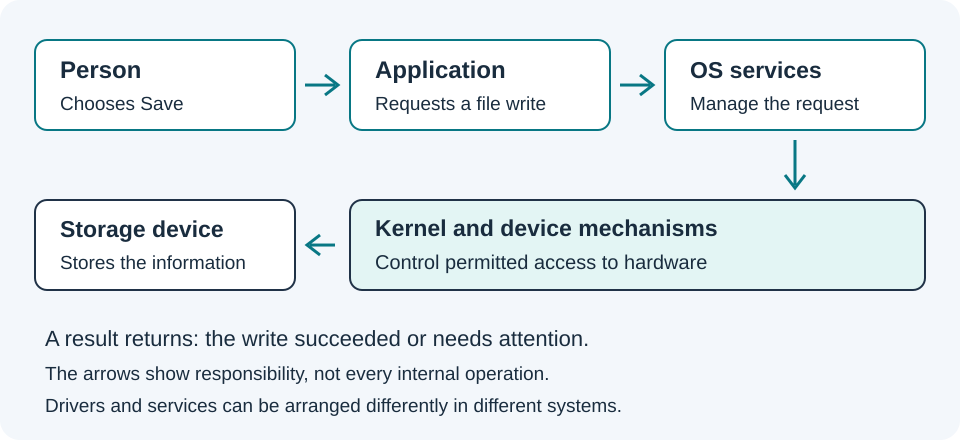

# How applications, an OS and a kernel fit together

Explain the role of each layer and distinguish Umicom OS from Umicom Kernel.

**Before you begin:** read [Read a command before running it](06-commands-without-mystery.md), or use it for a refresher.

## Begin with something familiar

Suppose you save a greeting. The text editor is an application: a program that helps with a particular activity. The application asks the operating system for a file operation. An operating system, often shortened to OS, is the software that manages resources and provides services to programs and people.

A service performs work for another part of the system. A file service helps programs open, read and write files. A process is a running instance of a program with its execution state and resources. Two windows do not always mean two processes; the application decides how to organise its work.

## Why a kernel has a special role

A kernel is the central software that controls important machine resources and provides controlled ways for other programs to request work. These resources include processor time and memory. Privilege means permission to perform operations that ordinary programs may not perform. Restricting privilege helps prevent one application from damaging another application's work or the system.

A driver is software that communicates with a kind of device. Drivers and other services may run in different places depending on the system's design. A simple drawing of layers helps us ask who owns a job, but it does not describe every operating system's internal design.

## Startup has several steps

Booting means starting the system so that it can perform useful work. Firmware is software supplied for early machine control. It can prepare hardware and help transfer control to a later program. A boot loader is a program that loads the next stage, such as a kernel. The exact sequence depends on the machine.

An emulator is software that models another machine's behaviour. In later Kernel work, QEMU provides a machine environment in which a research kernel can run. The host is the computer running the tools. The guest is the environment running inside the emulator. Testing a function on the host is different from booting an entire guest.

## The Umicom projects have different jobs

Umicom Framework provides reusable software services and libraries. A library is code that other programs can use. Umicom applications use those services to avoid each application inventing the same behaviour. Umicom OS includes a Linux-based image foundation and user-space software. User space is the part of a system where ordinary programs run with controlled access to kernel services.

Umicom Kernel is a separate native-kernel project with its own machine code and C source. Its current teaching examples include a RISC-V machine, an instruction-set family different from many desktop processors. The OS course and the Kernel course are related learning paths, but building the Framework does not prove either system boots. Their lessons identify which code and environment each exercise actually uses.

## Try it step by step

1. Draw four boxes labelled Person, Application, Operating-system service and Storage device.
2. Add arrows for a request to save a note and for a response saying whether it succeeded.
3. On a separate drawing label the host computer, an emulator and a guest.
4. Place the Framework, the Linux-based OS foundation and the native Kernel on a project map without treating them as the same program.

## Check your understanding

If a parser test runs successfully on Windows, has a native RISC-V kernel necessarily booted?

**Explanation:** No. A parser test can check a small part on the host. A boot claim requires running the intended image in the intended machine environment and inspecting the results.

## Before you continue

Continue when you can describe an application and a kernel without using them as interchangeable words.

[Course contents](index.md) · [Words explained](../../courses/computing-from-the-beginning/glossary.html) · [Connected learning routes](../../start/systems-learning.md)

**Previous:** [Read a command before running it](06-commands-without-mystery.md).

**Next:** [Choose your next learning route](08-choose-your-next-project.md).

Sammy Hegab · Umicom Foundation · MIT. Original learning material.
