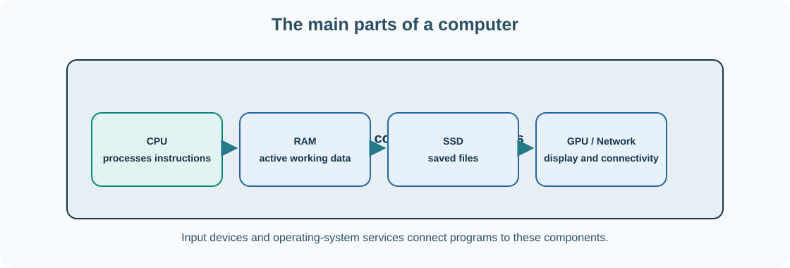

# 1. Inside a computer

A computer can display a photograph, play music, calculate a bank balance and run Umicom Studio IDE. Those activities appear very different, yet they rely on the same basic process: the computer receives information, follows instructions, produces a result and, when required, stores that result.

A **program** is a collection of instructions. **Hardware** is the physical equipment that carries them out. **Software** is the instructions and information that the hardware processes. You can touch a keyboard or a storage drive; you cannot touch the instructions in a program in the same way.



## Meet the main components

| Component | What it does | Example in an Umicom application |
| --- | --- | --- |
| Central processing unit (CPU) | Executes instructions and coordinates calculations | Works out a task's due date or checks an account balance |
| Random-access memory (RAM) | Holds instructions and data while programs are running | Keeps an open document ready for editing |
| Solid-state drive (SSD) or hard disk | Stores files when power is off | Keeps source code, saved notes and the operating system |
| Motherboard | Connects the processor, memory, storage and expansion hardware | Lets components communicate |
| Graphics processing unit (GPU) | Draws images and accelerates suitable calculations | Renders charts and graphical windows |
| Network interface | Sends and receives data over a network | Connects to a development repository or test server |
| Input/output devices | Let people and other equipment interact with the computer | Keyboard, mouse, screen, microphone and printer |

**RAM is not the same as storage.** When you edit a note, its current contents are normally in RAM. When you save it to a file, the operating system arranges for the note to be written to persistent storage. Closing the editor without saving may discard changes that were only in memory.

## The role of the operating system

Windows, Linux and other operating systems manage the computer's resources. They decide which processes get CPU time, allocate memory, maintain files and control access to devices. Applications such as Umicom Studio or a web browser request those services instead of directly controlling every component.

```text
You press Save
      ↓
Note-taking application
      ↓
Operating-system file service
      ↓
Storage driver and controller
      ↓
SSD stores the file
```

The reverse path brings the success result—or an error such as “access denied”—back to the application.

## Try it on Windows

Open **Start**, search for **PowerShell**, and open it. PowerShell is a command-line program: it accepts a typed instruction and prints a result. You do not need to run it as an administrator for these commands.

First find out which version of PowerShell you are using:

```powershell
$PSVersionTable.PSVersion
```

Next inspect the processor and memory:

```powershell
Get-CimInstance Win32_Processor |
    Select-Object Name, NumberOfCores, NumberOfLogicalProcessors

Get-CimInstance Win32_ComputerSystem |
    Select-Object Manufacturer, Model, TotalPhysicalMemory
```

The vertical bar (`|`) is a **pipeline**. It passes results from the first command into the next command. `Select-Object` chooses which pieces of information to display. `TotalPhysicalMemory` is reported in bytes; a byte is a small unit of digital information that we explore in the next chapter.

Find the operating system:

```powershell
Get-CimInstance Win32_OperatingSystem |
    Select-Object Caption, Version
```

The names and numbers will depend on your computer. Nothing in these commands changes the hardware.

## Check your understanding

Think of a source-code file open in Umicom Studio. Where is the saved version stored? Where are its working contents held while you type? Which component follows the instructions that make the editor respond? Why would a program need an operating system to open a file?

**Next:** [How information becomes bits and bytes](02-bits-and-logic.md).

## Continue with a connected course

[What does a computer do?](../../courses/computing-from-the-beginning/lessons/02-input-instructions-and-results.html) — Return to the input, instruction and result model before the component details.

[Find prerequisites and other learning routes](../../start/systems-learning.md). Return to this chapter whenever the course refers to its concepts.
