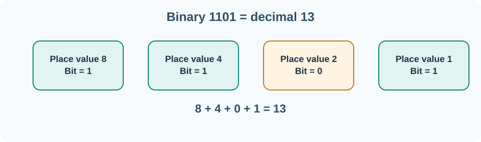

# 2. Bits, bytes and digital logic

Computers represent information using two distinguishable states. We write them as **0** and **1** and call each state a **bit**. Electrical circuits, memory cells and storage devices implement those states in different physical ways, but software can work with them using the same binary notation.

Eight bits make one **byte**. A byte can represent 256 different patterns, from `00000000` to `11111111`. The pattern does not tell us by itself whether it represents a number, a letter, part of a photograph or an instruction. The program and the chosen data format give the pattern meaning.

## Counting in binary

Decimal notation uses ten symbols (0–9). Binary notation uses only two (0 and 1). The positions in a binary number represent powers of two:

| Position | 8 | 4 | 2 | 1 |
| --- | ---: | ---: | ---: | ---: |
| Binary digit | 1 | 1 | 0 | 1 |

The number `1101₂` means `8 + 4 + 0 + 1`, which is **13** in decimal. The small `₂` simply says “written in base two”.



You can do the same with larger numbers. For example, `00101101₂` equals `32 + 8 + 4 + 1 = 45`. In hexadecimal, a compact notation based on sixteen symbols, the same value is written `0x2D`. Programmers often use hexadecimal to read memory addresses, byte values and instruction encodings.

## Decisions as logic

A computer can evaluate conditions. **Boolean logic** uses true and false values:

| A | B | A AND B | A OR B |
| --- | --- | --- | --- |
| False | False | False | False |
| False | True | False | True |
| True | False | False | True |
| True | True | True | True |

A login screen might allow access when a user is authenticated **AND** has permission. A task-board filter might show a card when it belongs to the current person **OR** has been assigned to their team. **NOT** reverses a Boolean value.

Electrical logic gates perform these simple operations. Complex processors combine enormous numbers of elementary circuits to implement arithmetic, memory control and instruction execution.

## What about text and money?

A text encoding describes how numbers become characters. **UTF-8** is a common encoding: the letter `A` can be stored using the byte `01000001`, while some characters require several bytes. A file is a sequence of bytes interpreted according to its format.

For money, precision matters. A price of £12.50 can be stored as **1,250 pence**, an integer with an agreed scale, instead of as a binary floating-point approximation. Currency codes and rounding rules still matter; different currencies use different minor-unit conventions. Later we use integer minor units in a simple ledger and explain where decimal types are appropriate.

## Try converting a number

In PowerShell, enter:

```powershell
[Convert]::ToString(13, 2)
[Convert]::ToString(45, 16)
[Convert]::ToInt32("1101", 2)
```

The results are `1101`, `2d` and `13`. The middle result is lower-case hexadecimal; case does not change the value.

Now work out decimal **19** in binary on paper. Start from the largest power of two that does not exceed 19: `16`. What remains after removing 16? Which smaller powers of two make up that remainder? Check your answer with `[Convert]::ToString(19, 2)`.

If the command reports an error, check that the radix (`2` or `16`) is supported and that the digits are valid in that radix. Binary notation cannot contain the digit `2`.

## Check your understanding

Why does the same sequence of bits sometimes represent a letter and sometimes a number? What is the difference between `0x10` and decimal `10`? Why do money calculations need explicit precision and rounding rules?

**Next:** [How the CPU executes a program](03-cpu-and-memory.md).
