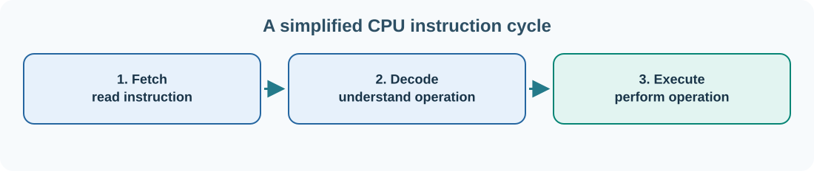

# 3. The CPU, memory and the instruction cycle

A computer processor does not understand a note, an account or a trading chart as human ideas. It executes **machine instructions** that move data, compare values, perform arithmetic and change which instruction comes next. Many small instructions working together create the behaviour we recognise as software.

## Fetch, decode, execute

A simplified description of the processor's work has three repeating stages:



1. **Fetch:** obtain the next instruction from memory, often through a cache.
2. **Decode:** determine what operation the instruction describes.
3. **Execute:** perform the operation, such as adding two numbers or loading a value.

Real modern processors overlap these stages and may execute several instructions simultaneously. The three-stage model remains useful for understanding what an instruction is.

## Registers, cache, RAM and storage

A **register** is a small storage location inside the processor used for values being operated on immediately. A **cache** keeps recently or frequently used data near the CPU. **RAM** holds the working contents of running programs. An **SSD** stores persistent files. In typical conditions, registers and caches are much faster than retrieving information from persistent storage, although their capacities are smaller.

A program also organises its memory into regions. The **stack** often holds function-call information and local data. The **heap** is an area used for dynamic allocations whose lifetime is managed by a program or runtime. Neither is a separate chip: these are ways software organises memory.

## One calculation, several layers

Imagine an Umicom task board counting unfinished tasks. A simple calculation is:

```text
unfinished = total_tasks - finished_tasks
```

If there are 12 tasks and 5 are finished, the result is 7. A compiler can translate a high-level statement like this into machine instructions that place values in registers, subtract one from another and save the result.

The CPU has an **instruction set architecture** (ISA) that defines available instructions and registers. Common examples are x86-64, ARM64 and RISC-V. Programs compiled for one ISA do not normally run natively on a different ISA without translation or emulation. Later, we examine Assembly—the human-readable representation of machine instructions.

## Processes and threads

When you run Umicom Studio, the operating system creates a **process** with its own virtual address space and resources. Within a process, one or more **threads** can execute work. An editor might use one thread for user interaction and workers for indexing or file searches. If lengthy work blocks the interaction thread, the window may appear frozen.

The operating-system scheduler decides when runnable threads receive CPU time. **Virtual memory** gives processes managed views of memory and helps isolate one process from another. The physical memory behind those views is controlled by the operating system and processor hardware.

## Inspect an active process

Open a program such as Notepad. In PowerShell enter:

```powershell
Get-Process notepad -ErrorAction SilentlyContinue |
    Select-Object ProcessName, Id, CPU, WorkingSet64
```

`Id` identifies a process. `CPU` is an accumulated processor-time value exposed by Windows. `WorkingSet64` is one measure of physical memory currently associated with the process, reported in bytes. These values can change while the program runs. If nothing appears, Notepad may not be running under that exact process name on your system.

For a quick view of memory capacity, use:

```powershell
Get-CimInstance Win32_ComputerSystem |
    Select-Object TotalPhysicalMemory
```

An important distinction: a program that uses many bytes is not necessarily faulty. Its memory usage must be understood alongside its workload, allocations, caching, and whether unused resources are eventually released.

## Check your understanding

What is the difference between a register and a file on an SSD? What does a process provide that a thread does not? Why might a task-board window become unresponsive while a long calculation is running?

**Next:** [Turn a problem into an algorithm](../02-programming/04-problems-and-algorithms.md).
