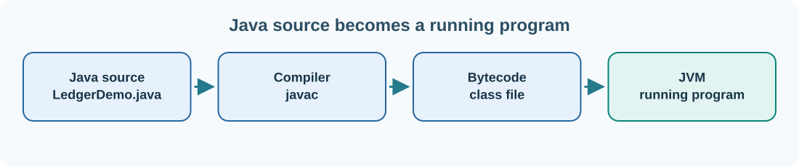

# 11. Java: programs, objects and exact monetary values

Java source code is compiled into **bytecode**. A **Java Virtual Machine** (JVM) loads the resulting `.class` files and executes their instructions. This lets compiled Java bytecode run on different supported operating systems when a compatible JVM is installed.

Java is widely used in enterprise applications. Our Umicom learning path also uses it to explain the design of systems such as Calypso and to compare managed memory with the explicit ownership model in C.



## Check the Java tools

Open PowerShell and enter:

```powershell
java -version
javac -version
```

`java` launches the runtime; `javac` compiles source code. You need a **JDK** (Java Development Kit), not just a runtime, to use both commands. The example below targets Java 17 or newer.

## Create a balanced journal

Our example models the basic accounting rule that the total debits in a journal must equal the total credits. We use `BigDecimal` because the amount **£25.10** must be represented exactly for this exercise.

Save the following as **`LedgerDemo.java`**:

```java
import java.math.BigDecimal;
import java.util.List;

public class LedgerDemo {
    record Posting(String account, BigDecimal debit, BigDecimal credit) {}

    static boolean IsBalanced(List<Posting> postings) {
        BigDecimal totalDebit = BigDecimal.ZERO;
        BigDecimal totalCredit = BigDecimal.ZERO;

        for (Posting posting : postings) {
            totalDebit = totalDebit.add(posting.debit());
            totalCredit = totalCredit.add(posting.credit());
        }
        return totalDebit.compareTo(totalCredit) == 0;
    }

    public static void main(String[] args) {
        List<Posting> journal = List.of(
            new Posting("Cash", new BigDecimal("25.10"), BigDecimal.ZERO),
            new Posting("Donation income", BigDecimal.ZERO, new BigDecimal("25.10"))
        );
        System.out.println("Journal balanced: " + IsBalanced(journal));
    }
}
```

Compile it, then run the class:

```powershell
javac .\LedgerDemo.java
java LedgerDemo
```

The expected result is `Journal balanced: true`. Notice that `javac` creates a `.class` file while `java` launches the compiled class.

## Understand the key ideas

`public class LedgerDemo` defines a class. A **record** is a concise way of representing an immutable group of values. Each `Posting` has an account name, a debit and a credit. The `List` holds several postings; the `for` loop visits each one.

`BigDecimal` is designed for decimal arithmetic. Constructing it from a decimal string avoids first creating an inexact binary floating-point value. `compareTo` checks numeric equality even if the values have different scales, such as `25.10` and `25.100`.

The sample focuses on one rule, not a complete accounting system. A professional posting validator would also reject negative amounts, require recognised accounts and currencies, track dates, approvals, unique identifiers and audit records, and prevent double posting.

## Managed memory and the JVM

Java manages object memory using **garbage collection**. You normally do not call `free` for each object. Garbage collection can reclaim memory that is no longer reachable, but developers still need to close files, database connections and other external resources. In Java, a `try`-with-resources block is commonly used for such resources.

## Extend the example

Change the credit to `24.10`, compile and run again. The result should be `false`. Restore the original amount. Then add a third posting and work out what other changes would be required to maintain a balanced journal.

Later, we will use the same business rule in C and explain how Umicom Framework can expose a stable contract to Java without leaking Java objects across a native ABI.

**Next:** [Create a web page with HTML](../04-web/12-html.md).
