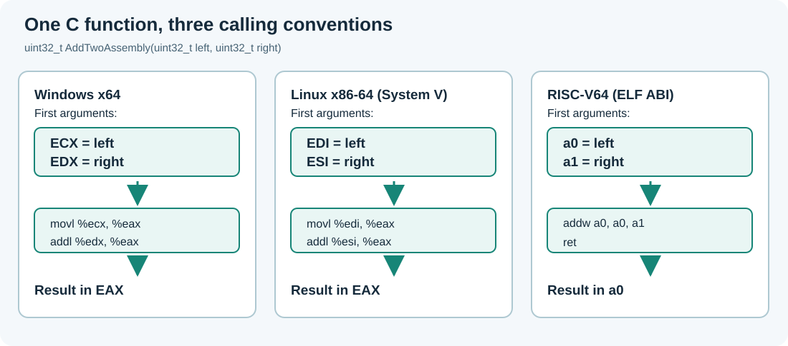

# 53. Call an Assembly function from C23

A C program and an Assembly function can work together without either language knowing the other's source code. The compiler and linker connect them using a **calling convention**: a set of rules describing how arguments are passed, where a result is returned, which registers a function must preserve, and how execution returns to its caller.

In this chapter, a small C23 program calls an Assembly function that adds two unsigned 32-bit integers. The example uses reference numbers rather than changing a real account balance. The code is in [`labs/native/assembly-functions`](https://github.com/umicom-foundation/Bits2Banking/tree/main/labs/native/assembly-functions).



## 1. Start with the C function

Open [`main.c`](https://github.com/umicom-foundation/Bits2Banking/blob/main/labs/native/assembly-functions/main.c). Near the beginning is a declaration:

```c
extern uint32_t AddTwoAssembly(uint32_t left, uint32_t right);
```

`extern` tells the compiler that the function exists, but its implementation is in another source file. `uint32_t` is an unsigned integer whose width is exactly 32 bits. The function takes two values and returns another 32-bit value.

The C version of the same operation is:

```c
static uint32_t AddTwoC(uint32_t left, uint32_t right)
{
    return left + right;
}
```

C defines unsigned arithmetic modulo 2³². If the answer grows beyond the largest 32-bit value, the low 32 bits are retained. This is a deliberately precise contract. The same computation expressed with *signed* integers could have undefined behaviour if the result overflowed.

## 2. Follow the values into processor registers

A **register** is a small storage location directly available to the processor. A calling convention specifies which registers carry the first arguments of a function. The convention is not the same on every operating system or processor architecture.

For two 32-bit integer arguments:

| Platform and ABI | First argument | Second argument | Return value |
| --- | --- | --- | --- |
| Windows x64 | `ECX` | `EDX` | `EAX` |
| Linux x86-64, System V | `EDI` | `ESI` | `EAX` |
| RISC-V64, standard ELF ABI | `a0` | `a1` | `a0` |

An **ABI**, or application binary interface, defines the machine-level contract between separately compiled components. Windows x64 and Linux x86-64 both execute x86-64 instructions, but they do not use the same register convention for these arguments.

Open [`add_x86_64.S`](https://github.com/umicom-foundation/Bits2Banking/blob/main/labs/native/assembly-functions/add_x86_64.S). Under Windows the function performs:

```asm
movl %ecx, %eax
addl %edx, %eax
ret
```

Read the instructions in order. First copy the left argument into the return-value register. Next add the right argument. Finally, return to the C code that called the function. On System V x86-64, the same instructions use `EDI` and `ESI` instead.

The RISC-V version is in [`add_riscv64.S`](https://github.com/umicom-foundation/Bits2Banking/blob/main/labs/native/assembly-functions/add_riscv64.S):

```asm
addw a0, a0, a1
ret
```

`addw` computes the low 32-bit result. The RV64 calling convention specifies how a 32-bit scalar result is represented in the wider return register. Do not assume every processor uses the same instructions or register names.

## 3. Build the application

On Windows, open PowerShell and enter:

```powershell
Set-Location "C:\umicom\Umicom-Bits2Banking"
$env:Path = "C:\msys64\ucrt64\bin;$env:Path"

cmake -S ".\labs\native\assembly-functions" `
    -B ".\output\learning-build\assembly-functions" `
    -G Ninja `
    -DCMAKE_C_COMPILER="C:\msys64\ucrt64\bin\gcc.exe"

cmake --build ".\output\learning-build\assembly-functions" --parallel 2
```

The first command **configures** a build directory: CMake reads the target definitions and selects source files suitable for your compiler's architecture. The second command asks Ninja to compile those sources and link the executable. If configuration reports an unsupported architecture, do not run a binary intended for a different processor.

Run the test:

```powershell
ctest --test-dir ".\output\learning-build\assembly-functions" --output-on-failure
```

Expected result: one test passes. Run the executable:

```powershell
& ".\output\learning-build\assembly-functions\bits2banking-assembly-functions.exe"
```

It should report that the C and Assembly implementations agree on **100 value pairs**. The test includes boundary values such as `UINT32_MAX`, not just easy examples.

On Linux x86-64, use the Linux commands in the [lab README](https://github.com/umicom-foundation/Bits2Banking/blob/main/labs/native/assembly-functions/README.md). A RISC-V64 result requires an RV64 compiler and an RV64 execution environment: a successful x86-64 test does not exercise RISC-V hardware.

## 4. Understand why the linker is necessary

The C compiler processes `main.c` and records a reference to a symbol named `AddTwoAssembly`. The assembler processes the `.S` file and emits machine instructions defining that symbol. The **linker** matches the reference and definition so the final executable has a callable function.

If the function name is misspelled in one file, compilation might succeed but linking fails with an undefined-reference or unresolved-external error. This is a linker problem, not a runtime problem.

The `.S` extension normally means that the Assembly file passes through the C preprocessor before assembly. The `#if defined(_WIN32)` sections therefore select the relevant x86-64 calling convention at build time.

## 5. Try it yourself

Change the C test to include one more unsigned value, such as `500000U`. Rebuild and run CTest. Explain why adding one more test input adds more than one comparison: each input is paired with every input, including itself.

Next, deliberately change `AddTwoAssembly` to `AddTwoAssemblyWrong` in the C declaration only. Try building. Record the linker diagnostic and restore the original declaration before continuing.

**Check your understanding:** Which register holds the first argument on Windows x64? Why does the same x86-64 source select different instructions on Linux? Why must a test include values near `UINT32_MAX`? What does the linker contribute after compilation and assembly?

## Continue with Umicom Framework

The same approach is used by [the existing Umicom Framework Assembly laboratory](https://github.com/umicom-foundation/umicom-framework/tree/main/examples/learning/assembly). Compare its `add_x86_64.S`, `add_riscv64.S` and test driver. The next lesson uses this foundation to understand the very different responsibility of Assembly when a kernel first starts.
