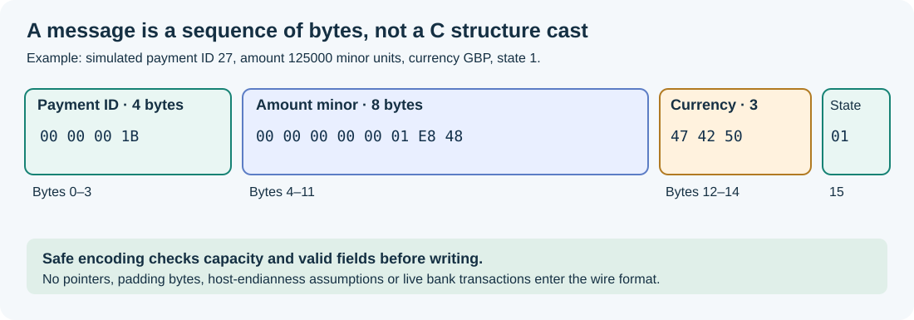

# 55. Write a binary record safely in C23

A programme that saves a note, sends an HTTP message or stores a simulated payment cannot assume that two computers use the same in-memory representation. This chapter shows how to encode information as an exact sequence of bytes, then decode it without reading beyond a buffer or silently accepting damaged data.

The [binary payment record laboratory](https://github.com/umicom-foundation/Bits2Banking/tree/main/labs/native/binary-payment-records) uses a fictional amount and account reference. It contains no real payment connectivity.



## 1. Differentiate values from their representation

Suppose a training application holds a payment reference numbered `27` and a fictitious amount of `125000` minor units. For a currency such as GBP, 125000 pence represents £1,250.00. In a C program, you might store the reference in `uint32_t` and the amount in `uint64_t`.

These type names specify widths, but they do not define how a whole C structure is laid out in memory. A compiler can add **padding bytes** between fields. A processor may also store the least significant byte of an integer first, which is called **little-endian** representation.

A network or file format needs an exact layout independent of the current compiler's private choices. It should say which byte goes where.

## 2. Read the wire-format contract

Our learning record has exactly 16 bytes:

| Byte positions | Width | Meaning |
| --- | --- | --- |
| 0–3 | Four bytes | Unsigned payment reference |
| 4–11 | Eight bytes | Unsigned amount in minor currency units |
| 12–14 | Three bytes | Uppercase ASCII currency code |
| 15 | One byte | Training state: 1 = pending, 2 = reviewed |

All multi-byte numbers use **network byte order**, also called big-endian, meaning the most significant byte appears first. A currency code such as `GBP` occupies exactly three bytes. It is not a null-terminated C string; the type deliberately uses `char currency[3]`.

Open [`record.h`](https://github.com/umicom-foundation/Bits2Banking/blob/main/labs/native/binary-payment-records/record.h). The public functions take a pointer to the source record, a pointer to destination storage and the buffer's capacity. Each call returns a named status so the caller can distinguish success, invalid data and insufficient space.

## 3. Inspect the encoder

The implementation first validates inputs. The reference must not be zero, the amount must be positive, the currency must contain three uppercase letters and the training state must be recognised.

It checks the buffer's capacity before writing:

```c
if (capacity < BTB_PAYMENT_RECORD_SIZE)
    return BTB_RECORD_TOO_SMALL;
```

Only after validation does it write the bytes. The helper `WriteBE` shifts an **unsigned** integer by a known amount, then narrows it to one byte. This avoids implementation-dependent C structure padding and does not involve a pointer cast to a packed structure.

The lab checks that a rejected request leaves both the destination bytes and `outWritten` unchanged. This is an important function contract: callers should not have to wonder whether a failure left half a record in the output buffer.

## 4. Inspect the decoder

The decoder requires exactly 16 input bytes. A shorter or longer packet is refused. It constructs a candidate record in temporary local storage, checks the candidate's fields and assigns it to the caller's destination only after validation succeeds.

This approach prevents malformed input from partially changing the existing object. It is useful when a program is decoding financial messages, saved notes or other structured data, although each real application also needs its own schema, business validation, permissions and versioning.

The example does not contain a network server and does not implement ISO 20022, SWIFT or a banking protocol.

## 5. Configure, build and run the lab

Open PowerShell:

```powershell
Set-Location "C:\umicom\Umicom-Bits2Banking"
$env:Path = "C:\msys64\ucrt64\bin;$env:Path"

cmake -S ".\labs\native\binary-payment-records" `
    -B ".\output\learning-build\binary-payment-records" `
    -G Ninja `
    -DCMAKE_C_COMPILER="C:\msys64\ucrt64\bin\gcc.exe"

cmake --build ".\output\learning-build\binary-payment-records" --parallel 2
ctest --test-dir ".\output\learning-build\binary-payment-records" --output-on-failure
```

The expected result is one passing test. Run the example:

```powershell
& ".\output\learning-build\binary-payment-records\bits2banking-record-demo.exe"
```

The expected hexadecimal bytes are:

```text
00 00 00 1B 00 00 00 00 00 01 E8 48 47 42 50 01
```

`1B` is hexadecimal for the reference `27`. The sequence `00 00 00 00 00 01 E8 48` is the amount `125000` in a 64-bit big-endian field. `47 42 50` represents the ASCII letters `GBP`.

## 6. Break a rule and observe a controlled failure

Open [`test_record.c`](https://github.com/umicom-foundation/Bits2Banking/blob/main/labs/native/binary-payment-records/test_record.c). The test deliberately tries to encode into a buffer that is one byte too small. It then checks that the output bytes were not changed.

Next, the test damages the currency and state fields and asks the decoder to read the record again. The decoder rejects the bad input and keeps the previously decoded object unchanged.

Try modifying the example amount from `125000U` to `7500U` in `main.c`, then rebuild. Which of the eight amount bytes changed? Explain the new value in ordinary currency units.

**Check your understanding:** Why is an integer field's width not sufficient to specify a file format? What is network byte order? Why is `char currency[3]` not a C string? Why is a successful test more convincing when it includes deliberately invalid input?

## 7. Connect the exercise to Umicom

The real Umicom financial applications rely on Framework-owned contracts for monetary amounts, persistence and messaging. The learning record deliberately avoids copying those production models: it exists to reveal the byte-level reasoning behind a safe message format.

See [Umicom Framework](https://github.com/umicom-foundation/umicom-framework), and later study its platform and finance modules after completing the foundational C lessons.
