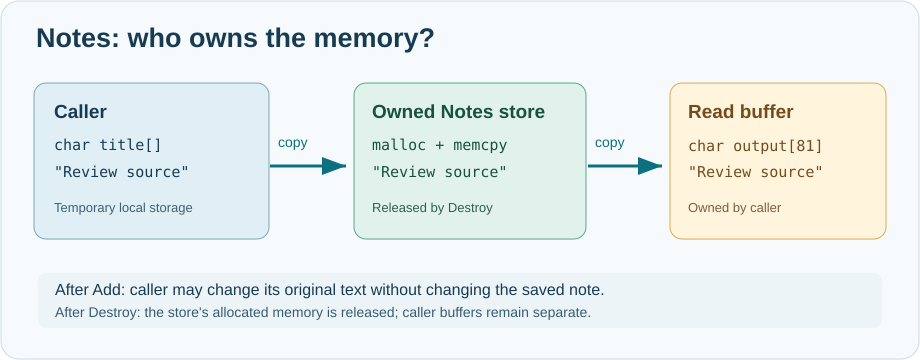

# 58. Who owns this memory? Build a Notes model in C23

A note-taking application must keep a note after the function that created it has finished. It also needs to release the note when the user deletes it. These two ordinary requirements introduce one of the most important subjects in C programming: **memory ownership**.

In this lesson, you will build and test a small model that stores the tasks a contributor is working on. It does not draw a window yet; we will add a user interface after its storage rules are clear.



## 1. Start with values and addresses

A variable stores a value. A pointer stores the **address** of some storage. A C function can receive a pointer so it can examine or change that storage without making a complete copy.

Consider:

```c
char title[] = "Review Umicom documentation";
```

The array has room for the letters and the terminating zero byte (`'\0'`). Now suppose you pass `title` into a Notes model. Should the model remember the address or make a copy?

If the model only remembers the address, changing `title` later could unexpectedly change the saved note. Worse, the address may become invalid after the function's local array ceases to exist. The model therefore **copies the text into memory that it owns**.

## 2. Distinguish stack storage and dynamically allocated storage

A local variable usually lives for the current function call. In C, this is called *automatic storage duration*; the compiler and runtime organise its lifetime.

A program can also request dynamic storage with `malloc` and release that storage with `free`. A successful `malloc` call returns the address of new storage. A failed call returns `NULL`.

```c
size_t byteCount = 40U;
char *ownedText = malloc(byteCount);
if (ownedText == NULL) {
    /* Allocation failed; do not access ownedText. */
    return;
}
/* Use no more than byteCount bytes. */
free(ownedText);
ownedText = NULL;
```

This fragment illustrates the steps; the complete laboratory manages the storage inside a Notes object. The caller does **not** release internal text that it never received ownership of.

## 3. Read an explicit ownership contract

Open [`notes.h`](https://github.com/umicom-foundation/Bits2Banking/blob/main/labs/native/owned-notes/notes.h). The public type is declared as:

```c
typedef struct BtbNoteStore BtbNoteStore;
```

The structure's fields are not exposed by this header. This is an **opaque type**. A caller receives a pointer to a store without being allowed to change its internal allocation table directly.

The main operations are:

```c
BtbNoteStatus BtbNoteStoreCreate(BtbNoteStore **outStore);
BtbNoteStatus BtbNoteStoreAdd(BtbNoteStore *store,
                              const char *title, const char *body,
                              BtbNoteId *outId);
void BtbNoteStoreDestroy(BtbNoteStore *store);
```

The store owns the memory it allocates. The caller owns its input strings. `Add` makes copies. `Destroy` releases the copies and the store itself. This division of responsibilities prevents two parts of a program from both trying to free the same allocation.

An ID identifies a note even if another note is removed. It is different from the note's current position in an array.

## 4. Follow one note into memory

Open [`notes.c`](https://github.com/umicom-foundation/Bits2Banking/blob/main/labs/native/owned-notes/notes.c) and find `BtbOwnedPair`. It allocates a copy of the title and a copy of the body. If either allocation fails, it releases any successful earlier allocation and reports an error.

`BtbNoteStoreAdd` then asks `BtbReserve` to enlarge the note array if necessary. The key operation is:

```c
BtbOwnedNote *enlarged = realloc(store->notes,
                                 newCapacity * sizeof(*enlarged));
if (enlarged == NULL) return BTB_NOTE_OUT_OF_MEMORY;
store->notes = enlarged;
```

Why use a temporary pointer? `realloc` can fail. If it does, the original memory remains valid. Assigning its result directly to `store->notes` would lose the original address on failure, causing a memory leak.

The store accepts at most 64 notes. Its title and body limits are expressed in **bytes**, not letters, because UTF-8 characters may occupy more than one byte.

## 5. Replace a note without losing the old one

A user may replace a draft title with a better title. A dangerous implementation would free the old text first and then attempt to allocate the replacement. If the allocation fails, the previous note has already been lost.

Instead, `BtbNoteStoreReplace` prepares both new strings first. Only when both are ready does it release the old strings and install the replacements.

This is called a **failure-atomic edit**: a rejected operation leaves the previous note usable. It is a useful design principle for a document editor, a settings screen and an account-review form.

## 6. Build and run the complete program

Open PowerShell and enter:

```powershell
Set-Location "C:\umicom\Umicom-Bits2Banking"
$env:Path = "C:\msys64\ucrt64\bin;$env:Path"

cmake -S ".\labs\native\owned-notes" `
    -B ".\output\learning-build\owned-notes" `
    -G Ninja `
    -DCMAKE_C_COMPILER="C:\msys64\ucrt64\bin\gcc.exe"

cmake --build ".\output\learning-build\owned-notes" --parallel 2
ctest --test-dir ".\output\learning-build\owned-notes" --output-on-failure
& ".\output\learning-build\owned-notes\bits2banking-owned-notes.exe"
```

The test should report one passing case. The demonstration prints one contributor task with its note ID, title and body.

## 7. Prove that the Notes model really owns its text

Open `test_notes.c`. The test creates a note using two local character arrays, then changes the first character of each original array. It reads the stored note again and verifies that the saved text did not change.

The test also requests a note using output buffers that are too small. The model refuses the read without overwriting either buffer. It tries an invalid replacement and checks that the original note remains intact.

These tests exercise the contract rather than merely checking that the program starts.

## 8. Your next change

Add a second contributor task in `main.c`. Give it a meaningful title such as *Write a CMake test*. Compile and run the application. Add an assertion in `test_notes.c` that removes the first note and verifies that the second note can still be found by its original ID.

**Check your understanding:** Who releases the title strings? Why should `realloc` use a temporary pointer? Why is a note ID not the same as its current array index? What should happen to an existing note if replacement allocation fails?

### Continue with Umicom Framework

The learning model is deliberately small. Real Umicom applications use shared Framework services rather than copying this implementation. Examine the Framework's [public allocator contract](https://github.com/umicom-foundation/umicom-framework/blob/main/include/umicom/base/memory.h) and its [document services](https://github.com/umicom-foundation/umicom-framework/tree/main/include/umicom/document) after completing this exercise. Notice how explicit ownership rules let many applications share one reliable implementation.
