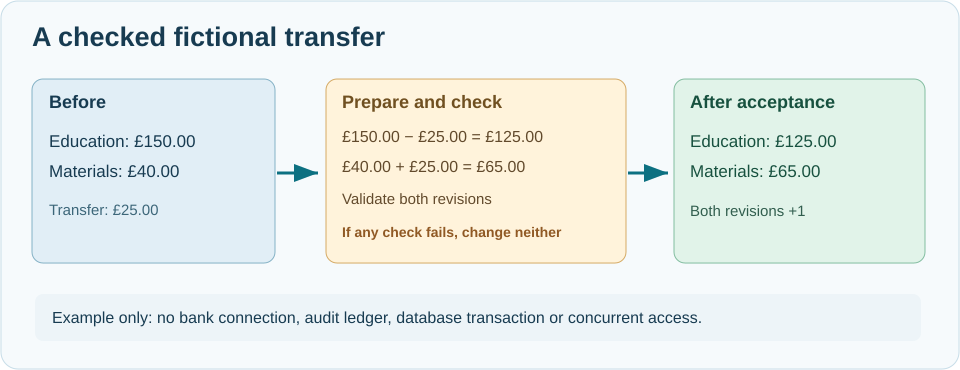

# 59. Checked arithmetic: build a fictional account transfer in C23

A financial application must not silently change a balance because an integer is too large for its storage type. A similar rule applies when calculating the size of a memory buffer: **the arithmetic must be valid before the program trusts its result**.

You will build a small, single-process training exercise. It transfers fictional funds between an education budget and a materials budget. It does not connect to a bank or send real payments.



## 1. Express money in exact units

Suppose an account holds £150.00. Store this as `15000` pence. One pence is the smallest unit used by this example, and the number is an **integer** rather than a floating-point approximation.

```c
uint64_t balancePence = 15000U;
```

The type `uint64_t` holds an unsigned integer with 64 bits. Its largest value is `UINT64_MAX`. Adding another amount when it is already at that maximum cannot produce a larger 64-bit value.

Unsigned arithmetic in C wraps around modulo 2⁶⁴. Although the wrap itself is defined behaviour, it would be a serious *logic error* if a financial balance unexpectedly became small.

## 2. Check before adding

Open [`account.c`](https://github.com/umicom-foundation/Bits2Banking/blob/main/labs/native/checked-money/account.c). The addition helper is:

```c
BtbAccountStatus BtbCheckedAdd(uint64_t left,
                               uint64_t right, uint64_t *out)
{
    if (out == NULL) return BTB_ACCOUNT_INVALID;
    if (left > UINT64_MAX - right) return BTB_ACCOUNT_OVERFLOW;
    *out = left + right;
    return BTB_ACCOUNT_OK;
}
```

Read it from top to bottom. First, the output address must exist. Second, subtracting `right` from the known maximum reveals the largest safe starting value. Only when the test passes does the function add the numbers and write the result.

The function leaves the caller's output unchanged on failure.

Multiplication needs a different check. Before multiplying two unsigned values, ensure `left <= UINT64_MAX / right` when `right` is non-zero. Check division by zero before dividing.

## 3. Build a transaction-sized operation

Our teaching account has two fields:

```c
typedef struct BtbTrainingAccount {
    uint64_t balancePence;
    uint64_t revision;
} BtbTrainingAccount;
```

The `revision` counts accepted changes. It allows us to see that a rejected operation did not change the account.

A fictional transfer of 2,500 pence should perform four calculations:

1. Subtract 2,500 pence from the education budget.
2. Add 2,500 pence to the materials budget.
3. Increment the education account revision.
4. Increment the materials account revision.

What if the second account is already at `UINT64_MAX`? We must not debit the first account and then discover that the second account cannot receive the amount.

`BtbAccountTransfer` calculates **all four values first**. If any check fails, it returns a status and leaves both accounts unchanged. Only after every check passes does it update the two records.

This resembles one important property of a database transaction, but it is not a real database transaction. There is no durable journal, crash recovery, locking, authentication or reconciliation in this example.

## 4. Build and test on Windows

```powershell
Set-Location "C:\umicom\Umicom-Bits2Banking"
$env:Path = "C:\msys64\ucrt64\bin;$env:Path"

cmake -S ".\labs\native\checked-money" `
    -B ".\output\learning-build\checked-money" `
    -G Ninja `
    -DCMAKE_C_COMPILER="C:\msys64\ucrt64\bin\gcc.exe"

cmake --build ".\output\learning-build\checked-money" --parallel 2
ctest --test-dir ".\output\learning-build\checked-money" --output-on-failure
& ".\output\learning-build\checked-money\bits2banking-checked-money.exe"
```

The test should pass. The example prints:

```text
Education budget: GBP 125.00 (revision 1)
Materials budget: GBP 65.00 (revision 1)
```

Before running it, calculate the result yourself: £150.00 minus £25.00 is £125.00; £40.00 plus £25.00 is £65.00. Both revisions advance from zero to one.

## 5. Read the negative tests

Open `test_account.c` and locate the tests for `UINT64_MAX`. One tries to add one to the maximum value. Another tries to multiply the maximum by two. Both must return an overflow result without changing the previous output value.

Later, the test simulates a transfer to an account whose balance is already at its maximum. The transfer is refused, and both account records retain their earlier values. A separate test proves that an account with revision `UINT64_MAX` cannot be changed without overflowing its revision.

## 6. Extend the practical example

Change the transfer from 2,500 pence to 1,250 pence. Predict the result and run the program. Then add a test for a transfer of zero pence: does the function accept or refuse it, and why?

A useful next exercise is to design a simple audit record for each **accepted** transfer. Write down which fields you would need: operation ID, two account IDs, amount, time, previous and new revisions. Do not add networking or real payment functionality.

**Check your understanding:** Why do we calculate in pence? Why is unsigned wraparound still a defect in this context? What happens when the recipient account cannot hold the new balance? Which important safeguards would a real banking system need beyond this example?

### Continue with Umicom

Study the [Framework repository](https://github.com/umicom-foundation/umicom-framework) and the [Umicom Bank module](https://github.com/umicom-foundation/umicom-bank-module) as you advance. Real applications must use the shared financial contracts, controlled posting workflows and durable transaction services rather than this isolated training structure.
