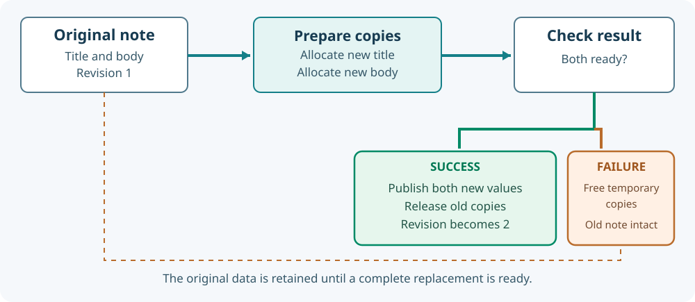

# 64. Make allocations fail on purpose

Imagine editing the title of a note from *Review Umicom documentation* to *Review the Framework API*. The computer may be running low on memory when you press Save. A reliable Notes application must either accept the **whole** replacement or keep the old note intact. Losing the previous title merely because an allocation failed would be a software defect.

In C23, we can test this without actually exhausting the computer's memory. We give the program an **allocator** that refuses a chosen request, then examine what happens to the note.

## 1. Understand the two operations

`malloc` asks the runtime for a new region of memory. A successful call returns a pointer to that region. A failed call returns `NULL`. `free` releases a region the program owns.

```c
char *title = malloc(64U);
if (title == NULL) {
    /* Do not use title. No memory was allocated. */
    return;
}
/* The program may use at most 64 bytes through title. */
free(title);
```

In the complete exercise, **the Notes model**, not the caller, owns the title and body allocations. Borrowed pointers should never be freed by the caller.

## 2. Why replace both fields at once?

A note has two related values: a title and a body. Suppose the new title is allocated successfully but the body allocation fails. If the code has already freed the old title, the user loses the original note even though the operation was rejected.

The safer sequence is:

1. Check that the supplied text lengths are within the limits.
2. Allocate a new title, then a new body.
3. If either allocation fails, release any temporary allocation and retain the old note.
4. Only after both copies are ready, release the previous values and publish the new pair.
5. Increase the revision so another caller can detect that the note has changed.



This is called a **failure-atomic replacement**. It is not a database transaction, but it follows the same useful principle: a rejected operation should not leave half a change.

## 3. Locate the allocator interface

Open `labs/native/fault-injection/note.h`.

```c
typedef void *(*BtbAllocateFn)(size_t size, void *context);
typedef void (*BtbReleaseFn)(void *pointer, void *context);

typedef struct BtbAllocator {
    BtbAllocateFn allocate;
    BtbReleaseFn release;
    void *context;
} BtbAllocator;
```

A *function pointer* stores the address of a function. The `context` pointer lets a test allocator retain its own counters and settings. The Notes implementation calls the supplied functions rather than reaching directly for the system allocator.

Umicom Framework uses the same general idea in its real [public allocator contract](https://github.com/umicom-foundation/umicom-framework/blob/main/include/umicom/base/memory.h), which supplies `UmiAllocator`, `umi_alloc`, `umi_realloc` and `umi_free`. The laboratory is intentionally independent so you can read every line; it is not a replacement for Framework memory services.

## 4. Inspect the replacement code

Open `labs/native/fault-injection/note.c` and find `BtbNoteReplace`. It calls `CopyPair` before releasing the previous title and body. When the second allocation fails, `CopyPair` releases the new title and returns a failure status.

The important condition is:

```c
if (status != BTB_OK) return status;
```

At that point the note's previously accepted data and revision are still intact. The operation has **not** committed the replacement.

The example also checks a revision number. Passing the wrong expected revision produces `BTB_CONFLICT` without allocating anything. This prevents a stale editing operation from unexpectedly replacing a newer note.

## 5. Build the exercise

Open PowerShell:

```powershell
Set-Location "C:\umicom\Umicom-Bits2Banking"
$env:Path = "C:\msys64\ucrt64\bin;$env:Path"

cmake -S ".\labs\native\fault-injection" `
    -B ".\output\learning-build\fault-injection" `
    -G Ninja `
    -DCMAKE_C_COMPILER="C:\msys64\ucrt64\bin\gcc.exe"

cmake --build ".\output\learning-build\fault-injection" --parallel 2
ctest --test-dir ".\output\learning-build\fault-injection" --output-on-failure
```

The build should produce `bits2banking-fault-injection-test.exe`; CTest should report one passing test. The normal demonstration can be started with:

```powershell
& ".\output\learning-build\fault-injection\bits2banking-fault-injection.exe"
```

It prints a note at revision 1 with its title and body.

## 6. Follow the test that refuses memory

Open `test_note.c`. The test allocator counts how many allocations have been requested. Its `failOn` field identifies the request that should return `NULL`.

The test covers an initial failure, a failure during the second allocation, stale revision refusal and two failures during replacement. After each refusal, it checks that the **old values remain readable** and the revision has not increased. After destroying the note, its live allocation count must be zero.

This is more informative than checking that the program works only when every allocation succeeds.

## 7. Change one thing and observe the test

Find the early return after `CopyPair` fails. Temporarily remove it in a **copy** of the laboratory and predict which tests would fail. Do not keep this deliberately broken change in the normal source tree. Restore the original code and confirm that all tests pass again.

A safer experiment is to add another rejected-input assertion in `test_note.c`, using a title containing an embedded zero byte. A byte sequence supplied with an explicit length is not automatically a valid C string; the example refuses embedded zeros.

**Check your understanding:** Who owns the allocated title? Which allocation is released when the second request fails? Why does the note's revision remain unchanged after rejection? What does the test's `live` counter prove, and what does it **not** prove about unrelated memory in the process?

Continue with [Lesson 65: Parse incoming bytes without assuming a string](65-parse-bounded-http-bytes.md).
