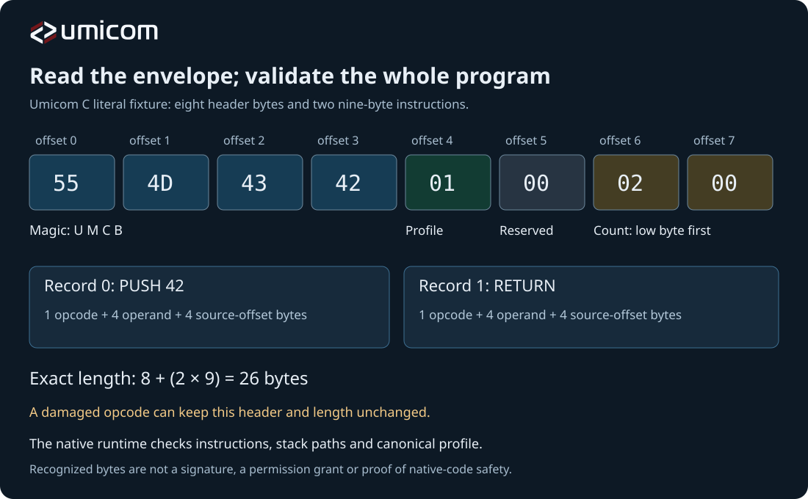

<!--
Umicom Bits2Banking
File: content/lessons/03-native-code/learning-d/30-state-the-effects-of-a-binary-reader.md

PURPOSE:
State the effects of a binary reader

AUTHOR AND ORGANISATION:
Sammy Hegab
Umicom Foundation

LICENCE:
MIT
-->

# State the effects of a binary reader

[Course contents](index.md)

## Make a small function's promises visible

A function can describe more than the types of its inputs and result. It can also state which kinds of effects it permits. This lesson uses D to read the envelope of an Umicom C bytecode artifact. The exercise makes its borrowing, output and allocation rules explicit, then compares that limited reader with the complete native runtime. The goal is to understand each promise and its limits, not to assume that an impressive-looking declaration proves every property of a program.

Read the earlier lessons about slices, structs, ref parameters, unit tests and C linkage first. The example is normal D source with a small restricted function inside it. The surrounding console program uses the standard D runtime and std.stdio. It is not a BetterC executable and is not compiled into Framework production code. D compilation has not been performed in the current authoring environment; keep that qualification distinct from the separate native C fixture check.

## Start with the actual byte layout

The first eight bytes of the Umicom C artifact contain four identifying bytes, a wire profile, a reserved byte and a two-byte instruction count. The identifying bytes spell UMCB in ASCII. Current profiles are one through six, the reserved byte is zero, and the count lies between one and 256. Each instruction occupies nine more bytes. Our literal fixture contains two instructions, so its total length is 26 bytes.

~~~text
Offsets 0..3 : 55 4D 43 42  (UMCB)
Offset  4    : 01           (wire profile)
Offset  5    : 00           (reserved)
Offsets 6..7 : 02 00        (two records, low byte first)
Offsets 8..25: two nine-byte instructions
~~~

Do not cast this storage to a native struct. A struct's alignment, padding and member layout are not the serialized contract. The example reads individual bytes and produces an ordinary result value after validation. This works conceptually on either host byte order because the byte-order conversion is explicit.

## Separate the result type from the file

~~~d
struct EnvelopeInfo
{
    ubyte profile;
    ushort instructionCount;
    size_t encodedBytes;
}
~~~

struct groups three named values. ubyte and ushort are unsigned integer types suitable for the accepted profile and count. size_t represents sizes for the selected target and may have a different width on different architectures. This result is private to the D example. Its use of size_t does not define a stable cross-language wire or C ABI layout. A public ABI would need a separately reviewed representation.

## Read the complete function declaration

~~~d
bool inspectEnvelope(scope const(ubyte)[] bytes, ref EnvelopeInfo result)
    @safe pure nothrow @nogc
~~~

bool is the success/refusal answer. const(ubyte)[] is a counted view of bytes that this function cannot modify through that view. It is not an independent copy or proof that no other alias can change the underlying storage. The caller must keep the input alive and stable for the call. scope expresses that the borrowed view must not escape this parameter boundary. The implementation stores only decoded scalar facts, not the input slice.

## Why this output uses ref rather than out

ref lets the function access the caller's existing EnvelopeInfo. The code leaves that value alone until all checks pass. An out parameter initializes its argument on entry, before the function body performs these checks. Using out here would therefore erase the previous result even when the first condition returns false. Parameter spelling is part of behavior, not just style.

~~~d
const sentinel = EnvelopeInfo(99, 77, 66);
auto result = sentinel;
assert(!inspectEnvelope(truncatedBytes, result));
assert(result == sentinel);
~~~

The unit-test helper follows this pattern for each rejected input. The first assertion checks refusal; the second checks preservation. Testing only the return value would miss a function that correctly says false but has already overwritten useful state. This pattern also applies to a native settings preview or a proposed transaction that must not become visible until it is complete.

The source also contains no explicit native allocation and keeps no data after return. Those are properties of this inspected implementation, not consequences of the attribute names alone. main writes to the console and uses the normal runtime. A restricted helper does not make its callers, imported modules or entire executable allocation-free.

## Interpret the four attributes carefully

| Attribute | Promise relevant to this function | What it does not establish |
| --- | --- | --- |
| @safe | Uses the language's checked memory-safety subset | Correct file format or permission to execute |
| pure | Restricts access to mutable external state; ref arguments can still be modified | A mathematical function with no possible argument mutation |
| nothrow | Does not propagate ordinary Exception failures | Immunity to Error conditions such as a failed bounds check |
| @nogc | Does not use the D garbage collector in this function | A whole-program memory cap or a ban on every possible native allocation |

## Check length before accessing storage

~~~d
if (bytes.length < 8 || bytes.length > 2312) return false;
if (bytes[0] != 0x55 || bytes[1] != 0x4D ||
    bytes[2] != 0x43 || bytes[3] != 0x42) return false;
~~~

A slice carries a length, so the reader need not search for a terminating zero. Zero is an ordinary byte inside this format. The first condition rejects both a short header and an input larger than the current maximum envelope. Only afterward does the code access positions zero through seven. Keep checks enabled during learning; the explicit shape check and the language's bounds checks serve different purposes.

## Widen before combining bytes

~~~d
const count = cast(uint)bytes[6] | (cast(uint)bytes[7] << 8);
if (count == 0 || count > 256) return false;
const size_t needed = 8 + cast(size_t)count * 9;
if (bytes.length != needed) return false;
~~~

cast(uint) makes the arithmetic type explicit. Shifting the high byte by eight places gives it weight 256, and bitwise OR combines the two disjoint bit groups. The count bound is established before computing the total size. That order makes the multiplication small and auditable. The exact length check rejects both missing records and unexplained trailing bytes.

Notice the difference between const and immutable in the file. The decoded local count is const because it will not be reassigned through that name. The literal fixture is immutable data shared by the tests. Mutable damaged arrays receive copied element values through slice assignment; the tests never try to modify the immutable reference. A const view alone would not have created that independent test storage.

## Publish a local candidate at the end

~~~d
const candidate = EnvelopeInfo(bytes[4], cast(ushort)count, needed);
result = candidate;
return true;
~~~

The narrowing cast to ushort occurs only after count is known to be at most 256. All result fields are available together when the assignment happens. Earlier return statements have no result assignment. No input view is kept in the result, so its scalar facts remain usable after the input slice's owner releases its storage. That does not make the facts current if somebody later changes the original artifact.

## Compile the D example separately

1. Open the native-language-boundary folder in Bits2Banking and read inspect_umc_header.d.
2. Check that dmd identifies the intended D compiler. If using LDC or GDC, consult that compiler's command-line reference instead of assuming DMD options are interchangeable.
3. Compile with unit tests and diagnostic context enabled. Keep runtime checks enabled.
4. Run the new executable only after compilation succeeds. Record the actual compiler version and result.

~~~powershell
Set-Location "C:\umicom\Umicom-Bits2Banking\labs\languages\native-language-boundary"
dmd --version
dmd -unittest -g -checkaction=context inspect_umc_header.d -of=inspect_umc_header.exe
& ".\inspect_umc_header.exe"
~~~

The expected summary reports profile 1, two instructions and 26 bytes. The unittest block runs before main in this normal D program when -unittest is enabled. A build without that option does not execute those tests. A printed summary is therefore not equivalent to recorded unit-test qualification. These commands remain unexecuted in the current authoring environment.

## Understand the malformed cases

The tests pass every shorter prefix of the fixture to the refusal helper, then add a trailing byte and alter header fields one at a time. The half-open range 0 .. fixture.length includes zero and excludes the complete length. The slice fixture[0 .. length] borrows exactly that prefix. The reader must refuse it without changing the sentinel. The damaged-array cases use copies, preserving the original reference for the next case.

A final case changes the first opcode to 255. The header reader still returns true because the header and size remain correct. It has not inspected the instruction body. Changing the profile from one to six also leaves a superficially supported envelope, but the complete Umicom C decoder rejects an unnecessarily high profile for an arithmetic-only program. Canonical encoding means one agreed minimal encoding for that program; simply choosing the newest version number is not an upgrade.

## Use the production runtime for the stronger check

The companion C fixture calls umc_decode, umc_inspect and umc_execute from the actual runtime source. It verifies that the valid literal returns 42, every truncated prefix is rejected, and the two body/profile corruptions fail admission. The language exercises teach how to inspect a format; the C runtime continues to own full instruction semantics. This avoids growing a second incompatible interpreter inside a language demo.

~~~powershell
Set-Location "C:\umicom\Umicom-Bits2Banking"
cmake -S labs/languages/native-language-boundary -B build/native-wire-lesson -G Ninja -DUMICOM_C_SOURCE=C:/umicom/umicom-c -DUMICOM_FRAMEWORK_SOURCE=C:/umicom/Umicom-Applications/framework
cmake --build build/native-wire-lesson
ctest --test-dir build/native-wire-lesson --output-on-failure --no-tests=error
~~~

Use an installed C23 compiler and replace paths to match your own checkout. The Framework source option supplies approved branding resources. This small exercise does not configure a full GUI application or claim installed-SDK qualification. Passing its C tests says nothing about whether the D source compiles; record both results independently.

## Apply the lesson to Umicom applications

A D teaching client can inspect a proposed artifact, organize metadata or demonstrate a contract. Production reusable behavior remains in C and Assembly under the Framework and Umicom C ownership rules. To call a native library, use a separately reviewed extern(C) boundary with exact widths, calling convention, ownership and error semantics. The D slice and this result struct are not automatically that boundary.

Compile-time reflection can help generate repetitive field checks, as the earlier lessons show, but it cannot infer the meaning of external bytes. Reflection over EnvelopeInfo would describe an in-memory type, not establish the bytecode's canonical profile, instruction graph or origin. Keep the protocol definition and the actual admission service explicit.

## Check your understanding

1. Explain why replacing ref with out would change the rejected-input behavior.
2. For the bytes 00 01 at offsets six and seven, calculate the count and required complete length.
3. Explain why @safe does not make opcode 255 valid.
4. Name one ordinary runtime operation in main that is outside the restricted inspector's effects.
5. Explain why a const byte slice is a view, while assigning fixture elements into a separate fixed array creates separate element storage.
6. Compare the FreeBASIC and D readers. Identify which syntax differs and which format checks are exactly the same.
7. Describe which stronger checks must happen before executing the bytecode, and why a valid header is neither an authenticity signature nor authorization.

## Further reading

- [Complete D envelope example](https://github.com/umicom-foundation/Bits2Banking/blob/main/labs/languages/native-language-boundary/inspect_umc_header.d)
- [D function and parameter reference](https://dlang.org/spec/function.html)
- [Umicom C bytecode contract](https://github.com/umicom-foundation/umicom-c/blob/main/docs/bytecode.md)
- [Real native runtime fixture](https://github.com/umicom-foundation/Bits2Banking/blob/main/labs/languages/native-language-boundary/check_umc_fixture.c)

[Previous: Turn field metadata into explicit checks](29-turn-field-metadata-into-explicit-checks.md)

[Next: Follow the lifetime of input-range data](31-follow-the-lifetime-of-input-range-data.md)
