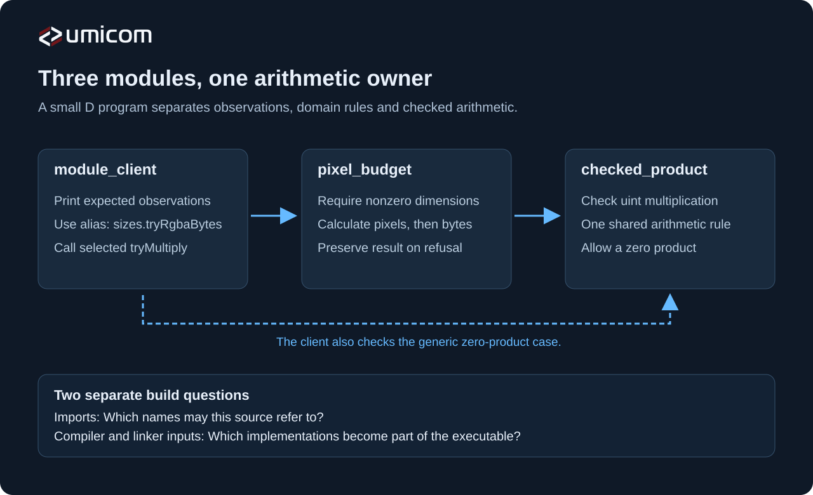

<!--
Umicom Bits2Banking
File: content/lessons/03-native-code/learning-d/36-separate-modules-names-and-linked-code.md

PURPOSE:
Separate modules, visible names and linked code

AUTHOR AND ORGANISATION:
Sammy Hegab
Umicom Foundation

LICENCE:
MIT
-->

# Separate modules, visible names and linked code

[Course contents](index.md)

## Give each source file one clear job

A small program can fit in one file, but a growing project needs a way to divide work without copying the same rules everywhere. D calls each source file a module. A module has a name and can make declarations available to another module through imports. In this lesson, three original files calculate the byte count of a simple image-like array. One owns checked multiplication, one applies a pixel rule, and one prints observations. No image is allocated, decoded or displayed.

## Define module, package and symbol

A module name is not a running object you create with new. A package is not automatically a downloaded package-manager archive. These terms describe source organization here. Finding a declaration and linking its implementation are related but separate build responsibilities.

| Term | Meaning in this project |
| --- | --- |
| Module | One source file with declarations and an optional explicit module declaration |
| Package | A hierarchy of module names, normally represented by directories |
| Symbol | A declared name such as tryMultiply or tryRgbaBytes |
| Import | A declaration controlling access to names from another module |
| Namespace | A scope that keeps names associated with their owner |
| Linking | Combining compiled implementations and required libraries into an executable |

## Inspect the project shape

The module declaration in checked_product.d is module umicom_lessons.checked_product;. The package is umicom_lessons and the module name is checked_product. Keep names and paths in matching lower case so the project does not depend on a case-insensitive filesystem. The module declaration comes before other declarations, after the source header comment. Files with similarly named functions can coexist because their module names distinguish them.

~~~text
native-language-boundary/
  module_client.d
  umicom_lessons/
    checked_product.d
    pixel_budget.d
~~~

## Start with the arithmetic owner

D uint is an unsigned 32-bit type. The condition checks whether the product would exceed its maximum before multiplying. The && operator skips the division when right is zero. A generic multiplication service accepts a zero product, which is mathematically valid. The ref parameter refers to caller-owned output; it is assigned only after admission. The four attributes constrain this function’s effects. They do not prove that an input is a sensible image dimension.

~~~d
module umicom_lessons.checked_product;

@safe pure nothrow @nogc
bool tryMultiply(uint left, uint right, ref uint result)
{
    if (right != 0 && left > uint.max / right) return false;
    result = left * right;
    return true;
}
~~~

## Compose the pixel rule in another module

This domain chooses nonempty dimensions and four bytes per pixel: one each for red, green, blue and alpha. Alpha is an opacity-related channel. The first checked multiplication finds the pixel count; the second finds bytes. Local variables hold candidates so a failure in the second operation cannot partially replace the caller’s result. The calculation assumes a tightly packed four-byte representation. Real images may have row padding, different channel formats or compression.

~~~d
module umicom_lessons.pixel_budget;
import umicom_lessons.checked_product : tryMultiply;

@safe pure nothrow @nogc
bool tryRgbaBytes(uint width, uint height, ref uint result)
{
    if (width == 0 || height == 0) return false;
    uint pixels, bytes;
    if (!tryMultiply(width, height, pixels) ||
        !tryMultiply(pixels, 4, bytes)) return false;
    result = bytes;
    return true;
}
~~~

## Understand selective imports

The colon in import umicom_lessons.checked_product : tryMultiply; selects the name tryMultiply. It makes the dependency obvious to someone reading this file and avoids bringing unrelated unqualified names into scope. It does not copy the function’s source text into the file like a textual C include, and it does not promise that only one function will occupy machine code. Optimization and linking determine the final executable. Imports are private by default, so importing pixel_budget does not automatically re-export all of its private imports.

## Use a module alias at the call site

Here sizes is a short alias for a module name. The dot says to find tryRgbaBytes through that module. This is useful when a long package path would make repeated calls hard to read. It is not a new copy of the module, and it does not change the binary calling convention. Choose aliases that reveal the owner’s role instead of hiding unrelated functionality behind vague names.

~~~d
import sizes = umicom_lessons.pixel_budget;

uint bytes = 71;
if (!sizes.tryRgbaBytes(640, 360, bytes)) return 1;
~~~

## Use static import for qualified library names

A static import requires the module-qualified name when using its declarations. The word static here does not mean static linking, a static local variable, compile-time execution, or a module constructor. This is one reason keyword meaning must be learned in context. The client also uses a selective import of tryMultiply, so you can compare an unqualified selected name with the qualified std.stdio.writeln call.

~~~d
static import std.stdio;
std.stdio.writeln("Bytes: ", bytes);
~~~

## Know when public import is appropriate

A public import intentionally re-exports names through a module. It can provide a small reviewed facade for a library, but it also expands the library’s visible contract. Do not add public to every import merely to make a missing-name error disappear. Likewise private declarations belong to their module’s implementation boundary; privacy is a language visibility rule, not encryption or a sandbox. This exercise keeps the two ownership layers explicit and uses no re-exporting facade.

## Build all three implementations

From PowerShell, use the actual D compiler and provide every implementation file. The -I. option adds the current directory as an import search root. It is not recursive source discovery and does not by itself add every implementation object to the link. The explicit file list makes this exercise repeatable without relying on automatic imported-module compilation options. Run each command separately and stop on an error.

~~~powershell
Set-Location "C:\umicom\Umicom-Bits2Banking\labs\languages\native-language-boundary"
dmd -unittest -checkaction=context -I. -of=module-client-d.exe module_client.d umicom_lessons/checked_product.d umicom_lessons/pixel_budget.d
.\module-client-d.exe
~~~

## Read the expected result

The first result comes from 640 × 360 × 4. The client then asks for a zero-width image and for a byte count too large for uint. Both must refuse while keeping 71. Finally it calls the arithmetic owner directly with a zero operand, which succeeds with zero. This contrast explains why arithmetic and domain validation belong in separate layers. The main function performs these calls outside assert expressions so normal behavior does not disappear when assertions are disabled.

~~~text
640 x 360 RGBA bytes: 921600
Refused requests preserve: 71
Generic zero product: 0
~~~

## Run unit tests deliberately

The -unittest option includes the unittest blocks in the helper modules. Those blocks check zero multiplication, exact representable limits and refusal without output changes. Keep assertions enabled during learning. A helper’s unit test is distinct from the client’s ordinary execution. The normal D runtime remains enabled because std.stdio is used; this is not a BetterC or freestanding Kernel example. These source files need qualification with your installed D compiler. A separate C test cannot establish that D import rules, attributes or unit tests compile successfully.

## Diagnose source discovery and linking separately

1. If the compiler cannot find umicom_lessons.checked_product, confirm the directory name, source filename, module declaration and current working directory. Check that -I. refers to the directory containing umicom_lessons.
2. If a name is undefined, inspect the import style. A module alias requires the alias prefix; a static import requires qualification; a selective import admits only selected names.
3. If a linker reports an undefined implementation, confirm that the implementation source or its matching library was included in the build. An available declaration is not enough.
4. If a nonempty-image request is refused, inspect dimensions and the checked arithmetic. Do not change uint to a larger type merely to silence a test without deciding the API’s size contract.
5. If compilation fails, do not run an older executable left in the output directory and report it as a pass for the current source.

## Connect the design to Umicom Framework

The useful design is ownership: one shared service owns reusable arithmetic and callers add their own domain policy. Umicom production services remain primarily C23 and appropriate Assembly. A D client can call a reviewed C ABI rather than duplicating Framework logic. D module paths are not C ABI symbols, and D reflection metadata is not automatically a Framework descriptor. Bindings still require matching widths, calling convention, ownership, status handling and version checks. This project teaches module organization; it does not add a D frontend to Umicom C.

## Practice with a dependency you can explain

1. Trace tryRgbaBytes from the client to pixel_budget and then to checked_product. Identify the only place that implements multiplication admission.
2. Explain why the generic helper accepts zero but the pixel-budget function rejects a zero dimension. Both behaviors can be correct under different contracts.
3. Predict the result for 1 by 1 pixels: four bytes. Add a normal client check and rebuild all changed sources.
4. Remove only the module alias prefix in a separate learning copy and read the compiler diagnostic. Restore the source afterward; do not repair it by duplicating the function.
5. Describe how a future Framework C wrapper would differ from a D import. List representation and lifetime obligations before writing that wrapper.

## Read the official module specification

- [D modules, import forms and packages](https://dlang.org/spec/module.html)

[Previous: Separate invariants from input validation](35-separate-invariants-from-input-validation.md)

[Next: Reuse typed declarations with template mixins](37-reuse-typed-declarations-with-template-mixins.md)
