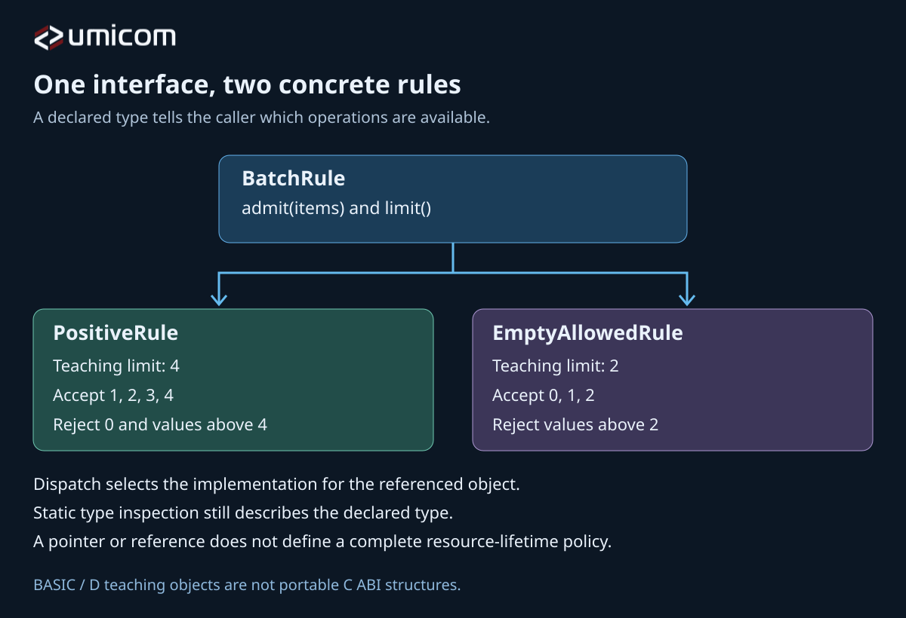

<!--
Umicom Bits2Banking
File: content/lessons/03-native-code/learning-d/46-separate-runtime-dispatch-from-type-reflection.md

PURPOSE:
Separate runtime dispatch from type reflection

AUTHOR AND ORGANISATION:
Sammy Hegab
Umicom Foundation

LICENCE:
MIT
-->

# Separate runtime dispatch from type reflection

[Course contents](index.md)

## Before you begin

Use [Install D and compile a first program](01-install-and-run.md) to check your compiler. Open `virtual_rules.d` in `labs/languages/native-language-boundary` in the course checkout. Find the rule interface and its implementations. Predict which rule the interface call selects, then compare the separate type-reflection output.

## What you will observe

Reflection asks about types or declarations. Runtime dispatch chooses an implementation for a particular object. They are related tools with different jobs. This lesson's two original batch rules answer the same admit(items) operation using different limits. A variable declared as BatchRule can refer to either concrete class. typeof still sees the variable's declared interface type; a checked runtime class cast can inspect the object it references. Read the introductory class and reflection lessons before starting.

## 1. Read the common interface

An interface describes operations clients may request. It is not itself the concrete object. bool is true or false; uint is a nonnegative 32-bit integer; parentheses list arguments. A semicolon ends each declaration. The complete lab supplies both methods through classes and never attempts new BatchRule().

~~~d
interface BatchRule
{
    bool admit(uint items);
    uint limit();
}
~~~

## 2. Learn the class-related spellings

| Spelling | Role in the lab |
| --- | --- |
| abstract class BoundedRule : BatchRule | Provides part of the contract while leaving admit to a concrete class. |
| private immutable uint bound | Stores a limit initialized during construction and not subsequently changed. |
| this(uint bound) | Defines a constructor and its input parameter. |
| this.bound | Names this object's field when a parameter has the same name. |
| super(bound) | Calls the base constructor from a derived constructor. |
| override bool admit(uint items) | Provides behavior for the inherited operation. |
| final uint limit() | Supplies a limit operation that derived classes cannot override. |
| final class | Prevents further derivation from that concrete class. |
| is / !is | Compare reference identity or compare a reference with null. |

## 3. Trace construction before dispatch

Open virtual_rules.d. new PositiveRule(4) calls the derived constructor, which forwards four to BoundedRule's constructor. That constructor checks 1..64 before assigning the immutable bound. The other object receives two. The limit belongs to the object; it is not a global variable shared by both. A constructor error throws an Exception. These input checks are ordinary code and remain active when assertions are disabled.

## 4. Predict each decision

The first policy requires a positive count and an upper bound. The second permits zero. These are teaching choices, not a general rule about valid model batches. The common interface does not silently standardize the meaning of zero; the application must document that policy.

| items | PositiveRule(4) | EmptyAllowedRule(2) |
| --- | --- | --- |
| 0 | false | true |
| 1 | true | true |
| 2 | true | true |
| 3 | true | false |
| 4 | true | false |
| 5 | false | false |

## 5. Compare static type and dynamic object

typeof is evaluated from the source expression's type. It does not discover which object will be created at runtime. The compile-time assertion checks that declared interface type. The checked class casts run against the actual object. A failed class cast here returns null; it does not convert the object into another policy. Always check the result before dereferencing it. The require calls are ordinary runtime checks, separate from static assert.

~~~d
BatchRule positive = new PositiveRule(4);
static assert(is(typeof(positive) == BatchRule));
require(cast(PositiveRule)positive !is null, "matching class");
require(cast(EmptyAllowedRule)positive is null, "mismatched class");
~~~

## 6. Reference assignment is not an object copy

The statement BatchRule aliasOfPositive = positive creates another reference to the same object. It does not duplicate the constructor's work or make independent object state. The lab checks aliasOfPositive is positive. Immutable bound makes this example easier to reason about, but shared identity still exists. A future mutable class needs a deliberate concurrency and ownership contract. A reference is not permission to close or destroy an object owned elsewhere.

## 7. Build and run the D example

Use the full D runtime for this exercise. The new class objects, interface dispatch and Exception handling are not a BetterC example. Run each PowerShell line separately and stop on errors. If dmd is unavailable, record the missing tool instead of inferring a pass from a different language.

~~~powershell
Set-Location C:\umicom\Umicom-Bits2Banking\labs\languages\native-language-boundary
dmd --version
dmd -unittest -g -of=virtual_rules-d.exe virtual_rules.d
.\virtual_rules-d.exe
~~~

## 8. Understand what the checks establish

Expected successful output is Umicom virtual rules: all checks passed. The unittest invokes checkRules and main invokes it again with fresh objects. Runtime checks use an ordinary require helper which throws on failure, so evaluation is not removed with assert. This verifies only the small admitted rule behavior once you run it. It does not measure allocator costs, garbage-collector latency, cross-language ABI compatibility or Framework integration.

## 9. Try deliberate failures

Keep compile-time errors and runtime refusals in separate notes. They occur at different phases and require different recovery.

1. Copy the source into a practice folder. Change the PositiveRule constructor call to zero and predict the constructor exception.
2. Restore four. Try to override final limit() in PositiveRule and compile; expect a declaration error.
3. Restore the file. Attempt to instantiate BoundedRule, which still has an abstract operation; expect rejection.
4. Restore the file. Change the runtime class cast to the other concrete class and keep the null check. Explain why the static interface type remains unchanged.

## 10. Relate this to Framework reflection

D can inspect declarations and generate typed code during compilation. A C service generally needs explicit descriptors for field metadata and explicit function/context tables for runtime dispatch. Neither mechanism should accept an arbitrary object representation across an ABI. A future D learning client can wrap native Framework calls while keeping class ownership in D and reusable operations in C. This lesson does not introduce a production D dependency into Framework.

## 11. Keep resources out of GC timing assumptions

The exercise owns no file handles, sockets or GPU allocations. It uses small runtime-managed objects. Do not adapt it by assuming a class destructor runs immediately after the last reference assignment. A real resource wrapper needs a reviewed explicit release or scoped-lifetime design. Measuring a few objects also cannot support a claim that D or C always uses less memory than another language.

## Further reading

- [D class declarations and methods](https://dlang.org/spec/class.html)
- [D interfaces](https://dlang.org/spec/interface.html)
- [D expression semantics](https://dlang.org/spec/expression.html)
- [D garbage collection](https://dlang.org/spec/garbage.html)

[Previous: Separate local static storage from caller ownership](45-separate-local-static-storage-from-caller-ownership.md)

[Next: Validate bytes before converting to bool](47-validate-bytes-before-converting-to-bool.md)
