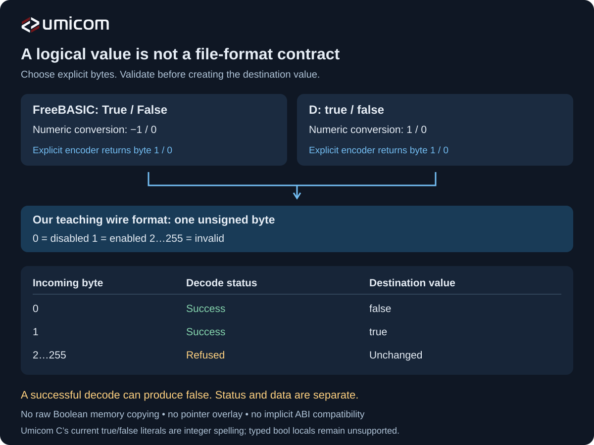

<!--
Umicom Bits2Banking
File: content/lessons/03-native-code/learning-d/47-validate-bytes-before-converting-to-bool.md

PURPOSE:
Validate bytes before converting to bool

AUTHOR AND ORGANISATION:
Sammy Hegab
Umicom Foundation

LICENCE:
MIT
-->

# Validate bytes before converting to bool

[Course contents](index.md)

## Before you begin

Use [Install D and compile a first program](01-install-and-run.md) to check your compiler. Open `boolean_wire.d` in `labs/languages/native-language-boundary` in the course checkout. Mark the input bytes 0, 1 and 2. Predict the result of truth conversion and strict decoding for each byte, including the output on refusal.

## Start with values, types and a file contract

A setting such as enabled has a logical value. D's bool type represents true or false. A file stores bytes, and a file format must say which bytes mean which values. This lesson chooses a strict one-byte flag: 0 means false, 1 means true, and 2 through 255 are invalid. The goal is to decode that contract without treating arbitrary memory as a bool object.

## Learn the relevant language forms

| Form | Purpose |
| --- | --- |
| bool | The logical type |
| ubyte | An unsigned eight-bit integer |
| ref bool value | A reference parameter that can update the caller's logical value |
| cast(bool)expression | Convert a value to truth according to D's conversion rules; not a strict 0/1 validator |
| value ? 1 : 0 | Choose an explicit numeric encoding |
| @safe | Ask the compiler to enforce its safe-language rules for the function |
| pure | Restrict access to unrelated mutable state; a mutable ref argument can still be updated |
| nothrow | Promise that the function does not throw recoverable Exceptions |
| @nogc | Disallow GC allocation by this function |
| static assert | Check a condition during compilation |
| typeof and is | Inspect the expression's type during compilation |
| unittest | Declare a test block enabled with -unittest |

## Separate a truth conversion from strict admission

D converts bool to an integral type as 0 or 1. An explicit cast from an arithmetic value to bool tests whether it is nonzero. Therefore cast(bool)2 is true, but byte 2 is still invalid under this lesson's format. The decoder must compare the byte against its permitted domain before converting. A successful type conversion cannot establish that an external record was well formed.

## Read the two allocation-free helpers

~~~d
ubyte encodeFlag(bool value) @safe pure nothrow @nogc
{
    return value ? 1 : 0;
}

bool decodeFlag(ubyte raw, ref bool value) @safe pure nothrow @nogc
{
    if (raw > 1) return false;
    value = raw == 1;
    return true;
}
~~~

## Explain the ownership and publication rule

raw is passed by value. value refers to a real caller-owned bool variable. The function refuses an invalid byte before writing to that variable. Success writes exactly one logical value. There is no allocation, retained reference, raw pointer or file access. The return value reports status, while the ref parameter carries decoded data. Input 0 returns success and produces false; rejected input leaves the previous value intact.

## Predict all input classes

| Byte | Return status | Output |
| --- | --- | --- |
| 0 | true | false |
| 1 | true | true |
| 2..255 | false | Unchanged |

## Understand the effect annotations

The helper is small enough to state its effects explicitly. @safe rules out unsafe pointer tricks in this code; it does not certify the correctness of our chosen file format. pure still allows mutation through the supplied ref parameter. nothrow and @nogc apply to the helpers, not to every function in the example. The Require-style checking function can construct and throw an Exception, and printing uses the D runtime. Do not describe the entire executable as allocation-free or BetterC merely because two functions have annotations.

## Use reflection without inspecting raw bytes

~~~d
static assert(is(typeof(true) == bool));
static assert(encodeFlag(false) == 0 && encodeFlag(true) == 1);
~~~

## Know what the compile-time checks prove

typeof(true) names the expression's type. The is expression compares that type with bool, and static assert stops compilation if the statement is false. The second check can evaluate the small encoder during compilation. Neither check proves that a byte read later from a file is a valid Boolean representation. Type reflection describes declarations and expressions; input validation still has to examine each external value.

## Never overlay bool on untrusted storage

The D specification permits bool values true and false and warns that interpreting an invalid raw representation as bool is undefined behavior. Casting an arbitrary byte pointer to bool* and reading it is not a decoder. Keep incoming data as bytes, validate it, then create the logical value using a normal comparison. This rule is especially useful in binary formats, memory-mapped files and C interoperability, where a type name cannot sanitize bytes that came from elsewhere.

## Build the subject-language program

1. Install a D compiler and follow the earlier setup lesson. This example uses DMD command syntax and the normal D runtime.
2. Open PowerShell in the native-language-boundary laboratory folder.
3. Compile with -unittest and -g, then stop on any compiler or linker error.
4. Run the new executable. The same checkFlags routine runs from the unittest block and main, using fresh local state each time.
5. The checks call an ordinary require function, so the decoding operations are not removed by disabling runtime assertions. Subject-language execution must still be recorded separately from website and C checks.

## Run these commands

~~~powershell
Set-Location "C:\umicom\Umicom-Bits2Banking\labs\languages\native-language-boundary"
dmd -unittest -g -of=boolean-wire-d.exe boolean_wire.d
.\boolean-wire-d.exe
~~~

## Expected completion output

~~~text
Umicom Boolean wire: all 256 bytes checked.
Explicit encoding: false=0, true=1.
~~~

## Read the exhaustive loop

The loop counter is uint, which can hold 256 without wrapping. It visits every byte value from 0 through 255 and only then casts that known in-range value to ubyte. For 0 and 1 it checks both status and decoded value. For every other value it checks refusal and preservation of an initially true destination, then repeats with an initially false destination. This is a complete enumeration of one-byte inputs, not evidence about larger messages or every possible pointer.

## Compare three language boundaries

FreeBASIC's Boolean-to-integer conversion uses -1 for true, while D uses 1. Native C logical conversion also needs to be distinguished from strict external validation. The companion examples deliberately produce identical 0/1 wire bytes through explicit encoders. Umicom C's current experimental integer language separately supports true/false literal spellings but has no bool local type. Keep language semantics, C ABI types and serialized bytes as three separate contracts.

## Use this in Framework clients

A D learning client can invoke a reviewed C API with explicit C linkage and matching parameter widths. Reusable production parsing stays in Umicom Framework. A D adapter should convert values according to the actual API contract and should not reinterpret a D bool reference as an unrelated C integer pointer. A binary record should name its accepted values and version. The example does not change Framework's public ABI or claim a validated D SDK binding.

## Try controlled variations

1. Replace the admission condition with a direct cast(bool)raw and predict why values 2 through 255 would be incorrectly accepted.
2. Change ref bool to out bool in a copy and review how out initialization changes the preserve-on-refusal promise. Keep the production example's ref contract.
3. Add an optional unknown state to a new version of the record. Decide whether an enum or tagged value is appropriate instead of squeezing three states into bool.
4. Write a text parser separately. Decide whether the string "1" is accepted and explain why a string, a JSON Boolean and one numeric byte are different inputs.
5. Remove the std.stdio printing in a separate experiment before exploring a freestanding boundary. Do not assume the normal-runtime example is already BetterC.

## Read the precise D rules

- [D types: bool, conversions and typeof](https://dlang.org/spec/type.html#bool)

[Previous: Separate runtime dispatch from type reflection](46-separate-runtime-dispatch-from-type-reflection.md)

Logical meaning, numeric conversion and an external byte contract are separate decisions.

[Next: Separate rounding from checked integer conversion](48-separate-rounding-from-checked-integer-conversion.md)
