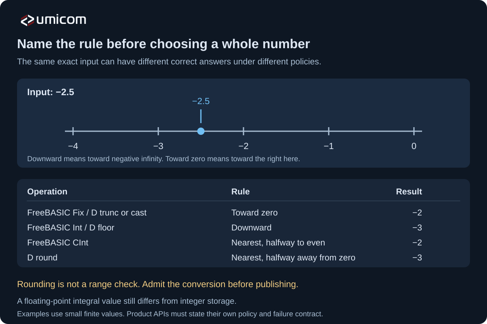

<!--
Umicom Bits2Banking
File: content/lessons/03-native-code/learning-d/48-separate-rounding-from-checked-integer-conversion.md

PURPOSE:
Separate rounding from checked integer conversion

AUTHOR AND ORGANISATION:
Sammy Hegab
Umicom Foundation

LICENCE:
MIT
-->

# Separate rounding from checked integer conversion

[Course contents](index.md)

## A cast does not choose your application policy

A measurement, a pixel channel and an exact cash amount can all be displayed as numbers, but their conversion rules need not match. This lesson uses six original values to separate a D cast, mathematical rounding, validation and publication. You will also examine a small function with a caller-owned output and explicit effect attributes. The example is a language laboratory; reusable Umicom product behavior remains in the shared C Framework.

## Set up the experiment

1. Review the previous D lessons about int, double, arrays, ref and Boolean status. An int here is a signed 32-bit integer; double is a binary floating-point type.
2. Open labs/languages/native-language-boundary/rounding_policy.d and locate the six-value array. The selected halves and quarters have exact binary representations.
3. Write your own predicted results before compiling. Use a number line for the negative values rather than assuming all operations drop the fraction.
4. Use a reviewed DMD or LDC installation from the setup course. This exercise needs the normal D runtime and Phobos standard library; it is not a BetterC program.

## Compare the operations

| Operation | Policy for these admitted inputs | Important distinction |
| --- | --- | --- |
| cast(int)x | Discard the fraction toward zero | Changes the storage type; it is not a range check. |
| trunc(x) | Discard the fraction toward zero | Produces a floating-point integral value. |
| floor(x) | Move downward to the lower integer value | Negative fractions move farther from zero. |
| ceil(x) | Move upward to the higher integer value | Negative fractions move toward zero. |
| round(x) | Nearest; exact halfway ties go away from zero | Different from FreeBASIC CInt’s even-tie rule. |

## Work through the six rows

| Input | cast / trunc | floor | ceil | round |
| --- | --- | --- | --- | --- |
| 2.5 | 2 | 2 | 3 | 3 |
| 3.5 | 3 | 3 | 4 | 4 |
| -2.5 | -2 | -3 | -2 | -3 |
| -3.5 | -3 | -4 | -3 | -4 |
| 1.75 | 1 | 1 | 2 | 2 |
| -1.75 | -1 | -2 | -1 | -2 |

## Which names come from the language?

cast, int, double, ref, if and return are language syntax. floor, ceil, trunc and round are library functions imported from std.math.rounding. isFinite comes from std.math.traits. The selective import syntax after a colon names the specific symbols this module needs. A compiler can accept the syntax of a call while the linker still needs its runtime or library implementation. Keeping those layers distinct helps explain why copying a function name into C does not provide a C implementation.

## Admit before conversion

The original input must be finite and inside the signed int interval before the cast. The bounds are intentionally applied to the original value: 2147483647.5 is refused even though truncating first could yield int.max. This choice is conservative and documented, rather than an accidental compiler-dependent overflow behavior. The function does not clip or wrap an invalid request.

~~~d
bool tryTruncateInt(double value, ref int destination) @safe pure nothrow @nogc
{
    if (!isFinite(value) || value < int.min || value > int.max) return false;
    destination = cast(int)value;
    return true;
}
~~~

## Read the short-circuit condition

1. Evaluate isFinite(value). It rejects NaN and either infinity. The exclamation mark reverses that result.
2. If the value is nonfinite, || short-circuits and the function returns false. No cast occurs.
3. For a finite value, compare against int.min and int.max. These named type properties avoid repeating width-dependent assumptions in the implementation.
4. Only after admission does cast(int)value produce the destination integer. The final true reports successful publication.

## Why ref matters here

The caller gives the function access to an existing destination. A refused call returns before modifying it, so a previous value such as 77 survives. ref preserves that incoming state. An out parameter has initialization semantics that would change this contract before the body begins, so substituting out is not a cosmetic change. Status and data remain separate: false means refusal, not that the result happened to be numeric zero.

## What the attributes establish

| Attribute | Useful guarantee for this small helper | What it does not establish |
| --- | --- | --- |
| @safe | Language memory-safety checking applies | It does not know your business rounding policy. |
| pure | No untracked mutable global dependency | The function may still update the explicitly passed ref destination. |
| nothrow | No ordinary D exception escapes this helper | It does not mean every possible runtime failure is impossible. |
| @nogc | The helper does not allocate through the garbage collector | It is not a claim about the whole program or every library. |

## The executable includes more than the helper

The exercise’s require procedure can throw an Exception, and main writes text through std.stdio. Those parts are not advertised as pure, nothrow or @nogc. Unit tests call the checks when built with -unittest, and main also calls them explicitly. Required calls do not appear only inside an assert expression, so a release build does not silently skip the operation being examined.

## Build and execute

Create the build folder if needed, run one command at a time and stop on failure. A reviewed LDC setup can use ldc2 -unittest -of=build/rounding-policy-d.exe with the same source. No D compiler was available for this mirror continuation, so these subject-language commands remain unexecuted. Do not infer a D pass from the separate C Framework tests.

~~~powershell
Set-Location "C:\umicom\Umicom-Bits2Banking"
dmd -unittest -of=build/rounding-policy-d.exe labs/languages/native-language-boundary/rounding_policy.d
& ".\build\rounding-policy-d.exe"
~~~

## Expected output

The source tests all six rows, ordinary admitted input, both exact integer endpoints, finite overshoots, a very large finite number, NaN and both infinities. Each refused conversion begins with a known destination and checks that it remains intact. This is more informative than testing only that the helper returned false.

~~~text
Umicom D rounding: six rows checked.
Refused conversions preserve the caller's integer.
~~~

## Reflection cannot infer numerical intent

D can inspect types at compile time with facilities taught in the reflection lessons. That can help generate a field catalogue or require an integer destination type. It cannot deduce whether an application wants floor, ties-to-even, ties-away, clipping or refusal from the spelling double alone. Store policy as reviewed metadata or an explicit argument and test its meaning. If a D tool generates C-facing declarations, the shared C API still owns its value, lifetime and failure contracts.

## Connection to image and financial code

The Framework image-output API rounds nonnegative scaled unit values with exact halfway cases upward. That is an explicitly documented pixel contract, not a promise that arbitrary signed values follow D round. An image decoded from a latent also needs a declared range, channel layout and color interpretation before quantization. Financial code has further requirements: amounts, currency scale and settlement rounding need an exact domain contract. Avoid using floating-point display conversion as a substitute for the existing money service.

## Practice and recovery

1. Explain why floor(-2.5) gives -3 while ceil(-2.5) gives -2. Mark both on a number line.
2. Compare D round(2.5) with FreeBASIC CInt(2.5). State the tie rule in words rather than blaming one language for being wrong.
3. Change a refusal fixture’s starting destination and confirm the caller’s new value remains unchanged.
4. Temporarily substitute out for ref in a separate exercise copy, observe the changed entry behavior, then restore the production example. Preserve the original file.
5. If the compiler rejects a library import, check your installed Phobos version and module name. If an attribute is rejected, inspect the called declaration rather than removing all attributes silently.

## Official references

- [D expression specification: numeric casts](https://dlang.org/spec/expression.html#cast_expressions)
- [Phobos rounding functions](https://dlang.org/phobos/std_math_rounding.html)

[Previous: Validate bytes before converting to bool](47-validate-bytes-before-converting-to-bool.md)

[Next: Constrain operator templates and test their meaning](49-constrain-operator-templates-and-test-their-meaning.md)
