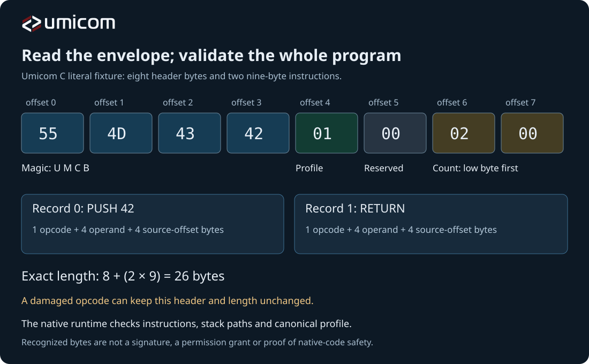

<!--
Umicom Bits2Banking
File: content/lessons/03-native-code/learning-freebasic/24-inspect-a-bounded-binary-header.md

PURPOSE:
Inspect a bounded binary header

AUTHOR AND ORGANISATION:
Sammy Hegab
Umicom Foundation

LICENCE:
MIT
-->

# Inspect a bounded binary header

[Course contents](index.md)

## Read a real format without pretending to execute it

A binary file is a sequence of bytes. Each byte can hold a number from zero through 255. A format assigns meaning to positions in that sequence. In this lesson you will use FreeBASIC to inspect the outside structure of a real Umicom C bytecode artifact. You will check its identifying bytes, version, record count and exact length. You will also see a damaged program pass those checks, which explains why a correct header is only one layer of validation.

This exercise follows the earlier lessons on arrays, records, Boolean decisions and explicit byte order. It does not need file access: the source contains a small literal array whose contents you can inspect directly. That keeps file permissions and disk errors separate from the parsing lesson. The FreeBASIC example is authored for compiler qualification; it has not been compiled in the current authoring environment. The separate native C reference check cannot validate FreeBASIC syntax or runtime behavior.

Each following instruction occupies nine bytes: one opcode byte, four operand bytes and four source-offset bytes. The current runtime limit is 256 instructions. A file containing two instructions therefore needs 8 + 2 × 9 = 26 bytes. The largest permitted envelope under this limit is 8 + 256 × 9 = 2,312 bytes. These numbers come from the actual Umicom C format; they are not rules for every bytecode language.

## Learn the terms used by a binary reader

| Term | Meaning |
| --- | --- |
| Byte offset | A position counted from zero at the beginning of the input |
| Header | A small prefix describing the following data |
| Payload | The records following the header |
| Magic bytes | An identifying byte sequence; not a security signature |
| Version/profile | A number identifying an agreed format contract |
| Reserved byte | A position that must currently have a specified value |
| Little-endian | The least significant byte appears first |
| Envelope | The header and total-size rules around a payload |
| Admission | The checks required before allowing a later operation |
| Transactional output | Publish a complete result only after every required check passes |

## Read the eight-byte header

| Offset | Bytes | Meaning in the current Umicom C format |
| --- | --- | --- |
| 0 | 4 | ASCII UMCB: hexadecimal 55 4D 43 42 |
| 4 | 1 | Minimum wire profile, currently 1 through 6 |
| 5 | 1 | Reserved and required to be zero |
| 6 | 2 | Instruction count, low byte first |

## Describe a result with Type

~~~freebasic
Type EnvelopeInfo
    profile As ULong
    instructionCount As ULong
    encodedBytes As ULong
End Type
~~~

Type introduces a user-defined record. Each named member has a type. ULong is the FreeBASIC unsigned 32-bit type used here for small nonnegative facts. The record is an in-memory result, not the file format. The reader never loads the incoming bytes directly into this record. That distinction avoids assuming that field padding, alignment or native byte order matches a portable artifact.

## Understand the function boundary

~~~freebasic
Function InspectEnvelope(bytes() As UByte, ByRef result As EnvelopeInfo) As Boolean
~~~

Function declares a named operation that returns a value. bytes() receives an array descriptor, and each element is a UByte. ByRef gives the function access to the caller's result record. As Boolean says the returned answer is success or refusal. A false answer leaves the previous result fields unchanged. This is different from returning a partially filled record and asking the caller to guess which members are valid.

## Check bounds before reading bytes

UBound(bytes, 0) asks for the number of dimensions. This reader accepts one dimension. LBound(bytes) asks for the first valid index and UBound(bytes) for the last valid index. The reader requires a zero-based array with at least eight and at most 2,312 elements. An unallocated dynamic array is refused before its elements are accessed. A one-based array is also refused, even if it happens to contain 26 values; this particular contract uses file offsets directly as indices.

~~~freebasic
If UBound(bytes, 0) <> 1 Then Return False
If LBound(bytes) <> 0 OrElse UBound(bytes) < 7 OrElse UBound(bytes) > 2311 Then Return False
~~~

The last valid index of an eight-element zero-based array is seven. That is why the lower size check uses seven instead of eight. OrElse is short-circuit logical OR: once a term is true, later terms are unnecessary. It differs from the bitwise Or used later. Keep the shape checks before every element read. Reordering the code so that bytes(0) is read first would make an empty input unsafe.

## Decode the count explicitly

~~~freebasic
Dim As ULong count = CULng(bytes(6)) Or (CULng(bytes(7)) Shl 8)
If count = 0 OrElse count > 256 Then Return False
Dim As ULong needed = 8 + count * 9
If CULng(UBound(bytes) + 1) <> needed Then Return False
~~~

CULng converts each byte to the unsigned 32-bit calculation type. Shl shifts the high byte left by eight positions, multiplying its place value by 256. Bitwise Or combines the disjoint low and high bit positions. Bytes 2 and 0 encode two; bytes 0 and 1 encode 256. Bytes 1 and 1 encode 257, which exceeds the current program limit.

The count limit is checked before multiplication. Once count lies between one and 256, needed is at most 2,312 and safely fits this type. The input must have exactly that length. A short payload is refused, and an extra trailing byte is refused too. Permitting arbitrary trailing bytes would describe a different container format and must not be added accidentally.

## Commit only a complete candidate

After all checks pass, the function fills a local candidate record and assigns it to result once. Earlier Return False statements never touch result. In the refusal tests the previous fields are 99, 77 and 66. Every rejected input must leave all three values unchanged. This pattern is useful for configuration import and preview dialogs: a rejected candidate should not silently replace a valid current value.

## Build and run the FreeBASIC exercise

1. Open the native-language-boundary folder in the Bits2Banking repository. Read inspect_umc_header.bas from the header down to its literal fixture.
2. Make sure the FreeBASIC compiler is installed and the fbc command identifies that compiler. A similarly named shell command is not enough.
3. Use the fb dialect and enable runtime checks during learning. Execute each command separately and stop if it fails.
4. Keep the compiler version, command and actual exit status in your exercise notes. Do not report a pass merely because these commands are written in a guide.

~~~powershell
Set-Location "C:\umicom\Umicom-Bits2Banking\labs\languages\native-language-boundary"
fbc -version
fbc -lang fb -exx -w all inspect_umc_header.bas -x inspect_umc_header.exe
& ".\inspect_umc_header.exe"
~~~

The expected first line describes profile 1, two instructions and 26 bytes. A later line reports malformed-envelope checks, followed by a warning that opcode 255 still passes this header-only reader. The program uses End 1 for a failed expectation. That is suitable for this standalone teaching executable; a reusable library should return a status instead of terminating its host.

## Read the tests as a specification

The source tests the complete literal, an empty dynamic array, every shorter nonempty prefix, a one-based array, a trailing byte and seven changed header cases. ReDim creates the prefix arrays for the truncation exercise. For and Next copy exactly the prefix being tested. Select Case chooses one corruption at a time. The source keeps valid data as a fixed reference rather than deriving every expected answer from the same parser.

At the end, the code changes the first opcode to 255 while retaining the header and length. InspectEnvelope deliberately still succeeds. It did exactly what its name and contract promise: it inspected the envelope. It did not check opcode identities, stack depth, local initialization, branch targets, source offsets or the minimum required profile.

## Compare with the real Umicom C runtime

The companion check_umc_fixture.c contains the same literal bytes and calls Umicom C's production decoder, inspection service and bounded interpreter. It expects the intact program to return 42. It then expects opcode 255 and a needlessly raised profile to be refused. This gives an independent reference for the lesson format without copying the interpreter into BASIC.

~~~powershell
Set-Location "C:\umicom\Umicom-Bits2Banking"
cmake -S labs/languages/native-language-boundary -B build/native-wire-lesson -G Ninja -DUMICOM_C_SOURCE=C:/umicom/umicom-c -DUMICOM_FRAMEWORK_SOURCE=C:/umicom/Umicom-Applications/framework
cmake --build build/native-wire-lesson
ctest --test-dir build/native-wire-lesson --output-on-failure --no-tests=error
~~~

These commands require a C23 compiler, CMake, Ninja, the matching Umicom C source and Framework branding resources. They compile only the chosen native exercise and its runtime owner, not a full application. The C check and the FreeBASIC check are separate qualifications. Neither proves that arbitrary native machine code or an unrelated bytecode artifact is safe.

## Use the idea at the right boundary

A BASIC tool might show a quick file summary, help compare artifacts or teach a byte layout. A production consumer should still delegate complete Umicom C admission and execution to the native runtime through a reviewed ABI. The language-boundary lessons explain that calling convention and lifetime work. Recognizing four magic bytes is not permission to run code, proof of its origin or a cryptographic signature.

## Practice without guessing

1. Write the eight header bytes for 256 records, then calculate the required complete length. Explain why merely changing the count in the 26-byte fixture must fail.
2. Explain the difference between Or and OrElse using the count expression and the refusal condition.
3. Change the reserved byte to one. Identify which check refuses it and verify that the previous result remains intact.
4. Change only the first opcode to 255. Explain why the teaching reader accepts it but the real decoder refuses it.
5. Describe why reading a file directly into EnvelopeInfo would not implement this format.
6. Compare this reader with the D lesson. Identify the same checks despite different syntax and array conventions.

## Further reading

- [Complete FreeBASIC example](https://github.com/umicom-foundation/Bits2Banking/blob/main/labs/languages/native-language-boundary/inspect_umc_header.bas)
- [Current Umicom C bytecode specification](https://github.com/umicom-foundation/umicom-c/blob/main/docs/bytecode.md)
- [FreeBASIC UBound reference](https://www.freebasic.net/wiki/KeyPgUbound)

[Previous: Distinguish text from its stored bytes](23-distinguish-text-from-its-stored-bytes.md)

[Next: Read file records and preserve errors](25-read-file-records-and-preserve-errors.md)
