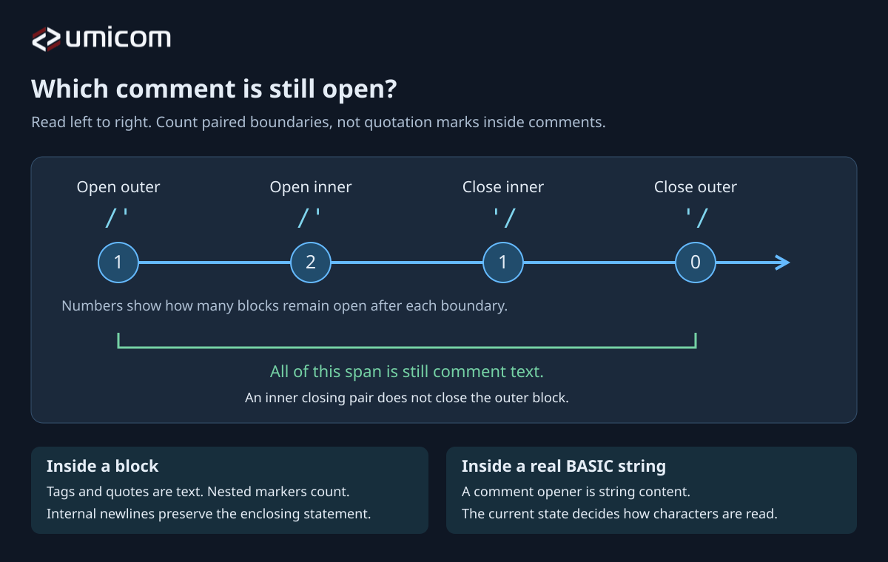

<!--
Umicom Bits2Banking
File: content/lessons/03-native-code/learning-freebasic/40-read-nested-comments-and-logical-lines.md

PURPOSE:
Read nested comments and logical lines

AUTHOR AND ORGANISATION:
Sammy Hegab
Umicom Foundation

LICENCE:
MIT
-->

# Read nested comments and logical lines

[Course contents](index.md)

## What the compiler ignores

Source code is the text you write. A compiler reads that text to build a program. A comment explains the program to people; ordinary comment text is not executed as an instruction. A delimiter is a character or short sequence that marks a boundary. FreeBASIC uses an apostrophe for a single-line comment and slash-apostrophe paired with apostrophe-slash for a block comment. This lesson uses the modern fb dialect. Older compatibility dialects can interpret special comment forms differently.

## Three forms to recognise

| Form | Where it ends | Use |
| --- | --- | --- |
| ' explanation | At the physical line ending | Explain an individual declaration or calculation. |
| REM explanation | At the line ending | A named comment statement; REM is a keyword. |
| /' explanation '/ | At the matching closing pair, allowing nested pairs | Explain or temporarily exclude a block of text. |

## Read an original short program

~~~freebasic
Dim answer As /' The type continues after this comment. '/ Integer = 40
answer = answer + /' Continue the same expression
                     on another physical line. '/ 2
If answer <> 42 Then End 1
Print "Answer: 42"
~~~

## Follow every symbol

1. Dim declares a variable named answer. As says which type follows; Integer is the integer type selected by the compiler's platform rules.
2. The block comment ends before Integer, so the declaration still has a type. The comment did not create a variable or a string.
3. The assignment sets answer to its old value plus two. The block crosses a physical line but the expression continues after its closing pair.
4. The operator <> means not equal. If the answer is not 42, End 1 terminates this small program with an error exit code.
5. Print writes text to the console. The displayed text is deliberately separate from the numeric check: a message alone is not proof that the calculation succeeded.

## Physical lines and logical statements

A physical line ends where a line-ending character is stored in the file. A logical statement is a complete instruction according to the language grammar. A block comment can contain physical line endings without ending the surrounding statement. This does not mean you may break any BASIC expression anywhere: the separate underscore continuation feature has its own rules. Here, the line break is inside the comment.

## Follow nested pairs

~~~freebasic
/' Outer explanation begins.
   /' An inner explanation begins and ends here. '/
   This text still belongs to the outer explanation.
'/
Print "After the comment"
~~~

## Count the boundaries

| What you encounter | Open blocks remaining | Meaning |
| --- | --- | --- |
| First slash-apostrophe | 1 | Enter the outer comment. |
| Second slash-apostrophe | 2 | Enter a nested comment. |
| First apostrophe-slash | 1 | Only the inner block has ended. |
| Second apostrophe-slash | 0 | Resume normal source scanning. |

## Quotation marks do not protect markers inside a block

Within an active block comment, quotation marks are ordinary comment characters. A nested opening marker still counts even if you placed it between quotation marks in the comment. Within a real string outside a comment, the situation is reversed: the string owns those characters, so a slash-apostrophe in that string does not open a comment. Read which state you are already in before interpreting a new pair of characters. In the modern fb dialect, a block opener inside a single-line comment is ignored until that line ends.

## Compile and run the complete lab

1. Open PowerShell in labs/languages/native-language-boundary inside your Bits2Banking checkout.
2. Run Get-Command fbc and fbc -version. If no compiler is found, complete the earlier FreeBASIC setup lesson before proceeding.
3. Open block_comments.bas. Read its named header and locate the declaration, nested explanatory block and arithmetic check.
4. Run the compile command below. Stop if it reports an error; do not run an older executable from an earlier attempt.
5. Run the newly compiled program. Expect two lines: Answer: 42 and Nested comments preserved the statement.
6. Make a separate working copy before the exercises so the supplied lab remains a reference.

## Commands

~~~powershell
fbc -lang fb -exx block_comments.bas -o block_comments.exe
.\block_comments.exe
~~~

## Exercises that expose mistakes

1. Remove one closing pair from your copy. Compile again. Expect a diagnostic about an unterminated comment; wording can vary with compiler version.
2. Restore the pair, then move the physical line break outside the comment without adding a valid continuation. Explain why that changes the source grammar.
3. Inside a block, place a nested opener between double quotation marks and leave it unclosed. Predict the remaining depth before compiling.
4. Write a string that contains slash-apostrophe outside all comments. Confirm that it is text, then explain the difference from the previous exercise.

## How Umicom C uses the idea

Umicom C has an experimental regions command for identifying tagged language spans. Its BASIC region scanner now protects nested block comments up to 32 levels, keeps original source offsets and uses an iterative counter rather than recursive calls. An attempted 33rd level is refused. That limit belongs to the Umicom envelope; FreeBASIC's reference describes no equivalent fixed nesting limit. The Umicom scanner retains a narrower REM rule: it recognises REM only at a statement start. It does not execute BASIC, implement a complete BASIC lexer or translate these examples into machine code.

## Try boundary discovery separately

~~~powershell
.\build\bin\umicom-c.exe regions .\examples\basic_block_comments.umc
~~~

## Interpret the result

Run that command from an Umicom C checkout using the location of its built executable. Expect a BASIC span and a classification-only notice. The source header and outer whitespace can add ordinary Umicom spans. Text such as ?> inside the nested comment must remain in that span. A malformed comment must produce an error instead of a usable partial list. This exercise inspects boundaries; it does not replace the FreeBASIC compilation above.

## Why this matters for an IDE

An editor can highlight, navigate or select language regions only when its scanner understands where comments and strings begin and end. Misreading a delimiter inside a comment can send the wrong source slice to another tool. A small explicit state machine is easier to test than replacing text patterns without context. Reusable production behaviour remains native code; the BASIC program here teaches source rules.

## Qualification and recovery

The Umicom C scanner has native boundary tests. Those tests do not compile this .bas program. FreeBASIC execution must be qualified with the chosen compiler and dialect. If a program prints nothing, first check whether a missing closing pair swallowed the Print statement. If it prints stale output after a compilation error, confirm which executable you ran. Keep compiler errors and application output as separate evidence.

## Reference

- [FreeBASIC comments and nesting](https://www.freebasic.net/wiki/ProPgComments)

[Previous: Separate local names from retained storage](39-separate-local-names-from-retained-storage.md)

[Next: Follow abstract and virtual method dispatch](41-follow-abstract-and-virtual-method-dispatch.md)
