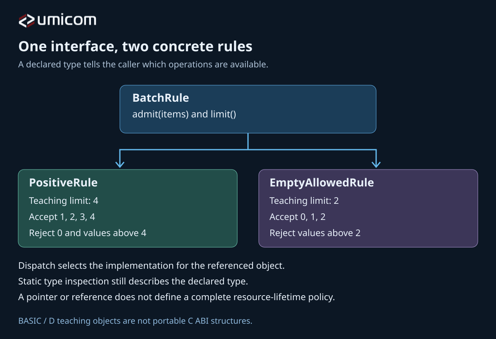

<!--
Umicom Bits2Banking
File: content/lessons/03-native-code/learning-freebasic/41-follow-abstract-and-virtual-method-dispatch.md

PURPOSE:
Follow abstract and virtual method dispatch

AUTHOR AND ORGANISATION:
Sammy Hegab
Umicom Foundation

LICENCE:
MIT
-->

# Follow abstract and virtual method dispatch

[Course contents](index.md)

## What problem are we solving?

Suppose a teaching program reviews batches of work. One rule accepts one through four items. Another accepts zero through two. We want a caller to ask Admit(items) without repeating a separate If for every concrete rule type. A method is a procedure attached to a type. Dispatch means choosing the method implementation for a call. This lesson uses two small original rules; it does not load models, send jobs or add a new Framework provider.

## 1. Start with concrete values and a shared contract

Open labs/languages/native-language-boundary/virtual_rules.bas. The PositiveRule and EmptyAllowedRule values live in the program's own scope. The rules array contains pointers to those values through their common BatchRule base type. A pointer is a borrowed way to reach an object, not a copy of that object. The pointed-to values must remain alive while the calls run. This example deliberately has no New or Delete.

## 2. Learn the relevant words

| Spelling | Role in this example |
| --- | --- |
| Type … End Type | Declares a named data type and its members. |
| Extends Object | Supplies the built-in object base needed by FreeBASIC's virtual methods. |
| Extends BatchRule | Makes a concrete rule derive from the common base. |
| Declare Abstract Function | Declares an operation that this base does not implement. |
| Declare Virtual Function | Declares an overridable operation with a base implementation. |
| Override | Asks the compiler to check that the declaration overrides a matching base operation. |
| This.Limit() | Calls Limit on the current object. |
| Base.Limit() | Explicitly calls the base implementation rather than dispatching to this override. |
| Ptr, @ and -> | Declare a pointer, obtain an address, and call through a pointer. |

## 3. Read the base declaration

This is a fragment from the complete example. Admit has a declaration but no base body. Limit has both. The base cannot supply a complete rule by itself. A derived type must provide the missing operation before you can construct a concrete value. UInteger holds a nonnegative integer; Boolean is the true/false result. ByVal supplies the method with its own parameter value.

~~~basic
Type BatchRule Extends Object
    Declare Abstract Function Admit(ByVal items As UInteger) As Boolean
    Declare Virtual Function Limit() As UInteger
End Type

Function BatchRule.Limit() As UInteger
    Return 4
End Function
~~~

## 4. Trace the two calls on paper

The first pointer refers to PositiveRule. Its Admit accepts items greater than zero and no greater than Limit(), which uses the base result four. The second pointer refers to EmptyAllowedRule. Its Limit override returns Base.Limit() minus two, producing two. Its Admit accepts any unsigned value no greater than that. Both callers use the same base-pointer spelling, but the actual object determines which overriding method runs.

| Request | PositiveRule | EmptyAllowedRule |
| --- | --- | --- |
| 0 | False | True |
| 1 | True | True |
| 2 | True | True |
| 3 | True | False |
| 4 | True | False |
| 5 | False | False |

## 5. Distinguish overriding from overloading

An overload chooses among different parameter lists. An override supplies behavior for an existing overridable operation. In this example every Admit declaration takes one ByVal UInteger and returns Boolean. Changing a parameter type is not a safe way to replace the same contract. Keep Override on derived declarations so the compiler can reject an accidental mismatch. For deeper inheritance, review the manual's Virtual rules: this example has only one concrete derived level.

## 6. Build with the subject-language compiler

Run these commands in PowerShell one line at a time. Confirm fbc exists first; an unrecognized command means the compiler is unavailable on PATH, not that the program succeeded. This course uses the fb dialect. Keep the source and executable in the lesson folder; no project files or production data are overwritten by the exercise.

~~~powershell
Set-Location C:\umicom\Umicom-Bits2Banking\labs\languages\native-language-boundary
fbc -version
fbc -lang fb -exx virtual_rules.bas -o virtual_rules-basic.exe
.\virtual_rules-basic.exe
~~~

## 7. Interpret the expected result

The successful program prints Umicom virtual rules: all checks passed. Require is an ordinary procedure: it prints a specific failure and ends with status one if a condition is false. Operations are not hidden inside an assertion that a release build might remove. The example is authored source until run with FreeBASIC; a C compiler run or a website check cannot validate BASIC syntax or runtime dispatch.

## 8. Make a controlled mistake

Compiler diagnostics test the declaration contract. Runtime checks test your chosen policy. Neither proves that an arbitrary application policy is useful or safe.

1. Copy the example into a separate practice folder so you preserve the original.
2. Change the derived Admit parameter from UInteger to String while retaining Override.
3. Compile and read the error about the incompatible overriding declaration. Do not try to fix it by removing every compiler check.
4. Restore the correct signature. Change the empty-allowed limit from two to three and predict which existing test should now fail.
5. Restore the original behavior and run again.

## 9. Keep lifetime separate from dispatch

Do not Delete rules(0): it points to a scoped value, not a separately allocated New object. Do not return one of these pointers after its owning local value has ended. If a later example creates objects on the heap and deletes them through base pointers, it needs an explicitly designed virtual destruction chain. This lab does not demonstrate that ownership pattern.

## 10. Apply the idea to Umicom

A Studio teaching tool could present several validation rules through one interface while retaining concrete language implementations in a learning client. Shared production behavior still belongs behind Framework's C contracts. A FreeBASIC object includes language-specific dispatch machinery; passing its raw bytes or vtable to C is not a portable interface. Use the earlier explicit C callback/context lesson when crossing that boundary. Dynamic dispatch chooses code; it does not automatically validate credentials, allocate safely or provide concurrent access.

## Check your understanding

Why can two BatchRule pointers answer differently? They point to different concrete object types. Why is Base.Limit() used inside the overriding Limit? It calls the retained base body deliberately; calling the same override again would recurse. Why is a pointer array not an ownership container? The array does not create, extend the lifetime of or destroy the pointed-to values.

## Further reading

- [FreeBASIC Extends](https://www.freebasic.net/wiki/KeyPgExtends)
- [FreeBASIC Virtual and overriding rules](https://www.freebasic.net/wiki/KeyPgVirtual)
- [FreeBASIC full language index](https://www.freebasic.net/wiki/CatPgFullIndex)

[Previous: Read nested comments and logical lines](40-read-nested-comments-and-logical-lines.md)

[Next: Encode Boolean values with an explicit byte contract](42-encode-boolean-values-with-an-explicit-byte-contract.md)
