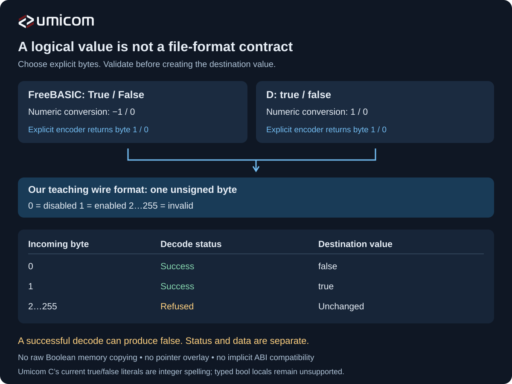

<!--
Umicom Bits2Banking
File: content/lessons/03-native-code/learning-freebasic/42-encode-boolean-values-with-an-explicit-byte-contract.md

PURPOSE:
Encode Boolean values with an explicit byte contract

AUTHOR AND ORGANISATION:
Sammy Hegab
Umicom Foundation

LICENCE:
MIT
-->

# Encode Boolean values with an explicit byte contract

[Course contents](index.md)

## Begin with one yes-or-no setting

Imagine saving whether a lesson is enabled. Inside your program this is a logical value: True or False. In a file or network message it must become an agreed sequence of bytes. A byte contains eight binary digits and can represent 256 different patterns. Our teaching format uses one byte: 0 means disabled, 1 means enabled, and every other value is invalid. This format is our explicit choice; the language's internal representation does not define it.

## Learn the FreeBASIC words used here

| Word or form | Meaning in this exercise |
| --- | --- |
| Boolean | A logical True/False value |
| True and False | Logical constants; FreeBASIC keywords are case insensitive |
| UByte | An unsigned eight-bit integer from 0 through 255 |
| UInteger | The unsigned loop counter type; do not assume it has the same width as a wire field |
| ByVal | Pass the input value into the function |
| ByRef | Allow the function to update the caller's destination |
| As Boolean | The function returns a logical result |
| Return | End this function with a result |
| CInt | Explicit conversion to the language's Integer type |
| CUByte | Explicit conversion to UByte; it is not a substitute for validating a wider input |
| AndAlso | Evaluate the right condition only if the left condition is true |

## Separate truth from its numeric conversion

FreeBASIC documents that converting logical True to a numeric type yields -1, while False yields 0. That is a language conversion rule, not a binary file-format definition. Our format requires an enabled byte of 1. Therefore the encoder uses an If statement to return exactly 1 or 0. It does not copy the memory of a Boolean variable or cast -1 into an unsigned byte. Other BASIC dialects can differ, so this course explicitly targets FreeBASIC's fb dialect.

## Read the complete encoder

~~~basic
Function EncodeFlag(ByVal value As Boolean) As UByte
    If value Then Return 1
    Return 0
End Function
~~~

## Follow the two paths

1. If value is True, execute Return 1 and leave the function immediately.
2. If value is False, skip the first return and reach Return 0.
3. In both cases the return type is UByte, the field type chosen for this teaching format.
4. There is no dependency on the byte layout of the Boolean input variable.

## Validate before changing the destination

~~~basic
Function DecodeFlag(ByVal raw As UByte, ByRef value As Boolean) As Boolean
    If raw > 1 Then Return False
    value = (raw = 1)
    Return True
End Function
~~~

## Distinguish status from the decoded value

The returned Boolean says whether decoding succeeded. The ByRef parameter receives the decoded logical value only on success. For raw byte 0, the function returns True for successful decoding while setting value to False. For raw byte 2, it returns False and does not assign value at all. A single yes-or-no return cannot represent both meanings without another channel. This is a common pattern at a native API boundary.

## Predict the contract

| Input byte | Status returned | Destination after call |
| --- | --- | --- |
| 0 | True: accepted | False |
| 1 | True: accepted | True |
| 2 through 255 | False: refused | Exactly the previous logical value |

## Prepare and run the example

1. Install a FreeBASIC compiler using the earlier setup lesson and verify that fbc is available in PowerShell.
2. Open the native-language-boundary laboratory folder in your Bits2Banking checkout.
3. Compile boolean_wire.bas with the fb dialect and runtime-checking option. Stop if compilation fails.
4. Run the newly built executable. The source contains ordinary Require checks, so the operations are not hidden inside removable assertions.
5. Record your FreeBASIC version and target when qualifying this example. A successful C comparison does not prove FreeBASIC behavior.

## Use these commands

~~~powershell
Set-Location "C:\umicom\Umicom-Bits2Banking\labs\languages\native-language-boundary"
fbc -lang fb -exx boolean_wire.bas -o boolean-wire-basic.exe
.\boolean-wire-basic.exe
~~~

## Read the expected completion lines

~~~text
Umicom Boolean wire: all 256 bytes checked.
Explicit encoding: false=0, true=1.
~~~

## Understand why every byte is tested

The loop visits 0 through 255 using a wider counter. A UByte loop counter could wrap from 255 back to 0 if the loop were written carelessly. Each value is converted to UByte only after the loop itself has constrained it to the valid byte range. The two canonical bytes must decode correctly. Every other byte must be refused with an initially True destination and again with an initially False destination. Testing both states catches a decoder that incorrectly overwrites the destination with a default on failure.

## Do not confuse conversion with validation

A conversion answers how to represent a value in another type. Validation answers whether that value belongs to an allowed set. A command-line integer such as 256 must be range-checked before conversion to UByte; otherwise a narrowing conversion can lose information before DecodeFlag sees it. This decoder's input contract already starts with one byte. It cannot reconstruct the wider value that a caller discarded. Similarly, accepting any nonzero integer as truth would silently accept malformed bytes that our format reserves.

## Use logical operators for logical work

Not on a Boolean expresses logical negation here. Integer bit operations have different purposes: they manipulate patterns of bits, and FreeBASIC's Not has numeric behavior that must not be treated as a portable wire encoder. Use comparisons and explicit branches when translating a logical setting to a protocol field. If your actual C API accepts any nonzero integer, document that separate contract; do not automatically impose this lesson's strict one-byte format on every existing interface.

## Apply the idea to Umicom

A FreeBASIC learning client can call a native Umicom C API through an explicit declaration with reviewed integer widths and calling convention. Keep reusable production behavior in Framework and keep language-specific adapters thin. For a serialized flag, define its width, accepted values and version in the format. For a C function, use the types declared by that function. Do not pass the address of a FreeBASIC Boolean where a C bool or a different integer type is expected merely because both names sound alike. This example teaches value translation; it does not establish an ABI bridge.

## Try deliberate mistakes safely

1. Change DecodeFlag to accept raw <> 0 and observe which of the exhaustive byte cases should now fail. Restore strict validation afterward.
2. Move the destination assignment above the refusal condition and explain why rejected input can then erase prior state.
3. Change the encoder's true output to 255. Explain why that violates this format even if another system might use that convention.
4. Add a separate parser for text words true and false. Decide its case and whitespace rules explicitly; do not reuse byte decoding as a text parser.
5. Explain why bytes 0 and 1 have no endianness issue by themselves, while a later multi-byte length field would need a byte-order contract.

## Recover from common errors

| Observation | What to inspect |
| --- | --- |
| CInt(True) is not the expected value | Check the compiler, version and dialect against the FreeBASIC documentation. |
| All invalid bytes appear successful | Check whether the function converted truth instead of validating the exact domain. |
| A false setting looks like a decode failure | Keep status and destination value separate. |
| A wider input unexpectedly becomes zero | Validate before narrowing to UByte. |
| An executable prints no final lines | Stop at the first Require failure and inspect its description; do not claim the exercise passed. |

## Read the language reference

- [FreeBASIC Boolean type and numeric conversion rules](https://www.freebasic.net/wiki/KeyPgBoolean)

[Previous: Follow abstract and virtual method dispatch](41-follow-abstract-and-virtual-method-dispatch.md)

Logical meaning, numeric conversion and an external byte contract are separate decisions.

[Next: Choose a rounding rule before conversion](43-choose-a-rounding-rule-before-conversion.md)
