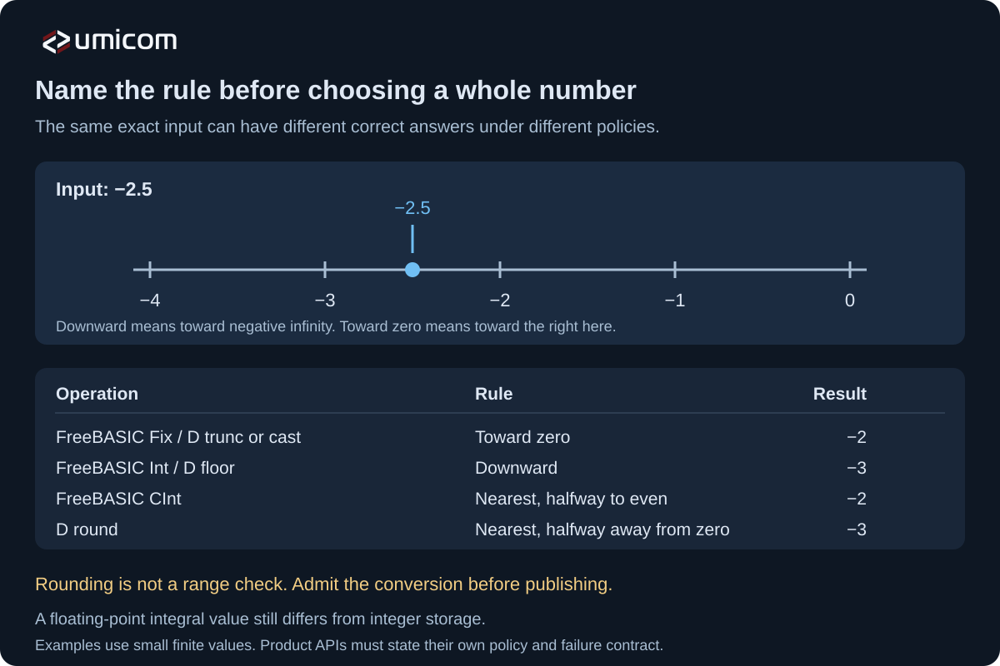

<!--
Umicom Bits2Banking
File: content/lessons/03-native-code/learning-freebasic/43-choose-a-rounding-rule-before-conversion.md

PURPOSE:
Choose a rounding rule before conversion

AUTHOR AND ORGANISATION:
Sammy Hegab
Umicom Foundation

LICENCE:
MIT
-->

# Choose a rounding rule before conversion

[Course contents](index.md)

## The question this lesson answers

You have measured 2.5 units and need a whole number. Should the answer be 2 or 3? Neither answer is universally correct. The rule depends on what the number means. Allocating enough boxes may require rounding upward; reporting complete boxes may require dropping a fraction; converting a pixel may require a particular nearest-value rule. A numeric conversion function cannot infer your intention. This lesson compares FreeBASIC operations with six small values, then builds a checked conversion that preserves the old result when admission fails.

## Prepare a small experiment

1. Review the earlier lessons about Double, Integer, Long, arrays, Function and ByRef. Double stores approximate binary floating-point values; Long is the signed 32-bit destination chosen here.
2. Open labs/languages/native-language-boundary/rounding_policy.bas. The fixture uses exact binary fractions 0.5 and 0.75 so representation error does not obscure the first comparison.
3. Write down your predicted results for 2.5 and -2.5 before looking at the table. Remember that moving downward on a number line moves toward more negative numbers.
4. Use the FreeBASIC compiler installed through your reviewed setup. This subject-language example is separate from the C23 Framework build.

## Three operations with different contracts

| Expression | Rule | Result type for a Double input |
| --- | --- | --- |
| CInt(x) | Nearest integer; halfway ties choose the even integer | Integer |
| Fix(x) | Drop the fractional part toward zero | Double with an integral value |
| Int(x) | Floor: greatest integer value no larger than x | Double with an integral value |

## Predict all six rows

| Input | CInt: nearest/even | Fix: toward zero | Int: downward |
| --- | --- | --- | --- |
| 2.5 | 2 | 2 | 2 |
| 3.5 | 4 | 3 | 3 |
| -2.5 | -2 | -2 | -3 |
| -3.5 | -4 | -3 | -4 |
| 1.75 | 2 | 1 | 1 |
| -1.75 | -2 | -1 | -2 |

## Read negative values on a number line

Between -3 and -2, the number -2.5 is halfway. Moving toward zero reaches -2; moving downward reaches -3. Nearest/even chooses -2 because -2 is even. At -3.5 the even neighbor is -4 instead. The sign does not make an even-tie rule always move toward zero. Do not identify the rule from only a positive example.

## A mathematical integer value is not necessarily an integer storage type

Fix and Int can return a Double whose fractional part is zero. That value still has floating-point storage and floating-point behavior. CInt selects Integer storage, and its overflow is not checked automatically. This exercise uses CLng after admission because the desired destination is explicitly Long. Once Fix has produced an exactly integral value inside the chosen interval, the subsequent conversion does not need to decide between two neighboring integers. Keep that reasoning separate from the general behavior of CInt on fractional inputs.

## Read the checked boundary

This is a conservative policy: the original input must already lie between the exact signed 32-bit endpoints. A value of 2147483647.5 is refused even though truncating it first could produce a representable result. That is intentional. Decide whether your application admits original values or rounded values, document the decision, and test its endpoints. The service returns a Boolean status separately from its numeric result.

~~~basic
Function TryTruncateLong(ByVal value As Double, ByRef destination As Long) As Boolean
    If Not (value >= -2147483648.0 AndAlso value <= 2147483647.0) Then Return False
    destination = CLng(Fix(value))
    Return True
End Function
~~~

## Understand the words and punctuation

| Spelling | Meaning in this example |
| --- | --- |
| Function / End Function | Begin and finish the procedure that returns a value. |
| ByVal value As Double | Receive a copy of the caller’s floating-point value. |
| ByRef destination As Long | Refer to the caller’s 32-bit integer so success can publish into it. |
| As Boolean | Return True for admission and False for refusal. |
| Not (...) | Invert the complete admission condition. Parentheses keep that grouping explicit. |
| AndAlso | Evaluate the second bound only if the first bound succeeds. |
| Return False | Leave before assigning the destination. |
| CLng(Fix(value)) | First remove the fractional part, then convert the admitted integral value to Long. |

## Why checking before assignment matters

Suppose destination currently contains 77, perhaps the last accepted setting. The failed call must leave 77 there. The procedure makes no assignment until the bounds pass. The full exercise checks this after a fractional overshoot on both sides and after a very large finite input. A caller must still inspect the returned status; retaining an older value does not mean the new request succeeded. This example does not use a sentinel numeric result such as zero, since zero could be a legitimate accepted value.

## Floating-point special values and compilation assumptions

NaN is a special not-a-number value. In ordinary floating-point comparison semantics it does not satisfy ordered lower and upper bounds. Infinity also falls outside this finite interval. This bounded conjunction therefore provides refusal before the conversion under those semantics. Do not enable optimization options that assume all inputs are finite without reviewing the contract. The FreeBASIC fixture uses ordinary finite inputs and explicit endpoints; it does not claim that a special-value test ran in this environment.

## Build and run the original source

Create the build folder first if your setup lesson has not already done so. Run each command separately and stop if compilation fails. The example was authored for the FreeBASIC dialect; its subject compiler was unavailable during this mirror continuation, so the commands are supplied for execution rather than presented as a passed result.

~~~powershell
Set-Location "C:\umicom\Umicom-Bits2Banking"
fbc -lang fb labs/languages/native-language-boundary/rounding_policy.bas -x build/rounding-policy-basic.exe
& ".\build\rounding-policy-basic.exe"
~~~

## Expected output and what it establishes

Require is an ordinary procedure that exits with a failure status if a condition is false. Its calls remain part of the program rather than depending on debug-only assertions. A successful run checks the six rows and the explicit boundary cases in this file. It does not prove every floating-point operation, compiler mode or external ABI is compatible.

~~~text
Umicom BASIC rounding: six rows checked.
Refused conversions preserve the caller's integer.
~~~

## Use this knowledge with Umicom

Umicom Framework’s RGB output conversion has its own documented nearest rule, including exact halfway ties upward after nonnegative scaling. Do not replace it with CInt merely because both return whole-number values. A BASIC client should call the reviewed C boundary for shared product behavior. In banking examples, define currency scale and rounding policy explicitly and use the established exact money representation; changing a display rounding function is not a settlement policy. These are separate contracts even when the same number appears on screen.

## Exercises and troubleshooting

1. Explain why Int(-1.75) and Fix(-1.75) disagree. Point to the relevant neighbors on a number line.
2. Change the first input from 2.5 to 3.5 and predict how the even neighbor changes. Keep both original rows for regression coverage.
3. Set destination to another value before a refused call and verify that exact value survives. Do not test only a zero-initialized destination.
4. If a default Integer has a different width on your target, explain why this procedure still selects Long explicitly. Do not silently change the advertised storage contract.
5. If a test fails, capture the compiler version and flags plus the particular expression. Do not remove the test or label all rounding interchangeable.

## Official references

- [FreeBASIC CInt conversion and overflow notes](https://www.freebasic.net/wiki/KeyPgCint)
- [FreeBASIC Fix](https://www.freebasic.net/wiki/KeyPgFix)
- [FreeBASIC Int](https://www.freebasic.net/wiki/KeyPgInt)

[Previous: Encode Boolean values with an explicit byte contract](42-encode-boolean-values-with-an-explicit-byte-contract.md)

[Next: Give operators a clear domain meaning](44-give-operators-a-clear-domain-meaning.md)
