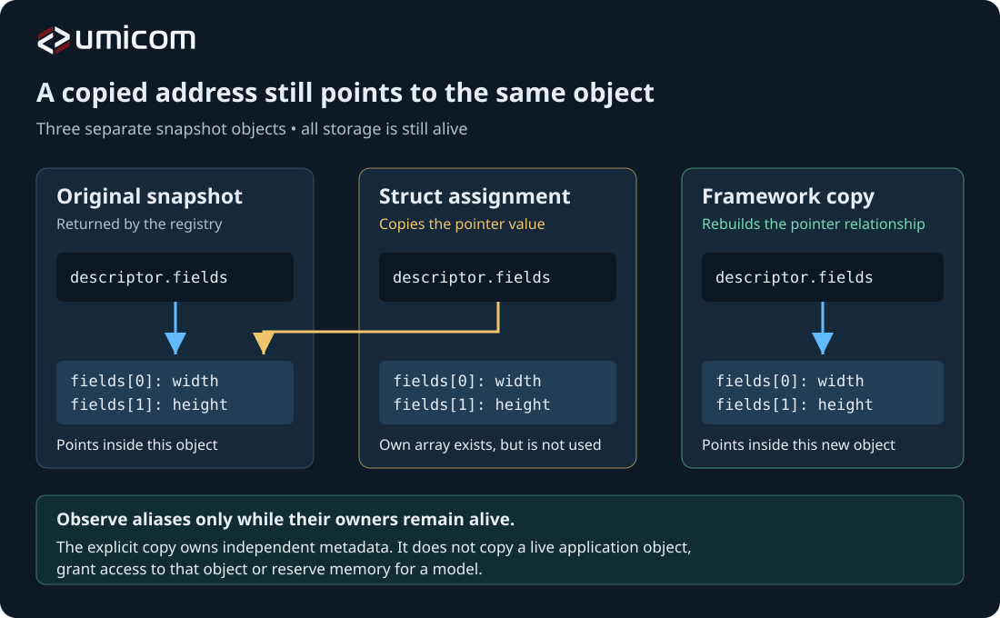

<!--
Umicom Bits2Banking
File: content/lessons/03-native-code/safer-c-programming/42-copy-metadata-with-explicit-pointer-ownership.md

PURPOSE:
Copy metadata with explicit pointer ownership

AUTHOR AND ORGANISATION:
Sammy Hegab
Umicom Foundation

LICENCE:
MIT
-->

# Copy metadata with explicit pointer ownership

[Course contents](index.md)

## A copy can still depend on its source

A C struct groups named fields into one value. Assigning one struct to another copies its member values. That sounds like an independent copy, but a pointer member is itself only a value: an address. Copying an address does not copy the allocation at that address or change where it points. In this lesson you will observe that distinction without reading freed memory, then use Umicom Framework to make an independent metadata snapshot.

You need the earlier lessons about pointers, arrays, ownership and cleanup, plus a C toolchain and the complete reflection-snapshot lab. If any word is unfamiliar, pause at the definitions below rather than guessing at a memory address. This exercise is a console program. It does not open a model, modify a real application object or require a graphical window.

Framework reflection is explicit metadata. A type descriptor contains a display name, a type identifier and pointers to field and attribute descriptions. A snapshot stores the descriptor plus bounded arrays for those descriptions inside the same struct. After the registry fills a snapshot, a populated descriptor pointer refers to an array inside that exact snapshot. This relationship is useful, but a plain struct assignment does not know that the relationship must be rebuilt for a new address.

## Read the simple relationship first

~~~c
typedef struct SmallSnapshot {
    const int *selected;
    int values[2];
} SmallSnapshot;

SmallSnapshot original = {0};
original.values[0] = 42;
original.selected = original.values;
SmallSnapshot shallow = original;
/* shallow.values contains 42, but shallow.selected points
 * to original.values, not to shallow.values. */
~~~

Both arrays exist after the assignment. The integer bytes are copied into shallow.values. The selected pointer is also copied, so it still contains the address of original.values. The term shallow copy describes copying pointer values without independently acquiring the storage they refer to. If original is still alive, reading through that pointer is an alias: another way to reach the same data. If original dies first, using the pointer can become invalid. We will keep every object alive while observing the alias.

## Find the complete Framework exercise

1. Open labs/framework/reflection-snapshot/main.c in the Bits2Banking checkout. Find PreviewOptions, which has width and height members.
2. Read the two UMI_REFLECTION_FIELD declarations. The macros use the C compiler to calculate offsetof and sizeof; the lesson does not guess numeric field offsets.
3. Find the type descriptor. Its type and module identifiers describe this example. Its field array describes PreviewOptions; it does not point to a live PreviewOptions value.
4. Find the three calloc calls. Each allocates one complete snapshot and begins with zeroed storage. Every result is checked before the program uses it.
5. Find cleanup. It destroys any remaining registry and frees every caller allocation. The exercise does not depend on returning early from the middle of ownership-sensitive code.

The snapshot type contains up to 64 field records and 16 attribute records, including fixed-capacity text. It is substantially larger than the two-field example suggests. The exercise puts these snapshots on the heap rather than a small thread stack and checks allocation failure. Heap means dynamically allocated storage managed through allocation and release calls. It is not unlimited memory. A real application should bound how many snapshots it retains and release obsolete ones.

## Build using the installed SDK

An SDK is a development package containing public headers, compiled libraries and build metadata. The normal lab configuration finds the installed Umicom Framework package and requests its reflection component. The application links Umicom::reflection. It does not clone the Framework repository or implement its own copy of the registry. Use a package containing the snapshot-copy API, and match the producer toolchain and architecture.

~~~powershell
cmake -S . -B build-sdk -G Ninja -DCMAKE_PREFIX_PATH=C:/UmicomSDK
cmake --build build-sdk
ctest --test-dir build-sdk --output-on-failure --no-tests=error
~~~

1. Open PowerShell in the reflection-snapshot lab directory. Choose the installed Framework SDK directory you actually use.
2. Replace C:/UmicomSDK below with that path. Run configure first and stop if it fails.
3. Build the configured target, then run its CTest entry. CTest is the runner that launches the executable and records its exit result.
4. Read the executable output captured by CTest if a check fails. A missing library component and a runtime ownership error need different repairs.

For a focused source exercise, the lab also accepts UMICOM_FRAMEWORK_SOURCE pointing to an existing matching checkout. Use a separate build-source directory. That mode compiles the metadata, registry and threading owner required by this exercise. It checks those source files, not the complete installed package or application. The lab README gives the exact alternative commands. Never report a source-mode pass as proof that another SDK installation includes the same symbol.

## Follow the registry boundary

The program creates a registry with a capacity of one type, one module and one resource. It registers the type descriptor and asks the registry to copy its metadata into original. Registration owns independent metadata copies. get_type writes caller-owned arrays and points populated descriptor spans into original itself. A span is a pointer together with a count of elements. Empty descriptor spans are null in a canonical snapshot, so an empty array does not retain a meaningless caller pointer.

Canonical means following one agreed representation. Here, the pointer for a populated field span must equal the address of that snapshot's field array. The attribute span follows the same rule. A zero count uses a null pointer. These rules make it possible for the explicit copy API to check whether a source snapshot has the expected ownership relationships before reading the arrays.

## Observe a shallow copy safely

~~~c
*shallow = *original;
/* This is true while both allocations remain alive: */
shallow->descriptor.fields == original->fields
/* This is false for the populated snapshot: */
shallow->descriptor.fields == shallow->fields
~~~

The expressions above illustrate comparisons; the complete program places them inside actual checks. The arrow operator accesses a member through a pointer. The program then asks umi_reflection_type_snapshot_copy to copy shallow into independent. That source is not canonical: its descriptor points to the original allocation. The API returns UMI_STATUS_INVALID_ARGUMENT and leaves the destination unchanged. The refusal is useful feedback, not an invitation to cast away a type or force the pointer through.

## Use the explicit ownership operation

~~~c
UmiStatus status = umi_reflection_type_snapshot_copy(original, independent);
if (status != UMI_STATUS_OK) {
    /* Follow the caller's cleanup or error-report path. */
}
~~~

The API first checks the source representation and validates bounded metadata. It copies the descriptor and populated records into the destination, then points the descriptor at the destination's own arrays. This adjustment is called rebasing: replacing an internal address relationship with the corresponding relationship in the new object. The operation allocates no heap storage itself. The caller supplies stable, disjoint source and destination objects; validated self-copy is supported as a special case.

Do not copy a valid destination later with raw assignment, memcpy or a growing array relocation and assume the invariant survives. Those operations copy addresses again. Either keep each snapshot at a stable address, use the explicit copy operation into stable destination storage, or design a representation using offsets rather than embedded pointers. Changing the representation of an existing public SDK type would require compatibility work; a lesson is not permission to silently change that ABI.

## Separate registry lifetime from snapshot lifetime

1. After making the explicit copy, the program destroys the registry. The caller-owned snapshots still exist.
2. It changes the original field's display label to Changed original. The shallow descriptor sees that changed label because it points to the original array.
3. The shallow object's own inline array still contains width. Its descriptor pointer and its inline storage now visibly disagree.
4. The explicit independent copy still reports width through its own descriptor. It does not borrow either earlier allocation.
5. The program discards shallow before freeing original, then validates independent again. No freed pointer is dereferenced at any point.

~~~text
A struct assignment keeps the original array pointer.
The explicit copy refuses a shallow snapshot.
A later source edit leaves the independent copy unchanged.
Independent metadata: 2 fields; first field width
No live application object was copied or modified.
~~~

This output is the expected successful sequence. If the executable returns a failure status, inspect which checked condition failed and which Framework source or installed package it linked. The example also checks final output flushing, because reporting a successful result can itself fail when the output destination is unavailable. The focused Framework regression suite tests whole-destination preservation, empty spans, maximum counts and malformed metadata in greater detail.

## Metadata is not permission to access a live object

A valid field offset only describes where a member belongs in a compatible C representation. It does not prove that a pointer supplied by another caller identifies a live object of that type, that another thread is not changing it, or that a user may read or edit it. An inspector needs object ownership, lifetime, synchronization and permission rules in addition to reflection metadata. A range attribute also does not automatically enforce a range or reserve memory for an image.

D can inspect declarations at compile time with traits and templates. Framework's C registry stores explicit runtime descriptions that applications can query. These approaches can teach similar ideas about discovering fields, but their execution times and ownership contracts differ. Neither automatically makes arbitrary C pointer access safe. Keep reusable metadata operations in Framework and let applications compose them with their own live-object access rules.

## Practice and explain your result

1. Change the example's original display label to a different short string. Predict the three observed labels before running it.
2. Explain why shallow->fields and shallow->descriptor.fields identify different arrays after assignment. Draw both addresses if needed.
3. Explain why destroying the registry does not destroy a successfully returned caller-owned snapshot.
4. Identify every allocation and the matching cleanup operation. Describe what happens when the second allocation fails.
5. State one fact metadata validation establishes and two facts about live-object access it does not establish.
6. Record whether you tested source mode or installed-SDK mode, the actual commands and the observed exit status. Do not merge those two evidence categories.

## Vocabulary before the first pointer

| Term | Meaning in this exercise |
| --- | --- |
| Object | A region of memory holding a C value |
| Pointer | A value that identifies another object or position |
| Inline array | Storage that is part of the struct itself |
| Descriptor | Metadata describing a type or its fields |
| Snapshot | A caller-owned copy of a registry record and its arrays |
| Owner | The code responsible for keeping storage alive and releasing it |
| Borrower | Code that may use storage while its owner keeps it valid |

## Further reading

- [Complete native ownership exercise](https://github.com/umicom-foundation/Bits2Banking/blob/main/labs/framework/reflection-snapshot/main.c)
- [Lab build and troubleshooting guide](https://github.com/umicom-foundation/Bits2Banking/blob/main/labs/framework/reflection-snapshot/README.md)
- [Framework snapshot-copy contract](https://github.com/umicom-foundation/umicom-framework/blob/main/include/umicom/reflection/registry.h)

[Previous: Turn a range contract into focused regression checks](41-qualify-the-corpus-range-contract.md)

[Next: Admit resource labels without trusting their contents](43-admit-resource-labels-without-trusting-content.md)
