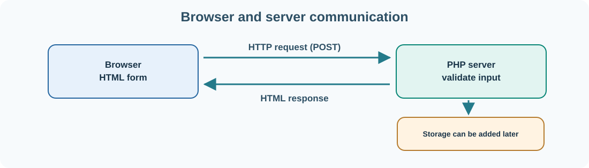

# 15. PHP: process a web form on a server

Our JavaScript task board runs inside the browser. A team-based system also needs a server to validate shared data, check permissions and store tasks centrally. **PHP** is one language used to write that server-side behaviour.

We will create a small PHP page that receives a task description through an HTML form and displays a validated result. It does not use a database yet: first we need to understand the request and response.



## Start with a local PHP environment

If PHP is installed, verify it with:

```powershell
php --version
```

Create a folder called `php-tasks`. Inside it, save this file as **`index.php`**:

```php
<?php
$task = '';
$message = '';

if ($_SERVER['REQUEST_METHOD'] === 'POST') {
    $task = trim((string)($_POST['task'] ?? ''));

    if ($task === '') {
        $message = 'Please enter a task.';
    } elseif (mb_strlen($task) > 120) {
        $message = 'A task must be at most 120 characters.';
    } else {
        $message = 'Received task: ' . $task;
    }
}
?>
<!doctype html>
<html lang="en-GB">
<head><meta charset="utf-8"><title>Umicom Task Entry</title></head>
<body>
  <h1>Umicom Task Entry</h1>
  <form method="post">
    <label for="task">Task</label>
    <input id="task" name="task" maxlength="120" required>
    <button type="submit">Send</button>
  </form>
  <p><?= htmlspecialchars($message, ENT_QUOTES | ENT_SUBSTITUTE, 'UTF-8') ?></p>
</body>
</html>
```

This code uses the PHP `mbstring` extension for `mb_strlen`. If it is not enabled in your installation, enable the extension or, for this introductory exercise, replace `mb_strlen($task)` with `strlen($task)` while recognising that `strlen` counts bytes rather than Unicode characters.

## Run the page

From the folder containing `index.php`, run:

```powershell
php -S 127.0.0.1:8080
```

Open `http://127.0.0.1:8080` in a browser. Enter `Review Umicom Bank accounts` and select **Send**. The page displays the received task. Stop the development server with **Ctrl+C**.

## What happens when you select Send?

1. The browser sends an **HTTP POST** request containing the form's task field.
2. The PHP server receives the request and executes the PHP code.
3. `$_POST['task']` retrieves the submitted value. `trim` removes extra surrounding spaces.
4. The server checks the value and prepares a message.
5. PHP generates HTML, including the safely encoded message, and sends it back as an HTTP response.

`htmlspecialchars` is important: user-supplied text must be encoded appropriately when inserted into an HTML response. For example, typing `<script>` as a task must not make the browser execute it.

## What is still missing?

This example does not save tasks or create authenticated accounts. It is not a production-ready application. A real task-board service needs authorisation, server-side session handling, persistent data, protection against CSRF when appropriate, error handling and tests. Validating the input length alone does not provide those safeguards.

PHP can use database libraries to persist records. Later we will learn SQL and why the application must use controlled queries rather than assembling SQL from untrusted input.

## Compare PHP and JavaScript

JavaScript can run in the browser and react immediately to a click. PHP runs on a web server and can apply rules before sending a response. Many real websites use both. Umicom's web adapters may serve frontends in other languages, but the same separation remains: the user interface does not own authoritative shared business state.

**Next:** [Track your project changes with Git](../05-engineering/16-git.md).
