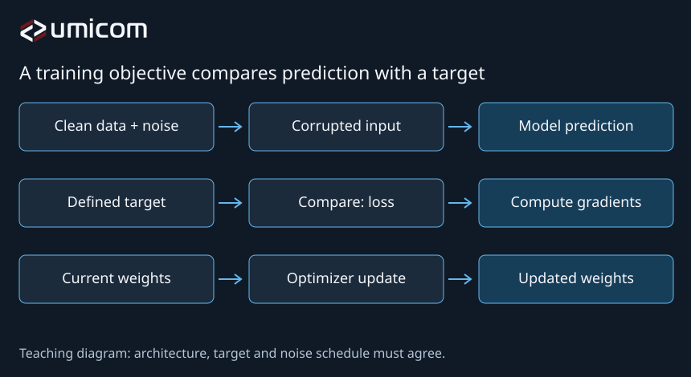

<!--
Umicom Bits2Banking
File: content/lessons/05-ai/generative-ai-foundations/04-noise-denoising-and-loss.md

PURPOSE:
Understand a denoising objective before training

AUTHOR AND ORGANISATION:
Sammy Hegab
Umicom Foundation

LICENCE:
MIT
-->

# Understand a denoising objective before training

[Course contents](index.md)
Noise is a controlled random disturbance added to data. In a diffusion-style training example, the system chooses a noise level, corrupts a clean representation, and trains a model to predict a defined target. Depending on the model and parameterization, that target may be noise, a clean sample or another related quantity. The scheduler and training code must agree.

A loss is a number measuring mismatch between prediction and target. For a tiny scalar example, squared error is (prediction − target)². A gradient tells how that error changes as a trainable parameter changes. An optimizer moves parameters according to a rule. This arithmetic illustrates learning; it is not an image generator.

~~~text
Toy scalar model: prediction = weight × input
input = 2, target = 1, weight = 0
prediction = 0
loss = (0 - 1)^2 = 1
gradient with respect to weight = 2 × (prediction - target) × input = -4
learning rate = 0.1
new weight = 0 - 0.1 × (-4) = 0.4
new prediction = 0.8; new loss = 0.04
~~~

1. Recalculate every number with a pencil or calculator.
2. Repeat with learning rate 1.0. The new weight becomes 4 and prediction 8, so loss becomes 49: a larger step can be worse.
3. Explain which value is trainable and which is supplied by the dataset.
4. Now imagine many parameters and tensor inputs. The same dependency idea scales, but the architecture, gradients, numeric stability and memory requirements become much more involved.

Training commonly samples a noise level for each example; inference repeatedly applies a learned denoising process under a scheduler. Training steps and inference denoising steps are not the same count. A fixed inference seed can aid comparison but does not guarantee identical outputs across implementations, hardware or versions.

## Check

A decreasing loss on one scalar example is not evidence that a model understands images. Keep this toy objective separate from any claim of a native diffusion trainer. Framework’s existing training primitives and dataset services are building blocks that need architecture-specific implementation and qualification.

Teaching diagram: architecture, target and noise schedule must agree.

## Continue learning

[Previous: Resize and batch images without silently changing the task](03-resizing-cropping-and-buckets.md) · [Course contents](index.md) · [Next: Understand latents, conditioning and image adapters](05-latents-conditioning-and-adapters.md)
