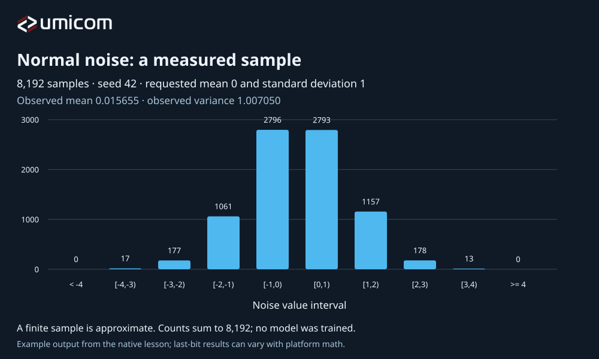

<!--
Umicom Bits2Banking
File: content/lessons/05-ai/generative-ai-foundations/12-measure-noise-before-training.md

PURPOSE:
Measure normal noise before using it in a training loop

AUTHOR AND ORGANISATION:
Sammy Hegab
Umicom Foundation

LICENCE:
MIT
-->

# Measure normal noise before using it in a training loop

[Course contents](index.md)
Noise is a deliberately introduced variation in a training example. In many denoising experiments, that variation is sampled from a normal distribution. A distribution describes which values are more or less likely. A sample is the finite collection of values your program actually produces. Before using noise in a large image or video experiment, measure a small sample and understand the parameters, memory and reproducibility contract.

## 1. Understand mean and standard deviation

The mean describes the centre of the distribution. The standard deviation describes its spread in the same units as the values. A standard normal distribution has mean zero and standard deviation one. Positive and negative values are both expected. Variance is the square of the standard deviation, so its target is one too. A finite sample will usually have an observed mean that is close to zero rather than exactly zero.

This is different from uniform noise, where equal-width intervals have equal probability within a selected range. Normal noise concentrates values near its centre and has less frequent larger magnitudes. Do not substitute one distribution for the other merely because both look random. The model’s training objective and schedule determine what kind of corruption is appropriate.

## 2. Reuse the native sampling owner

~~~c
UmiAiTrainingRandomState random;
float samples[8192];
UmiStatus status = UmiAiTrainingRandomSeed(&random, 42U);
if (status != UMI_STATUS_OK) return 1;
status = UmiAiTrainingRandomFillNormal(
    &random, 0.0F, 1.0F, samples, 8192U);
if (status != UMI_STATUS_OK) return 1;
~~~

The random state is a caller-owned structure that records where the deterministic number sequence has reached. A seed initializes that state. The API receives its address, requested mean and standard deviation, an output buffer and a count. The suffix F marks a floating-point literal of type float; U marks an unsigned integer literal. This example allocates its fixed sample array locally and calls a shared Framework function. It does not implement another random-number generator in the lesson.

Framework uses its existing integer generator and a Box-Muller transform to produce pairs of normal samples. A transform is a mathematical operation that turns one kind of value into another. The implementation draws values strictly between zero and one before taking a logarithm, avoiding log(0). You do not need to memorize that formula to use the public API, but understanding its domain explains why endpoint handling is part of correctness.

## 3. Build the small measurement program

1. Complete the compiler and CMake setup in the preceding native denoising lesson. Keep the original fixed-noise experiment as a comparison.
2. From the Bits2Banking repository root, read labs/framework/denoising-objective/noise_statistics.c. It contains one complete C main function and uses the matching Framework source checkout.
3. Run the configure and build commands below separately. Replace the Framework path if your checkout is elsewhere. Stop on an error instead of using an older executable by accident.
4. Run CTest. Expect two passing tests: the original objective and the separate noise-statistics exercise. Then run the statistics executable to read the table.
5. Record the compiler, platform, seed, count and API revision with your result. These source-level checks do not qualify an installed SDK package or a GPU trainer.

~~~powershell
$env:Path = "C:\msys64\ucrt64\bin;$env:Path"
cmake -S labs/framework/denoising-objective -B build/denoising-objective -G Ninja -DUMICOM_FRAMEWORK_SOURCE=C:/umicom/Umicom-Applications/framework
cmake --build build/denoising-objective --parallel 2
ctest --test-dir build/denoising-objective --output-on-failure
& ".\build\denoising-objective\umicom-noise-statistics.exe"
~~~

On Linux use the same CMake workflow with your actual Framework directory and run ./build/denoising-objective/umicom-noise-statistics. The target platform and math library require their own checks. No model download, image decoder or remote service is required for this experiment.

## 4. Read the histogram

A histogram groups samples into intervals called bins and counts how many fall in each interval. The notation [-1,0) includes minus one and excludes zero. This prevents a boundary value from being counted twice. The outer bins collect values below minus four and at least four. Their counts can be zero in a finite sample even though the mathematical distribution has tails beyond those values.

The chart shows one measured run of the supplied program: 8,192 samples, seed 42, observed mean 0.015655 and variance 1.007050. The tallest bins are close to zero. The ten counts sum to 8,192. These values illustrate a real execution of the small sampling exercise; they are not image-quality scores, a trained model result or a promise of byte-identical output on every computer.

## 5. Calculate the two summary statistics

The program sums the sample values and divides by the sample count to obtain the observed mean. It also sums their squares. For this controlled small demonstration, variance is computed as the average square minus the square of the average. Double-precision accumulators reduce rounding compared with summing in float. For data with a very large offset and a tiny spread, this subtraction can lose accuracy; use a numerically stable online variance algorithm for that different problem.

The regression checks use tolerances rather than demanding an exact mean of zero or variance of one. Randomness does not excuse any possible result: nonfinite values, a wildly wrong spread or counts that do not add up should fail. A simple moment check still cannot prove independence, perfect distribution tails or suitability for every scientific use.

## 6. Know what is reproducible

Using the same seed, parameters and call sequence with the same implementation reproduces the samples. The underlying integer sequence is deterministic. The normal transform uses logarithms, square roots, sine and cosine; platform math implementations can differ in their final bits. Compare expected numerical behavior with suitable tolerances across platforms, and save the environment and generated dataset when exact replay matters.

The transform generates two samples per pair of draws. If a call asks for an odd count, the unused partner is discarded. Consequently, asking for one sample twice does not promise the same two values as asking for two samples once. Batch boundaries are part of the experiment. A standard deviation of zero returns the mean without advancing RNG state; a count of zero produces no output and also leaves state unchanged.

## 7. Follow failure and memory ownership

The API requires finite parameters and a nonnegative standard deviation. It uses bounded scratch storage so that it can validate every requested output before changing your buffer or state. If allocation fails or a transformed value cannot fit in FP32, the request fails and both outputs remain unchanged. The scratch sample bytes are cleared before release. The caller still owns the resulting sample array and must manage its later lifetime.

These guarantees are local to the sampling call. They do not prevent a caller from retaining every batch forever, copying large image tensors unnecessarily or requesting more total memory than a model can use. Keep training graph lifetime, model weights, optimizer state, image buffers and download caches visible in a separate memory budget. A seed is not a memory limit, a security secret or proof that training succeeded.

## 8. Run controlled experiments

1. Change the requested mean to two and standard deviation to three in a separate learning copy. Predict a centre near two and a variance near nine. Update the experiment’s stated expected range before running it.
2. Reduce the count substantially. Expect a less stable-looking histogram. Explain why a small sample is a noisy estimate of a distribution.
3. Use a different seed while keeping the original parameters. Compare the shape and moments instead of requiring every bin count to match.
4. Try a negative standard deviation and check for refusal. Do not inspect the buffer as if new samples were produced.
5. Explain how you would pass accepted samples to UmiAiDenoisingMix while keeping normalization and alphaBar consistent with the chosen model. Do not call the sampling program an image generator.

## Keep the experiment vocabulary precise

| Term | Meaning | What it does not prove |
| --- | --- | --- |
| Seed | Initial state of a deterministic sequence | Data diversity or security |
| Mean | Centre of a distribution | Every finite sample has exactly that average |
| Standard deviation | Scale of variation | A maximum absolute sample value |
| Histogram | Counts in defined intervals | A complete statistical quality assessment |
| Noise sampler | A source of corruption values | A trained denoiser or image/video model |

[Previous: Run a native denoising experiment and observe overfitting](11-run-a-native-denoising-experiment.md)

[Next: Distinguish step noise from cumulative signal](13-distinguish-step-noise-from-cumulative-signal.md)
