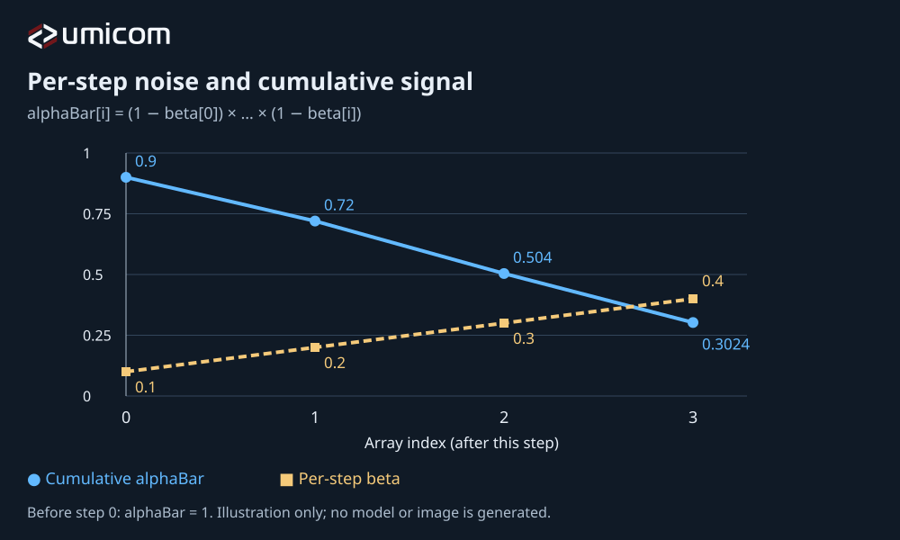

<!--
Umicom Bits2Banking
File: content/lessons/05-ai/generative-ai-foundations/13-distinguish-step-noise-from-cumulative-signal.md

PURPOSE:
Distinguish step noise from cumulative signal

AUTHOR AND ORGANISATION:
Sammy Hegab
Umicom Foundation

LICENCE:
MIT
-->

# Distinguish step noise from cumulative signal

[Course contents](index.md)
The previous lessons mixed a clean value with noise using one coefficient called alphaBar. A real model configuration may instead describe many per-step values called beta. They are related, but they are not interchangeable. This lesson derives the relationship with four small numbers, runs an original C example through Framework, and explains what the calculation does and does not prove. No image, video, model weights or network connection is required.

## 1. Understand the three names before writing code

Beta, written β in mathematical notation, is the selected fraction of noise variance introduced by a step in a variance-preserving forward diffusion convention. Alpha for that step is one minus beta. Alpha-bar is the cumulative product of the alphas up to and including that step. The bar is part of the name of a different quantity; it is not decoration. Multiplication matters because the clean signal is attenuated repeatedly. Different model families may use other conventions, so these definitions must be checked against the model being studied.

A coefficient is simply a number multiplying another quantity. In this example, start with a cumulative value of one. Multiply by 0.9 to obtain 0.9, then by 0.8 to obtain 0.72, then by 0.7 to obtain 0.504, then by 0.6 to obtain 0.3024. The betas increase while the cumulative clean-signal coefficient decreases. Real schedules are chosen to suit a model and a training procedure; these deliberately large values are for easy arithmetic.

~~~text
beta:       0.1       0.2       0.3        0.4
alpha:      0.9       0.8       0.7        0.6
alphaBar:   0.9       0.72      0.504      0.3024
~~~

## 2. Keep array indexes separate from a model’s timestep convention

C arrays start at index zero. Framework output element zero describes the cumulative coefficient after applying input beta zero. The initial state before that first step has alphaBar equal to one and is not stored in the output array. Some papers count their first noising step as t = 1. Always state which convention a file or function uses. A one-position mismatch can pair a noisy example with the wrong timestep even when every array access is within bounds.

## 3. Read the actual shared C contract

The function is declared in umicom/ai/training/denoising.h. It borrows the input and output arrays for the duration of the call; the caller owns both. The first count is the number of beta values, and the final capacity is the number of float slots available for output, not bytes. Keep the spans separate and do not let another thread modify them during the call. On success the first four output elements contain the cumulative coefficients. On failure the entire output remains unchanged. Check status before reading results.

~~~c
const float betas[4] = {0.1F, 0.2F, 0.3F, 0.4F};
float cumulative[4];
UmiStatus status = UmiAiDenoisingScheduleFromBetas(
    betas, 4U, cumulative, 4U);
~~~

## 4. Know which inputs are refused

The service accepts one through 4,096 finite beta values in the range zero inclusive to one exclusive. Zero means no additional noise at that step. One would remove all clean signal, so it is refused by this schedule contract. Negative values, infinity and NaN are also refused. NaN means “not a number”, a special floating-point value that may arise from invalid arithmetic. A small output buffer reports a capacity error. A valid prefix is not published when a later beta fails.

The implementation accumulates in double precision, validates every coefficient, then repeats the bounded arithmetic to write float results. This avoids a temporary array while preserving all-or-nothing output. It rejects a cumulative product below FLT_MIN, the smallest positive normal float for the target. Values smaller than that can be subnormal or round to zero; this API does not rely on hardware treatment of those values. A refusal is not permission to clip the coefficient or remove the check. A different numerical representation needs separate design and validation.

## 5. Use a cumulative coefficient in forward noising

The square roots apply the selected coefficients to signal amplitudes. Do not substitute beta directly for alphaBar. For a suitable standard-normal noise variable, this formula describes a marginal sample at the selected forward-noising step. A marginal describes the distribution at one step without requiring you to simulate every preceding step. Our tiny example uses a fixed noise value of one to make the arithmetic easy to inspect. One fixed value is not evidence of a Gaussian distribution.

~~~text
noisy = sqrt(alphaBar) * clean
      + sqrt(1 - alphaBar) * noise
~~~

## 6. Build only this teaching lab

Run each command separately and stop on an error. Use your actual checkout paths. The source directory selects the small lesson, not every application. The Framework source option identifies the existing matching implementation. CMake configures, the build command compiles, CTest executes three lesson checks, and the final command displays the schedule example. On Linux use ./build/denoising-objective/umicom-noise-schedule. This source exercise does not qualify an installed SDK package.

~~~powershell
Set-Location "C:\umicom\Umicom-Bits2Banking"
cmake -S labs/framework/denoising-objective -B build/denoising-objective -G Ninja -DUMICOM_FRAMEWORK_SOURCE=C:/umicom/Umicom-Applications/framework
cmake --build build/denoising-objective
ctest --test-dir build/denoising-objective --output-on-failure
.\build\denoising-objective\umicom-noise-schedule.exe
~~~

## 7. Interpret the printed table

The program prints step, beta, alphaBar, noisy and recovered columns. Its clean scalar is 0.25 and its known noise is 1. Each row starts again from that same clean scalar and uses its own cumulative coefficient; it does not repeatedly noise the previous printed result. The alphaBar column should be 0.900000, 0.720000, 0.504000 and 0.302400. The recovered column should remain near 0.250000 within floating-point tolerance. The executable checks these expectations and returns a nonzero exit code if they fail.

Recover uses the exact noise that Mix was given. A trained model must predict unknown noise from noisy inputs and conditioning. Giving Recover the answer tests arithmetic; it does not test prediction quality. A reverse sampler also needs a model-compatible update rule, timestep selection and possibly further randomness. None of those is supplied by this schedule conversion.

~~~text
Checks passed: cumulative products and known-noise reconstruction.
No model was trained; known noise is not a learned prediction.
~~~

## 8. Try a controlled coefficient experiment

1. Calculate the cumulative products for beta values 0.1, 0.1, 0.1 and 0.1 on paper. The results should be 0.9, 0.81, 0.729 and 0.6561.
2. Copy the example into a separate experimental source and update both the beta values and independently calculated expected products. Rebuild that experiment with the same warning checks. Preserve the original reference exercise.
3. Predict what four zero betas do. The cumulative value stays one, so Mix returns the clean value. This is a valid arithmetic endpoint, not useful generative training by itself.
4. Try a beta of one in the experimental copy. Expect the schedule to be refused. Do not read the uninitialized cumulative array after that error.
5. Explain why changing a pretrained model’s schedule arbitrarily can break its predictions, even if this coefficient function succeeds. Compatibility is a model contract, not a property of multiplication alone.

## 9. Connect the idea to image and video training

Image training typically applies a selected coefficient to many values at once, with normalization, tensor layout and prediction target defined by the model. Video adds frame order, timing and relationships across frames; using the same numerical schedule does not create temporal coherence. Record the exact schedule, timestep convention, normalization, random seeds and prediction type in an experiment’s metadata. Keep related source images or clips together when splitting training and evaluation data. The native functions here are reusable numerical building blocks, not a production diffusion trainer.

## 10. Recover from common mistakes

An undefined symbol at link time usually means headers and implementation do not match or the new source was omitted from the selected library. Reconfigure the correct lab rather than copying an unrelated binary. If the schedule is refused, inspect the count, capacity, every beta and cumulative precision range. If reconstructed values are wrong, first check that the same cumulative coefficient and compatible noise convention were used. If numerical tests pass but images are poor, investigate model/data compatibility and evaluation; a coefficient unit test cannot establish perceptual quality.

[Previous: Measure normal noise before using it in a training loop](12-measure-noise-before-training.md)

[Next: Combine compatible noise predictions and measure guidance](14-combine-compatible-noise-predictions.md)
