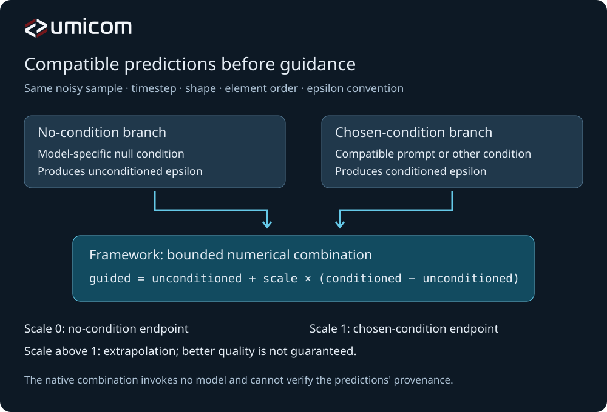

<!--
Umicom Bits2Banking
File: content/lessons/05-ai/generative-ai-foundations/14-combine-compatible-noise-predictions.md

PURPOSE:
Combine compatible noise predictions and measure guidance

AUTHOR AND ORGANISATION:
Sammy Hegab
Umicom Foundation

LICENCE:
MIT
-->

# Combine compatible noise predictions and measure guidance

[Course contents](index.md)

## What you will learn

A text-to-image system often has a guidance setting. It is tempting to read that setting as a quality slider: turn it up and receive a better image. This lesson replaces that assumption with a small calculation. You will distinguish conditioning from guidance, combine two compatible noise predictions in C and measure how the result affects reconstruction. The example intentionally uses four numbers rather than a photograph, so every value can be traced by hand.

Read the earlier lessons about forward noise, cumulative signal and clean reconstruction first. You should know that a tensor is a collection of numbers with an agreed shape, and that epsilon is a common name for noise. For the practical exercise you need the existing denoising-objective lab, matching Framework source, CMake, Ninja and a C23 compiler. No account, model download, GPU or external service is needed. This exercise does not run a learned image or video generator.

## 1. Understand conditioning

Conditioning supplies information that should influence a model’s prediction. In a text-conditioned generator, a tokenizer converts prompt text into token IDs and a text encoder converts those IDs into numerical representations. The denoising model uses those representations together with the noisy sample and timestep. Other systems may condition on a reference image, a depth map, an audio signal or previous video frames. The model architecture and its training determine what those inputs mean; arbitrary arrays cannot simply be substituted.

A conditioned prediction uses the chosen condition. An unconditioned prediction uses the model’s trained no-condition representation. That may be an empty-text encoding, a learned null representation or another model-specific convention. A blank string typed into a user interface is not proof that the implementation supplies the correct unconditioned branch. Likewise, a negative prompt normally creates another conditioned prediction; it is not automatically the same thing as the no-condition branch.

## 2. Keep the training stage separate from inference

Training adjusts the model’s parameters using examples and an objective. In one common classifier-free training strategy, the trainer sometimes drops the conditioning input. The same network therefore learns both conditioned and unconditioned behavior. The dropout policy, probability, null representation and prediction target must match the model design. This is different from erasing random pixels, discarding a whole example or applying a loss mask to language tokens.

Inference uses learned parameters to make predictions without updating them. Classifier-free guidance is a way to combine compatible predictions during inference. It does not require a separate classifier network for this combination. The name does not mean the system has no conditions, and the arithmetic function below does not train anything. A model-specific sampler still owns timesteps, repeated denoising updates and the conversion from latents to visible pixels.

## 3. Write the combination rule

~~~text
guided = unconditioned + scale * (conditioned - unconditioned)
~~~

Read the formula from the inside outward. First subtract the unconditioned prediction from the conditioned prediction. That difference describes how the condition changed the prediction. Multiply the difference by a nonnegative guidance scale. Finally add the result to the unconditioned prediction. Apply the same arithmetic separately to each corresponding tensor element. You are combining predictions of the same quantity, not blending two arbitrary images.

At scale zero, the result is the unconditioned prediction. At scale one, it is the conditioned prediction. A scale between zero and one interpolates between them. A scale above one extrapolates beyond the conditioned prediction in the direction of their difference. Extrapolation can amplify errors as well as useful condition information. It does not promise sharper images, better motion, improved factual detail or more faithful prompts.

## 4. Calculate one element by hand

Suppose the unconditioned prediction is -0.1 and the conditioned prediction is 0.2. Their difference is 0.3. At scale 0.5, multiply 0.3 by 0.5 to obtain 0.15, then add -0.1 to obtain 0.05. At scale 3, the result is -0.1 + 0.9 = 0.8. Notice that 0.8 lies beyond both original predictions. That is allowed by this arithmetic; clipping it back into a display color range would change the operation.

## 5. Establish compatibility before arithmetic

The two vectors must refer to the same noisy sample, timestep, shape, element order and prediction convention. Shape describes dimensions such as batch, channels, height and width. Element order describes how those coordinates map into a flat memory buffer. Two equal-length arrays can still be incompatible if one uses a different layout or a different sample. A native float pointer carries none of that identity by itself.

This lab assumes epsilon prediction: both vectors estimate noise. Some models predict the clean sample directly, a velocity-like v target or a flow-related quantity. The formulas and conversion rules differ. Do not feed those outputs into an epsilon reconstruction function merely because they contain floats. A production caller needs explicit model metadata and reviewed adapters; this bounded numerical operation cannot infer the correct convention.

## 6. Inspect the complete native exercise

1. Open Umicom-Bits2Banking/labs/framework/denoising-objective/guidance.c. Keep the original main.c, noise_statistics.c and noise_schedule.c exercises available.
2. Find clean: four synthetic values represent the original sample. Find exactNoise: four known noise values are used to create the noisy sample. These are teaching fixtures, not decoded pixels.
3. Find UmiAiDenoisingMix. It creates one noisy vector using cumulative signal alphaBar = 0.25. AlphaBar is a signal coefficient, not the guidance scale.
4. Find unconditioned and scales. The program combines that prediction with exactNoise at four scales. The conditioned prediction is deliberately perfect in this constructed example.
5. Find UmiAiDenoisingRecover. It estimates the clean values from the noisy sample and guided epsilon prediction.
6. Find the error loop. It squares the difference between each reconstructed and original value, sums those squares and divides by four. That is mean squared error, abbreviated MSE.

## 7. Build and run the exercise

The following Windows commands assume the existing UCRT64 GCC toolchain and Ninja. Substitute your own checkout paths when needed. Run one command at a time and stop on an error. The build directory is separate from the source files. This narrow source composition uses Framework’s actual implementation; it is not a full Framework application build or an installed-SDK verification.

~~~powershell
$env:Path = "C:\msys64\ucrt64\bin;C:\Program Files\CMake\bin;$env:Path"
Set-Location "C:\umicom\Umicom-Bits2Banking\labs\framework\denoising-objective"
cmake -S . -B build -G Ninja -DCMAKE_C_COMPILER=C:/msys64/ucrt64/bin/gcc.exe -DUMICOM_FRAMEWORK_SOURCE=C:/umicom/Umicom-Applications/framework
cmake --build build --parallel 2
ctest --test-dir build --output-on-failure
& ".\build\umicom-noise-guidance.exe"
~~~

The matching lab contains four CTest exercises: objective, noise statistics, schedule and guidance. The guidance executable prints one row per scale, including four guided values and a reconstruction MSE. For this fixed fixture, scale one should have error close to zero because it selects the exact noise predictor. Scale three should be worse. Those are outcomes to verify on your build, not evidence about the quality of a real image model.

## 8. Explain the measured error

With alphaBar = 0.25, the clean coefficient is sqrt(0.25) = 0.5 and the noise coefficient is sqrt(0.75), approximately 0.866. An error in the predicted noise is multiplied by approximately 0.866 / 0.5 during clean reconstruction. Its squared contribution is therefore multiplied by three. In this fixture the unconditioned and exact noise vectors differ, so moving away from the exact conditioned vector increases reconstruction error.

Ignoring small floating-point rounding, the four expected MSE values are 1.0575, 0.264375, zero and 4.23 for scales zero, 0.5, one and three. These values are not perceptual image scores. They measure four synthetic scalars against known original values. A real system must separately evaluate prompt adherence, detail, diversity, artifacts and video temporal consistency. There may be tradeoffs between those criteria even when one numerical objective improves.

## 9. Read the Framework boundary

UmiAiDenoisingGuideNoise accepts two input pointers, a count, scale, output pointer and output capacity. Count and capacity are numbers of floats, not byte lengths. The count must be between one and UMI_AI_DENOISING_MAX_VALUES, currently 16384. The scale must be finite and nonnegative. Finite excludes NaN, which means not a number, and positive or negative infinity. Both input vectors are checked even at scale zero or one; an unused endpoint does not hide invalid data.

~~~c
UmiStatus status = UmiAiDenoisingGuideNoise(
    unconditioned, conditioned, count, scale, output, capacity);
if (status != UMI_STATUS_OK) {
    /* Keep the previous output; inspect the refusal before proceeding. */
}
~~~

The operation validates every candidate result before publishing any output. If a later element is invalid or would exceed the finite float range, earlier output elements remain unchanged too. Intermediate arithmetic uses double precision. Scale zero and one use exact endpoints to avoid losing a small conditioned value when subtracting and adding a much larger unconditioned value. The operation performs no allocation, model call, random sampling or file access.

The input vectors are borrowed and may share read-only storage. Output must be separate from both, and every buffer must remain valid and unchanged by other threads for the duration of the call. Spare output capacity is left untouched. The maximum value count bounds this scalar operation; it does not mean a whole high-resolution image fits in that count. A future tensor caller must preserve shape and lifetime while processing appropriate bounded spans.

## 10. Connect the idea to Umicom Media

A native media pipeline can keep model loading, condition preparation, prediction identity, numerical guidance and sampler updates as separate responsibilities. Framework can own reusable arithmetic and validation, while Media presents a model-compatible control and explains its range. The user interface must not offer an arbitrary setting when the selected model or sampler does not support that convention. A successful arithmetic call cannot establish that a remote service implements the same algorithm.

Two predictions also have a resource cost. An implementation might compute them in one larger batch or in two sequential calls. A larger batch can require more peak activation memory; sequential calls can increase latency. Neither strategy is universally best, and this array-only operation measures neither. Record actual model identity, shapes, device, precision, peak memory and elapsed time before making an efficiency claim. Reuse shared model and memory services rather than inventing another application-local allocator.

## Troubleshooting and experiments

1. If the symbol is missing, check that both header and implementation come from the same Framework revision, then rebuild the narrow lab.
2. If scale is refused, check for a negative number, NaN or infinity. If output overflows, review the model outputs and requested scale rather than silently clipping them.
3. If the fixed scale-one reconstruction is wrong, verify that the same alphaBar and noisy sample reach both mixing and recovery. Confusing beta, alphaBar and guidance scale changes the calculation.
4. Change one element of the conditioned prediction and predict whether scale one will remain exact. It should no longer be exact for that element. Keep the original fixture for comparison.
5. Before trying a real video model, write down frame order, timestep policy, conditioning identity and output convention. Check temporal coherence across an entire clip, not just one attractive frame.

## Check your understanding

Guidance combines compatible predictions during inference; conditioning tells the model what information to use. Training with dropped conditioning prepares a model for one common guidance approach, but the native combination does not train it. A scale above one extrapolates and may worsen a result. A finite successful calculation proves only that the bounded arithmetic contract was satisfied. It does not prove the inputs came from compatible models or that the resulting image or video is good.

## One prediction element at four scales

| Scale | Calculation | Result | Interpretation |
| --- | --- | --- | --- |
| 0 | -0.1 + 0 × 0.3 | -0.1 | Unconditioned endpoint |
| 0.5 | -0.1 + 0.5 × 0.3 | 0.05 | Interpolation |
| 1 | -0.1 + 1 × 0.3 | 0.2 | Conditioned endpoint |
| 3 | -0.1 + 3 × 0.3 | 0.8 | Extrapolation |

## Further reading

- [Complete native guidance exercise](https://github.com/umicom-foundation/Bits2Banking/blob/main/labs/framework/denoising-objective/guidance.c)
- [Framework denoising API](https://github.com/umicom-foundation/umicom-framework/blob/main/include/umicom/ai/training/denoising.h)

[Previous: Distinguish step noise from cumulative signal](13-distinguish-step-noise-from-cumulative-signal.md)

[Next: Follow a deterministic denoising trajectory](15-follow-a-deterministic-denoising-trajectory.md)
