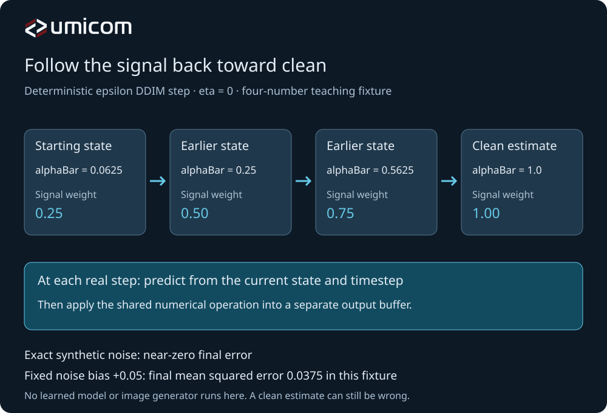

<!--
Umicom Bits2Banking
File: content/lessons/05-ai/generative-ai-foundations/15-follow-a-deterministic-denoising-trajectory.md

PURPOSE:
Follow a deterministic denoising trajectory

AUTHOR AND ORGANISATION:
Sammy Hegab
Umicom Foundation

LICENCE:
MIT
-->

# Follow a deterministic denoising trajectory

[Course contents](index.md)

## What you will learn

The previous lessons introduced forward noise, cumulative signal coefficients and guidance. This lesson takes one small step toward sampling: moving a noisy numerical sample to an earlier noise level using an epsilon prediction. You will follow four numbers through three steps, compare an exact prediction with a deliberately biased one, and measure the final error. Every operation uses the existing native Framework implementation. No trained model, image file, GPU or account is required.

A trajectory is the sequence of states a process visits. A sampler chooses and applies steps along such a trajectory. DDIM is a family of diffusion sampling methods. Here we use only its deterministic epsilon-prediction step with eta equal to zero. Eta controls a stochastic contribution in the broader formulation; zero removes newly sampled noise from this step. This lesson does not implement every DDIM option or claim compatibility with any downloaded checkpoint.

## 1. Recall the forward construction

~~~text
noisy = sqrt(alphaBar) * clean + sqrt(1 - alphaBar) * epsilon
~~~

Clean is the original numerical sample. Epsilon is the noise array used to construct the sample. AlphaBar is the cumulative signal coefficient. A coefficient of one preserves the clean sample; a coefficient close to zero gives the noise a larger role. Sqrt means square root. In an image model the numbers could represent normalized pixels or latent values; those meanings depend on the model. Our four values are simply a small arithmetic fixture, not a picture.

The earlier schedule lesson converts per-step beta values into cumulative alphaBar values. Those are different quantities. In a normal forward noising schedule, alphaBar decreases as noise accumulates. Moving backward therefore uses an earlier point whose alphaBar is at least as large. A reverse step cannot infer the correct schedule from an arbitrary number typed into a user interface.

## 2. Recover an estimate of the clean sample

~~~text
cleanEstimate =
    (noisy - sqrt(1 - currentAlphaBar) * predictedEpsilon)
    / sqrt(currentAlphaBar)
~~~

This rearranges the forward equation. If predictedEpsilon equals the exact noise in the construction, the estimate recovers clean up to floating-point rounding. In a real generator, a neural network predicts epsilon from the current noisy state, timestep and condition. The prediction can be wrong. Dividing by a small square root can amplify its error, which is one reason numeric correctness and generated quality must be evaluated separately.

CurrentAlphaBar must be greater than zero. At exactly zero the forward sample has lost all contribution from clean, so this algebra cannot invert it. The shared API refuses that coefficient instead of dividing by zero or inventing a clean estimate. It also rejects nonfinite values, invalid lengths and results outside the representable float range.

## 3. Move to the earlier noise level

~~~text
previous = sqrt(previousAlphaBar) * cleanEstimate
         + sqrt(1 - previousAlphaBar) * predictedEpsilon

Required order: 0 < currentAlphaBar <= previousAlphaBar <= 1
~~~

Previous means earlier in the forward process. It does not mean subtracting one from a C array index. The chosen points can skip parts of the original schedule, but a real model integration must choose them consistently with its scheduler and timestep convention. The equation reuses the same epsilon prediction for this numerical step. It does not ask a network to predict, choose a prompt or decode a latent.

Equal coefficients are the identity case: the output is the original noisy input. The implementation preserves those float values exactly, including signed zero, while still checking that both input arrays contain finite values. Setting previousAlphaBar to one removes the remaining noise term and returns the clean estimate. Neither case proves that the clean estimate is accurate.

## 4. Trace the native memory contract

~~~c
UmiAiDenoisingDeterministicStep(
    state, prediction, 4U, currentAlpha, previousAlpha,
    next, 4U);
~~~

State and prediction are borrowed arrays of four floats. Next is a different writable array with room for four floats. Count and capacity measure float elements, not bytes. The source values must stay stable until the synchronous call returns. The destination must be disjoint from both input arrays. The function does not keep pointers, allocate a second tensor or perform input/output.

The implementation calculates a scalar clean estimate in double precision, checks every candidate output, and only then repeats the arithmetic to publish results. If any candidate is invalid, the entire destination stays unchanged. The caller must check the returned status before copying next into state. This is a bounded memory pattern: explicit ownership, fixed working storage and a failure path that preserves existing data. It does not make arbitrary invalid pointers safe.

## 5. Inspect the complete experiment

Open trajectory.c in the denoising-objective lab. The clean array is [-0.5, 0, 0.5, 1]. The exact epsilon array is [0.2, -0.4, 0.1, 0.8]. UmiAiDenoisingMix constructs the starting state at alphaBar 0.0625, which is one sixteenth. The Follow function then visits 0.25, 0.5625 and 1. Those values have square roots 0.5, 0.75 and 1, making the changing signal contribution easier to inspect.

The first trajectory deliberately supplies the known exact epsilon at every step. This is an oracle fixture: the exercise author already knows the answer. In a real sampling loop, the model must predict from each current state and timestep. Reusing one fixed prediction is not a general shortcut for model inference. It is valid here because the constructed reference trajectory is defined around that same noise array.

The second trajectory adds 0.05 to every epsilon component. That gives a known, controlled bias. With the chosen starting coefficient, the final clean error has magnitude sqrt(15) times 0.05, about 0.19365 per element. Its mean squared error is 15 times 0.05 squared, which equals 0.0375. The point is to predict a measurable consequence before running the code, rather than judging an attractive image after the fact.

## 6. Configure, build and run the example

You need CMake, Ninja, a C23 compiler and the matching primary Framework source checkout. These commands compile only the small source-linked teaching lab. They do not download dependencies, validate an installed SDK or build the graphical applications. Run one command at a time and stop after any failure.

~~~powershell
Set-Location "C:\umicom\Umicom-Bits2Banking"
$env:Path = "C:\msys64\ucrt64\bin;$env:Path"
cmake -S labs/framework/denoising-objective -B build/denoising-objective -G Ninja -DUMICOM_FRAMEWORK_SOURCE=C:/umicom/Umicom-Applications/framework
cmake --build build/denoising-objective --parallel 2
ctest --test-dir build/denoising-objective -R "lesson[.]denoising[.]trajectory" --output-on-failure --no-tests=error
~~~

The test should pass only when the exact trajectory reconstructs within the specified tolerance and the biased trajectory produces the expected error. For the printed intermediate values, run the focused test with CTest’s verbose option: ctest --test-dir build/denoising-objective -R "lesson[.]denoising[.]trajectory" -V. Compare the two paths at each coefficient. The final values in the exact path should be close to the original four clean values; the biased path should differ.

## 7. Understand what the test establishes

The host regression suite also checks independent scalar references, identity behavior, the clean endpoint, schedule ordering, nonfinite inputs, overflow, capacity refusal, the maximum supported vector and unchanged input storage. It compares a rearranged reference equation and checks that skipped steps work in the constructed oracle case. These checks can reveal implementation defects without running a huge model.

They do not establish the correctness of a pretrained model’s scheduler, its image normalization, its text encoder, its latent scale or its prediction parameterization. Some models predict velocity or the clean sample directly rather than epsilon. Feeding those arrays into an epsilon equation produces the wrong operation even when every number is finite. A model adapter must make that convention explicit and test it against a trusted reference for the particular model.

## 8. Connect sampling to training and applications

Training adjusts model parameters so predictions improve on examples. Sampling uses model predictions and a schedule to construct outputs. This operation belongs to the second process. A low training loss does not guarantee a good sample, and a passing numerical test does not measure training quality. Evaluate held-out data, inference behavior and memory use separately.

Umicom Media can eventually compose a reviewed model adapter, a schedule, the shared guidance operation and this deterministic step. The application should own user choices and display progress; Framework should own reusable numeric behavior and bounded state. A production pipeline still needs a tensor/model backend, cancellation, memory reservations, decoded output checks and a tested image or video path. Video adds frame ordering and temporal consistency; applying a scalar operation to more values does not create a temporally coherent video model.

## Practice and troubleshooting

1. Write the four chosen alphaBar values in increasing order and calculate their square roots. Explain why the reverse path increases alphaBar.
2. Change the bias from 0.05 to 0.02 in a practice copy. Predict the final mean squared error as 15 times 0.02 squared before updating the assertion.
3. Use the exact initial noise and jump directly from 0.0625 to one in a separate test. Compare the result with the three-step oracle path; do not infer that a real learned model can skip arbitrary timesteps without quality loss.
4. Try a previous coefficient smaller than the current one. Expect refusal and verify that next remains unchanged.
5. If the executable cannot be built, check that the Framework header and source both contain the deterministic-step API and that the configured source path points to that checkout.
6. If a numerical assertion fails, retain the compiler version, source and complete test output. Check parameterization, coefficient direction and buffer ownership before loosening tolerances.

## Further reading

- [Complete deterministic trajectory source](https://github.com/umicom-foundation/Bits2Banking/blob/main/labs/framework/denoising-objective/trajectory.c)
- [Framework denoising API](https://github.com/umicom-foundation/umicom-framework/blob/main/include/umicom/ai/training/denoising.h)
- [Framework deterministic-step regression tests](https://github.com/umicom-foundation/umicom-framework/blob/main/tests/denoising/test_deterministic_step.c)

[Previous: Combine compatible noise predictions and measure guidance](14-combine-compatible-noise-predictions.md)

[Next: Convert diffusion velocity predictions before using them](16-convert-diffusion-velocity-predictions.md)
