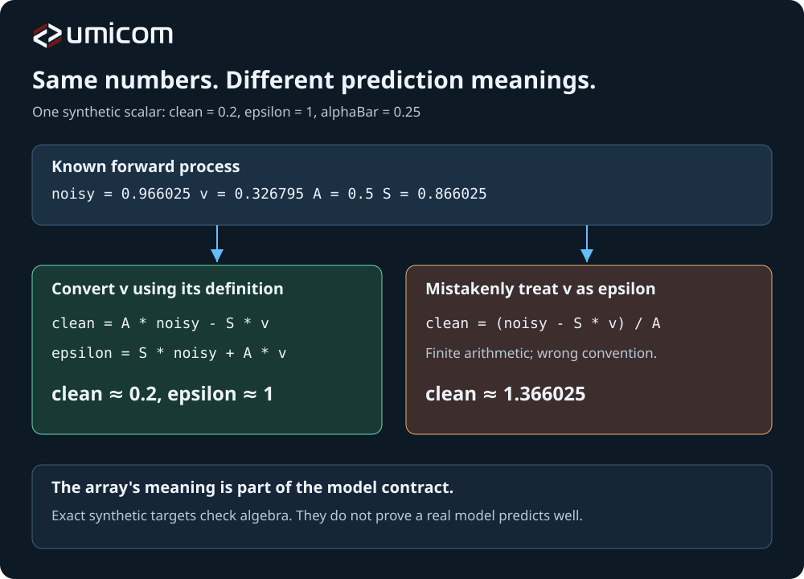

<!--
Umicom Bits2Banking
File: content/lessons/05-ai/generative-ai-foundations/16-convert-diffusion-velocity-predictions.md

PURPOSE:
Convert diffusion velocity predictions before using them

AUTHOR AND ORGANISATION:
Sammy Hegab
Umicom Foundation

LICENCE:
MIT
-->

# Convert diffusion velocity predictions before using them

[Course contents](index.md)

## What you will learn

A model output is an array of numbers with an agreed meaning. Two arrays can have the same length and contain only finite numbers, yet represent different quantities. In this lesson you will distinguish clean data, noise and diffusion velocity; convert one prediction convention to another; and run a small native C example that deliberately makes a convention mistake. You will need the C compiler, CMake and Ninja introduced in the setup lessons, a Bits2Banking checkout, and the matching Umicom Framework source checkout. No GPU, downloaded weights, Python environment or paid service is needed.

## 1. Begin with one number, then an array

Imagine one normalized image value is 0.2. Normalized means the data has been mapped into a numerical range chosen by the model. The number does not have to be a byte between 0 and 255. An array is an ordered collection of such values. In a real pipeline, the values might be pixels or a compressed representation called a latent. The conversions here work element by element; they do not know which interpretation applies. A caller must preserve the element order, shape, units and scale. A float is C's single-precision floating-point type: it can represent fractions approximately, but not every real number exactly.

## 2. Name the forward-noising quantities

Call the original clean value x0 and a sampled noise value epsilon. The Greek letter epsilon is written as eps in some programs. At a chosen timestep, let a be alphaBar, the cumulative signal coefficient, with a between zero and one. Define A = sqrt(a) and S = sqrt(1-a), where sqrt means square root. Then the noisy value xt equals A*x0 + S*epsilon. The subscript t identifies the timestep; it is not multiplication. A and S are nonnegative, and A squared plus S squared equals one. Lesson 13 explains how per-step beta values become cumulative alphaBar. Do not pass beta or the integer timestep where an API expects alphaBar.

~~~text
A  = sqrt(alphaBar)
S  = sqrt(1 - alphaBar)
xt = A * x0 + S * epsilon
~~~

## 3. Decide what the network predicts

Training chooses a target: the answer the model is asked to approximate. An epsilon-predicting network is trained to estimate the added noise. An x0-predicting network estimates clean data. In the variance-preserving diffusion convention used in this lesson, a v-predicting network estimates v = A*epsilon - S*x0. The name velocity comes from a parameterization of the noising path; here it is an algebraic quantity, not the speed of a physical object. Model documentation must state the convention. A different flow-matching model can also call its output velocity while using another path and another formula. The shared word does not establish compatibility.

## 4. Derive the conversion instead of guessing

Multiply xt = A*x0 + S*epsilon by A, and v = A*epsilon - S*x0 by S. Subtract the second expression from the first. The two A*S*epsilon terms cancel, leaving (A squared + S squared)*x0, which equals x0. Therefore x0 = A*xt - S*v. To recover epsilon, multiply xt by S and v by A, then add. The clean terms cancel, leaving epsilon = S*xt + A*v. Neither formula divides by A. This is why both endpoints have well-defined arithmetic.

~~~text
cleanEstimate = sqrt(alphaBar) * noisy
              - sqrt(1 - alphaBar) * predictedVelocity

noiseEstimate = sqrt(1 - alphaBar) * noisy
              + sqrt(alphaBar) * predictedVelocity
~~~

## 5. Check the endpoints and the meaning of a prediction

At alphaBar zero, the forward sample is entirely noise. Conversion returns epsilon = noisy and cleanEstimate = -predictedVelocity. This does not magically reveal the original image: a network would have to predict the corresponding clean information, which may be uncertain. At alphaBar one, the sample is clean, so cleanEstimate = noisy and epsilonEstimate = predictedVelocity. The operation still checks every value of both arrays, including values that the endpoint arithmetic does not use. A wrong model prediction remains wrong after conversion. Correct algebra is necessary for an application but cannot prove image quality.

## 6. Examine the supplied native example

Open labs/framework/denoising-objective/velocity.c in your editor. It declares clean values 0.2, -0.8 and 1.2, and known epsilon values 1, -0.5 and 0.25. These small synthetic arrays make the expected answer visible. For each alphaBar value 0, 0.25 and 1, the example calls UmiAiDenoisingMix and constructs the matching v target. It then calls UmiAiDenoisingVelocityToClean and UmiAiDenoisingVelocityToNoise. Since the example knows the original clean and noise arrays, it can measure reconstruction error. A real application does not know these answers during generation; a trained model supplies the predicted array instead.

~~~c
UmiStatus status = UmiAiDenoisingVelocityToClean(
    noisy, predictedVelocity, count, alphaBar, estimatedClean, capacity);
if (status != UMI_STATUS_OK) {
    /* Keep the previous state. Do not consume an unproduced estimate. */
    return 1;
}
~~~

## 7. Configure and build the small exercise

The following PowerShell commands assume the owner-style repository locations shown. If your checkouts live elsewhere, replace every root consistently. The source directory is this teaching lab, so the command compiles the selected Framework arithmetic sources, not all Umicom applications. CMake prepares build rules, Ninja executes them, and CTest runs the registered checks. Run each command separately and stop if it fails. Installing CMake does not install a C compiler; use the UCRT64 compiler established in the setup lessons.

~~~powershell
Set-Location "C:\umicom\Umicom-Bits2Banking\labs\framework\denoising-objective"
$env:Path = "C:\msys64\ucrt64\bin;C:\Program Files\CMake\bin;" + $env:Path
cmake -S . -B build -G Ninja -DUMICOM_FRAMEWORK_SOURCE=C:/umicom/Umicom-Applications/framework -DCMAKE_C_COMPILER=C:/msys64/ucrt64/bin/gcc.exe
cmake --build build --parallel 2
ctest --test-dir build -R "lesson[.]denoising[.]velocity" --output-on-failure --no-tests=error
& ".\build\umicom-denoising-velocity.exe"
~~~

## 8. Read the result

The program prints three rows, one for each coefficient. The maximum clean error and maximum epsilon error should be close to zero, within the checked tolerance of 0.000002. Maximum error means the largest absolute difference among the three corresponding values. Small nonzero values can arise from floating-point rounding. At alphaBar 0.25, the program also deliberately passes velocity directly into UmiAiDenoisingRecover, whose second argument must be epsilon. That call may return success because the numbers are finite and the equation is calculable. Its clean result is nevertheless wrong: the maximum error is about 2.0165. The test requires the mistake to remain visible, above 1.0. This contrast teaches a semantic error that numeric validation alone cannot catch.

## 9. Connect the converted value to another operation

The existing deterministic DDIM step accepts epsilon predictions. A compatible v-predicting client can first convert v to epsilon using the same current noisy sample and alphaBar, then call UmiAiDenoisingDeterministicStep with a reviewed previous coefficient. Keep the converted output separate from both inputs. Near very small alphaBar, epsilon-based clean reconstruction divides by a small square root and can amplify rounding. The direct v-to-clean conversion avoids that division. Do not assume every sequence of mathematically equivalent float operations gives identical bits. Model-specific schedulers, clipping, scaling and precision rules still require separate implementation and qualification.

## 10. Understand the memory contract

The Framework functions allocate no memory. The caller provides a stable noisy array, a stable velocity array, and a disjoint writable destination. Count and capacity are numbers of floats, not bytes. One float commonly occupies four bytes on these targets, so confusing bytes with elements can overstate the available storage. Calls accept one through 16,384 elements. Each function first checks the complete input and every candidate output; only then does it publish values. A bad final element therefore cannot leave a half-updated destination. The unused tail is untouched. This guarantee requires that another thread does not mutate an input between the two passes. Disjointness and valid storage are caller obligations; C pointers do not carry automatic span proofs.

## 11. Relate the convention to training

During supervised diffusion training, a clean example and sampled noise are available, so the trainer can construct the chosen target. If training for v prediction, it compares the model's v output with A*epsilon - S*x0 at that example's timestep. A common loss is mean squared error, the average of squared prediction differences. Changing from an epsilon target to a v target changes the learning objective and its timestep-dependent relationship to reconstruction error. Do not relabel existing epsilon weights as a v model or swap targets halfway through a run without a deliberate training plan. The small example constructs exact targets but performs no optimizer step. The earlier overfitting exercise teaches optimization separately.

## 12. Extend the idea carefully to image and video data

For image latents, the same arithmetic can be applied to a flattened tensor only when the model uses the stated convention and coefficient. For video, tensor dimensions can include batch, channels, frames, height and width. Those dimensions determine element order and memory cost; a scalar conversion does not add temporal attention, motion consistency or a video decoder. Do not split a large tensor into calls unless the coefficient and layout contract remain correct for every chunk. The 16,384-value bound belongs to this small CPU primitive, not a claim that a full video pipeline fits into that memory.

## 13. Try controlled experiments

1. Change one clean value, rebuild and rerun. The exact synthetic conversion should still reconstruct it within tolerance.
2. Change one velocity value after the target has been formed. Observe how reconstruction error grows; remove the intentional change before expecting the regression test to pass.
3. Use alphaBar 0.5 in an additional loop row. Predict that both weights are sqrt(0.5), then compare the printed errors.
4. Pass a capacity smaller than count in a separate local experiment and check for UMI_STATUS_CAPACITY_EXCEEDED. Initialize output with known values and confirm they remain unchanged.
5. Write down the model facts you would need before adapting real weights: prediction convention, schedule, latent scaling, input shape, timestep encoding, conditioning and expected numerical precision.

## 14. Recover from common problems

An unknown function declaration usually means the example and Framework headers are from different revisions; compare both source trees. An undefined reference during linking means the compiled Framework source or library does not contain the new functions, even if the header does. A CMake cache referring to another workspace needs a separate build directory, not a blind overwrite of that workspace. A failed numerical assertion needs the complete output and compiler information preserved for investigation. Do not remove the check or claim image generation passed. This exercise qualifies a model-free arithmetic contract; installed SDK use, loaded model inference, real image quality and video behavior remain separate checks.

## Prediction conventions at a glance

| Quantity | What it represents | What the conversion assumes |
| --- | --- | --- |
| x0 | Clean pixels or latents in the model's scale | Same shape and element order as the noisy sample |
| epsilon | Added noise or its prediction | The epsilon convention expected by Recover and DeterministicStep |
| v | A*epsilon - S*x0 in this diffusion convention | A=sqrt(alphaBar), S=sqrt(1-alphaBar) |
| alphaBar | Cumulative signal coefficient | Finite value between zero and one from the matching schedule |

## Further reading

- [Progressive Distillation for Fast Sampling of Diffusion Models: Section 4 and Appendix D](https://arxiv.org/abs/2202.00512)
- [Framework denoising API](https://github.com/umicom-foundation/umicom-framework/blob/main/include/umicom/ai/training/denoising.h)
- [Complete native velocity exercise](https://github.com/umicom-foundation/Bits2Banking/blob/main/labs/framework/denoising-objective/velocity.c)

[Previous: Follow a deterministic denoising trajectory](15-follow-a-deterministic-denoising-trajectory.md)

[Next: Exclude padding from a training objective](17-exclude-padding-from-a-training-objective.md)
