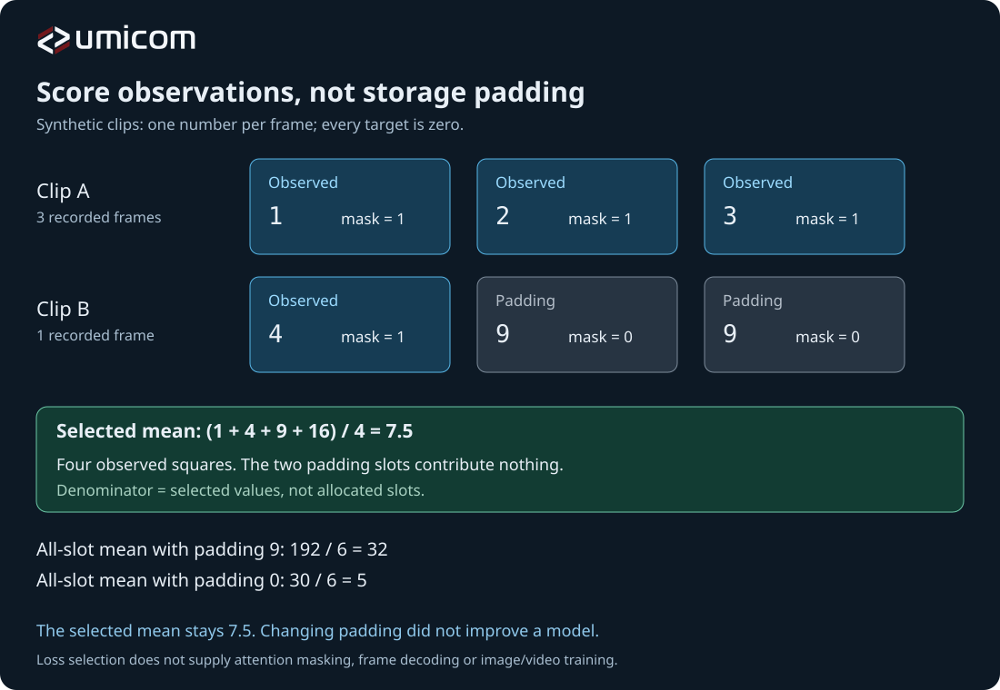

<!--
Umicom Bits2Banking
File: content/lessons/05-ai/generative-ai-foundations/17-exclude-padding-from-a-training-objective.md

PURPOSE:
Exclude padding from a training objective

AUTHOR AND ORGANISATION:
Sammy Hegab
Umicom Foundation

LICENCE:
MIT
-->

# Exclude padding from a training objective

[Course contents](index.md)

## Why a storage slot is not always an observation

A video clip is a sequence of frames. Two clips can contain different numbers of frames. Many training operations are easier to express when each item in a batch occupies the same shape, so a preparation step may add unused slots to the shorter clip. Those slots are called padding. Allocating space for a value does not mean that the value is an observation that should teach the model anything.

This lesson builds on the earlier pixel, frame, loss and gradient lessons. You will run a small C program using Umicom Framework, calculate its result by hand, and change the padding without changing the intended objective. There are no image files, downloaded weights or network requests. Each imaginary frame contains only one scalar number so that every calculation fits on paper. A real frame has height, width and channels, and its adapter must map those dimensions explicitly.

## Read the words before the formulas

| Term | Meaning here |
| --- | --- |
| Batch | Several examples processed as one group |
| Shape | The dimensions describing how values are arranged |
| Padding | Unused storage added so examples share a common shape |
| Prediction | The value the model or toy fixture proposes |
| Target | The desired value used for comparison |
| Loss | A scalar measuring disagreement under a specified rule |
| Mask | An array saying which values belong to that rule |
| Gradient | The local rate at which the loss changes with one input |
| Denominator | The number by which the sum is divided |

## Draw two clips in six slots

Clip A has three recorded frames. Clip B has one recorded frame and two padding slots. Store the values in row-major order: all of A, then all of B. The matrix has two rows and three columns, so it contains six values. In this teaching arrangement rows identify clips and columns identify frame positions. The Framework tensor itself does not know that interpretation.

~~~text
Clip A predictions: 1  2  3
Clip B predictions: 4  9  9
Targets:            0  0  0  0  0  0
Selection:          1  1  1  1  0  0
~~~

One in the selection array means include the corresponding value in this objective. Zero means exclude it. The two nines deliberately make unused storage conspicuous. They are finite values, not missing-value markers. A selection array is not a substitute for shape validation, valid memory or finite tensor values. A zero byte cannot make an invalid pointer safe.

## Calculate both answers yourself

1. Subtract each target from its prediction. The differences are 1, 2, 3, 4, 9 and 9.
2. Square the differences: 1, 4, 9, 16, 81 and 81. A square is a value multiplied by itself.
3. Add all six squares: 192. Divide by six to obtain the complete mean squared error, 32.
4. For the selected objective, include only the first four squares: 1 + 4 + 9 + 16 = 30.
5. Divide by the four selected values. The selected mean squared error is 7.5.
6. Replace the two padding predictions with zero. The complete mean becomes 30 / 6 = 5, while the selected mean stays 30 / 4 = 7.5.

A lower reported error is not automatically a better model. Here the all-slot error fell from 32 to 5 solely because unused storage changed. No recorded frame improved. Including zero padding can also dilute the objective by increasing its denominator. Decide what the measurement means before comparing runs.

## Use the exact native contract

~~~c
const unsigned char observed[6] = {1, 1, 1, 1, 0, 0};
UmiStatus status = UmiAiTrainingMaskedMeanSquaredError(
    tape, prediction, target, observed, 6U, &selectedLoss);
~~~

The final argument is the address of a tensor handle. On success Framework writes a new handle there. The prediction and target must belong to the same live tape and have identical rows and columns. The count is a number of individual values, not rows, frames or bytes of floating-point storage. Every selection byte must be exactly zero or one, and at least one must be one. A mismatched shape, empty selection or invalid byte refuses the operation.

The result is a one-by-one tensor containing a float. Framework accumulates selected squared differences in double precision and refuses a result outside the finite float range. The tape copies the selection into its own allocation before publishing the node. You can release the caller-owned selection after the call returns, but must keep it stable during the call. Rewind, rollback and tape destruction release that copy. A failed operation preserves the existing graph and the output handle.

## Expand frame validity to the actual tensor layout

Our example needs six selection bytes because each frame has one value. Suppose a real batch has two clips, three frame slots, two-by-two pixels and three color channels. It contains 2 × 3 × 2 × 2 × 3 = 72 values. If the last two frames are padding, mark all 24 associated channel values as excluded. Supplying six bytes for 72 values is not accepted by this API. Flattening order must match the prediction and target arrays exactly.

A black pixel is a valid observed pixel. Do not decide validity by testing whether its numerical value is zero. Carry validity from the preparation process. Likewise, a repeated last frame may be a deliberate temporal augmentation or mere padding; those are different modeling choices. Record the rule rather than asking the loss function to guess.

## Prepare the exercise folder

1. Find the Bits2Banking repository and the matching primary Umicom Framework source. A repository is the folder containing source files and their version history.
2. Locate labs/framework/denoising-objective/padded_frames.c. Read its header and the Measure function before building.
3. Open PowerShell in the Bits2Banking root. The examples below assume sibling folders under C:/umicom; adapt that common root to your own machine.
4. Check the compiler, CMake and Ninja commands. These programs translate C, describe the build and execute build steps. Stop when a command reports an error.

~~~powershell
Set-Location "C:\umicom\Umicom-Bits2Banking"
$env:Path = "C:\msys64\ucrt64\bin;$env:Path"
gcc --version
cmake --version
ninja --version
Test-Path "..\Umicom-Applications\framework\include\umicom\ai\training\tape.h"
~~~

The final check should print True. Open that header and confirm it declares UmiAiTrainingMaskedMeanSquaredError. A file existing under the expected name is not enough to prove it contains the matching API. If compilation reports an unknown declaration or the linker cannot find this function, reconcile the Framework header and source versions together. Do not silence the error by inventing a declaration in the example.

## Configure, build and run the small lab

~~~powershell
cmake -S labs/framework/denoising-objective -B build/denoising-objective -G Ninja -DUMICOM_FRAMEWORK_SOURCE=C:/umicom/Umicom-Applications/framework
cmake --build build/denoising-objective
ctest --test-dir build/denoising-objective -R "lesson[.]denoising[.]padded-frame-loss" --output-on-failure --no-tests=error
& ".\build\denoising-objective\umicom-padded-frame-loss.exe"
~~~

The source option selects the lab; the build option selects a separate output folder. Keep the same build path in every command. This source-based lab compiles the Framework owner directly; it is not an installed-SDK qualification. On Linux, replace the Framework path, use an installed C23 compiler, and run the resulting executable without the .exe suffix. Other target platforms need their own qualification.

## Read the result instead of merely counting a pass

~~~text
Padding 0: complete mean = 5.000000; observed-value mean = 7.500000
Padding 9: complete mean = 32.000000; observed-value mean = 7.500000
Selected gradients: 0.5 1.0 1.5 2.0 0.0 0.0
One prediction update: 0.95 1.90 2.85 3.80; padding unchanged
Selection storage: 6 bytes; this is not total process memory
~~~

The executable checks these values before printing its explanation. CTest checks its exit status. A nonzero result means an expectation or Framework operation failed; read the failure output and fix that cause. The last line concerns only the copied mask. Tensor values, gradients, metadata, allocator overhead and the program itself also require memory. A graph budget is not a reservation of all RAM or GPU memory.

## Follow the derivative one element at a time

For a selected prediction p with target t and N selected values, the derivative is 2 × (p − t) / N. With N = 4 and zero targets, the first four derivatives are 0.5, 1, 1.5 and 2. Excluded elements contribute zero from this loss operation. The target receives the opposite derivative because increasing the target reduces the same difference. A nontrainable target can still have a computed gradient; only an explicitly trainable leaf is eligible for the SGD update.

SGD means stochastic gradient descent, an update rule that subtracts a learning rate times the gradient. This toy program updates the six prediction values directly with learning rate 0.1. Thus the first value becomes 1 − 0.1 × 0.5 = 0.95. A real denoising model updates weights whose effects flow through many operations. Directly editing six predictions teaches the update arithmetic; it does not train a reusable image generator.

The program also computes the complete scalar for comparison but starts Backward from the selected scalar. Merely creating another loss tensor does not automatically give it a weight in the objective. Conversely, if you combine two loss tensors through an Add operation, both graph paths can contribute gradients. A zero in one loss mask does not globally freeze a parameter or erase gradients from other paths.

## Choose whether clips or values have equal weight

The selected-value mean gives every included scalar equal weight. Clip A supplies three values and clip B supplies one, so A has three times as many opportunities to contribute. An equal-clip objective would first average A: 14 / 3, then B: 16 / 1, then average those two results: about 10.3333. That is a different objective from 7.5. The new API does not infer per-clip weighting. Define that policy explicitly in a separate composition and verify its gradients.

## What this mask does not change

Loss selection does not stop an attention layer from reading a padded key or value, remove a padded frame from a convolution, resize an image, decode a video or select a training split. Those operations have separate contracts. A model can still be influenced by padding earlier in the graph even when padded output values are not scored. Loss masking and model-input masking must be designed together for a real architecture.

## Try controlled experiments

1. Change the two padding predictions from 9 to another finite number. Predict which two reported means should change before running. Keep the program expectations consistent with your experiment.
2. Change one recorded prediction while keeping the padding fixed. Calculate the new selected mean and derivative by hand.
3. Select only the first recorded value. The loss should be 1 and its derivative 2; the denominator is now one.
4. Try an all-zero mask, a byte with value 2, and a count of five. Each should be refused without publishing a result. Do not interpret refusal as a successful zero loss.
5. Explain why a zero-valued observed pixel must remain selected and why a padding slot containing 9 must remain excluded.
6. Draw a real frame layout with two pixels and three channels. Expand one frame-validity flag into the six corresponding value-selection bytes.

## Keep a useful experiment record

Record the source revisions, compiler identity, exact configure command, selected-value rule, batch shape, prediction convention, expected arithmetic, test exit status and any skipped checks. For a real dataset also record provenance, clip groups, train/evaluation split and transformations. Comparing a masked mean with an unmasked mean without identifying the denominator can create a misleading improvement claim. This lesson establishes a small native objective and an ownership contract, not real-model training performance or video quality.

## Further reading

- [Complete native padded-frame exercise](https://github.com/umicom-foundation/Bits2Banking/blob/main/labs/framework/denoising-objective/padded_frames.c)
- [Framework tape contract](https://github.com/umicom-foundation/umicom-framework/blob/main/include/umicom/ai/training/tape.h)
- [Independent masked squared-error regression](https://github.com/umicom-foundation/umicom-framework/blob/main/tests/training_loss/test_masked_squared_error.c)

[Previous: Convert diffusion velocity predictions before using them](16-convert-diffusion-velocity-predictions.md)

[Next: Weight a training objective deliberately](18-weight-a-training-objective-deliberately.md)
