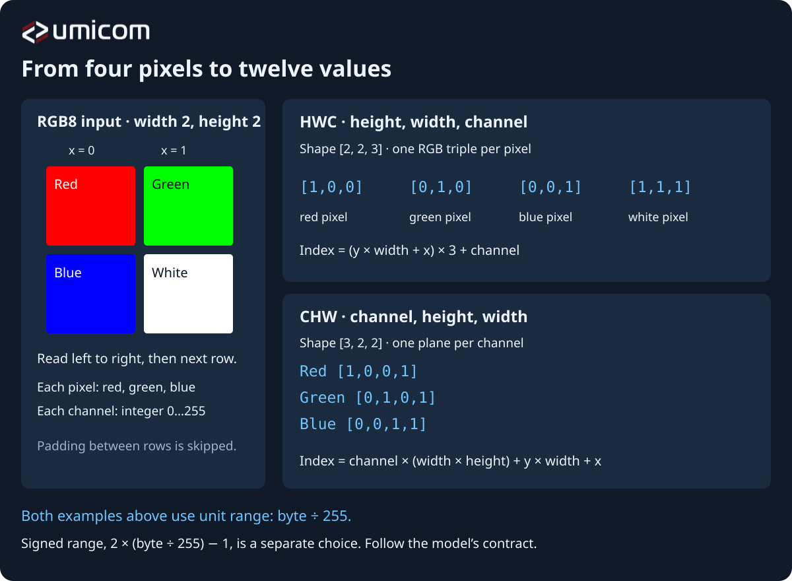

<!--
Umicom Bits2Banking
File: content/lessons/05-ai/generative-ai-foundations/20-read-pixels-as-an-explicit-tensor.md

PURPOSE:
Read pixels as an explicit tensor

AUTHOR AND ORGANISATION:
Sammy Hegab
Umicom Foundation

LICENCE:
MIT
-->

# Read pixels as an explicit tensor

[Course contents](index.md)

## Start with a picture small enough to count

A digital image is a grid of samples called pixels. Width counts columns; height counts rows. Our image has width two and height two, so it contains four pixels. The top row is red then green. The bottom row is blue then white. A coordinate names a position: x increases from left to right and y increases from top to bottom. C arrays begin at zero, so the first pixel is (0,0) and the bottom-right pixel is (1,1). We construct this image ourselves. You do not need a camera, a downloaded model or a collection of photographs.

1. Draw a square divided into four smaller squares. Label the top squares red and green; label the bottom squares blue and white.
2. Write x=0 and x=1 above the columns, and y=0 and y=1 beside the rows.
3. Open labs/framework/image-tensor/main.c. The rgb array stores the same four pixels as numbers.

## Represent one pixel using three channel values

A channel is one component of a sample. RGB uses a red, green and blue component. RGB8 stores each component as an unsigned eight-bit number. A bit has two possible values, zero and one. Eight bits give 256 combinations, so an unsigned byte can represent the whole numbers zero through 255. In C, uint8_t names an unsigned integer type with exactly eight bits when that type is available. The three bytes (255,0,0) represent full red with no green or blue. White uses (255,255,255). These numbers are encoded color values; interpreting their physical brightness requires a color-space contract.

| Position | Visible color | Red byte | Green byte | Blue byte |
| --- | --- | --- | --- | --- |
| (0,0) | Red | 255 | 0 | 0 |
| (1,0) | Green | 0 | 255 | 0 |
| (0,1) | Blue | 0 | 0 | 255 |
| (1,1) | White | 255 | 255 | 255 |

## Separate decoded pixels from an image file

A PNG or JPEG file contains an encoded representation, metadata and possibly compressed data. Its file bytes are not directly an array of RGB samples. A decoder interprets that representation and produces pixels. This lesson begins after decoding: the input is already RGB8. Passing a PNG file directly to this function would give incorrect input, even if a byte-count check happened to succeed. Similarly, BGR stores blue first, RGBA adds a fourth alpha channel, and grayscale stores fewer components. A filename extension does not establish the decoded layout. Check the decoder’s actual output contract before adapting it.

1. Locate the three channel values for each pixel in the embedded array.
2. Notice that there is no file-open or decoder call in main.c.
3. Keep alpha handling explicit. Alpha commonly describes transparency or coverage; simply dropping it can produce unexpected colors, especially for premultiplied representations.

## Understand a row stride before counting bytes

A row stride is the distance in bytes from the start of one row to the start of the next. Two RGB8 pixels need six useful bytes per row. Our example deliberately uses a stride of eight. Bytes 99 and 88 are padding between rows and are not pixels. The second row starts at byte offset eight. An offset is a distance from the beginning of the array. Its six useful bytes occupy offsets eight through thirteen. The array therefore needs fourteen bytes; it does not need two extra padding bytes after the final row. Some graphics interfaces require row alignment, which is one reason stride may exceed the useful row length.

~~~text
row 0: 255 0 0 | 0 255 0 | 99 88
row 1:   0 0 255 | 255 255 255
useful row bytes = width * 3 = 6
last required byte span = (height - 1) * stride + width * 3
                       = (2 - 1) * 8 + 6 = 14
~~~

## A tensor adds a shape to a list of numbers

For this exercise, a tensor is a numerical array interpreted with named dimensions. The same twelve channel values can be arranged in more than one memory order. Shape describes the dimension lengths; layout describes their order. HWC means height, width, channel. With shape [2,2,3], each pixel’s red, green and blue values are next to one another. CHW means channel, height, width. With shape [3,2,2], all four red values form one plane, followed by the green plane and then the blue plane. Both contain twelve values. A pointer and a count of twelve do not distinguish them.

| Layout | Conceptual dimensions | First four unit-range values |
| --- | --- | --- |
| HWC | [height=2, width=2, channels=3] | 1, 0, 0, 0 |
| CHW | [channels=3, height=2, width=2] | 1, 0, 0, 1 |

## Trace the index for one selected channel

An index selects one element of an array. For HWC, the index is (y*width+x)*3+channel. For CHW, it is channel*(width*height)+y*width+x. Channel zero is red, one is green and two is blue. Consider the blue component of the bottom-left pixel: y=1, x=0 and channel=2. HWC places it at index eight; CHW places it at index ten. Both positions must contain the same color component after the selected range conversion. Write out the arithmetic before relying on a larger tensor library.

~~~text
HWC: (1*2+0)*3+2 = 8
CHW: 2*(2*2)+1*2+0 = 10
~~~

## Choose a numerical range independently of layout

A float is a floating-point type used for approximate real-number arithmetic. A model often expects floating-point values instead of integer bytes, but its documented preprocessing decides the range. Unit range uses byte/255 and maps zero to 0 and 255 to 1. Signed unit range uses 2*(byte/255)-1 and maps zero to -1 and 255 to 1. These are independent of HWC versus CHW: either range can be paired with either layout. There is no automatic choice based on a model’s name.

| Byte value | Unit range | Signed unit range |
| --- | --- | --- |
| 0 | 0 | -1 |
| 127 | Approximately 0.498039 | Approximately -0.003922 |
| 128 | Approximately 0.501961 | Approximately 0.003922 |
| 255 | 1 | 1 |

## Do not confuse rescaling with color management

Dividing by 255 rescales stored code values. It does not linearize an sRGB transfer function, convert between color spaces, subtract per-channel means, divide by channel standard deviations, or encode a latent representation. A latent is a learned intermediate representation produced by a model such as an image encoder. Pretrained models can depend on any of these additional conventions. Incorrect preprocessing can reduce quality without causing a C compiler error. Save the preprocessing contract with your dataset and model configuration: channel meaning/order, color space, size, layout, range, normalization and any encoder scaling. The helper cannot infer those facts from twelve numbers.

## Read the Framework call from left to right

UmiAiTrainingImagePackRgb8 receives the input pointer and byte count, width and height, row stride in bytes, chosen layout, chosen range, output pointer and output capacity in floats. A pointer identifies storage owned by the caller. Borrowing means the function reads or writes that storage during the call and retains no pointer afterward. The input and output must be separate, valid arrays that remain stable throughout the call. Another thread must not modify them while this operation uses them. C cannot infer the actual size of an allocation from its pointer, so truthful lengths remain the caller’s responsibility.

~~~c
float values[12];
UmiStatus status = UmiAiTrainingImagePackRgb8(
    rgb, sizeof rgb, 2U, 2U, 8U,
    UMI_AI_TRAINING_IMAGE_CHW,
    UMI_AI_TRAINING_IMAGE_SIGNED_UNIT,
    values, 12U);
if (status != UMI_STATUS_OK) {
    return 1;
}
~~~

## Check dimensions before multiplying them

Integer overflow occurs when a mathematical result does not fit the chosen integer type. A malicious or damaged image header can claim enormous dimensions while its actual buffer is tiny. The helper checks width against the maximum divided by three, then height against the remaining element limit divided by the useful row length. Only afterward does it multiply. It separately checks whether the last readable byte offset fits size_t, the type used for object sizes. The current helper allows at most 16,384 float values; because RGB uses groups of three, the largest complete RGB count is 16,383. This intentionally small contract supports bounded native examples, not arbitrary full-resolution training images.

1. Keep the element limit separate from byte capacity. Twelve float elements are not twelve bytes; use sizeof when measuring C storage.
2. Do not silently crop or split a larger image just to pass this bound. Tiling or resizing changes model input and needs its own documented policy.
3. Check the UmiStatus return before using new output. A refused operation leaves every output byte unchanged, including unused capacity.

## Follow the complete laboratory in PowerShell

PowerShell is the command shell in which you type these commands. CMake reads the project’s build description. Ninja performs the compiler steps. CTest executes the registered exercise and reports whether its checks succeeded. Use an existing matching Framework checkout; the small laboratory compiles the actual shared converter and includes the approved Umicom icon through Framework’s branding helper. It does not need a GPU or model file. Replace the checkout paths below if your folders differ and run one command at a time.

~~~powershell
$env:Path = "C:\msys64\ucrt64\bin;$env:Path"
cmake -S labs/framework/image-tensor -B build/learning-image-tensor -G Ninja -DCMAKE_C_COMPILER=C:/msys64/ucrt64/bin/gcc.exe -DUMICOM_FRAMEWORK_SOURCE=C:/umicom/Umicom-Applications/framework
cmake --build build/learning-image-tensor
ctest --test-dir build/learning-image-tensor --output-on-failure
& ".\build\learning-image-tensor\umicom-image-tensor.exe"
~~~

## Compare the expected output with your drawing

The first line lists unit-range values pixel by pixel. The second lists signed-range values plane by plane. Each plane contains the four pixels in top-left, top-right, bottom-left, bottom-right order. The program checks those exact arrays before printing them. It then deliberately declares an input one byte too short and confirms that the previous tensor remains unchanged. This is a refusal exercise, not a failed training run.

~~~text
HWC unit: 1 0 0 0 1 0 0 0 1 1 1 1
CHW signed: 1 -1 -1 1 -1 1 -1 1 -1 -1 1 1
Short input refused; previous tensor unchanged.
No image decoder, model or training operation was run.
~~~

## Recover from the first error instead of running stale code

If configuration says image_tensor.h or image_tensor.c is missing, select a complete matching Framework checkout. Do not create an empty header to suppress the message. If compilation fails, fix the first compiler error and rebuild before running anything. An older executable can remain after a failed build. If the executable returns an error, compare the shape, stride, ranges and expected arrays rather than changing the check simply to make it pass. In an installed SDK consumer, include the public header and link Umicom::ai; a missing library symbol means the selected binary package needs updating and qualification as well as its headers.

## Connect this step to image and video training

An image-training pipeline may decode an approved file, apply a documented crop/resize and color policy, convert pixels to the model’s layout/range, and then form a training batch. A batch introduces another dimension for several examples. A video adds a time dimension for ordered frames; some models expect NCTHW while others expect another order. This helper handles one RGB image only and adds neither batch nor time dimensions. It also does not create noise, captions, loss functions, gradients or optimized weights. Reuse the earlier denoising lessons only after establishing that their scalar arrays represent the same model-specific shape and scale.

## Practice by changing one convention at a time

The point of the exercise is to make hidden assumptions visible. Several layouts or ranges can be valid, but a producer and consumer must agree. Record each experiment’s input shape, byte layout and expected values before editing the code.

1. Change the two padding bytes to zero. Explain why the resulting tensors should not change.
2. Keep CHW but choose unit range. Write the three expected channel planes on paper before updating the checks.
3. Change the bottom-right pixel from white to black. Identify its three affected positions in both HWC and CHW.
4. Use byte 128 for all three channels of one pixel. Predict values close to 0.501961 or 0.003922 rather than exactly 0.5 or zero.
5. Explain why copying a PNG file into the rgb array does not replace an image decoder.
6. Describe why a passing conversion test is not evidence that an image or video generation model has been trained.

[Previous: Own the noise in a stochastic denoising step](19-own-the-noise-in-a-stochastic-denoising-step.md)

[Next: Prepare a video sample with explicit frame order](21-prepare-a-video-sample-with-explicit-frame-order.md)
