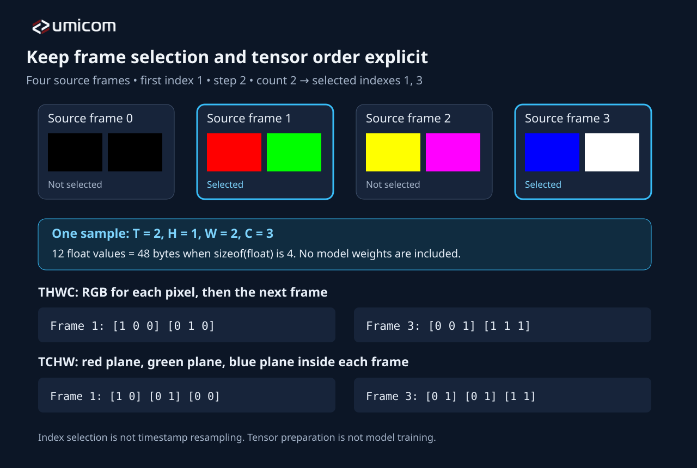

<!--
Umicom Bits2Banking
File: content/lessons/05-ai/generative-ai-foundations/21-prepare-a-video-sample-with-explicit-frame-order.md

PURPOSE:
Prepare a video sample with explicit frame order

AUTHOR AND ORGANISATION:
Sammy Hegab
Umicom Foundation

LICENCE:
MIT
-->

# Prepare a video sample with explicit frame order

[Course contents](index.md)

## A video contains both pictures and time

An image describes one moment. A video presents a sequence of images, called frames, with timing information. A video model must learn relationships within each image and across moments. Merely collecting unrelated pictures does not automatically provide those temporal relationships. In this lesson you will prepare a tiny ordered sequence in native C, inspect its memory layout, and separate this preparation work from actually training a model. No downloaded model or video codec is needed.

## Know what has already been decoded

A stored MP4 file normally contains compressed data in a container. A container organizes streams and metadata. A codec defines how a stream is compressed and decoded. Decoding reconstructs pixel data that other operations can read. Our exercise begins after that step with four arrays of RGB8 bytes. RGB8 means one unsigned eight-bit value for red, green and blue per pixel. Each frame here has two pixels in one row. These arrays are original teaching data, not real footage.

1. Open labs/framework/video-tensor/main.c in the Bits2Banking checkout.
2. Find pixels[4][6]. The first number is the number of frames. Six bytes hold two RGB pixels.
3. Read frame 1 as red followed by green. Read frame 3 as blue followed by white.
4. Notice that frames 0 and 2 remain in the source but are not selected for this sample.

## Make the selection rule explicit

Indexes count from zero: the first frame has index 0, the second index 1, and so on. Our source contains four frames. The requested first index is 1, the step is 2, and the count is 2. The selected indexes are therefore 1 and 3. A positive step advances through the known source order. The service refuses a request extending beyond the source instead of repeating the last frame or silently shortening the sample.

~~~c
size_t indices[2];
UmiStatus status = UmiAiTrainingVideoSelectFrames(
    4,  /* source frame count */
    1,  /* first source index */
    2,  /* index step */
    2,  /* requested output count */
    indices, 2);
if (status != UMI_STATUS_OK) {
    return 1;
}
~~~

## Do not mistake an index step for a frame rate

A frame rate describes frames per second. A timestamp identifies when a frame should be presented. If a source is constant-rate video at 30 frames per second, selecting every third frame normally gives sample moments separated by 0.1 seconds. Variable-rate video may have unequal gaps between consecutive frames. An index step alone cannot promise a constant time interval. The selection function knows only indexes; it does not inspect timestamps or resample video. A real decoder adapter must preserve timing and apply the model’s documented sampling policy.

## Count the dimensions before the bytes

T is time, the number of frames in one sample. H is frame height, W is width, and C is the number of channels. Here T=2, H=1, W=2 and C=3, so the sample contains 2×1×2×3=12 scalar values. A scalar is one number. A tensor is a group of numbers with an explicit shape and indexing rule. Shape gives meaning to the flat storage; the numbers alone do not say which frame or channel they belong to.

| Symbol | Meaning in this sample | Value |
| --- | --- | --- |
| T | Selected frames | 2 |
| H | Rows per frame | 1 |
| W | Pixels per row | 2 |
| C | RGB channels per pixel | 3 |
| T×H×W×C | Total float values | 12 |

## Plan storage without reading pixels

UmiAiTrainingImageDescribeRgb8 checks dimensions and row stride before publishing the required byte span and float count for one frame. A row stride is the number of bytes between the start of consecutive rows. Decoders sometimes insert padding between rows. The required span includes those gaps but does not require unused padding after the final row. The description is a plan, not an allocation and not proof that a pointer actually owns that much storage.

~~~c
UmiAiTrainingImageSpan span;
if (UmiAiTrainingImageDescribeRgb8(2, 1, 6, &span) != UMI_STATUS_OK) {
    return 1;
}
/* span.required_bytes is 6; span.value_count is 6. */
float values[12];
size_t allocatedBytes = sizeof values;
~~~

## Keep bytes and elements separate

The decoded two-frame RGB sample uses twelve useful byte values. Converting it to twelve floats uses twelve times sizeof(float) bytes. With four-byte floats that is forty-eight bytes, even before model weights, gradients, decoder buffers or other workspaces. This small example illustrates why moving code from Python to C does not make model tensors disappear. Native code can avoid unnecessary copies and control lifetimes, but the numeric representation and dimensions still determine real storage costs.

## Choose an axis order deliberately

THWC keeps each frame’s pixels in RGB order. TCHW keeps each frame consecutive but groups that frame’s red plane, green plane and blue plane. In our one-row frame, a plane contains two values. CTHW would instead place the time dimension inside the channel dimension; that is a different layout and this helper does not produce it. A model requesting CTHW cannot receive TCHW merely because both contain the same number of floats.

| Layout | First six values for red then green | Meaning |
| --- | --- | --- |
| THWC | 1 0 0 0 1 0 | First pixel RGB, second pixel RGB |
| TCHW | 1 0 0 1 0 0 | Two red values, two green values, two blue values |
| CTHW | Not produced by this adapter | Channels would contain multiple time steps |

## Describe borrowed frames

A descriptor is a small structure describing another object. UmiAiTrainingVideoFrame contains the pixel pointer, its declared readable byte count, and its row stride. It does not copy or own the pixels. The selected array below holds two descriptors referencing the original pixel arrays. Keep those arrays alive and unchanged until packing returns. Read-only descriptors may share pixel storage, but output must not overlap any descriptor or input pixel span.

~~~c
UmiAiTrainingVideoFrame selected[2];
for (size_t i = 0; i < 2; ++i) {
    selected[i] = (UmiAiTrainingVideoFrame){
        pixels[indices[i]], 6, 6
    };
}
status = UmiAiTrainingVideoPackRgb8(selected, 2, 2, 1,
    UMI_AI_TRAINING_IMAGE_HWC, UMI_AI_TRAINING_IMAGE_UNIT,
    values, 12);
~~~

## Reuse the image conversion contract

The video service delegates each frame to Framework’s existing RGB image packer. The UNIT range divides code values by 255, giving values between zero and one. SIGNED_UNIT rescales them between minus one and one. Neither option performs sRGB linearization, statistical standardization or latent encoding. A latent encoder is a learned model that maps pixels into another representation. Follow the actual model’s preprocessing specification; do not choose a range because it looks convenient.

## Validate the last frame before writing the first

A naive loop could convert frame one, then discover that frame two is too short. The caller would be left with a half-new, half-old tensor. This service uses a metadata admission pass first. It checks every frame’s pointer, dimensions, row stride and declared span, then checks the full output budget. Only after all checks succeed does it convert pixels. Every possible byte value is a valid RGB channel, so no later pixel-value validation is required. Stable borrowed inputs are part of the contract; concurrent mutation violates that contract.

## Build and run the original laboratory

The following commands compile the production Framework image and video sources into a small learning program. They reuse the Framework branding helper. They do not build the entire Media application or qualify an installed SDK. Run each command separately and stop on errors. Change the two checkout paths if your folders are different.

~~~powershell
Set-Location "C:\umicom\Umicom-Bits2Banking"
$env:Path = "C:\msys64\ucrt64\bin;$env:Path"
cmake -S labs/framework/video-tensor -B build/learning-video-tensor -G Ninja -DCMAKE_C_COMPILER=C:/msys64/ucrt64/bin/gcc.exe -DUMICOM_FRAMEWORK_SOURCE=C:/umicom/Umicom-Applications/framework
cmake --build build/learning-video-tensor
ctest --test-dir build/learning-video-tensor --output-on-failure
& ".\build\learning-video-tensor\umicom-video-tensor.exe"
~~~

## Compare the printed arrays

On a target with four-byte float, the storage line reports forty-eight bytes. THWC and TCHW contain the same color values in different orders. The final exercise deliberately shortens the second frame’s declared span by one byte. The program verifies that packing refuses the request and leaves the previous tensor intact. It does not access that missing byte.

~~~text
Selected source frames: 1 3
Float storage: 48 bytes (12 values)
THWC: 1 0 0 0 1 0 0 0 1 1 1 1
TCHW: 1 0 0 1 0 0 0 1 0 1 1 1
Short final frame refused; previous tensor unchanged.
No decoder, frame-rate conversion, model or training was run.
~~~

## Understand the intentionally small bounds

Frame selection and packing allow at most sixty-four frames. Each frame obeys the image service’s 16384-value bound, and a complete packed sample is limited to 65536 floats. A whole RGB image always contains a multiple of three values, so not every numeric capacity can be filled exactly. These bounds make the teaching operation predictable. They do not make this a full-resolution video training pipeline. Larger production workloads need an explicit resource plan, suitable model shapes, cancellation and qualified device kernels.

## Place the sample in a training workflow

Preparation creates model inputs, not learned weights. A video training pipeline also needs a model architecture, a training objective, an optimizer, checkpoints and held-out evaluation. An objective defines what error the model should reduce. An optimizer updates weights using calculated gradients. Text-to-video training may associate a caption with an ordered clip; a denoising model may learn to predict noise or another parameterization from a corrupted sample and a time-step condition. The exact targets and schedule come from the model design. A vector database is not a substitute for these numeric training tensors.

## Split footage before extracting nearby frames

Adjacent frames from the same clip often look almost identical. Randomly sending neighboring frames to both training and validation can make validation results look better than performance on new footage. Decide the split at an appropriate source level, such as original clip, recording session or subject, before extracting samples. Keep a record linking each sample to its source and selection rule. A repeated frame is not an independent new example simply because it has a different exported filename.

## Try three controlled changes

1. Change selection from first 1, step 2, count 2 to first 0, step 1, count 2. Predict the selected colors before adapting the expected arrays.
2. Request three frames starting at 1 with step 2 from the four-frame source. Explain why index 5 is outside the source and verify refusal.
3. Restore the original source, change the range to SIGNED_UNIT, and calculate how zero and 255 become minus one and one. Update expected values deliberately.
4. Write a sample record containing source identity, selected indexes, known timestamps, dimensions, layout and range. Mark timestamps unknown when you do not have them instead of inventing a frame rate.

## Recover without hiding a mismatch

If a required header is missing, integrate the matching Framework source set rather than adding an empty file. If compilation fails, do not launch a retained older executable. A capacity error means the declared shape, source span or destination cannot satisfy this contract; increasing one unrelated buffer is not a general fix. If a real model expects another layout, add and qualify an explicit adapter instead of relabeling the same bytes. Successful preparation is evidence about input handling, not proof of model quality or generated-video capability.

[Previous: Read pixels as an explicit tensor](20-read-pixels-as-an-explicit-tensor.md)

[Next: Borrow an image crop with explicit lifetime](22-borrow-an-image-crop-with-explicit-lifetime.md)
