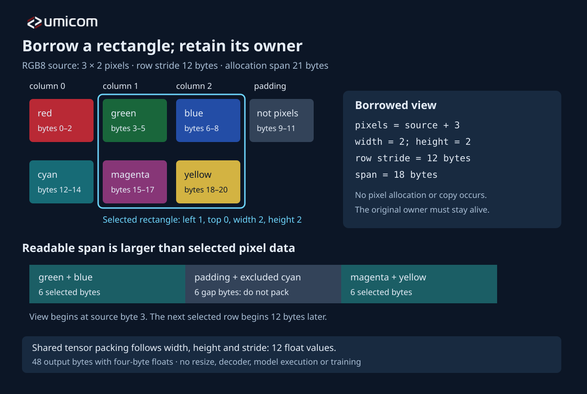

<!--
Umicom Bits2Banking
File: content/lessons/05-ai/generative-ai-foundations/22-borrow-an-image-crop-with-explicit-lifetime.md

PURPOSE:
Borrow an image crop with explicit lifetime

AUTHOR AND ORGANISATION:
Sammy Hegab
Umicom Foundation

LICENCE:
MIT
-->

# Borrow an image crop with explicit lifetime

[Course contents](index.md)

## Why a training pipeline needs careful image preparation

A model expects numerical inputs with a particular shape, channel order and range. A source image may have a different shape or contain a region you do not want to use. Cropping selects a rectangle; resizing changes the sampling grid. They are different operations. In this lesson you will select a small rectangle without allocating a second pixel image, then feed it to Framework’s existing tensor packer. The exercise prepares data. It does not decode a file, run a generative model or train weights.

## Review the storage vocabulary

RGB stores red, green and blue channel values for each pixel. RGB8 gives each channel one unsigned byte from zero through 255. Width counts pixels across a row. Height counts rows. Row stride is the byte distance between the starts of consecutive rows. Stride can be larger than width times three because a buffer may include padding or share storage with a larger image. A pointer identifies a starting location; it does not say how many bytes are valid there.

## Draw the original source

The laboratory source has three pixels in each of two rows. Row zero contains red, green and blue. Row one contains cyan, magenta and yellow. Row zero also has three padding bytes. The final row needs no padding because no later row follows it. The complete readable source span is therefore 12 + 9 = 21 bytes. These colors are original synthetic data chosen so that every expected channel can be checked manually.

| Row | Column 0 | Column 1 | Column 2 | Extra bytes |
| --- | --- | --- | --- | --- |
| 0 | red at 0–2 | green at 3–5 | blue at 6–8 | padding at 9–11 |
| 1 | cyan at 12–14 | magenta at 15–17 | yellow at 18–20 | none required |

## Select a rectangle with counts

Choose left=1 and top=0, then width=2 and height=2. left and top are zero-based pixel coordinates. Width and height are positive counts, not inclusive ending coordinates. The result includes green and blue in its first row, then magenta and yellow. It excludes red and cyan. Asking for left=3 is outside this three-column image, even if the requested rectangle has width one.

## Create a descriptor instead of another image

UmiAiTrainingRgb8View is a small descriptor containing a pixel pointer, readable byte span, width, height and row stride. A descriptor describes storage; it does not own it. UmiAiTrainingImageCropRgb8 validates the whole source and rectangle, then publishes a new descriptor. In this exercise its pointer is source.pixels + 3, its dimensions are two by two, and its stride remains 12. No pixels move.

~~~c
const UmiAiTrainingRgb8View source = {
    pixels, sizeof pixels, 3U, 2U, 12U
};
UmiAiTrainingRgb8View crop = {0};
UmiStatus status = UmiAiTrainingImageCropRgb8(
    &source, 1U, 0U, 2U, 2U, &crop);
~~~

## Read the ownership diagram

The outline marks the selected rectangle while the descriptor still refers to the original allocation. The lower strip expands the contiguous readable span starting at source byte three. It includes a gap between selected rows. The packer skips that gap using the original stride. A view is useful because it preserves this relationship explicitly; pretending the crop is tightly packed would read the wrong colors.

## Distinguish selected data from readable span

Four selected pixels contain 4×3 = 12 channel bytes. The crop’s readable span is (height−1)×stride + width×3 = 12 + 6 = 18 bytes. Between its first six selected bytes and its final six selected bytes lie six gap bytes: the original row padding and the excluded cyan pixel. The larger span is needed to reach the second selected row. It is not permission to treat every byte in that span as a selected pixel.

| Quantity | This crop | Use |
| --- | --- | --- |
| Visible RGB bytes | 12 | Number of selected channel values |
| Readable span | 18 | Bound through the last selected row |
| Row stride | 12 | Move from one selected row start to the next |
| Tensor values | 12 floats | Model-facing output element count |
| Tensor payload | 48 bytes with four-byte float | Actual output storage in this build |

## Keep the owner alive

The source array in main remains alive until the function returns. Both crop selection and packing happen synchronously before that return. Copying the descriptor only copies the pointer and metadata; it does not duplicate or retain the allocation. Returning a view of a local stack array would leave a dangling pointer after the function ends. A background job needs an explicit owner that remains alive for the entire job, or a deliberate copy into job-owned storage. Zero-copy is a choice about ownership, not a free lifetime extension.

## Use the shared admission rules

The crop service calls the same ImageDescribeRgb8 shape validator as the tensor converter. It validates the complete source even if the requested rectangle is tiny. A source with a missing final row must be refused rather than made to look valid through a smaller view. The bounded training image profile accepts at most 16,384 channel values. That is a small reference contract, not a claim that arbitrary full-resolution photographs are supported by this service.

## Avoid overflowing coordinate arithmetic

A naive test might calculate left + width and compare it with source width. That addition could wrap for a very large hostile value. The service first checks that left is inside the source, then compares width with source.width - left. It does the equivalent check for top and height. The shared span validator checks multiplication and addition bounds before a pointer offset is formed. This illustrates why validating metadata belongs before memory access.

## Pack only the selected pixels

Pass the view’s pointer, span, dimensions and stride to UmiAiTrainingImagePackRgb8. HWC means height, width, channel: visit each selected pixel’s red, green and blue values before moving to the next pixel. Unit range divides byte values by 255. Our synthetic colors use only zero and 255, so the packed floats are exactly zero or one. The output still needs its own storage; the optimization removes an intermediate RGB copy, not the final tensor.

~~~c
float tensor[12];
status = UmiAiTrainingImagePackRgb8(
    crop.pixels, crop.bytes, crop.width, crop.height,
    crop.row_stride_bytes, UMI_AI_TRAINING_IMAGE_HWC,
    UMI_AI_TRAINING_IMAGE_UNIT, tensor, 12U);
~~~

## Predict every output value

Green becomes 0,1,0. Blue becomes 0,0,1. Magenta becomes 1,0,1. Yellow becomes 1,1,0. Joining those triples in row order gives the expected tensor below. A wrong stride would read padding or cyan instead. A wrong layout would rearrange values into channel planes. A correct memory span alone therefore does not establish that a model receives the layout it expects.

~~~text
0 1 0   0 0 1   1 0 1   1 1 0
~~~

## Build the focused learning consumer

Open PowerShell in Bits2Banking. Point UMICOM_FRAMEWORK_SOURCE at the matching Framework checkout. This small CMake project compiles the production crop and tensor sources directly and applies the approved Umicom icon. It does not build or launch the entire Media application. Run each command separately and stop on errors. A source-based learning consumer is not evidence that an independently installed SDK package has been qualified.

~~~powershell
Set-Location "C:\umicom\Umicom-Bits2Banking"
$env:Path = "C:\msys64\ucrt64\bin;$env:Path"
cmake -S labs/framework/borrowed-image-crop -B build/borrowed-image-crop -G Ninja -DCMAKE_BUILD_TYPE=Debug -DUMICOM_FRAMEWORK_SOURCE=C:/umicom/Umicom-Applications/framework
cmake --build build/borrowed-image-crop --parallel 2
ctest --test-dir build/borrowed-image-crop --output-on-failure
.\build\borrowed-image-crop\umicom-borrowed-image-crop.exe
~~~

## Check status and retained output together

The program checks pointer identity, span, stride and all twelve float values. It then requests an outside rectangle and expects INVALID_ARGUMENT. The existing crop descriptor must remain unchanged after that refusal. This is a small publication contract: failed admission does not replace a previously valid view. The caller still checks the returned status before using a newly requested result. The service allows narrowing the same descriptor in place only because all checks finish before the final assignment.

## Understand what cropping cannot promise

A borrowed view does not erase excluded pixels from the underlying allocation. Saving its whole readable span could expose gap data that is outside the crop. Use a proper encoder or packer that walks only selected pixels when creating an exported artifact. Cropping also does not automatically update a caption, bounding box, segmentation mask or consent record. A caption saying there is a red object may become false after the red region is removed. Training quality depends on keeping data and labels consistent, not merely on making dimensions fit.

## Place augmentation after the split decision

Augmentation creates changed training examples, such as selected crops or flips. If variants of the same original image appear in both training and evaluation sets, evaluation can become misleading because the model has already seen closely related content. Establish source-level grouping and split membership before generating variants. Keep the original identifier and recorded crop coordinates with each variant. This service selects explicit coordinates and uses no random generator; random augmentation policy and reproducible seed handling belong in a separate reviewed pipeline.

## Relate the exercise to image and video generation

A generative training system may next normalize colors, encode images into a latent representation, select timesteps, add noise, run a model and compute a loss. None of those stages is created by a crop view. For video, independent frame crops can make content jump over time, so temporal consistency needs its own policy. The preceding video lesson handles explicit frame order; this lesson handles one frame’s borrowed spatial region. Keeping those stages separate makes both memory use and data transformations easier to inspect.

## Practice safely with the synthetic source

1. Select only the yellow pixel using left=2, top=1, width=1, height=1. Predict pointer offset 18 and readable span three.
2. Select the full source and explain why its descriptor still has a 12-byte stride and 21-byte readable span.
3. Request a crop extending beyond the right edge. Verify refusal and retention of the old descriptor.
4. Create a crop of an existing crop and compare its pointer and dimensions with a directly selected equivalent rectangle.
5. Explain why a copied view cannot outlive the source array and why serializing crop.bytes bytes is not the same as exporting the selected image.

[Previous: Prepare a video sample with explicit frame order](21-prepare-a-video-sample-with-explicit-frame-order.md)

[Next: Transform pixels without changing their labels by accident](23-transform-pixels-without-changing-their-labels-by-accident.md)
