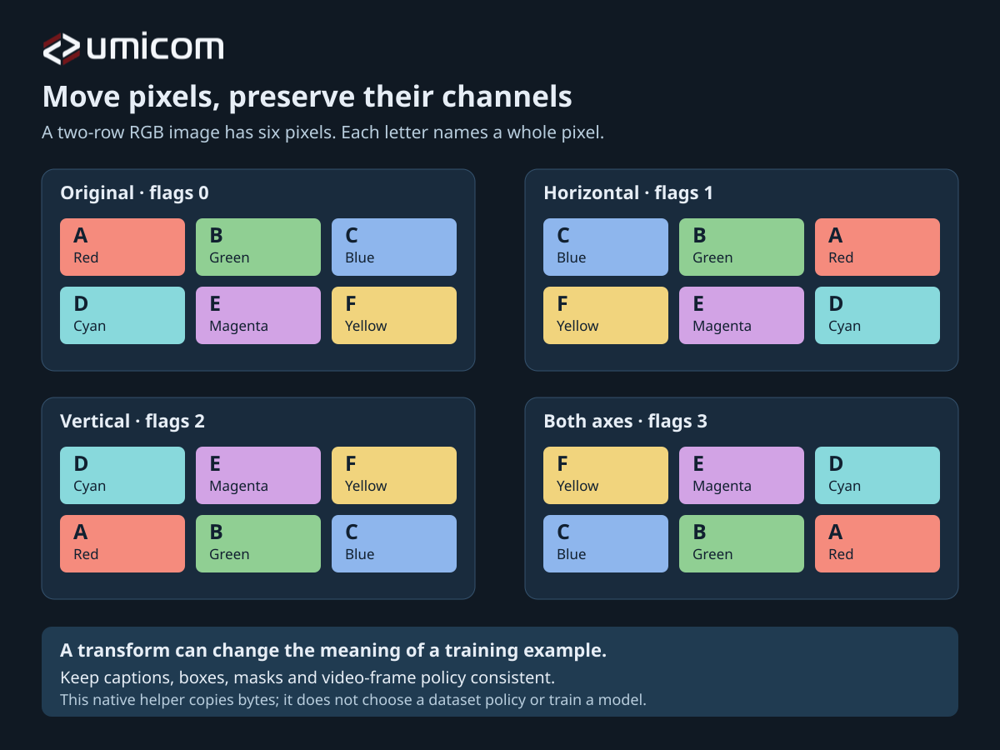

<!--
Umicom Bits2Banking
File: content/lessons/05-ai/generative-ai-foundations/23-transform-pixels-without-changing-their-labels-by-accident.md

PURPOSE:
Transform pixels without changing their labels by accident

AUTHOR AND ORGANISATION:
Sammy Hegab
Umicom Foundation

LICENCE:
MIT
-->

# Transform pixels without changing their labels by accident

[Course contents](index.md)

## What this lesson builds

You will use three native Framework functions to crop an already decoded image, mirror its pixels horizontally and turn the result into a float tensor. You will also decide when that transform would be wrong for a training example. The code is small enough to trace by hand: six original colored pixels, four selected pixels and twelve output numbers. Nothing downloads a model, decodes a photo or trains a generator. This is a real data-preparation component that can sit before a separately specified training loop.

## Start with the vocabulary

| Term | Meaning |
| --- | --- |
| Pixel | One position in an image. Here each pixel has red, green and blue byte values. |
| RGB8 | Three channels per pixel, each stored as an unsigned eight-bit integer from 0 to 255. |
| Transform | A rule that changes data, such as moving whole pixels to mirrored positions. |
| Augmentation | A deliberate training policy that derives altered examples from existing ones. |
| Label or caption | Information describing the example, such as a class, a region mask or a sentence. |
| Packed row | A row whose stored bytes are exactly its visible pixels, with no padding between rows. |
| Tensor | An ordered array of numbers with a declared shape and layout; it is not automatically a model. |

## Read the orientation picture

The picture uses letters so you can follow positions even if colors are hard to distinguish. A is one entire RGB pixel, not its red channel. Horizontal means reverse the pixel order within every row. Vertical means reverse the row order. Combining the flags does both. Each pixel retains its own three-channel order.

## Why useful training transforms are not automatic

A model trained only on one narrow arrangement may fail when a valid real example looks different. Some augmentations can broaden that experience. But a transform is helpful only when its new example still matches the learning task. Mirroring a face might be reasonable for one task, but mirroring a road sign reverses text. Flipping a medical image can change laterality. A native function can move bytes correctly and still produce a scientifically wrong training example.

## Predict the meaning before running code

| Example | Potential problem | A decision to record |
| --- | --- | --- |
| Caption says “a red cup on the left” | Horizontal flip moves the cup to the right. | Rewrite and review the caption or prohibit the flip. |
| Image contains readable text | Mirrored letters are different visual evidence. | Use a task-specific policy; do not assume text is unchanged. |
| Image has a segmentation mask | Transforming only the image misaligns every marked region. | Apply the identical spatial operation to both. |
| A clip has several frames | Independent flips can create abrupt impossible motion. | Choose one policy for the clip or an explicitly reviewed temporal policy. |
| Training and evaluation share one source photo | A flipped copy is still related to the original. | Keep all derivatives in the same source group when splitting. |

## Prepare a safe learning workspace

1. Read the earlier lessons on RGB packing and borrowed crops. Review row stride and channel order if either is unfamiliar.
2. Open PowerShell in your Bits2Banking checkout. Navigate to labs/framework/image-orientation.
3. Confirm that main.c, CMakeLists.txt and README.md are present. These are the complete original example files.
4. Locate a matching Framework checkout containing image_flip.h, image_flip.c, image_view.c and image_tensor.c. The focused laboratory uses that source directly.
5. Use synthetic pixels first. Do not begin by rewriting a large personal image collection.
6. Keep generated files in the lab build directory and run commands one at a time. Stop at the first failure.

## Follow the original bytes

The first row contains red, green and blue, followed by three padding bytes. The second row contains cyan, magenta and yellow and needs no final padding. Width is three pixels; height is two rows; stride is twelve bytes from one row start to the next. sizeof pixels is twenty-one bytes. The descriptor borrows this array and does not extend its lifetime.

~~~c
const uint8_t pixels[] = {
    255,0,0,  0,255,0,  0,0,255,  19,20,21,
    0,255,255,  255,0,255,  255,255,0
};
const UmiAiTrainingRgb8View source = {
    pixels, sizeof pixels, 3U, 2U, 12U
};
~~~

## Select a two-by-two crop

The left coordinate 1 skips the red/cyan column. Top 0 keeps the first row. The selected visible colors are green, blue / magenta, yellow. The crop still has stride twelve: it did not repack the original image. Its readable span is eighteen bytes from its first selected byte through its last selected pixel, but only twelve of those bytes are visible RGB channels. Copying all eighteen bytes as a packed image would include gaps.

~~~c
UmiAiTrainingRgb8View crop = {0};
if (UmiAiTrainingImageCropRgb8(&source, 1U, 0U, 2U, 2U, &crop) != UMI_STATUS_OK)
    return 1;
~~~

## Materialize the horizontal transform

The result is blue, green / yellow, magenta. It owns an independent copy in the caller’s flipped array. Its packed stride is six bytes, not twelve. The function does not allocate an image, keep a pointer or guess a label policy. Passing flag zero creates a packed identity copy. Vertical uses the vertical flag; bitwise OR combines the two flags. Unknown bits are refused.

~~~c
uint8_t flipped[12];
if (UmiAiTrainingImageFlipRgb8(&crop, UMI_AI_TRAINING_FLIP_HORIZONTAL,
        flipped, sizeof flipped) != UMI_STATUS_OK)
    return 2;
~~~

## Do not reverse the channels

The horizontal loop selects a different source pixel but copies its red, green and blue channels in their original order. Reversing every byte in a row would change RGB into BGR as well as reversing pixels. That is a different operation and would change colors. The tests deliberately use pixels with unequal channel values so that this mistake cannot hide behind grayscale examples.

## Pack the transformed bytes for a model

HWC means height, width, channel: all three channels of the first pixel, then the next pixel. UNIT maps a byte to byte/255. The twelve expected values are 0 0 1, 0 1 0, 1 1 0, 1 0 1. A float is a numeric representation, not a byte. Twelve output float elements occupy sizeof tensor bytes, normally forty-eight in this toolchain. Use the real model’s layout and range instead of choosing them by habit.

~~~c
float tensor[12];
if (UmiAiTrainingImagePackRgb8(flipped, sizeof flipped, crop.width, crop.height,
        crop.width * 3U, UMI_AI_TRAINING_IMAGE_HWC, UMI_AI_TRAINING_IMAGE_UNIT,
        tensor, 12U) != UMI_STATUS_OK)
    return 3;
~~~

## Memory ownership without hidden allocations

| Object | Owner | What must stay valid |
| --- | --- | --- |
| pixels | The calling function in this lab | Until every borrowed view is finished. |
| source and crop descriptors | The calling function | Metadata and pixels remain stable during each operation. |
| flipped | The caller | A disjoint writable twelve-byte array. |
| tensor | The caller | A disjoint writable twelve-float array. |
| Framework operation | No retained allocation | Reads and writes only during the synchronous call. |

## Run the complete original program

These paths describe the example Windows setup; change the Framework path to your matching checkout. Configuration checks required source files before compiling. The shared branding helper supplies the Windows icon and metadata. This source-built laboratory does not qualify an installed SDK package or a graphical application.

~~~powershell
$env:Path = "C:/msys64/ucrt64/bin;$env:Path"
cmake -S . -B build -G Ninja -DCMAKE_C_COMPILER=C:/msys64/ucrt64/bin/gcc.exe -DUMICOM_FRAMEWORK_SOURCE=C:/umicom/Umicom-Applications/framework
cmake --build build --parallel 2
ctest --test-dir build --output-on-failure
.\build\umicom-image-orientation.exe
~~~

## Expected result and what it proves

The test also checks exact output arrays and exit zero. Applying the same horizontal flip twice restores the visible crop; this property is called an involution. It is a useful check, but not enough alone: two executions of the same wrong operation could cancel. Independent literal fixtures verify the intended first transform too.

~~~text
Borrowed crop: 2x2, stride 12, readable span 18 bytes
Packed flipped RGB: 12 bytes, stride 6
HWC: 0 0 1 0 1 0 1 1 0 1 0 1
Two horizontal flips restore the visible crop.
Unknown transform refused without changing output.
Synthetic pixels only: no decoder, caption rewrite, RNG, model or training.
~~~

## Understand refusal before adding larger data

All metadata and capacities are admitted before the first pixel read or output write. Positive dimensions, sufficient row stride, a complete source span and the shared maximum value count are required. Capacity is measured in bytes for Flip and floats for Pack. Every failure preserves the entire destination, including its unused tail. This does not make arbitrary pointers safe: the caller must supply genuine objects of the declared size and must not race another thread or overlap source and destination.

## Place augmentation in a training pipeline

1. Identify original source groups and reserve evaluation groups before creating derivatives.
2. Decode using a separately reviewed image decoder and establish orientation and color conventions.
3. Choose an explicit task-compatible crop and flip policy. Record it with the experiment configuration.
4. Apply the matching spatial policy to labels, masks or boxes; do not assume this RGB helper transforms those objects.
5. For video, choose consistent spatial transforms across related frames unless the task explicitly requires another rule.
6. Pack the transformed pixels into the model’s required tensor layout and numeric range.
7. Run a separately specified forward pass, loss, gradient calculation and optimizer update on training data.
8. Evaluate on the reserved groups under a recorded evaluation policy. A successful pixel transform is not a model-quality result.

## Exercises and recovery

1. Predict the vertical flip of the two-by-two crop: magenta, yellow / green, blue. Then change the lab deliberately and verify it.
2. Explain why both flags equal a 180-degree orientation change, not a 90-degree rotation.
3. Change byte capacity from twelve to eleven and confirm the operation refuses without partial output. Restore the complete program afterward.
4. If configuration reports missing files, integrate the matching header/source set. Never create empty replacement headers.
5. If colors are wrong, inspect channel order, row stride and tensor layout separately; these are different contracts.
6. Write a one-sentence caption for the original crop that becomes false after a horizontal flip. Decide whether to rewrite it or disallow the transform.
7. Describe why a flipped evaluation image derived from a training photo can still leak information even if the raw bytes differ.

## How Umicom applications can reuse this

The function is available in the shared AI SDK and native training target. A future Media or model-training client can choose policy, own buffers and call this one native implementation. The current work does not add a Media button, an image decoder or a full generator. Keeping these boundaries explicit makes memory use and correctness easier to reason about, while leaving application-specific label and workflow decisions with the application.

[Previous: Borrow an image crop with explicit lifetime](22-borrow-an-image-crop-with-explicit-lifetime.md)

[Next: Count image values before preparing training inputs](24-count-image-values-before-preparing-training-inputs.md)
