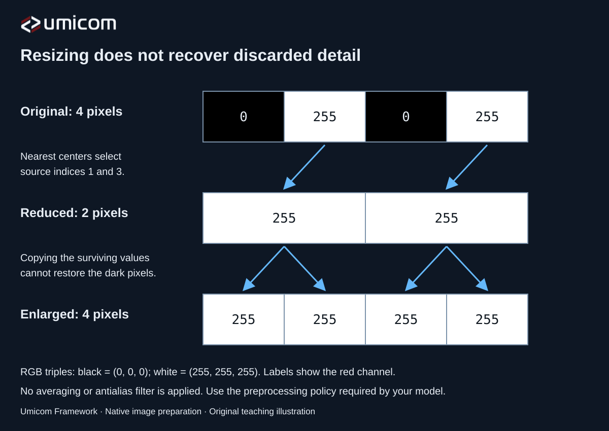

<!--
Umicom Bits2Banking
File: content/lessons/05-ai/generative-ai-foundations/25-resize-pixels-with-an-explicit-sampling-rule.md

PURPOSE:
Resize pixels with an explicit sampling rule

AUTHOR AND ORGANISATION:
Sammy Hegab
Umicom Foundation

LICENCE:
MIT
-->

# Resize pixels with an explicit sampling rule

[Course contents](index.md)

## The question before training

Many image models require a particular width and height. A photograph may have different dimensions. Resizing is the operation that prepares a new grid of pixels. It is not training: no model weights are adjusted. It is also not automatically harmless. A resizing rule decides which information survives. This lesson uses a tiny image so you can predict every output value before calling the native Framework service.

1. Read the preceding lessons on decoded RGB bytes, borrowed crops and histograms.
2. Open the complete C example in labs/framework/image-resize/main.c.
3. Use the four-pixel pattern below to calculate the expected result on paper before compiling.

## A pixel has a position and channels

A pixel is one cell in the image grid. RGB8 stores three unsigned byte channel values per pixel: red, green and blue, each from 0 to 255. In this exercise black is (0,0,0) and white is (255,255,255). The input is one row of four pixels: black, white, black, white. The image therefore has four pixels but twelve channel bytes. A byte count and a pixel count are different units.

~~~text
pixel index:        0          1          2          3
RGB triple:      (0,0,0)  (255,255,255)  (0,0,0)  (255,255,255)
byte offsets:     0,1,2      3,4,5       6,7,8      9,10,11
~~~

## What nearest-neighbor sampling means

For each destination pixel, nearest-neighbor sampling chooses one source pixel and copies all its channels. There is no averaging. For an enlargement, multiple destination pixels may copy the same source pixel. For a reduction, some source pixels may never be copied. The word nearest needs a precise coordinate rule: comparing corners instead of centers, or resolving ties differently, can produce another result even when image dimensions are equal.

## Map pixel centers explicitly

Framework selects floor((2*d + 1) * sourceSize / (2 * targetSize)) on each axis. Here d is a zero-based destination coordinate, sourceSize is the number of source pixels on that axis, and targetSize is the destination count. Floor discards a nonnegative fractional part. The multiplication by two represents half-pixel centers using integer arithmetic. An exact nearest-center tie selects the higher source coordinate.

| Four source pixels to two output pixels | Calculation | Selected source index |
| --- | --- | --- |
| Output 0 | floor((2*0+1)*4/(2*2)) | 1 |
| Output 1 | floor((2*1+1)*4/(2*2)) | 3 |

## Predict the reduced image

Both selected indices contain white pixels. The reduced row is therefore white, white. This result is correct for the declared sampling rule, even though it no longer shows the alternating pattern. Correct implementation and appropriate preprocessing are separate questions. The native service can implement its contract exactly while that contract is unsuitable for a particular model's training images.

## Try to enlarge it again

Two source pixels enlarged to four select indices 0,0,1,1. Because both surviving source pixels are white, all four output pixels become white. No part of the operation knows that black pixels existed earlier. Enlargement makes more samples, not more original evidence. An AI upscaler may infer plausible detail using a trained model, but inferred detail is not proof of the discarded original values.

## Observe the pattern visually

The illustration shows the selected source centers and the enlarged result. Each cell is an RGB triple. Only its red value is written because all three channels are equal in this grayscale example. The arrows represent copying a selected pixel, not averaging adjacent cells.

## Measure the change with a histogram

A histogram counts how often values appear. Before reduction, the red-channel count at 0 is two and at 255 is two. Afterwards, the count at 0 is zero and at 255 is two. The number of output pixels also changed, so compare proportions as well as raw counts. The dark proportion changed from two out of four to zero out of two. A histogram exposes this change, but it still does not preserve spatial positions or assess model quality.

| Image | Pixels | Red value 0 | Red value 255 |
| --- | --- | --- | --- |
| Original | 4 | 2 | 2 |
| Reduced | 2 | 0 | 2 |
| Enlarged result | 4 | 0 | 4 |

## Separate the three owned arrays

The C example keeps the original constant pixel array, a six-byte reduced array and a twelve-byte restored array separate. Each borrowed view contains a pointer, readable byte span, width, height and row stride. A view does not own the pixels or keep them alive. Its allocation must remain live and stable during every call. The output array must not overlap the source pixels or descriptor.

~~~c
const uint8_t stripes[]={0,0,0,255,255,255,0,0,0,255,255,255};
const UmiAiTrainingRgb8View source={stripes,sizeof stripes,4,1,12};
uint8_t small[6];
UmiStatus status = UmiAiTrainingImageResizeNearestRgb8(
    &source, 2, 1, small, sizeof small);
~~~

## Admit the whole operation before writing

The shared ImageDescribeRgb8 service validates the complete source view and target dimensions. The resizer checks that the declared input span reaches the final visible pixel and that output capacity holds width times height times three bytes. It performs every check before the first output write. A refused call leaves the previous destination bytes unchanged. A successful call writes the packed output and leaves unused capacity at its end alone. These rules make it easier for a caller to keep displaying a previous valid result after a bad request.

## Why padding and crops need explicit views

Decoded images can have unused bytes between rows. Row stride is the byte distance from one row's first pixel to the next row's first pixel. It can exceed width times three. A cropped view may also retain gaps containing pixels outside the selected rectangle. The service follows width, height and stride; it does not treat every byte in the readable span as a packed pixel. Crop first only when that is the intended policy, and keep the original allocation alive while the crop is borrowed.

## Build the complete C example

The example compiles the actual Framework services from a matching existing checkout; it does not copy their algorithms into the application. The following paths are for a prepared Windows UCRT64 toolchain. Run one command at a time and stop on unexpected errors. This exercise builds a source-linked console program, not an installed-SDK consumer or a Media window.

~~~powershell
Set-Location "C:\umicom\Umicom-Bits2Banking"
cmake -S labs/framework/image-resize -B build/image-resize -G Ninja -DCMAKE_C_COMPILER=C:/msys64/ucrt64/bin/gcc.exe -DUMICOM_FRAMEWORK_SOURCE=C:/umicom/Umicom-Applications/framework
cmake --build build/image-resize --parallel 2
ctest --test-dir build/image-resize --output-on-failure
& .\build\image-resize\umicom-image-resize.exe
~~~

## Read the expected output

The executable checks each condition before printing completion messages. Its final exercise intentionally offers five output bytes where six are required. The call must refuse without changing the earlier valid reduced image. That is an expected API refusal inside a successful test program, not a successful resizing request.

~~~text
Original red bins: 0=2 255=2
Reduced red bins: 0=0 255=2
Upsampling does not restore the missing dark pixels.
Insufficient output capacity was refused without changing the previous image.
~~~

## Do not confuse resizing with normalization

The resized output still contains RGB bytes in packed row order. A model tensor may require floating-point values, a different range and channels-first rather than channels-last layout. Framework's ImagePackRgb8 performs that separate explicit conversion. The order matters: first decide the image transformation, then apply the documented tensor layout and value range. A model requiring another normalization is not qualified merely because its input dimensions match.

## Aspect ratio is a policy decision

Aspect ratio is width divided by height. Resizing a wide photograph directly to a square can stretch objects. Alternatives include cropping, adding borders, or grouping images with similar shapes. This low-level resizer does not choose among those policies. A higher-level preparation plan must record the choice and apply corresponding changes to masks, bounding boxes and captions. A caption containing left or right may become inaccurate after another transformation such as a flip.

## Understand aliasing without advanced mathematics

Aliasing occurs when a sampled representation makes a changing pattern look like a different pattern. The alternating stripe becoming a uniform row is a small example. Antialias filtering reduces some high-frequency detail before sampling to avoid such artifacts. This service does not implement that filter. Nearest sampling is useful for explicit categorical grids or particular model contracts, but it is not a universal replacement for documented interpolation. Do not silently change an existing training pipeline's resize rule.

## Keep dataset preparation reproducible

A reproducible preparation record identifies the source content, crop, destination dimensions, sampling rule, channel interpretation and subsequent normalization. Keep source groups together when splitting training, validation and test data; multiple transformed copies of one source are not independent examples. Choose preprocessing policy using the training plan, not by repeatedly tuning it against the final test set. Image transformation does not establish permission to use an image or the quality of its caption.

## Know what the focused checks establish

The regression includes exact small examples and an independent oracle that compares distances to every source pixel center. It checks all source and target dimensions from one to seven on both axes, as well as padded rows, borrowed crops, maximal admitted rows and columns, malformed spans and unchanged outputs on refusal. Those checks establish this bounded algorithm's behavior. They do not run a diffusion trainer, certify a file decoder, qualify an installed DLL or prove that the policy improves generated images.

## Practice with answers you can explain

1. Replace the four input pixels with white, black, white, black. The same source indices 1 and 3 now produce two black pixels.
2. Reduce a three-pixel row to one pixel. The center rule selects index 1, the middle pixel.
3. Keep the original dimensions. Every destination center maps to its matching source center; visible RGB values should be identical even when source rows have padding.
4. Offer an output buffer one byte too short. Confirm refusal and unchanged previous output rather than accepting a partially resized image.
5. Write down a model's documented resize, crop and normalization requirements before choosing this service for real data. If it requires antialias filtering, this exercise alone does not meet that requirement.

[Previous: Count image values before preparing training inputs](24-count-image-values-before-preparing-training-inputs.md)

[Next: Place an image on a canvas without confusing padding and masks](26-place-an-image-on-a-canvas-without-confusing-padding-and-masks.md)
