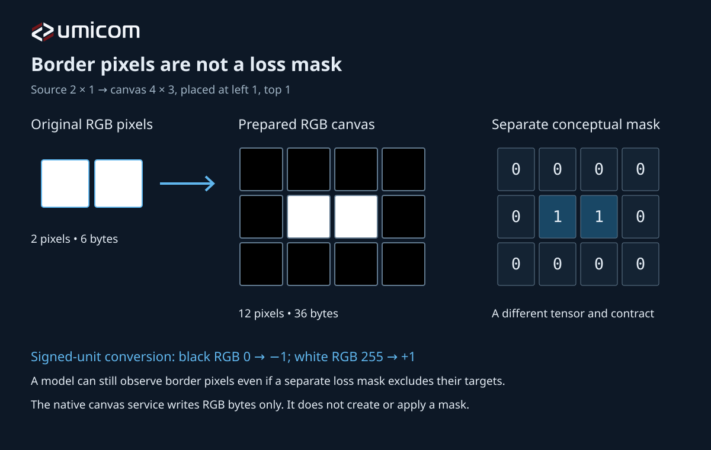

<!--
Umicom Bits2Banking
File: content/lessons/05-ai/generative-ai-foundations/26-place-an-image-on-a-canvas-without-confusing-padding-and-masks.md

PURPOSE:
Place an image on a canvas without confusing padding and masks

AUTHOR AND ORGANISATION:
Sammy Hegab
Umicom Foundation

LICENCE:
MIT
-->

# Place an image on a canvas without confusing padding and masks

[Course contents](index.md)

## Start with two pixels

A model may expect a rectangular input of a fixed size, while the image you have uses a different shape. One option is to preserve the image and put it inside a larger canvas. The extra positions receive a chosen colour. This lesson uses two white pixels and a black border, so you can calculate the result without needing a photograph, a graphics card or a trained model. You will prepare bytes and inspect them; no model is trained by this exercise.

1. Review the preceding RGB, crop, histogram and resize lessons.
2. Open labs/framework/image-canvas/main.c in the Bits2Banking repository.
3. Draw a grid four columns wide and three rows tall. Mark the second and third cells of the middle row as source pixels.

## A canvas has dimensions and contents

Width counts columns; height counts rows. The top-left cell has coordinate (0,0). Moving right increases x, and moving down increases y. The source image is two columns by one row. Its left edge is placed at x=1 and its top edge at y=1 inside the four-by-three canvas. There is one border column on each side and one border row above and below. Placement changes the surrounding image, but it does not change either source pixel.

~~~text
Canvas coordinates:       x=0   x=1   x=2   x=3
                    y=0    B     B     B     B
                    y=1    B     W     W     B
                    y=2    B     B     B     B
B = black border, W = original white pixel
~~~

## Count pixels and bytes separately

RGB8 uses three bytes for each pixel: one red, one green and one blue value. Each value is an integer from 0 to 255. White is (255,255,255); black is (0,0,0). The source therefore needs 2 × 1 × 3 = 6 bytes. The packed canvas needs 4 × 3 × 3 = 36 bytes. A float tensor has its own element size and layout, so 36 RGB bytes must not be confused with 36 bytes of floating-point storage.

| Quantity | Source | Canvas |
| --- | --- | --- |
| Width × height | 2 × 1 | 4 × 3 |
| Pixels | 2 | 12 |
| RGB8 channel bytes | 6 | 36 |
| White pixels | 2 | 2 |
| Black border pixels | 0 | 10 |

## Create a borrowed description

The source view contains a pointer, an accessible byte count, dimensions and row stride. A pointer identifies where the bytes begin; it does not allocate them or prove how many bytes exist. The sourcePixels array owns the six bytes for the duration of main. The view borrows that storage. Its stride is six because the next row would begin after two RGB triples. A real decoded image may contain unused bytes between rows, so stride is an explicit input.

~~~c
const uint8_t sourcePixels[6] = {255,255,255,255,255,255};
const UmiAiTrainingRgb8View source = {
    sourcePixels, sizeof sourcePixels, 2, 1, 6
};
const uint8_t border[3] = {0,0,0};
uint8_t canvas[36];
~~~

## Read the native call in order

The first argument describes the source. The next two numbers give the output width and height. The following two give the source's left and top position. The final arguments supply three border bytes, the destination buffer and its byte capacity. The status reports whether the service accepted the complete operation. The laboratory checks that status before looking at output.

~~~c
UmiStatus status = UmiAiTrainingImageCanvasRgb8(
    &source, 4, 3, 1, 1, border, canvas, sizeof canvas);
~~~

## Make the rectangle proof before copying

An origin must lie inside the canvas, and the whole source must fit after that origin. The implementation compares source width with canvas width minus left, after first checking the origin. This order matters because adding left and source width could wrap an unsigned integer when metadata is invalid. Subtraction after admission gives a bounded remaining space. The same reasoning applies vertically. The service rejects a source that extends outside the canvas; it does not silently crop it.

## Reuse one shape-admission service

The Framework service asks UmiAiTrainingImageDescribeRgb8 to check both shapes. That shared owner checks positive dimensions, row stride, multiplication and addition bounds, and the deliberately small training-image limit. The current adapter admits at most 16,384 channel values. That is a limit for these bounded native exercises, not a claim that a production image model can use only tiny pictures. A future larger adapter needs an explicit memory and cancellation design rather than removal of the existing checks.

## Publish only after admission succeeds

Before writing any destination byte, the function checks the source span, destination capacity and placement. A rejected request leaves the previous destination unchanged. Once admitted, it copies the border colour into a local three-byte value, fills the canvas and copies each source row to its destination. There are no allocations or fallible external calls after publication begins. Source and destination pixel storage must be disjoint and stable throughout the call; this contract is not an in-place image mover.

## Understand the small borrowed-colour exception

The three border bytes may be sampled from an existing image or from the old output because they are copied before the output is filled. This narrowly documented exception does not mean arbitrary source/output overlap is allowed. A borrowed source image overlapping the output would be overwritten while the canvas is being filled. Keep the full source in separate live storage.

## Measure the prepared pixels

The laboratory passes the canvas to the shared histogram service. Each channel has two observations at value 255 and ten at value 0. The histogram counts channel values, not physical brightness, transparency or semantic importance. The added border now dominates the value count. If a training dataset uses many similarly padded images, those borders are part of its input distribution.

~~~text
Canvas: 12 pixels, red bin 0=10, red bin 255=2
~~~

## Convert values according to the model contract

The example packs the canvas into a CHW tensor, meaning all red values first, then all green values, then all blue values. It chooses signed-unit conversion: 2 × (byte / 255) − 1. A black byte becomes −1 and a white byte becomes +1. Black is therefore not numerical zero under this convention. Under unit-range conversion, black would instead become zero. Choose the conversion specified by the model and training pipeline, and keep it consistent during evaluation and generation.

## A loss mask is another piece of data

A loss mask selects which target errors contribute to an objective. It is not automatically inferred from black pixels, because a real scene can legitimately contain black objects. The conceptual mask in the illustration marks the two original pixel positions with one and the border positions with zero. The canvas service does not create that mask. A training implementation must specify its shape, channel broadcasting, normalization denominator and how it aligns with targets. A mask for input pixels also cannot be applied blindly to a smaller latent grid.

## Excluding target loss does not hide input pixels

Even when a separate objective ignores border targets, a model may still read border inputs through convolutions, attention or other operations. A loss mask controls the scoring rule; it is not automatically an attention mask or a barrier to information flow. In diffusion training, noise and the target parameterization add further contracts. Decide whether padding is noised, which targets are supervised, and how any masks transform before claiming that a border is irrelevant.

## Place, resize and crop are distinct decisions

Canvas placement preserves source dimensions. Cropping discards pixels outside a selected rectangle. Resizing samples values onto another grid and can lose information. Letterboxing usually combines a deliberate resize with canvas placement to fit a target shape. This API implements only the placement step. If you compose it with the preceding nearest-resize service, allocate separate intermediate and output buffers, calculate the scaled dimensions explicitly, and record the sampling rule. Nearest sampling is not a general recommendation for photograph training.

## Keep captions, coordinates and splits consistent

Padding shifts source coordinates. An annotation at source position (x,y) moves to (x+left,y+top) in the canvas. Bounding boxes, segmentation labels and keypoints need matching transformations. A caption such as 'fills the whole frame' may become inaccurate after adding borders. Keep all transformed versions of the same source in the same dataset partition; creating a padded variant does not make it an independent evaluation example. Preserve the original data and record the preprocessing recipe.

## Build the complete C laboratory

Use a C23 toolchain and a matching Framework source checkout. This small laboratory compiles only the actual preparation owners it needs; it does not clone a dependency or build a model server. Run each command separately and stop on errors. An old executable left by an earlier successful build does not qualify newly edited source.

~~~powershell
Set-Location "C:\umicom\Umicom-Bits2Banking"
cmake -S labs/framework/image-canvas -B build/image-canvas -G Ninja -DUMICOM_FRAMEWORK_SOURCE=C:/umicom/Umicom-Applications/framework
cmake --build build/image-canvas --parallel 2
ctest --test-dir build/image-canvas --output-on-failure
& .\build\image-canvas\umicom-image-canvas.exe
~~~

## Interpret the expected result

The program checks the histogram, all tensor values, unchanged source pixels and refusal with one byte too little output capacity. A successful run prints the three lines below and returns zero. This is a deterministic native preprocessing exercise. It does not establish model quality, GPU memory use, image decoding correctness or an installed SDK deployment.

~~~text
Canvas: 12 pixels, red bin 0=10, red bin 255=2
Black border becomes -1 in the signed-unit tensor, not a loss mask.
A short output span was refused; the previous canvas is unchanged.
~~~

## Troubleshoot by contract

1. A missing header during configuration usually means the Framework source set is incomplete. Integrate the matching header and implementation; do not create an empty substitute.
2. A capacity error can refer to either the actual source span, the destination span or the adapter's shape limit. Check their units separately.
3. An invalid placement is a rectangle error. Recalculate left and top before increasing memory.
4. Unexpected black values in a tensor may be correct for the chosen range. Check the normalization formula instead of replacing values until the picture looks plausible.
5. A successful preprocessing test is not a successful training experiment. Inspect dataset partitions, targets, objective normalization and evaluation separately.

## Exercises with predicted answers

First move the source to left=0, top=0 without changing canvas dimensions. Predict which two cells turn white and verify that the histogram is unchanged. Next choose a border of (255,0,0): red will be 255 in all twelve pixels, while green and blue still have two values at 255 and ten at zero. Finally describe a two-step letterbox operation for a four-by-two source in a six-by-six canvas. State the resize rule, resulting dimensions, placement and label transformation before writing code.

[Previous: Resize pixels with an explicit sampling rule](25-resize-pixels-with-an-explicit-sampling-rule.md)

[Next: Select video frames by time with an explicit policy](27-select-video-frames-by-time-with-an-explicit-policy.md)
