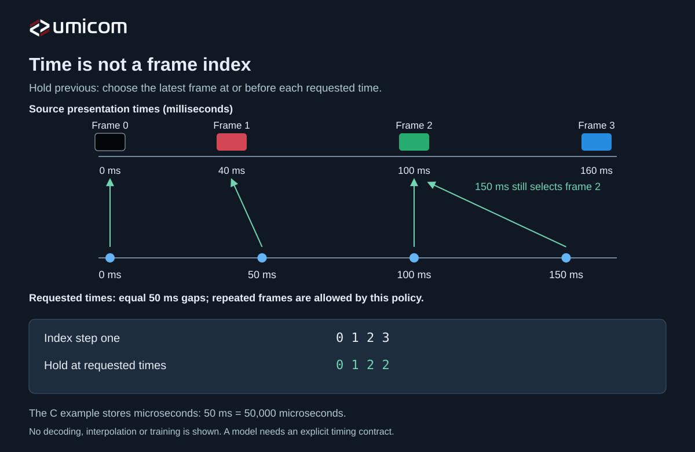

<!--
Umicom Bits2Banking
File: content/lessons/05-ai/generative-ai-foundations/27-select-video-frames-by-time-with-an-explicit-policy.md

PURPOSE:
Select video frames by time with an explicit policy

AUTHOR AND ORGANISATION:
Sammy Hegab
Umicom Foundation

LICENCE:
MIT
-->

# Select video frames by time with an explicit policy

[Previous lesson](26-place-an-image-on-a-canvas-without-confusing-padding-and-masks.md)

[Course contents](index.md)

## Why a video is more than a pile of images

A still image describes one view. A video also describes when views should appear. A model that learns from video may use a fixed number of frames, but selecting every second frame does not necessarily select equal amounts of time. This lesson starts with four tiny original frames and four integer timestamps. You will calculate which frame is selected at each requested time, run the native C example, and distinguish this preparation step from decoding, tensor conversion and training.

## Build the vocabulary one term at a time

| Term | Meaning in this lesson |
| --- | --- |
| Frame | One already decoded RGB image. The example uses one pixel per image so the arithmetic stays visible. |
| Index | A zero-based position in the source array: 0, 1, 2 or 3. It is not a time. |
| Timestamp | A number that identifies when a frame is presented relative to a chosen origin. |
| Microsecond | One millionth of a second. 50,000 microseconds equals 50 milliseconds, or 0.05 seconds. |
| Presentation order | The order in which the viewer should see frames; compressed decode order can differ. |
| Query time | A time at which the preparation policy asks for a source frame. |
| Hold previous | Choose the latest frame already reached at that time. Do not invent an intermediate image. |
| Tensor | A numbered array of values with an explicit shape and axis order, prepared for numerical processing. |

## Write down the source before choosing a policy

The first gap is forty milliseconds and the next two are sixty milliseconds each. These are not equal gaps. The times are strictly increasing: each is greater than the previous one. The lesson deliberately supplies already decoded pixels; a JPEG, PNG or compressed video byte stream is not a decoded RGB array.

| Source index | Presentation time in microseconds | Elapsed milliseconds | Pixel |
| --- | --- | --- | --- |
| 0 | 0 | 0 | Black: RGB 0,0,0 |
| 1 | 40000 | 40 | Red: RGB 255,0,0 |
| 2 | 100000 | 100 | Green: RGB 0,255,0 |
| 3 | 160000 | 160 | Blue: RGB 0,0,255 |

## Choose the requested times explicitly

We request times 0, 50000, 100000 and 150000 microseconds. The gap between queries is fifty milliseconds. A repeated grid with that spacing has twenty positions per second because 1 divided by 0.05 is 20. Four positions from zero through 150 milliseconds contain three gaps, not four. These four timestamps alone do not establish the duration of a complete exported clip. The final frame duration is separate metadata.

## Derive hold-previous selection

1. At zero, source frame zero has arrived. Select index zero.
2. At fifty milliseconds, frame one arrived at forty, while frame two will not arrive until one hundred. Select index one.
3. At one hundred milliseconds, the query exactly matches frame two. Select index two.
4. At one hundred and fifty milliseconds, frame two is still the latest source frame. Frame three is at one hundred and sixty, which is later than the query. Select index two again.

## Compare timing with index stepping

Neither row is universally correct. They answer different questions. A training configuration must say which policy is intended. Repeated green in the second row is expected hold behavior; it is not proof that a decoder crashed or stopped advancing. Conversely, a visually smooth sequence does not prove that its timing matches a model’s training assumptions.

| Method | Selected indices | Selected pixels |
| --- | --- | --- |
| First four source frames, index step one | 0, 1, 2, 3 | Black, red, green, blue |
| Hold previous at 0, 50, 100, 150 milliseconds | 0, 1, 2, 2 | Black, red, green, green |

## Follow the reusable native service

uint64_t holds an unsigned integer with exactly 64 bits. size_t is the platform’s unsigned size type and is used for array indices and capacity. The final four is a capacity in size_t elements, not four bytes. Read indices only when status equals UMI_STATUS_OK. The complete timing.c example includes all headers, checks, pixel conversion and failure handling; the fragment here shows the call boundary.

~~~c
#include "umicom/ai/training/video_timing.h"

const uint64_t source[] = {0, 40000, 100000, 160000};
const uint64_t query[] = {0, 50000, 100000, 150000};
size_t indices[4];
UmiStatus status = UmiAiTrainingVideoSelectAtOrBefore(
    source, 4, query, 4, indices, 4);
~~~

## Admit the whole request before publishing results

The service checks the source count, query count and output capacity. It checks every source timestamp, including frames that no query will select. Source timestamps must increase strictly, queries may stay equal or increase, and each query must lie between the first and last source times inclusive. Only after those checks does a monotonic scan publish indices. If the final query is invalid, no earlier index is written either. This lets a caller keep a previous complete selection until a new request is accepted.

## Know the small preparation limits

These limits describe this bounded preparation operation. They are not claims that the Framework can decode only sixty-four frames or that all production video models use this shape. The later image/video tensor adapter has additional pixel and float-count limits of its own.

| Boundary | Contract |
| --- | --- |
| Source timestamps | 1 through 4096 |
| Requested output positions | 1 through 64 |
| Before the first source timestamp | Refused |
| After the last source timestamp | Refused; no inferred endpoint duration |
| Duplicate source timestamps | Refused; review their meaning before preparing this input |
| Duplicate query timestamps | Allowed; the same frame can be selected more than once |
| Unused output capacity | Left unchanged |
| Temporary allocation | No heap allocation in timestamp selection |

## Compile the complete C example

1. Open PowerShell in your Bits2Banking checkout. Find labs/framework/video-tensor/timing.c and read its sourceTimes, queries and expected arrays.
2. Select an existing matching Framework checkout containing video_timing.h and video_timing.c. Replace the source path below if yours differs. This exercise compiles the actual native owners; it does not download or install an SDK.
3. Run configure, then build only after configure succeeds. Stop on an error rather than running an older executable.
4. Run the focused test and then the example. No model weights, private footage or network connection are needed.

~~~powershell
$env:Path = "C:\msys64\ucrt64\bin;$env:Path"
cmake -S labs/framework/video-tensor -B build/learning-video-tensor -G Ninja -DCMAKE_C_COMPILER=C:/msys64/ucrt64/bin/gcc.exe -DUMICOM_FRAMEWORK_SOURCE=C:/umicom/Umicom-Applications/framework
cmake --build build/learning-video-tensor --target umicom-video-timing
ctest --test-dir build/learning-video-tensor -R lesson.training.video-timing --output-on-failure
& ".\build\learning-video-tensor\umicom-video-timing.exe"
$LASTEXITCODE
~~~

## Read the expected output

The storage line is 48 bytes on a platform where sizeof(float) is four. The program calculates that byte count using sizeof instead of assuming it. Four one-pixel RGB frames contain 4 times1 times1 times3 = 12 float values. A failure returns a nonzero exit status. A passing source exercise does not establish installed SDK linking or Media interface behavior.

~~~text
Index step: 0 1 2 3
Time hold: 0 1 2 2
The green frame is selected twice; source pixels remain borrowed.
Tensor: 12 values, 48 bytes; late out-of-range query refused atomically.
No decoder, timestamp conversion, model or training was run.
~~~

## Keep indices, pixels and tensors separate

The selected indices are small integers. The frame descriptors borrow pointers into the original pixel array. Selecting frame two twice creates two descriptors referring to the same read-only pixels; it does not duplicate that source allocation. VideoPackRgb8 then writes each selected position into its output tensor. In this example the shape is time, height, width, channel, often abbreviated THWC. A different model may require a different axis order and numeric range. Selecting correct times does not solve a layout mismatch.

## Make failure visible without crashing

The example asks for times 50000 and 200000 after first obtaining a valid selection. The second time is beyond the final source timestamp 160000, so the service refuses the entire request. The program compares all previous indices and verifies that they remain unchanged. This is a controlled input error. It does not use an invalid pointer or a deliberate crash to test a boundary. C code still requires real readable arrays behind every declared span.

## Do not guess what a container timestamp means

A video container may express time as integer ticks with a rational time base. It may contain negative starting timestamps, missing values, discontinuities or frames whose decode order differs from presentation order. This API accepts already reviewed unsigned times sharing one unit and origin. It does not convert container ticks or reorder frames. Conversion needs checked arithmetic and an explicit rounding rule. If you sort timestamps, the corresponding frame identities must move with them; sorting the numbers alone corrupts the association.

## Why the implementation compares instead of subtracting

Very large integer timestamps can overflow an intermediate sum used to calculate a midpoint. Converting them to floating point can lose the distinction between adjacent times. Hold-previous selection only needs ordering, so the implementation compares unsigned values directly. It validates ordering before scanning. That keeps the policy meaningful even near UINT64_MAX, the largest value of uint64_t. This is an arithmetic property of this selector, not proof that a real container’s times have been interpreted correctly.

## Connect preparation to generative training

1. Choose reviewed clips with documented source identity, captions and permitted use. Keep related clips or fragments from one source together when separating training and evaluation.
2. Decode the selected source while recording presentation times. Decide how discontinuities and missing metadata will be handled.
3. Choose a temporal policy that matches the model contract. Record target times, source indices and whether frames repeat.
4. Prepare spatial dimensions, color interpretation, axis order and normalization explicitly. A time selector performs none of those conversions.
5. Apply any padding or loss mask as a separate documented rule. Repeated real frames and synthetic padding are not automatically the same thing.
6. Train only after resource admission and data review, then evaluate held-out motion, caption alignment and temporal consistency. This example performs none of those model steps.

## Understand the bias of holding a frame

Repeated frames can make a sample appear more static and can cause one source image to contribute to several positions in an objective. Nearest-frame selection, interpolation and motion-aware resampling would behave differently. Do not rename hold-previous as any of those operations. Compare candidate policies on appropriate held-out clips, and retain their provenance so an apparent training improvement is not merely an easier sampling distribution.

## Exercises with answers you can predict

1. Change the final query from 150000 to 160000. Predict the final index and pixel before running: the exact source timestamp selects index three.
2. Repeat query 100000 twice. Explain why the output may legally repeat index two.
3. Put the source times in descending order while leaving the query array unchanged. Explain why refusal is better than silently sorting only the numbers.
4. Change a query to a value before the first source time. Verify that the entire previous output is preserved.
5. Explain why the shape [time,height,width,channel] and a timestamp sequence answer different questions.
6. Describe which additional work would be required to turn this synthetic preparation check into a real video-generation training experiment.

## What this lesson has established

You have a small original C consumer of a shared timestamp policy, explicit limits and observable refusal behavior. The service does not decode video, synchronize audio, convert timestamps, infer frame duration, interpolate images, run a diffusion model or certify training quality. An installed SDK consumer must link the matching Umicom::ai implementation and verify its runtime dependencies separately.

[Next: Measure channel means without choosing normalization](28-measure-channel-means-without-choosing-normalization.md)
