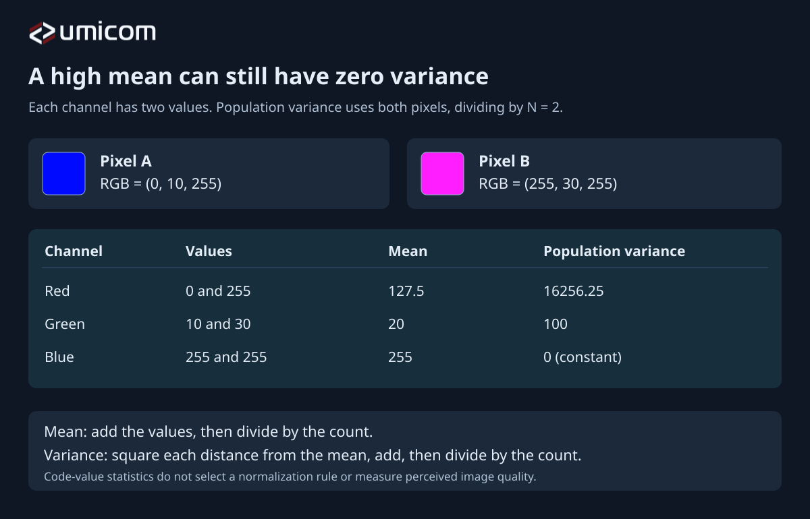

<!--
Umicom Bits2Banking
File: content/lessons/05-ai/generative-ai-foundations/28-measure-channel-means-without-choosing-normalization.md

PURPOSE:
Measure channel means without choosing normalization

AUTHOR AND ORGANISATION:
Sammy Hegab
Umicom Foundation

LICENCE:
MIT
-->

# Measure channel means without choosing normalization

[Course contents](index.md)

## Start with two pixels, not a model

A pixel is one position in an image. In the RGB8 format used here, each pixel has three unsigned byte values: red, green and blue. A byte can hold an integer from zero through 255. The number is a code value. Its relationship to light and perceived brightness depends on the image's color encoding; simply averaging codes does not perform a color-space conversion.

## The original teaching image

| Pixel | Red | Green | Blue |
| --- | --- | --- | --- |
| A | 0 | 10 | 255 |
| B | 255 | 30 | 255 |

## Define the unfamiliar words

| Term | Meaning in this lesson |
| --- | --- |
| Channel | One component, such as all red values in the image. |
| Count N | How many pixels contribute a value to each channel. |
| Sum | Add all contributing values. |
| Mean | Divide their sum by their count. |
| Deviation | A value minus the mean. |
| Population variance | Average the squared deviations, dividing by N. |
| Standard deviation | The nonnegative square root of variance; it has the original units. |
| Minimum and maximum | The smallest and largest contributing values. |

## Calculate the red mean by hand

1. There are two pixels, so N is two.
2. Add the red codes: 0 + 255 = 255.
3. Divide by two: the mean is 127.5.
4. The mean is allowed to be fractional even though each stored input code is an integer. The report stores it as a floating-point number.

## Calculate the red population variance

1. Subtract the mean from each red value: 0 - 127.5 = -127.5, and 255 - 127.5 = 127.5.
2. Square each deviation by multiplying it by itself. Both squares are 16256.25.
3. Add the squares: 32512.5.
4. Divide by N, which is two: population variance is 16256.25 squared code units.
5. The standard deviation would be 127.5 code units. The native moment report returns variance, not its square root.

## Compare all three channels

| Channel | Mean | Population variance | Minimum | Maximum |
| --- | --- | --- | --- | --- |
| Red | 127.5 | 16256.25 | 0 | 255 |
| Green | 20 | 100 | 10 | 30 |
| Blue | 255 | 0 | 255 | 255 |

## A high mean does not imply a wide spread

Blue has the largest mean, but both blue values are identical. Every blue deviation is zero, so its variance is zero. Red spreads across the full code range. Green varies only between ten and thirty. These observations describe numerical channel distributions. They do not tell you what the image depicts or whether it is a useful training example.

## Population is a deliberate denominator

This function describes the complete bounded image supplied to it, so it divides squared deviations by N. A common sample-variance estimator uses N minus one when estimating a larger population from a sample. Those are different questions. For one pixel, population variance is zero; an N-minus-one calculation would have a zero denominator. Do not silently swap formulas because a library uses another default.

## Reuse the native image owner

~~~c
const uint8_t pixels[] = {0,10,255, 255,30,255};
const UmiAiTrainingRgb8View view = {pixels,sizeof pixels,2U,1U,6U};
UmiAiTrainingRgb8Moments result;
UmiStatus status = UmiAiTrainingImageMeasureRgb8(&view,&result);
if (status == UMI_STATUS_OK) {
    /* result.mean[0] is red; result.population_variance[0] is red variance. */
}
~~~

## Read the view declaration

1. pixels owns six bytes in this small C example. The two RGB triples appear next to each other.
2. sizeof pixels provides the accessible byte extent. The view borrows those bytes; it does not allocate or copy an image.
3. 2U is the width, 1U is the height and 6U is the row stride in bytes. U marks an unsigned integer literal.
4. The service first uses the existing histogram reader's dimension, stride and extent checks.
5. The three channel arrays use index zero for red, one for green and two for blue. Read them only after status reports success.

## Build and run the complete example

1. Open labs/framework/image-histogram in a Bits2Banking checkout. Read its README and set UMICOM_FRAMEWORK_SOURCE to the matching existing Framework source checkout.
2. Configure and build using the commands below. Stop on a configuration or build error; do not run an older executable.
3. Run CTest. Both the earlier frequency lab and the moment lab should pass.
4. Run the moment executable to read the numeric report. Depending on your generator, the executable may be in a configuration subdirectory; use the built target's actual location.
5. Compare all four statistics for each channel with the table above before changing the fixture.

## Example PowerShell commands

~~~powershell
cmake -S . -B build -G Ninja -DUMICOM_FRAMEWORK_SOURCE=C:/umicom/Umicom-Applications/framework
cmake --build build
ctest --test-dir build --output-on-failure
.\build\umicom-image-moments.exe
~~~

## A source-backed lab is not an installed SDK qualification

This small laboratory compiles the canonical Framework sources selected by its CMake file. It does not clone another Framework copy or implement its own statistics engine. An independent application using the installed SDK should resolve the exported AI package and include image_moments.h. Running this lab does not prove that your installed package is current or that Media's graphical interface uses the new service.

## Why a histogram can be reused

A histogram records how many times each code occurs. If red code 20 occurs three times, it contributes 20 × 3 to the sum. The new service can accept an existing histogram directly, avoiding another pixel pass. It checks that every channel's frequencies sum to the declared positive pixel count. A malformed later channel causes a refusal without replacing an earlier complete report.

## Understand the numerical implementation

The implementation keeps sums and squared sums as bounded integers. It forms N times the sum of squared values minus the square of the sum, then divides by N squared. This equals population variance. Forming the subtraction before floating conversion avoids cancellation between separately rounded floating moments. The source includes an explicit arithmetic-bound assertion. The final division may still round; the result is not a promise of unlimited mathematical precision.

## Stay inside the teaching image profile

The current native profile allows at most 16,384 RGB values, or 5461 complete pixels. The wrapper uses fixed local histogram storage and the moment calculation allocates no heap memory. It skips row padding and pixels outside an admitted crop. A large production photograph needs a separately designed tiled or larger-profile pipeline; this service does not silently resize it or claim unlimited image support.

## Rescaling and standardization are different

| Operation | Typical formula | What it changes |
| --- | --- | --- |
| Fixed code rescaling | x / 255 | Maps code values into zero-to-one without fitting statistics. |
| Signed fixed rescaling | 2 × (x / 255) - 1 | Maps code values into minus-one-to-one. |
| Standardization | (x - chosen mean) / chosen standard deviation | Uses an explicit statistical convention and zero-variance policy. |
| Color linearization | Defined by the source color encoding | Converts encoded color values according to a color-space rule. |

## Do not divide by a constant channel's zero spread

The blue standard deviation in this example is zero. Dividing by zero does not become valid because the code is part of machine learning. A model may specify an epsilon, a fixed scale, or another handling rule. Epsilon is a small positive value used in a particular formula; its size and placement change the transformation. Choose the actual model contract. This inspection service reports the zero and performs no normalization.

## Keep evaluation data out of fitted preprocessing

If a training pipeline estimates a mean or standard deviation from data, estimate it from the intended training split and save the chosen values with the preprocessing configuration. Fitting them using evaluation data leaks information from the assessment set. Per-image standardization is another choice and can remove useful intensity or color information. The native report describes one admitted image; it does not estimate a whole dataset or choose a training policy.

## Statistics are not an image-quality score

Rearrange pixels without changing their channel values and the histogram, mean and variance stay the same. A recognisable object and a scrambled image can therefore share these statistics. Generative-model evaluation also needs appropriate visual, temporal and task-specific checks. These measurements do not establish semantic quality, caption correctness, image rights or training success.

## Exercises and recovery

1. Change the green values to twenty and twenty. Predict mean twenty and variance zero before rebuilding.
2. Swap pixel A and pixel B. Explain why every reported statistic stays the same.
3. Remove one accessible byte from the view's declared extent. Expect refusal and unchanged prior output rather than a partial image calculation.
4. Corrupt one histogram channel's count, as the complete program does. Explain why even an apparently plausible mean must not be published from inconsistent metadata.
5. Write down a hypothetical model's exact input range, layout, color encoding and normalization constants. Identify which steps the current Framework image services provide and which remain external requirements.

## Qualification boundary

The complete native lab and focused Framework tests exercise this C implementation. They do not load image files, execute an image/video generator, train a model, measure whole-process memory or qualify a Media GUI. Keep those separate checks visible when building a real application.

[Previous: Select video frames by time with an explicit policy](27-select-video-frames-by-time-with-an-explicit-policy.md)

[Next: Apply explicit channel normalization](29-apply-explicit-channel-normalization.md)
