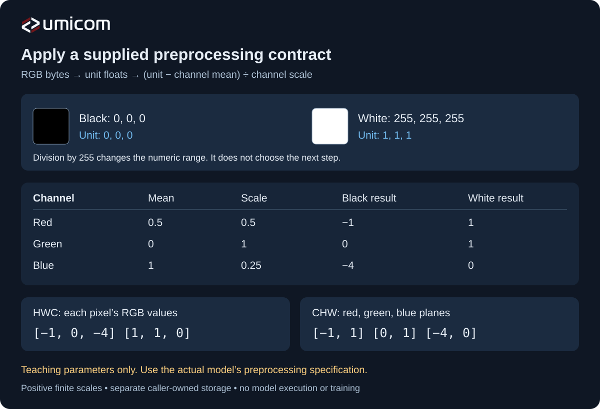

<!--
Umicom Bits2Banking
File: content/lessons/05-ai/generative-ai-foundations/29-apply-explicit-channel-normalization.md

PURPOSE:
Apply explicit channel normalization

AUTHOR AND ORGANISATION:
Sammy Hegab
Umicom Foundation

LICENCE:
MIT
-->

# Apply explicit channel normalization

[Course contents](index.md)

## Begin with the numbers a model actually receives

A picture on the screen hides an array of numbers. RGB means red, green and blue: each pixel in this exercise has three whole-number channel values from 0 through 255. A model input is often an array of floating-point numbers instead. Floating point is a way to represent values with fractional parts, with limited precision. Preprocessing is the series of decisions that turns the original picture into the exact kind of input a particular model expects. This lesson performs one explicit arithmetic step. It does not load or train a model.

## Keep three different operations separate

| Operation | What it answers | What it does not decide |
| --- | --- | --- |
| Rescale byte to unit value | What is byte / 255? Black maps to 0 and white to 1. | Which channel order or model normalization is correct. |
| Measure mean and variance | What average and spread occur in a specified set of pixels? | Whether the model expects statistics from that set. |
| Apply supplied mean and scale | What is (unit - mean) / scale for each channel? | How parameters were selected or whether the model was trained with them. |

## Understand subtraction and division before running code

Imagine a red channel whose supplied mean is 0.5 and scale is 0.5. Subtracting 0.5 makes that chosen center become zero. Dividing by 0.5 doubles distance from the center: black becomes (0 - 0.5) / 0.5 = -1, and white becomes (1 - 0.5) / 0.5 = 1. Negative numbers are permitted output; they do not mean a negative amount of light was decoded. The calculation is changing the representation of a code value. It is not converting between physical color spaces.

## Work through the two-pixel example

| Channel | Supplied mean | Supplied scale | Black: unit 0 | White: unit 1 |
| --- | --- | --- | --- | --- |
| Red | 0.5 | 0.5 | -1 | 1 |
| Green | 0 | 1 | 0 | 1 |
| Blue | 1 | 0.25 | -4 | 0 |

## Use model documentation to choose parameters

The table deliberately uses unusual, different values so that a channel mix-up is obvious. It is a teaching fixture, not a recommendation for an image generator. Obtain resize, crop, channel order, numeric type, color convention, range, mean and scale from the chosen model's published preprocessing contract or its checked reference implementation. Some models use no channel standardization; some use fixed values. A scale may be described as a standard deviation, but the service accepts an explicit positive scale rather than claiming it measured one. Do not recompute a pretrained model's parameters from one picture. For a new training design, estimate any learned preprocessing only from the training partition and preserve the same transformation for validation and deployment.

## Know why zero scale is refused

A constant channel can have zero measured variance and zero standard deviation. Dividing by zero is not a usable preprocessing step. Different training designs may choose to drop a feature, use a documented floor called epsilon, or apply another policy. Framework does not silently choose one. It rejects a zero or negative scale. An epsilon is a small positive value with a deliberately chosen meaning; adding an arbitrary epsilon can change a model's input distribution.

## Prepare the existing native tools

1. Use the C toolchain setup lesson if CMake, Ninja or the UCRT64 C compiler is not installed. CMake prepares a build; Ninja executes the compile/link steps; the compiler translates C source into machine code.
2. Open PowerShell and enter your Bits2Banking checkout. The example commands use the owner's C:\umicom checkout layout; substitute your own source locations when learning elsewhere.
3. Check that the matching Framework checkout contains include/umicom/ai/training/image_tensor.h and src/ai/training/image_tensor.c, including UmiAiTrainingImagePackRgb8Standardized.
4. Run each command separately. Stop when a command fails. Do not run an old executable left by an earlier successful build.

## Build and run the exercise

~~~powershell
Set-Location "C:\umicom\Umicom-Bits2Banking"
$env:Path = "C:\msys64\ucrt64\bin;$env:Path"
cmake -S labs/framework/image-tensor -B build/learning-image-tensor -G Ninja -DCMAKE_C_COMPILER=C:/msys64/ucrt64/bin/gcc.exe -DUMICOM_FRAMEWORK_SOURCE=C:/umicom/Umicom-Applications/framework
cmake --build build/learning-image-tensor
ctest --test-dir build/learning-image-tensor --output-on-failure
& ".\build\learning-image-tensor\umicom-image-standardize.exe"
~~~

## Read the expected output

~~~text
HWC standardized: -1 0 -4 1 1 0
CHW standardized: -1 1 0 1 -4 0
Zero scale refused; previous tensor unchanged.
Parameters are an example, not a model recommendation.
~~~

## Distinguish array order from channel meaning

HWC means height, width, channel: the first three values belong to the black pixel and the next three to the white pixel. CHW means channel, height, width: the first two values are red, then two green, then two blue. Changing the output arrangement does not change the parameter array's RGB order. Both outputs contain exactly the same six transformed values in different positions. This service adds no batch dimension.

## Read the parameter declaration

~~~c
const UmiAiTrainingImageStandardization parameters = {
    .mean = {0.5f, 0.0f, 1.0f},
    .scale = {0.5f, 1.0f, 0.25f}
};
~~~

## Explain each part of the declaration

A struct groups named values. This struct has two arrays; each array has three float elements in red, green, blue order. The dot names the member being initialized. The f suffix makes a floating literal have type float. const prevents this variable from being modified through its declared name. Passing &parameters gives the function its address for the duration of the call; the Framework does not retain it. The RGB input bytes, this struct and the output array must be separate stable storage. Output capacity counts float elements, not bytes.

## Follow the memory contract

The canonical packer checks dimensions, row stride and capacity before writing. The standardization wrapper also checks that all parameters are finite, scales are positive, and the transforms of unit endpoints 0 and 1 fit a finite float. A positive scale makes the transform increase monotonically, so checking the endpoints bounds every possible unit input. These checks happen before output publication. An invalid request leaves the complete output, including any spare capacity, unchanged. The caller still has to provide actual accessible memory and avoid concurrent changes; a C pointer does not prove the storage is valid.

## Understand the deliberate rounding boundary

Framework first computes byte / 255 using a double intermediate and stores it as float. It then computes (double(unit_float) - double(mean_float)) / double(scale_float) and stores the final float. A float cannot represent every fraction exactly. A fused calculation that keeps byte / 255 as double until the very end can differ slightly. Therefore compare the documented steps when checking a model adapter; do not assume all algebraically equivalent expressions produce identical bits. The exercise uses endpoint pixels whose expected values are exactly representable.

## Try controlled changes

1. Copy the example into your own learning workspace. Change all means to 0 and all scales to 1, then calculate the expected output before editing the expected arrays. The service should reproduce canonical unit packing.
2. Restore the original example. Change only the blue scale to zero in the invalid request. Confirm that the program checks the refusal status and compares all previous output bytes.
3. Change the declared RGB byte length from six to five in a separate experiment. A short input must be refused rather than reading past the array.
4. Explain why a blue output of -4 is valid under the teaching contract. Then explain why it might be wrong for a model expecting inputs in [-1,1].
5. Write a preprocessing record for a real model you intend to use. Leave unknown fields explicitly unknown rather than filling them with values from this exercise.

## Recover from common problems

| Symptom | Check next |
| --- | --- |
| Missing declaration or linker symbol | Header and library/source must come from a matching Framework revision with the additive API. |
| Missing branding resource at configure time | Use the complete Framework checkout and its resources; do not create placeholder icons. |
| INVALID_ARGUMENT for a scale | Check zero, negative, non-finite values and endpoint overflow. Do not bypass admission by dividing manually. |
| Wrong channel values | Check RGB input, HWC/CHW selection, parameter RGB order and byte stride. |
| Slight numeric disagreement | Compare the unit-float rounding boundary, parameter types and exact preprocessing specification. |

## Connect this service to a real application

A Media or Studio client can read reviewed preprocessing settings and call this shared Framework service after decoding and explicitly resolving alpha and channel order. The client should not duplicate normalization loops. The bounded service accepts at most 16,384 output values; RGB images therefore fit at most 5,461 complete pixels. This is an instructional and bounded preparation primitive, not a general large-image training pipeline. There is no decoder, resize, clipping, color management, latent scaling, GPU kernel, model inference, optimizer, parameter fitting or image-generation claim in this exercise.

[Previous: Measure channel means without choosing normalization](28-measure-channel-means-without-choosing-normalization.md)

Teaching parameters make channel-order differences visible; they do not specify a real model.

[Next: Turn model values into explicit pixels](30-turn-model-values-into-explicit-pixels.md)
