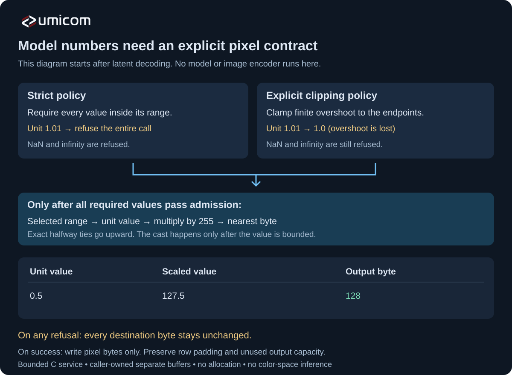

<!--
Umicom Bits2Banking
File: content/lessons/05-ai/generative-ai-foundations/30-turn-model-values-into-explicit-pixels.md

PURPOSE:
Turn model values into explicit pixels

AUTHOR AND ORGANISATION:
Sammy Hegab
Umicom Foundation

LICENCE:
MIT
-->

# Turn model values into explicit pixels

[Course contents](index.md)

## What you will learn

A generated image usually passes through several representations before you see it. A model may produce a latent: a compressed numerical representation that needs a separate decoder. That decoder may produce a tensor: a rectangular arrangement of numbers. A display or image-file encoder needs pixels with a known channel order and range. This lesson starts only after a caller has obtained decoded RGB values. It explains the last numerical conversion with six original values, so you do not need a model, a photograph, a GPU or a large download.

## Before you begin

1. Complete the image-tensor lesson and identify width, height, channel and stride in its two-by-two example. Revisit that lesson if those words are unfamiliar.
2. Keep your existing Bits2Banking and Framework checkouts. You need a C23 compiler, CMake and Ninja; the earlier setup lesson explains each tool.
3. Open PowerShell at your Bits2Banking folder. The commands below use the established Windows UCRT64 example paths. If your folders differ, change the paths consistently.
4. Read labs/framework/image-tensor/quantize.c before building. It owns two small arrays and calls the shared Framework service. It does not train a model or save an image.

## Three different meanings of a number

| Representation | Example | What it does not tell you |
| --- | --- | --- |
| Latent value | A coordinate produced by a generative model | It is not automatically a red, green or blue pixel. |
| Decoded unit code value | 0.5 in the declared [0,1] range | It does not establish a color space, a transfer function or a file format. |
| Stored RGB8 channel | The integer 128, stored in one byte | It does not record the original floating-point precision. |

## A byte has a finite number of choices

A byte has eight bits. Eight binary choices create 256 different patterns, numbered 0 through 255 when interpreted as an unsigned integer. RGB8 uses one such byte for red, one for green and one for blue. The 8 describes bits per channel, so one pixel occupies three bytes here. Floating-point values can represent many intermediate values that cannot all fit into those 256 choices. Quantization is the deliberate mapping from those values to the smaller set. Some information is lost; converting the bytes back to floats cannot generally recover an arbitrary original tensor.

## Choose the declared input range first

| Range | Lowest endpoint | Middle | Highest endpoint |
| --- | --- | --- | --- |
| UNIT | 0 maps to byte 0 | 0.5 maps to byte 128 | 1 maps to byte 255 |
| SIGNED_UNIT | -1 maps to byte 0 | 0 maps to byte 128 | 1 maps to byte 255 |

## Calculate one channel by hand

1. Take the unit value 0.5. Multiply by 255: the result is 127.5. The nearest integer is tied between 127 and 128.
2. This service defines an exact halfway tie to go upward, so the result is 128. The rule is part of the API contract. A different library may use a different rule.
3. Take 0.25. Multiplying by 255 gives 63.75, which rounds to 64. Take 0.75: 191.25 rounds to 191.
4. For a signed value, first calculate (value + 1) / 2 using double intermediates. A signed value of 0 becomes unit 0.5. A signed value of 0.5 becomes unit 0.75.
5. Do not cast an unchecked floating-point value directly to a byte. A cast is a conversion, not a bounds check; nonfinite or out-of-range conversion can violate the language rules.

## Strict admission and explicit clipping

A valid decoded tensor might be defined to stay inside its declared range. If that is your contract, choose REJECT_OUTSIDE. A value just above 1 or just below 0 in a unit tensor refuses the whole call. A preview policy may instead allow finite overshoot to be clipped to the nearest endpoint. Choose CLIP_OUTSIDE only when that change is intended. Clipping hides the amount of overshoot and cannot repair a model or prove its output is correct. Neither policy accepts NaN, positive infinity or negative infinity. NaN means not a number; infinity is not a finite channel intensity.

## Walk through the original source

The example has two pixels, one row and three channels per pixel: six input floats. HWC means consecutive RGB values for each pixel. The row stride is six bytes because the output row contains two three-byte pixels. The output array deliberately has eight bytes: the last two are outside the image and must remain unchanged. The full source initializes the buffer, checks status, compares expected bytes and verifies those two spare bytes.

~~~c
const float unit[6] = {0.0F, 0.5F, 1.0F, 0.25F, 0.75F, 0.0F};
uint8_t rgb[8];
UmiStatus status = UmiAiTrainingImageUnpackRgb8(
    unit, 6, 2, 1, 6,
    UMI_AI_TRAINING_IMAGE_HWC, UMI_AI_TRAINING_IMAGE_UNIT,
    UMI_AI_TRAINING_IMAGE_REJECT_OUTSIDE, rgb, sizeof rgb);
~~~

## Understand each argument and its unit

| Argument | Meaning | Unit |
| --- | --- | --- |
| values and valueCount | Borrowed input address and available float elements | floats, not bytes |
| width and height | Positive image dimensions | pixels and rows |
| rowStrideBytes | Distance between starts of output rows | bytes |
| layout | HWC interleaving or CHW channel planes | enumerated choice |
| range | UNIT or SIGNED_UNIT value convention | enumerated choice |
| quantization | Reject outside values or explicitly clip them | enumerated choice |
| outRgb and rgbCapacityBytes | Caller-owned destination address and available storage | bytes |

## Build the three related exercises

Run one command at a time and stop on any error. Configuration creates build instructions. Building compiles and links the programs. CTest executes their registered checks. A program from a previous successful build is not evidence that a failed new build worked.

~~~powershell
Set-Location "C:\umicom\Umicom-Bits2Banking"
$env:Path = "C:\msys64\ucrt64\bin;$env:Path"
cmake -S labs/framework/image-tensor -B build/learning-image-tensor -G Ninja -DCMAKE_C_COMPILER=C:/msys64/ucrt64/bin/gcc.exe -DUMICOM_FRAMEWORK_SOURCE=C:/umicom/Umicom-Applications/framework
cmake --build build/learning-image-tensor
ctest --test-dir build/learning-image-tensor --output-on-failure
& ".\build\learning-image-tensor\umicom-image-quantize.exe"
~~~

## Read the expected result

The first line contains the two pixels in order. The second line comes from trying strict signed-range conversion on -4, 0 and 8: -4 and 8 are outside [-1,1]. The next call explicitly clips those finite values to -1, 0 and 1 before conversion. The NaN check places the invalid value at the end of the input, demonstrating that earlier channels are not published before the complete tensor is admitted.

~~~text
Strict unit RGB: 0 128 255 64 191 0
Outside values refused; previous pixels unchanged.
Explicitly clipped signed RGB: 0 128 255
NaN refused even when clipping is selected.
This converts code values; it does not decode a latent or train a model.
~~~

## Memory ownership and incomplete results

The function borrows the input array for the duration of the call. It neither stores the pointer nor frees the array. You own the destination too. Keep the two storage regions disjoint and unchanged by other threads until the call returns. The function checks dimensions, stride arithmetic and declared lengths; it cannot prove that an arbitrary pointer really refers to accessible storage. It scans all required input floats before writing pixels. No second image allocation is needed. On success it writes only pixel bytes, leaving row padding and the unused tail untouched. On failure it preserves every destination byte. This is a synchronous ownership contract, not a lock or a guarantee against concurrent misuse.

## Limits you must check before a larger image

This educational shared service has a bound of 16,384 float elements, including all three channels. Since an RGB pixel needs three elements, the largest allowed count is a multiple of three no greater than that limit. It does not accept a 512-by-512 image directly. A production large-image path needs separately reviewed tiling or streaming with its own complete-image publication contract. Do not split calls and then claim the entire image is atomic: a later tile could fail after earlier tiles changed.

## Why this is not an inverse of every preprocessing pipeline

The earlier standardization lesson computes (unit - mean) / scale. Those standardized values are not automatically UNIT or SIGNED_UNIT output. You must apply the matching model-defined inverse transform before this API when appropriate. A latent decoder, gamma or sRGB transfer function, alpha compositing, BGR reordering, color-profile conversion and image-file compression are separate operations. A successful RGB byte conversion proves none of them occurred. Umicom Media also applies its approved branding and export policy at the product layer; a low-level pixel converter does not invent a watermark or an export workflow.

## Experiments and recovery

1. Replace the third unit value with 1.01F and keep strict policy. Expect INVALID_ARGUMENT and no changed output bytes; do not print them as a new image.
2. Use the same finite value with clipping policy. Explain why byte 255 hides whether the original value was 1.01 or 100.
3. Try a capacity one byte shorter than the required image span. Expect CAPACITY_EXCEEDED and unchanged output. Restore the capacity before proceeding.
4. Switch layout to CHW without rearranging the input. Explain why the values are interpreted differently even though the total count is unchanged. Layout is not inferred.
5. If the header or symbol is missing, use matching Framework source and rebuild. Do not make an empty replacement declaration or link an unrelated installed library.
6. If your result differs around a halfway value, print the actual float you supplied and check the declared rounding rule. Decimal text is not always represented exactly as a binary float.

## Check your understanding

| Question | Answer to compare after trying |
| --- | --- |
| Does successful clipping prove the model stayed within its intended range? | No. Clipping deliberately discards the overshoot. |
| Does valueCount use the same unit as rgbCapacityBytes? | No. The first counts floats; the second counts bytes. |
| Can unused input tail elements contain NaN? | They are outside the declared image prefix and are not read. Every required pixel value must still be finite. |
| Can a signed zero be converted? | Yes. Both +0 and -0 are finite and map according to the selected range. |
| Does this example generate a new picture? | No. It converts an original six-value numerical fixture. |

[Previous: Apply explicit channel normalization](29-apply-explicit-channel-normalization.md)

[Next: Validate every frame before publishing a clip](31-validate-every-frame-before-publishing-a-clip.md)
