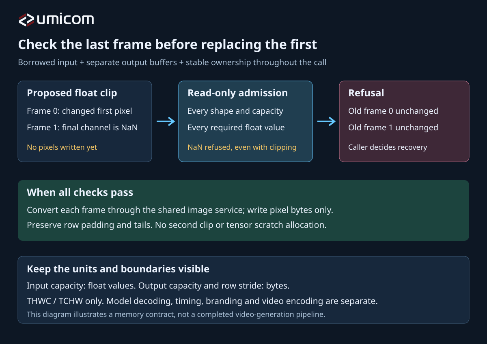

<!--
Umicom Bits2Banking
File: content/lessons/05-ai/generative-ai-foundations/31-validate-every-frame-before-publishing-a-clip.md

PURPOSE:
Validate every frame before publishing a clip

AUTHOR AND ORGANISATION:
Sammy Hegab
Umicom Foundation

LICENCE:
MIT
-->

# Validate every frame before publishing a clip

[Course contents](index.md)

## A video contains more than one image

A frame is one image in a sequence. A clip is a selected sequence of frames. A model may produce floating-point numbers for every channel of every pixel in that sequence. Before an application displays or encodes those numbers, it must turn them into a defined pixel representation. The previous lesson handled one image. This lesson adds a transaction across the whole clip: either every frame is admitted, or all the old destination pixels remain unchanged.

1. Review the image output lesson and its explicit range and rounding choices.
2. Open labs/framework/video-tensor/output.c. The example uses two frames, each only two pixels wide and one pixel high. It loads no model or media file.
3. Open the shared declarations in include/umicom/ai/training/video_tensor.h and image_tensor.h in Framework. The example calls these services rather than implementing its own converter.

## Count the values before counting their bytes

Each RGB pixel contains red, green and blue channels. Two frames × one row × two pixels × three channels equals 12 float values. If sizeof(float) is four on the compiler in use, those values occupy 48 bytes. The converter receives valueCount in floats, while each destination capacity and row stride are measured in bytes. Mixing those units can turn an apparently generous capacity into an out-of-bounds access.

| Quantity in this example | Value | Unit |
| --- | --- | --- |
| Frame count | 2 | frames |
| Width and height | 2 and 1 | pixels |
| Values per frame | 6 | floats |
| Required input prefix | 12 | floats |
| Destination pixel bytes per frame | 6 | bytes |
| Destination capacity per frame | 8 | bytes; last two stay unchanged |

## Read the axes in their actual order

T means time, H height, W width and C channel. THWC stores a complete interleaved RGB image, followed by the next image. TCHW stores the red plane, green plane and blue plane of one image, then the next image. The existing HWC and CHW enum choices select these two per-frame orders. CTHW would group the same color across time and is not supported by this adapter. Identical element counts do not make different axis orders interchangeable.

## Trace the original fixture

The first frame contains a red pixel and a green pixel. The second contains blue and a gray whose three channels are each 0.5. In the unit range, 0 means the low endpoint and 1 means the high endpoint. The explicit nearest-integer rule turns 0.5 × 255 into 128. It does not use the truncating result of a bare cast.

~~~c
float values[12] = {
    1,0,0, 0,1,0,       /* frame 0: red, green */
    0,0,1, 0.5f,0.5f,0.5f /* frame 1: blue, gray */
};
uint8_t first[8], second[8];
const UmiAiTrainingVideoRgb8Output frames[2] = {
    {first, sizeof first, 6},
    {second, sizeof second, 6}
};
~~~

## Give each output a clear owner

A descriptor is a small record describing storage: a pointer, a byte capacity and a row stride. It does not allocate that storage. Here the main function owns both byte arrays for the entire call. The float input, descriptor array and writable destinations must stay stable and disjoint. Destinations must also be disjoint from one another. The service does not discover accidental aliases or lock buffers for other threads. A GUI client would need its own publication and synchronization boundary after conversion.

1. Initialize the arrays to a recognizable byte such as 91 before the first conversion.
2. Call UmiAiTrainingVideoUnpackRgb8 with two frames, width two, height one, HWC, UNIT and REJECT_OUTSIDE.
3. Require UMI_STATUS_OK before using newly converted pixels.
4. Check that the first six bytes in each array contain the expected colors and the last two remain 91. Those final bytes are capacity tail, not additional pixels.

## Why checking frame by frame can be wrong

Imagine replacing frame zero immediately, then discovering NaN in frame one. NaN means not a number; it can result from invalid numerical operations. The application would now hold a mixture of new and old frames. The shared video adapter avoids this by checking all output descriptors and required input values before it writes any pixels. It then delegates actual conversion to the shared image service. This takes an extra bounded read pass, but does not require a second clip allocation.

## Run the late-failure experiment

After a successful conversion, the program saves both output arrays. It changes the first proposed input channel from 1 to 0, then sets the very last channel to NAN. The first change would visibly alter the first frame if conversion began too early. The bad last channel forces refusal. Compare both complete output arrays with the saved copies: neither may have changed.

~~~c
values[0] = 0;
values[11] = NAN;
/* CLIP_OUTSIDE still rejects NAN and infinity. */
UmiStatus status = UmiAiTrainingVideoUnpackRgb8(
    values, 12, 2, 2, 1, UMI_AI_TRAINING_IMAGE_HWC,
    UMI_AI_TRAINING_IMAGE_UNIT,
    UMI_AI_TRAINING_IMAGE_CLIP_OUTSIDE, frames);
/* Expect INVALID_ARGUMENT and both old buffers unchanged. */
~~~

## Clipping is a policy, not a numerical repair

A finite value such as 1.2 can be rejected or explicitly clamped to the high endpoint. That changes the displayed result and may hide overshoot, so select the policy deliberately. NaN and infinity are refused in both policies. They are not valid endpoints and should trigger diagnosis of the model or preceding arithmetic. The read-only UmiAiTrainingImageValidateValues helper applies the same finite/range rule to an explicit prefix without mutating its input.

## Build and run the native example

Use a terminal in the Bits2Banking checkout. CMake, Ninja, a C23 compiler and a matching Framework checkout are required. Run each command separately and stop on errors. This small build compiles the actual shared implementation but does not qualify an installed SDK.

~~~powershell
$env:Path = "C:\msys64\ucrt64\bin;$env:Path"
cmake -S labs/framework/video-tensor -B build/learning-video-tensor -G Ninja -DCMAKE_C_COMPILER=C:/msys64/ucrt64/bin/gcc.exe -DUMICOM_FRAMEWORK_SOURCE=C:/umicom/Umicom-Applications/framework
cmake --build build/learning-video-tensor
ctest --test-dir build/learning-video-tensor --output-on-failure
& ".\build\learning-video-tensor\umicom-video-output.exe"
~~~

## Expected output and recovery

~~~text
Frame 0: red, green
Frame 1: blue, gray (128)
A bad final value preserved both earlier output buffers.
Padding stayed unchanged. No video file or model was produced.
~~~

1. A missing function declaration or symbol usually means the selected header and source are from different revisions. Inspect the configured Framework path; do not run an older executable after a failed build.
2. A capacity failure means an input prefix, output span or bounded size is too small or too large. Recalculate count × width × height × 3 and the last required row byte.
3. If a stride is smaller than width × 3, the rows overlap within one frame. Correct the descriptor rather than ignoring the error.
4. A zero-test match is not evidence. Inspect the test list with ctest --test-dir build/learning-video-tensor -N and confirm the output example is registered.

## Keep the next stages explicit

This service accepts up to 64 frames and 65536 floats for a clip, with at most 16384 floats per image. These deliberately small limits suit bounded teaching and preparation tasks, not arbitrary full-resolution video. It does not invert channel standardization, decode latent values, run a generative model, choose timestamps, encode audio/video or add branding. Umicom Media output still needs its approved logo watermark and separate encoding workflow. Chunking a larger clip into many calls does not automatically give one transaction across those calls.

## Check your understanding

1. Why does valueCount equal 12 rather than 48? It counts float elements, not their storage bytes.
2. Why can the extra input tail contain NaN without rejecting a valid two-frame prefix? Only the required prefix belongs to this conversion; capacity beyond it is not input data.
3. Why is CLIP_OUTSIDE not a fix for NaN? Clipping applies only to finite values with an ordering relative to the endpoints.
4. Why can a model output still look wrong after this service succeeds? Wrong axes, model semantics, latent decoding, preprocessing or poor model quality can all produce structurally admitted but unsuitable pixels.
5. What must a caller do if another thread might change the float input during preflight? Establish stable ownership or synchronization before calling; the service cannot make that race safe.

[Previous: Turn model values into explicit pixels](30-turn-model-values-into-explicit-pixels.md)

[Next: Choose an image interpolation policy](32-choose-an-image-interpolation-policy.md)
