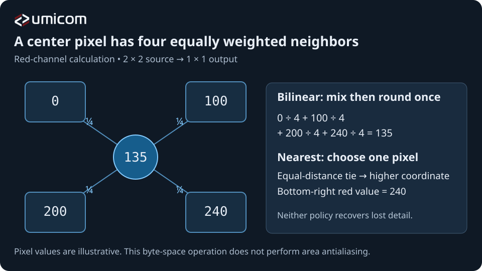

<!--
Umicom Bits2Banking
File: content/lessons/05-ai/generative-ai-foundations/32-choose-an-image-interpolation-policy.md

PURPOSE:
Choose an image interpolation policy

AUTHOR AND ORGANISATION:
Sammy Hegab
Umicom Foundation

LICENCE:
MIT
-->

# Choose an image interpolation policy

[Course contents](index.md)

## What you will make

You will shrink a tiny two-by-two image to one pixel twice: once by selecting a nearby pixel and once by mixing neighboring pixels. You will predict the numbers before running the program. This is a preprocessing lesson, not a model-training run. Preprocessing means changing input data into the form expected by a model. A different resizing rule can produce different training data even when the source files are identical.

## Start with pixels, channels and rows

An image is a rectangular grid. One position in that grid is a pixel. Our example stores three numbers per pixel: red, green and blue, abbreviated RGB. Each number is an unsigned byte, so it can hold an integer from 0 through 255. The numbers here are already decoded pixels in memory. A PNG or JPEG file has a different encoded file structure; passing its file bytes directly to this API would not decode it.

| Position | Red | Green | Blue |
| --- | --- | --- | --- |
| Top left | 0 | 10 | 20 |
| Top right | 100 | 110 | 120 |
| Bottom left | 200 | 210 | 220 |
| Bottom right | 240 | 250 | 255 |

## Locate a destination pixel in the source

Coordinates count from zero. In a two-pixel row, the source centers are called 0 and 1. Resizing to one pixel places its center halfway between those source centers. The center-mapping formula is (d + 0.5) × sourceSize / targetSize − 0.5. Here d is the destination coordinate; sourceSize and targetSize are the widths for a horizontal calculation or the heights for a vertical calculation. For 2 to 1, d is 0, so the result is 0.5. A coordinate outside the source is clamped to its nearest border: clamping means limiting a value to an allowed range.

1. Write d = 0, sourceSize = 2 and targetSize = 1 on paper.
2. Calculate (0 + 0.5) × 2 / 1 − 0.5 = 0.5.
3. Repeat for height. The destination center is at source position (0.5, 0.5).
4. Notice that all four source pixels are equally distant. A policy must specify what to do with this tie.

## Nearest and bilinear answer different questions

Nearest sampling selects one source pixel. Framework resolves equal-distance nearest ties toward the higher coordinate, so this example chooses the bottom-right RGB value: 240, 250, 255. Bilinear interpolation mixes two neighbors horizontally and two vertically. A weight is the fraction contributed by a neighbor. At the center, each horizontal weight is one half and each vertical weight is one half. Multiplying them gives one quarter for each of the four pixels. Bilinear is not a promise to invent missing detail.

## Compute the weighted result by hand

A byte cannot hold 153.75. The Framework policy rounds to the nearest integer, sending exact half ties upward: 127.5 becomes 128. It rounds once after combining both axes. Rounding each horizontal result before the vertical calculation is a different algorithm. For four scalar values 0, 0, 0 and 1, the exact center average is 0.25 and rounds to 0. Prematurely rounding the lower row average 0.5 to 1 and then averaging rows would produce 1 instead.

| Channel | Weighted calculation before rounding | Final byte |
| --- | --- | --- |
| Red | (0 + 100 + 200 + 240) / 4 = 135 | 135 |
| Green | (10 + 110 + 210 + 250) / 4 = 145 | 145 |
| Blue | (20 + 120 + 220 + 255) / 4 = 153.75 | 154 |

## Read the C data declaration

uint8_t names an unsigned eight-bit integer type. The square brackets create an array, a sequence of values stored next to one another. sizeof pixels gives its byte size. The five view fields are pixel address, accessible byte count, width, height and row stride. Row stride is the number of bytes from the start of one row to the start of the next; two RGB pixels need six bytes here. The ampersand in &source passes the descriptor address. The output array belongs to the caller and has room for one RGB pixel. Check status before using a result. The complete laboratory below includes those checks.

~~~c
const uint8_t pixels[] = {
    0,10,20, 100,110,120,
    200,210,220, 240,250,255
};
const UmiAiTrainingRgb8View source = {pixels,sizeof pixels,2,2,6};
uint8_t output[3];
UmiStatus status = UmiAiTrainingImageResizeBilinearRgb8(
    &source, 1, 1, output, sizeof output);
~~~

## Prepare the existing projects

1. Use the Umicom Framework and Bits2Banking checkouts from the same integrated source delivery. You need a C23-capable compiler, CMake and Ninja. These are build tools: the compiler translates C, CMake prepares build instructions, and Ninja executes the required compilation steps.
2. On Windows, open PowerShell. Check the paths in the commands below against your installed folders before running them. The example assumes the UCRT64 GCC toolchain is installed under C:\msys64.
3. Open labs/framework/image-resize/bilinear.c in a text editor. Compare its pixels array with the table above. Do not replace the entire Framework with a local copy inside the lesson.
4. Run each command separately. Stop if a command reports an error. The configure step selects an existing Framework source tree for a narrow teaching build; it does not prove that a separately installed SDK package works.

## Configure, compile, check and run

The build directory holds generated files and executables. It is separate from the source directory. The test command runs both the original nearest lesson and this bilinear comparison. The final command runs the comparison program directly. It neither downloads a model nor writes an image file.

~~~powershell
Set-Location "C:\umicom\Umicom-Bits2Banking"
cmake -S labs/framework/image-resize -B build/image-resize -G Ninja -DCMAKE_C_COMPILER=C:/msys64/ucrt64/bin/gcc.exe -DUMICOM_FRAMEWORK_SOURCE=C:/umicom/Umicom-Applications/framework
cmake --build build/image-resize --parallel 2
ctest --test-dir build/image-resize --output-on-failure
& .\build\image-resize\umicom-image-bilinear.exe
~~~

## Compare the observed output

The first two lines should match your paper calculation. The third line comes from an intentional refusal: a three-byte pixel cannot fit in a capacity of two bytes. The program checks that the previous output stays unchanged. A passed assertion establishes this specific behavior for the tested input; it does not establish that every possible caller supplies valid pointers.

~~~text
Nearest center: 240 250 255
Bilinear center: 135 145 154
Short output leaves the previous image unchanged.
Six stripes to two: 255 0; no area antialiasing.
~~~

## Why smoothing is not complete antialiasing

Aliasing occurs when fine patterns are represented incorrectly at a lower sampling resolution. Imagine six alternating black and white columns. When the example shrinks them to two columns, the mapped source positions are exactly 1 and 4. Bilinear then reads white and black at those positions. It does not average all pixels covered by each new pixel. An area filter or other suitable low-pass filter can use a wider footprint when shrinking, but this API does not implement that. Neither resizing method can reconstruct detail discarded by an earlier reduction.

## Choose the policy for the actual data

| Data or requirement | Decision to make |
| --- | --- |
| Ordinary RGB image | Match the model documentation: size, crop, interpolation, color handling and normalization. |
| Categorical mask: numbers mean classes | Use a label-preserving method. Mixing class 0 with class 2 must not silently invent class 1. |
| Light or color accuracy | Determine whether the workflow requires linear-light interpolation; these routines mix encoded byte values. |
| Small textures during substantial shrinking | Check aliasing and use a qualified antialiasing policy if required. |
| Reproducible dataset | Record the chosen algorithm and parameters alongside the dataset version. A filename does not capture preprocessing. |

## Keep the C memory contract visible

A borrowed view does not own or copy its pixels. Keep the pixel storage alive and unchanged until the call completes. Source descriptor, readable source bytes and writable destination storage must be disjoint; in-place overlap is not supported. Framework validates dimensions, stride, declared capacity and the limit of 16,384 channel values per input and output. It cannot discover whether a pointer actually refers to accessible memory. The bounded implementation performs no heap allocation and retains no pointer. This makes its resource use predictable, but does not turn all surrounding C code into memory-safe code.

## Troubleshoot before changing data

| Symptom | Check |
| --- | --- |
| The new function is not declared | Verify that the header and source come from the same integrated Framework version. |
| Configure cannot find a Framework file | Correct UMICOM_FRAMEWORK_SOURCE; it must name the Framework root. |
| Capacity-exceeded status | Check width × height × 3, output capacity and the bounded image limit. |
| Unexpected colors | Confirm RGB channel order, row stride and encoded-byte versus linear-light expectations. |
| The output differs only at borders | Check center alignment and clamping rules, not just the algorithm name. |
| The program crashes before returning a status | Inspect object lifetime, actual allocation size and overlap. A declared byte count does not allocate memory. |

## Practice and answers

1. Change the four blue values to 0, 0, 0 and 1 in a copy of the exercise. Predict the exact average and rounded output before editing its expected-value assertion. Answer: 0.25, then 0.
2. Make all four pixels equal to 70, 80, 90. Predict both policies. Answer: both return the same constant color.
3. Explain why passing JPEG file bytes as the source array is wrong. Answer: the API requires decoded pixels and does not parse compressed image files.
4. Write a short dataset note listing source resolution, output resolution, crop, interpolation, color convention and normalization. This note makes later training and inference preparation easier to compare.

[Previous: Validate every frame before publishing a clip](31-validate-every-frame-before-publishing-a-clip.md)
