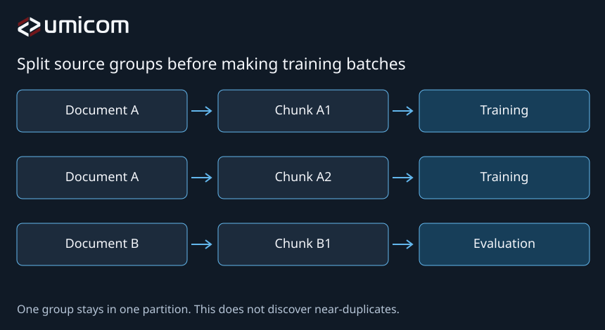

<!--
Umicom Bits2Banking
File: content/lessons/05-ai/preparing-llm-training-data/05-split-sources-before-chunking.md

PURPOSE:
Keep related sources out of different partitions

AUTHOR AND ORGANISATION:
Sammy Hegab
Umicom Foundation

LICENCE:
MIT
-->

# Keep related sources out of different partitions

[Course contents](index.md)
Training data changes model weights. Validation data helps choose settings during development. A final test set is held back for an independent assessment after those choices. If nearly identical material appears on both sides, the measured result can be misleading. This is called data leakage.

Imagine a long document split into ten chunks. Randomly placing individual chunks into training and validation lets the model see closely related text from the same document. Video frames from the same clip and conversations from the same session have the same problem. Assign a source group before splitting, and keep the entire group together.

~~~text
row     source group     content
0       100              handbook paragraph A
1       100              handbook paragraph B
2       200              separate tutorial
3       300              separate question set
4       300              another question in that set
5       400              independent note
~~~

1. Give every related source a stable group identifier. Different rows may share one identifier.
2. Choose training and evaluation groups before tokenizing or augmenting. For a final test set, reserve independent groups through a separate documented process.
3. Verify that no group identifier occurs in both outputs. Count both groups and rows.
4. Record the seed, source set and splitting policy so the decision can be reproduced.
5. If deployment predicts future events, consider a chronological split. A random grouped split is not automatically appropriate for finance time series.

The Framework function UmiAiTrainingSplitGroups implements a bounded, deterministic two-way group partition for up to 4096 rows. It selects a requested number of unique evaluation groups, maps membership back to rows, and leaves output unchanged on invalid requests. It does not discover duplicates, stratify labels or create a final test set. Two groups out of ten does not guarantee twenty percent of the rows.

## Exercise

If group 100 has ninety rows and the other nine groups have one row each, selecting one evaluation group may produce ninety evaluation rows or only one. Explain why both results satisfy a group-count request. If balanced label counts matter, design and validate an additional policy rather than describing this API as stratified.

One group stays in one partition. This does not discover near-duplicates.

## Continue learning

[Previous: Review quality, duplicates and allowed use](04-quality-deduplication-and-rights.md) · [Course contents](index.md) · [Next: Run a native Framework dataset-partition lab](06-run-the-framework-group-lab.md)
