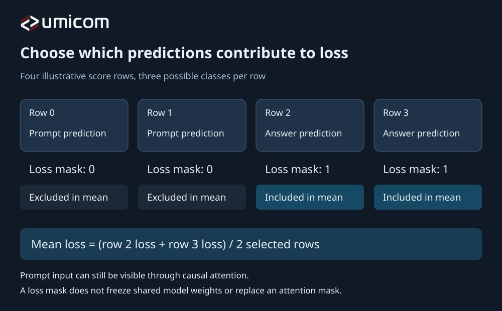

<!--
Umicom Bits2Banking
File: content/lessons/05-ai/preparing-llm-training-data/16-choose-which-predictions-contribute-to-loss.md

PURPOSE:
Choose which predictions contribute to loss

AUTHOR AND ORGANISATION:
Sammy Hegab
Umicom Foundation

LICENCE:
MIT
-->

# Choose which predictions contribute to loss

[Course contents](index.md)
A training record tells us what an example contains. It does not, by itself, decide which predictions a trainer should learn from. In a question-and-answer exercise, we may want the model to read the question while measuring its ability to produce the answer. This lesson introduces a loss mask: a small list of yes-or-no choices that decides which prediction rows contribute to a particular training objective. You will inspect an illustrated example and run a tiny C program using Umicom Framework. The program updates invented scores; it does not load or fine-tune a language model.

## 1. Start with scores, probabilities and a target

Imagine that a model must choose one of three possible next tokens. A token is a unit selected by a tokenizer; it might be a word, part of a word, punctuation or another symbol. For one prediction position, the model produces three scores. These raw scores are called logits. They are not probabilities: they can be negative, and they do not have to add up to one.

A softmax converts a row of finite scores into nonnegative probabilities that add up to approximately one. A target is the index of the correct class for that row. With three classes, valid indices are 0, 1 and 2. Cross-entropy for one categorical target is the negative natural logarithm of the probability assigned to that target. It is a measure of prediction error: assigning a larger probability to the correct target reduces this loss.

~~~text
Scores:                0, 0, 0
Softmax probabilities: 1/3, 1/3, 1/3
Target index:          2
Target probability:    1/3
Loss:                  -ln(1/3) = ln(3) = approximately 1.0986123
~~~

ln means the natural logarithm, whose base is the mathematical constant e. You do not need to calculate it by hand for this exercise; the C math library supplies log. Three equal scores give three equal probabilities even if all three scores are 100 or all three are negative. Adding the same constant to every score in a row must not change the probabilities or loss.

## 2. Understand the numerical correction

Computers store floating-point numbers with limited precision. A mathematically correct arrangement of operations can still lose a small result when a large number is added and later subtracted. For example, forming maximum + log(sum) - target can discard the logarithm when maximum and target are both extremely large. Framework subtracts the target from the maximum before adding the logarithm. It also subtracts the maximum before exponentiation, preventing large positive exponentials.

~~~text
maximum = largest score in the row
sum = sum of exp(score - maximum) over all classes
row loss = (maximum - target score) + log(sum)
~~~

The difference in parentheses is computed first. For three equal finite scores it is zero, so the logarithm remains visible. This is one reason to test extreme but valid inputs rather than checking only small round numbers. A lower numeric loss caused by cancellation is not evidence that a model learned anything.

## 3. Select rows, not vocabulary entries

Our toy tensor is a rectangular table with four rows and three columns. Each row represents one prediction position. Each column represents one of the three possible classes. The selection array has four entries, one per row. A value of 1 includes that row in this objective; a value of 0 excludes it. The mask does not choose particular columns or ban a word from the vocabulary.

~~~text
Row:        0  1  2  3
Target:     2  1  0  2
Selected:   0  0  1  1

Mean selected loss = (row 2 loss + row 3 loss) / 2
~~~

The denominator is two because exactly two rows are selected. Dividing by four would halve the contribution and change the update scale. An all-zero mask has no selected-row mean, so the Framework operator refuses it. Every target must still be a valid class index, including targets on excluded rows. Supply 0 or 1 for every selection entry; a nonzero value such as 7 is not accepted as an alternative spelling of true.

## 4. Keep loss masks separate from attention masks

An attention mask controls which input positions can influence one another. For example, causal attention prevents a prediction from using future tokens. A loss mask controls which predictions are scored by one objective. A prompt can remain visible as context while its own prediction rows are excluded from the loss. Removing the prompt from attention would ask a different learning question.

The zero-gradient result in this lab applies to excluded rows of an independent score tensor. In a real language model, shared weights and hidden states can still receive gradients through selected answer predictions. An answer may depend on prompt representations. Therefore a loss mask does not freeze the prompt embeddings or all parameters involved in reading the prompt. Freezing parameters, stopping gradients and controlling attention are separate operations.

## 5. Align targets before constructing a language-model mask

For next-token training, an output at position t usually predicts the token at position t + 1. This is called shifting the labels. A chat template may also insert role markers, separators and end-of-message tokens. The tokenizer and template determine the actual positions; counting words in the original text is not sufficient.

~~~text
Illustrative token sequence:  [prompt A] [prompt B] [answer C] [answer D] [end]
Predictions after inputs:      A          B          C          D
Corresponding targets:        B          C          D          end
Answer-only selection:        0          1          1          1
~~~

This example includes the end marker in the answer objective. That is an explicit policy, not a universal template rule. A different model may require another treatment of role or boundary tokens. Write down the expected shifted targets and mask for one short example before processing thousands of records. Never paste this illustrative mask into a real tokenizer pipeline without checking its conventions.

## 6. Read the complete C example

Open labs/framework/masked-language-loss/main.c in the Bits2Banking repository. initial contains twelve zeros: four rows times three classes. targets contains four valid class indices. selected contains 0, 0, 1, 1. The Framework tape owns the tensor and the loss node. A tape records operations so backward differentiation can compute how a change in each input would affect the objective.

~~~c
const float initial[12] = {0};
const size_t targets[4] = {2U, 1U, 0U, 2U};
const unsigned char selected[4] = {0U, 0U, 1U, 1U};

/* After creating a tape and the 4 by 3 score tensor: */
status = UmiAiTrainingMaskedCrossEntropy(
    tape, scores, targets, 4U, selected, 4U, &loss);
~~~

The snippet shows the operator call; use the complete lab file for declarations, error handling and cleanup. The two counts describe the number of targets and mask entries, and both must match the number of score rows. Framework copies the admitted targets and selection into its owned operation node. It does not keep borrowing the caller’s mask after the call returns. On refusal, the output loss pointer is left unchanged.

Backward differentiation writes gradients, which are rates of change. For a selected row, the gradient is the predicted probability minus 1 at the target class and minus 0 at other classes, divided by the selected-row count. The selected target’s gradient is negative for our uniform predictions. A small gradient-descent update subtracts that gradient, increasing the target score. The excluded rows have zero contribution from this objective.

## 7. Configure, build and run the exercise

1. Finish the earlier C setup lesson. Open PowerShell in the Bits2Banking checkout and confirm that CMake, Ninja and a C23 compiler are available.
2. Check that the primary Framework source checkout includes UmiAiTrainingMaskedCrossEntropy in its public tape header. Use matching headers and source rather than copying a single header from another version.
3. Run each command below separately and stop if it reports an error. The source path assumes Bits2Banking and Umicom-Applications are sibling folders.
4. Read the output. The initial loss should be close to 1.0986123, the result after one update should be lower, and the excluded-score-row check should pass. Small differences in printed final digits can depend on the math implementation.
5. Keep the command output with the compiler version when comparing machines. Passing this small source exercise does not qualify an installed SDK or a full model trainer.

~~~powershell
Set-Location "C:\umicom\Umicom-Bits2Banking"
cmake -S labs/framework/masked-language-loss -B build/masked-language-loss -G Ninja -DUMICOM_FRAMEWORK_SOURCE=../Umicom-Applications/framework
cmake --build build/masked-language-loss --parallel 2
ctest --test-dir build/masked-language-loss --output-on-failure
& ".\build\masked-language-loss\umicom-masked-language-loss.exe"
~~~

## 8. Recompute after an update

The lab applies one stochastic-gradient-descent-style update to its toy score values with a step size of 0.1. It then rewinds the tape while retaining the score leaf and builds a new loss. The old loss handle becomes invalid after the rewind. Reading that old handle would be a lifetime mistake; its previously computed number would also describe the old scores rather than the updated ones.

The single cleanup path destroys the tape exactly once. The tape owns its tensors and operation nodes, so the example does not free individual tensor pointers. This ownership model keeps a failed intermediate operation from leaving an untracked allocation behind. In a larger trainer, bounded tape memory and deliberate rewind points are as important as correct arithmetic.

## 9. Try small changes and diagnose refusals

1. In a separate learning copy, select all four rows. Predict the new denominator and compare the starting loss. It is still ln(3), because all rows initially have equal class probabilities.
2. Select only the final row. Predict which score gradients remain zero. The selected-row denominator becomes one.
3. Set every selection entry to zero. Expect the operator to refuse the request; do not replace the failure with a fabricated zero loss.
4. Set one target to 3. With three columns that index is outside the valid range, even if its row is excluded. Restore the target after observing the refusal.
5. Replace all initial scores with the same large finite value. The starting loss should remain close to ln(3). This exercise tests offset invariance, not model quality.
6. Explain in your own words why a prompt can affect an answer even when prompt prediction rows are excluded from the loss.

## 10. Connect this lab to a real fine-tuning pipeline

A complete pipeline still needs permissioned source material, a reviewed train/validation split, a tokenizer and model-specific chat template, shifted targets, padding rules, batches, a pretrained model, an optimizer, checkpoints and evaluation on held-out examples. This lab covers one small arithmetic and ownership boundary. It neither creates a vector database nor turns JSONL directly into a trained model.

Use the earlier data-validation and partition lessons to prepare records, then inspect tokenized examples with their target alignment and masks. Keep a small human-readable fixture containing token IDs, decoded tokens, targets and selection values. That fixture helps diagnose errors before an expensive training job. A falling training loss is only one signal; check answer quality, memorization, privacy and performance on unseen material separately.

## Different controls in a training pipeline

| Control | What it chooses | What it does not establish |
| --- | --- | --- |
| Record split | Which examples belong to training or evaluation | Token alignment or model quality |
| Tokenizer and template | How text becomes a token sequence | Which prediction rows are scored |
| Loss mask | Which rows contribute to one objective | Which context is visible |
| Attention mask | Which positions may influence attention | Which parameters are frozen |
| Parameter freeze policy | Which weights may be updated | Correct dataset contents |
| Held-out evaluation | How a saved model performs on unseen examples | Absence of every possible failure |

## Further reading

- [Framework C lab: masked language loss](https://github.com/umicom-foundation/Bits2Banking/blob/main/labs/framework/masked-language-loss/README.md)
- [Preparing Data for LLM Training course](../../../courses/preparing-llm-training-data/index.html)

[Previous: Turn reviewed partitions into complete JSONL buffers](15-serialize-reviewed-partitions.md)

[Next: Follow data ownership during import](17-follow-data-ownership-during-import.md)
