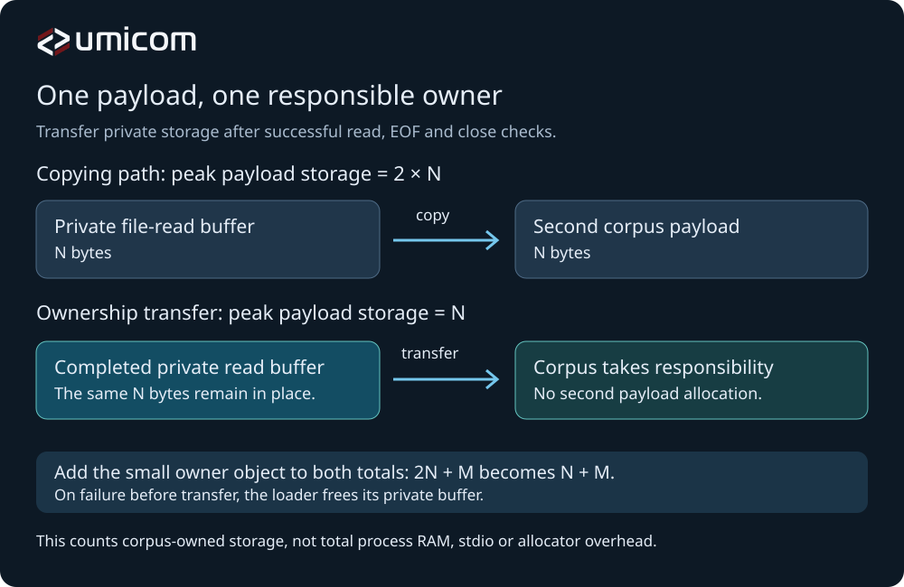

<!--
Umicom Bits2Banking
File: content/lessons/05-ai/preparing-llm-training-data/17-follow-data-ownership-during-import.md

PURPOSE:
Follow data ownership during import

AUTHOR AND ORGANISATION:
Sammy Hegab
Umicom Foundation

LICENCE:
MIT
-->

# Follow data ownership during import

[Course contents](index.md)
Before training starts, a program must bring data from storage into memory. The size of a file is not automatically the amount of memory required to load it. Temporary buffers, decoded text, token arrays and model state can coexist. This lesson follows one small native corpus loader and shows how an explicit ownership transfer avoids an unnecessary full copy without weakening cleanup or snapshot behavior.

## 1. Define payload, buffer and owner

A payload is the useful data being handled: here, the exact bytes of one local training corpus. A buffer is a region of memory large enough to hold those bytes. An owner is the part of the program responsible for keeping that storage alive and eventually releasing it. In C, that responsibility is usually a documented rule enforced by function design and tests rather than an automatic language guarantee.

A borrowed pointer gives temporary access without transferring responsibility. A copied payload occupies separate storage. An ownership transfer changes who is responsible for the same storage. These are three different operations. If both sides believe they should free a transferred allocation, the program can free it twice. If neither side takes responsibility, it can leak. A clear transfer point avoids both mistakes.

## 2. Inspect the original two-copy pattern

~~~text
Read N file bytes into private buffer A.
Call a public constructor that copies A into buffer B.
Keep A and B alive during the copy.
Free A.
Retain B until the corpus is destroyed.
~~~

This pattern can be correct, but its peak payload storage is two times N. The public copying constructor is useful when the caller still owns the original bytes and may change or release them. It is unnecessary when the loader already created a private buffer solely for the new corpus and nobody else can observe or mutate it.

Peak means the largest amount simultaneously held during the measured operation. Current usage after loading can look reasonable even if the temporary peak was much larger. A short-lived duplicate can therefore contribute to pressure during loading without appearing in a later idle measurement. This is not, by itself, a memory leak: the old path did release the temporary copy.

## 3. Transfer the completed private buffer

~~~text
Read N file bytes into private buffer A.
Check the complete read, end of file and successful close.
Allocate the small corpus owner object.
Move responsibility for A into that owner.
Publish the completed corpus.
Release A only when that corpus is destroyed.
~~~

The bytes stay in the same allocation. The owner object stores the pointer and length. Once publication succeeds, the loader must not free its former private buffer. If allocating the owner object fails before publication, the loader still owns the buffer and must free it. The caller’s output pointer remains unchanged on failure.

Umicom Framework implements this boundary in UmiAiCorpusLoadFile. It still imports exact bytes, enforces its existing maximum size, and does not reinterpret text or create a vocabulary. UmiAiCorpusCreate continues to copy caller-owned input. Changing the file loader does not silently turn that public copying constructor into a borrowing or ownership-taking API.

## 4. Calculate what the measurement means

Let N be the payload size and M the small corpus-owner object. The two-copy path peaks at 2N + M in allocations directly owned by this loader. The transfer path peaks at N + M. For a one-mebibyte payload, N is 1,048,576 bytes. If the target ABI uses a sixteen-byte owner, those totals are 2,097,168 and 1,048,592 bytes. The saved amount is exactly one payload.

A mebibyte, abbreviated MiB, is 1,024 × 1,024 bytes. A decimal megabyte is 1,000,000 bytes. Use explicit units when comparing file sizes and memory reports. The owner-object size depends on the target’s pointer and size representation, so do not hard-code sixteen bytes as a universal C rule.

These totals exclude standard-I/O buffering, allocator bookkeeping, stack frames, operating-system file cache, other application objects and child-model processes. A corpus allocation counter is not the same measurement as resident set size or private committed memory. A smaller corpus peak is useful evidence for this operation, not proof that every application uses half as much RAM.

## 5. Verify the successful path before studying failures

1. Open the Framework checkout and read include/umicom/ai/training/corpus.h. Identify which functions create an owner and which function destroys it.
2. Read the active UmiAiCorpusLoadFile implementation in src/ai/training/corpus.c. The superseded implementation remains in a disabled block for engineering comparison.
3. Find the exact line where the completed private buffer becomes the corpus payload. Explain why no other caller can still own that private allocation.
4. Run the focused commands below. They build a small source test project rather than starting a model or loading a pretrained weight file.
5. Read the verbose output for payload bytes, peak corpus-owned bytes and allocation calls. Keep those numbers separate from operating-system process measurements.

~~~powershell
Set-Location "C:\umicom\Umicom-Applications\framework"
cmake -S tests/training_corpus_memory -B build/training-corpus-memory -G Ninja
cmake --build build/training-corpus-memory --parallel 2
ctest --test-dir build/training-corpus-memory --output-on-failure --verbose
~~~

Run each command separately and stop on an error. The source test uses temporary files inside its build area. It does not download data, start a server or alter a model. Its allocation observer includes the actual production corpus source, so the reported payload behavior is not a second teaching implementation pretending to represent the loader.

## 6. Inject allocation failures deliberately

Out-of-memory failures are hard to reproduce by filling a real computer’s RAM, and doing so can disturb unrelated applications. A focused test can instead make a selected allocation call return failure. The corpus test first observes a successful path, then injects failure at each allocation position. Every refused load must leave the caller’s output owner unchanged and return the tracked live allocation total to zero.

This checks both the payload allocation and the later owner-object allocation. The second case is especially important: the file has already been read and closed, but publication cannot complete. The loader must release the private payload instead of dropping its pointer. A successful first allocation is not permission to forget cleanup when the next operation fails.

The test also refuses empty and oversized files before allocating a payload. Separate existing regressions check token-window bounds, overlapping output ranges and immutable source hashes. These checks address different contracts. A memory counter reaching zero does not prove token values are correct; a correct token result does not prove all failure paths release storage.

## 7. Preserve snapshot independence

After a successful import, the corpus owns an immutable copy of the bytes it read. It no longer depends on keeping the original file open. The test removes its own temporary source file and verifies that corpus hashing and token windows still work. This confirms that the ownership transfer did not accidentally turn the corpus into a borrowed file buffer with an invalid lifetime.

The import is not a filesystem snapshot transaction. Another process changing a file during the read can still create a consistency problem beyond the documented length, EOF and I/O checks. Use trusted, stable input paths and reviewed content identities for a reproducible training run. A hash identifies the imported bytes; it does not prove their licensing, factual quality or publisher authenticity.

## 8. Extend the same reasoning to a larger pipeline

Consider a document that passes through extraction, Unicode text, JSONL parsing, tokenization and batching. Each stage may create another representation. Draw the live buffers at each stage, identify which ones are still needed, and release or reuse them only after their final consumer has finished. Do not eliminate copies blindly: an asynchronous worker may need independent storage because the caller can edit or destroy the original.

For image and video training, decoded images and frame tensors can be much larger than compressed files. A small JPEG or video clip on disk does not imply a small decoded batch. Include resolution, channels, element width, number of frames, batch count, optimizer state and intermediate activations in the relevant memory plan. CPU RAM and device memory are separate address spaces and should not simply be added together as available capacity.

## 9. Practice an ownership review

1. Draw the two-copy and transfer paths. Label who must free each allocation at every stage.
2. Calculate old and new payload peaks for 256 KiB, 512 KiB and 1 MiB, leaving M symbolic.
3. Explain why transferring caller-owned bytes without changing the public contract would be a bug, even if it saved memory.
4. Explain why a process may keep a high resident-memory reading after free because of allocator or operating-system behavior. Do not call that observation a leak without further evidence.
5. Choose one pipeline boundary in your project. Write its input lifetime, output owner, failure cleanup and publication point before changing the implementation.

## Evidence and its limit

| Observation | What it supports | What it does not prove |
| --- | --- | --- |
| One payload allocation retained | The loader avoids a duplicate payload | Total process RAM is bounded |
| All injected allocation failures clean up | Covered allocation-refusal paths preserve ownership | Every possible I/O race was exercised |
| Hash remains stable after fixture removal | Imported bytes have an independent lifetime | Original source was trustworthy |
| Empty and oversized files refused | Declared size admission works for tested inputs | Real model weights fit in memory |
| Lower peak in this loader | A specific native memory improvement | Unrelated Python crashes are repaired |

## Further reading

- [Framework corpus ownership header](https://github.com/umicom-foundation/umicom-framework/blob/main/include/umicom/ai/training/corpus.h)
- [Framework training memory guide](https://github.com/umicom-foundation/umicom-framework/blob/main/learning/native-llm/TRAINING_MEMORY.md)

[Previous: Choose which predictions contribute to loss](16-choose-which-predictions-contribute-to-loss.md)

[Next: Train selected decoder targets without hiding the prompt](18-train-selected-decoder-targets.md)
