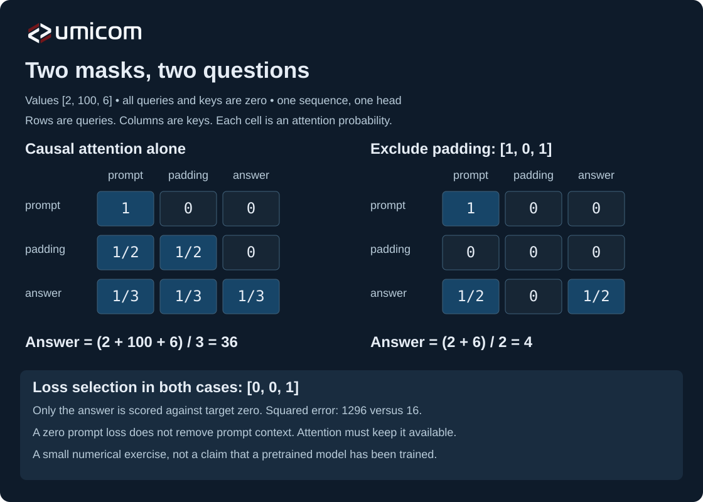

<!--
Umicom Bits2Banking
File: content/lessons/05-ai/preparing-llm-training-data/21-separate-attention-and-loss-masks.md

PURPOSE:
Separate attention masks from loss masks

AUTHOR AND ORGANISATION:
Sammy Hegab
Umicom Foundation

LICENCE:
MIT
-->

# Separate attention masks from loss masks

[Course contents](index.md)

## Begin with a small question

When a training batch contains short and long examples, programs often add padding so that arrays have a regular shape. Padding is storage used to fill unused positions. It is not another word in the conversation. This lesson asks two separate questions: which positions may influence a prediction, and which predictions should contribute to the training objective? A mask answers a selection question with one small value per position. Giving two masks the same name does not make their jobs interchangeable.

You will inspect three positions: a prompt, a padded position and an answer. The arithmetic uses invented scalar values, not text embeddings from a real model. This keeps every calculation small enough to check on paper. Then a C program calls the actual Umicom Framework attention and loss operators. The program downloads no model, starts no provider and changes no pretrained weights. Its purpose is to establish the contract that a later data pipeline must respect.

## Learn the vocabulary before reading the code

A tensor is an array together with its shape. A row is one position in this example. A channel is one numeric feature stored at that position. A batch combines independent examples. A sequence contains ordered positions belonging to one example. We use one sequence of three rows and one channel, so the tensor shape is [3, 1]. Larger models use many channels and divide them into attention heads, which are groups of features processed independently.

Attention combines value vectors using weights derived from queries and keys. A query represents the position asking for information. A key represents a position that can supply information. A value holds the information to combine. A dot product multiplies corresponding query and key components and adds the products. Softmax converts the resulting scores into nonnegative weights that sum to one over the permitted keys. Causal attention permits the current position and earlier positions, while excluding later ones. It cannot cross from one sequence in a batch into another.

A loss is a number that measures disagreement with a target. An objective specifies which disagreements to combine and how to average them. A gradient measures how that objective changes when one numeric input changes slightly. Backpropagation calculates these derivatives by following the computation graph backwards. A tape owns that graph and its stored arrays. These words describe different objects: a target is not a query, and an attention probability is not a loss-selection byte.

## Write the two selection policies

1. Number the three rows 0, 1 and 2. Treat row 0 as useful prompt information, row 1 as padding and row 2 as the answer position. The interior padding is deliberately visible; ordinary right-padded batches place padding at the end, but the contract also supports leading padding and holes.
2. Write attention selection [1, 0, 1]. One means this row may supply a query, key and value. Zero means the entire row is excluded from this attention operator.
3. Write loss selection [0, 0, 1]. Only the final output contributes to the objective. The prompt is context, even though its own output is not scored.
4. Keep these arrays separate. Copying the answer-only loss mask into the attention mask would remove prompt information from the answer. Copying the attention mask into the loss mask would add an objective term for the prompt.

## Calculate the result without padding exclusion

Set all queries and keys to zero. Each permitted dot product is therefore zero. The exponential of zero is one, so softmax assigns equal probability to every permitted key. Set the three value entries to [2, 100, 6]. The large middle value makes unintended padding influence easy to notice. At the final row, causal attention permits all three positions. With no padding selection, each receives probability one third.

~~~text
values = [2, 100, 6]
last output without an attention mask
    = (2 + 100 + 6) / 3
    = 36

loss selection = [0, 0, 1]
target for the selected output = 0
selected mean squared error = (36 - 0)^2 / 1 = 1296
~~~

The loss mask has excluded the first two output terms, but the padded value has already entered the last output. Discarding an output term cannot undo an input dependency inside another output. This is the central distinction. A training run can report a perfectly finite loss while still using the wrong information. An absence of crashes is not evidence that the data policy is correct.

## Calculate the result with padding exclusion

Now call the masked attention operator with [1, 0, 1]. The final query may use keys 0 and 2. Both scores are still zero, so their probabilities are one half each. Key 1 receives no probability and value 1 contributes nothing. The excluded query at row 1 produces zero output. The selected query at row 0 can still use its own key and produces 2.

~~~text
attention outputs = [2, 0, (2 + 6) / 2] = [2, 0, 4]
selected mean squared error = (4 - 0)^2 / 1 = 16

Change padding from 100 to 1000:
    final selected output remains 4
    selected objective remains 16
~~~

Smaller loss in this invented fixture does not prove that a model is better. We deliberately chose a zero target and a large padding value. What matters is the invariant: changing excluded padding must not change the selected prediction through this operator. A useful regression check tests this relationship across several padding values rather than merely looking for a small objective.

## Follow the gradient into the prompt

For the masked case, let y = (v0 + v2) / 2 and L = y squared. At y = 4, the derivative of L with respect to y is 8. Each selected value contributes one half of y, so the derivatives with respect to v0 and v2 are 4. The derivative with respect to padded v1 is zero. Thus the prompt value receives a derivative even though the prompt output has no objective term. This is expected: useful prompt information helped create the scored answer.

~~~text
with attention selection: value derivatives = [4, 0, 4]
with loss selection alone: value derivatives = [24, 24, 24]
~~~

The second row follows the same rule with y = 36: two times 36, multiplied by one third, is 24. Padding receives a derivative because it participated in the selected prediction. These are derivatives of the value inputs in this small graph, not a claim about every parameter in a real transformer. Other graph paths, residual connections and shared weights can still receive contributions. The Framework promise is zero contribution through this attention operation for its excluded query, key and value rows.

## Read the native calls

~~~c
const unsigned char attention_selection[3] = {1, 0, 1};
const unsigned char loss_selection[3] = {0, 0, 1};

status = UmiAiTrainingMaskedMultiHeadCausalAttention(
    tape, q, k, v, 3, 1, attention_selection, 3, &attention);
if (status == UMI_STATUS_OK)
    status = UmiAiTrainingMaskedMeanSquaredError(
        tape, attention, target, loss_selection, 3, &loss);
~~~

The two size arguments after v are sequence length and head count. The selection count must equal the number of rows, not the number of heads. All query, key and value shapes must agree; channels must divide evenly among heads. The loss operator in this scalar fixture takes one selection byte per scalar element. In a multiple-channel squared-error exercise, expand an intended row selection across its channel elements. Categorical cross-entropy instead selects prediction rows. Always read the specific operator contract before reusing an array.

## Build the focused laboratory

You need matching Bits2Banking and Framework source checkouts, a C23 compiler, CMake and Ninja. Open PowerShell and move to your Bits2Banking checkout. The commands below assume the checkouts have the usual sibling arrangement. Replace the Framework path with its absolute path if yours is different. A build directory stores generated files and executable output; it is separate from the source folders. Stop if any command reports an error.

~~~powershell
Set-Location C:\umicom\Umicom-Bits2Banking
cmake -S labs/framework/masked-language-loss -B build/masked-language-loss -G Ninja -DUMICOM_FRAMEWORK_SOURCE=C:/umicom/Umicom-Applications/framework
cmake --build build/masked-language-loss --parallel 2
ctest --test-dir build/masked-language-loss --output-on-failure
& ".\build\masked-language-loss\umicom-padding-attention.exe"
~~~

This source laboratory compiles a narrow set of Framework implementation files and keeps the algorithms there. It is not an installed SDK exercise. On Linux, use your checkout paths and run ./build/masked-language-loss/umicom-padding-attention. A multi-configuration generator may place executables in a configuration subfolder. The example target uses the existing Framework branding helper for native identity; it does not create a GUI window.

## Compare the expected output

~~~text
Loss selection only: prediction 36.0, objective 1296.0, padding gradient 24.0
Attention and loss selection: prediction 4.0, objective 16.0, padding gradient 0.0
Prompt value contributes; padding does not. All tapes released.
~~~

Open labs/framework/masked-language-loss/attention.c after running the program. Find inspect, which creates the graph, reads the output, differentiates the selected objective and destroys the tape on every exit path. Find the loop in main: it changes the padding value 32 times and checks that the masked result stays the same. The program returns a nonzero process status if a check fails. Printed expected values are teaching fixtures, not evidence that a different machine has passed the test.

## Respect ownership and memory limits

Framework copies the selection bytes into its attention node. The caller may release or change its input selection array after the call succeeds. The node retains its own copy until rollback, rewind or tape destruction. Selection storage counts toward the persistent graph budget, together with retained attention probabilities. The operator still uses temporary scores during calculation; a graph-budget number is not a total-process or system-memory limit.

All input tensor values must be finite under the normal tape contract, including excluded positions. Do not use a mask as permission to pass invalid pointers, NaN values or an incorrect count. An entirely excluded attention sequence is allowed and returns zeros, because no query needs a probability distribution. A completely excluded mean-squared-error objective is refused because its averaging denominator would be zero. An allowed empty attention result does not make an empty training objective useful.

## Recover from common mistakes

1. If configuration cannot find tape.h or matrix_kernel.c, correct UMICOM_FRAMEWORK_SOURCE. Do not copy one header into an unrelated SDK installation.
2. If linking cannot find the masked attention symbol, use matching header and source revisions. A declaration alone does not implement an operator.
3. If a status is invalid argument, compare shapes, row count, sequence length, head count and every selection byte. Binary bytes are exactly 0 or 1.
4. If changing padding changes a selected output, verify that the attention mask reached the attention call. A loss-only selection does not establish that invariant.
5. If the prompt no longer influences the answer, check that its attention byte is one even when its loss byte is zero.
6. If a memory limit refuses the operation, inspect retained graph storage and release obsolete graphs through the supported lifecycle. Do not raise a limit merely to hide unbounded growth.

## Connect this exercise to training data

A JSONL record can store text, roles and metadata, but its file format does not decide these masks automatically. A tokenizer turns text into token IDs. A batch builder then determines positions, padding, shifted targets and objective selection according to the chosen model and training task. A vector database serves retrieval and does not substitute for this preparation. Record the mask policy alongside the tokenizer, chat template and split policy so another person can reproduce the same examples.

This lesson adds a bounded native attention primitive and a transparent example. It does not by itself connect padding masks through every existing decoder or load external pretrained models. Before extending a decoder, preserve its unmasked behavior, verify all-selected equivalence and test independent sequences, gradients, allocation failures and rollback. For real fine-tuning, evaluate held-out tasks as well as training loss, and keep data licences and personal information under review.

## Try these exercises

1. Compute the unmasked final output if the middle value becomes 1000. It is 336; the selected squared error is 112896. Explain why the masked output remains 4.
2. Change the attention selection to [0, 0, 1]. Predict the final output and objective before running a modified copy. The output is 6 and objective is 36: the prompt was removed.
3. Explain why the prompt derivative is nonzero in the original masked example even though loss selection starts with zero.
4. Write separate sentences for an all-zero attention selection and an all-zero objective selection. Include why only one is accepted.
5. For two independent sequences, explain why a valid token in the second sequence must never attend to the first. Design a check that changes only the first sequence and observes the second.

## Further reading

- [Native attention-mask laboratory](https://github.com/umicom-foundation/Bits2Banking/blob/main/labs/framework/masked-language-loss/attention.c)
- [Framework training tape contract](https://github.com/umicom-foundation/umicom-framework/blob/main/include/umicom/ai/training/tape.h)

[Previous: Plan context capacity after fixed memory costs](20-plan-context-capacity-after-fixed-memory-costs.md)

[Next: Train a decoder with padded examples](22-train-a-decoder-with-padded-examples.md)
