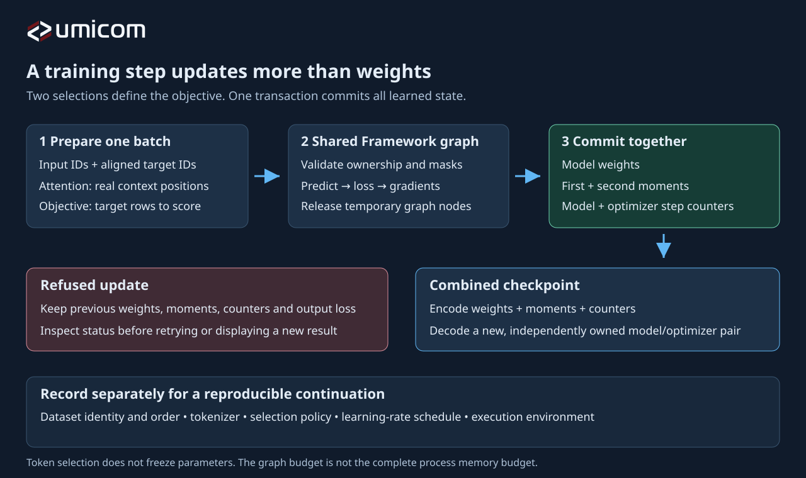

<!--
Umicom Bits2Banking
File: content/lessons/05-ai/preparing-llm-training-data/23-keep-optimizer-memory-for-selected-tokens.md

PURPOSE:
Keep optimizer memory when training selected tokens

AUTHOR AND ORGANISATION:
Sammy Hegab
Umicom Foundation

LICENCE:
MIT
-->

# Keep optimizer memory when training selected tokens

[Course contents](index.md)

## What you will learn

A training program has more memory than its model weights. Weights are the adjustable numbers used to make a prediction. An optimizer is the rule that changes those numbers after comparing a prediction with a desired answer. Some optimizers also remember information from earlier updates. In this lesson you will run a small C program that trains selected token positions, pauses, copies both the model and optimizer state, and proves that the copied run continues identically in the same executable. You will learn why a file containing weights alone cannot always resume training exactly.

Complete the earlier lessons on selected targets and padded examples first. You should recognize an array, a pointer, a loop and a status code from the C introduction. If those terms are unfamiliar, return to the linked source example and read each declaration before running it. This laboratory starts a tiny model from a reproducible seed and uses invented token IDs. It is not a pretrained language model, an image generator or a production assistant. The purpose is to make the ownership and state changes small enough to inspect.

## 1. Separate data, predictions and adjustable state

A token ID is an integer that identifies an item in a vocabulary. A vocabulary is a numbered catalogue; this example has eight entries numbered zero through seven. The input arrays do not contain English words. Each input position produces a row of eight prediction scores. A target ID tells the objective which vocabulary entry is desired at that position. The objective turns prediction scores into one scalar loss, a number describing disagreement with the selected targets. Backward propagation calculates how changing a weight would change that loss. That derivative is called a gradient.

Do not convert documents into a vector database for this exercise. The training arrays already contain integer IDs and targets. A tokenizer would be the separate component that converts real text to IDs. A vector database is commonly used to retrieve relevant passages for a prompt; it does not supply AdamW with its gradient history. Likewise, JSONL is a convenient record format for a dataset, not a replacement for the numeric arrays used during a training step. Keep these storage and computation roles distinct.

## 2. Understand why AdamW remembers previous gradients

SGD, or stochastic gradient descent, moves weights in the opposite direction to their current gradients, scaled by a learning rate. AdamW also maintains two moving summaries for each parameter element. The first moment tracks a smoothed signed gradient. The second moment tracks a smoothed squared gradient. A moment here is a statistical summary, not a unit of time. Smoothing mixes the new observation with the retained summary; beta1 and beta2 are the fractions controlling how much history is retained.

Consider gradients +2 followed by -2. Their signed average is zero, but their squared average is four. The first summary reflects a changing direction, while the second still indicates a substantial scale. AdamW uses both, corrects the initial bias caused by starting the summaries at zero, and divides by a scale derived from the second summary plus a small positive epsilon. Epsilon helps avoid a zero denominator. The completed-step counter matters to that bias correction. Copying the weights while losing the summaries or counter changes the next update.

The W refers to decoupled weight decay: the optimizer can shrink weights using a separate term controlled by weightDecay. This is different from adding a penalty to the loss and treating its derivative as ordinary input to the moving summaries. You do not need to reimplement these formulas in an application. Framework already owns the optimizer; this lesson calls it through its public C interface.

## 3. Keep the two token selections independent

The six input positions represent two independent sequences of length three. Attention selection says which positions contain real context. Objective selection says which predictions are scored. A zero in the objective does not hide that input from attention. For example, a prompt can help predict an answer without being directly scored. A padded position has attention zero, and it cannot be scored. Every selection byte must be exactly zero or one. At least one objective byte must be one.

~~~c
const size_t input[6] = {1, 2, 3, 4, 5, 6};
const size_t target[6] = {2, 3, 4, 5, 6, 7};
const unsigned char attention[6] = {1, 0, 1, 0, 1, 1};
const unsigned char objective[6] = {0, 0, 1, 0, 0, 1};
~~~

Only two target rows contribute directly to this objective, so the loss is their mean: add their losses and divide by two. Dividing by six would make padding change the scale of learning. The target values are already aligned by this example; the training API does not silently shift them. All IDs must still be valid, including placeholders at excluded positions. Padding does not change absolute positions: an interior padded slot still occupies its original position in the sequence.

## 4. Create two related owners in the right order

A decoder owns the training tape and its parameter tensors. The tape records the operations needed for backward propagation. AdamW owns its moment arrays but borrows handles to the decoder's parameter tensors. Borrowing means it refers to storage it does not own and must not destroy. Therefore the decoder must stay alive while its optimizer is used. Each decoder needs its own matching optimizer. Passing an optimizer created for another model is rejected even if their dimensions happen to match.

~~~c
UmiAiTrainingDecoder *model = NULL;
UmiAiTrainingAdamW *optimizer = NULL;
UmiAiTrainingAdamWConfig options;
UmiStatus status = UmiAiTrainingAdamWDefaults(&options);
/* Create the decoder, check status, then create its optimizer. */
if (status == UMI_STATUS_OK)
    status = UmiAiTrainingDecoderCreate(&geometry, &model);
if (status == UMI_STATUS_OK)
    status = UmiAiTrainingDecoderAdamWCreate(model, &options, &optimizer);
~~~

The complete source defines geometry as vocabulary size eight, context length three, channel width four, hidden width eight, two attention heads and seed forty-two. Channels are the small learned feature vectors used internally. An attention head is one independently calculated attention group within the layer. The configuration is intentionally tiny. Setting the same seed repeats this initialization; it does not prove that arbitrary systems or future library versions will make identical floating-point decisions.

## 5. Configure and run the actual example

1. Open PowerShell. Check that CMake, Ninja and the UCRT64 C compiler used in the earlier native lessons are available. Keep matching Framework headers and source together.
2. Change to your Bits2Banking checkout. The following commands use the owner's ordinary C:\umicom paths; substitute your own checkout location consistently if it differs.
3. Configure the teaching composition. This deliberately compiles a narrow set of existing Framework sources. It is not an installed-SDK qualification and does not clone another Framework checkout.
4. Build with two jobs, run its tests, then run the selected-AdamW executable. Stop at the first failed command and read its output before continuing.

~~~powershell
Set-Location C:\umicom\Umicom-Bits2Banking
cmake -S labs/framework/masked-language-loss -B build/masked-language-loss -G Ninja -DUMICOM_FRAMEWORK_SOURCE=C:/umicom/Umicom-Applications/framework
cmake --build build/masked-language-loss --parallel 2
ctest --test-dir build/masked-language-loss --output-on-failure
& ".\build\masked-language-loss\umicom-selected-adamw.exe"
~~~

The executable reports scored_rows=2, total_rows=6, completed_steps=40 and resumed_state=identical. It prints an initial and a smaller final loss for this fixed fixture. Do not copy a particular decimal value into an assertion across unrelated compilers. The program itself checks the relationships it promises and exits with failure if they do not hold. A smaller training loss demonstrates fitting these invented examples; it does not establish good answers on unseen documents.

## 6. Follow one update without losing an error

The padded AdamW call receives the model, its optimizer, input IDs, targets, the two masks, their counts, a positive finite learning rate and an output pointer. The output pointer identifies the caller's storage for the loss. The function checks ownership and data policy, constructs the shared decoder graph, computes the selected loss and gradients, releases temporary graph nodes, and asks the existing optimizer to commit the weight and moment changes together.

~~~c
status = UmiAiTrainingDecoderTrainAdamWPaddedStep(
    model, optimizer, input, target, 6,
    attention, 6, objective, 6, 0.02F, &original_loss);
~~~

On success, original_loss describes the model before that update, and both completed-step counters advance once. Evaluate again to obtain a post-update loss. On refusal, the weights, moments, counters and prior output loss remain unchanged. Scratch gradients are not part of that rollback promise. Always inspect the status before printing a new loss; otherwise an old value left in the output variable can be mistaken for a successful new observation. Calls on the same model must be serialized by the caller.

## 7. Pause, copy and resume the complete state

After twenty updates the example asks the combined checkpoint API for the required byte count, allocates two buffers of that size and encodes the model plus AdamW state into the first buffer. Encoding means translating the state into a specified sequence of bytes. Decoding validates that sequence and creates a new model and optimizer with independent ownership. The example then performs twenty more identical updates on both the original and decoded pairs.

It compares their losses along the way and finally compares their complete encoded states. Matching a printed loss alone would be too weak: different weight configurations can produce the same scalar. The combined checkpoint includes moment arrays and counters as well as model weights. Both new handles must eventually be destroyed. The checkpoint buffer is separately owned and must be freed too. The example keeps everything in memory; it does not write a file or overwrite an earlier experiment.

The checkpoint does not record the text corpus, source permissions, tokenizer, data order, selection policy or learning-rate schedule. Keep a training manifest for those. If you resume with different target alignment, mask values or learning rates, you have changed the experiment even if the loaded state is valid. A checksum can detect accidental changes to stored bytes; it does not establish that an untrusted checkpoint is authentic.

## 8. Interpret the memory figures honestly

The example compares retained tape storage before and after repeated steps and separately inspects retained optimizer-state bytes. Temporary graph nodes should return to the parameter-only prefix. Moment arrays should retain their expected fixed size rather than grow once per step. This detects one useful class of lifetime errors. It does not prove the absence of every allocation leak or describe the entire process footprint.

The decoder's graph budget does not include all optimizer temporaries, checkpoint buffers, stack arrays, allocator bookkeeping or operating-system memory. AdamW requires more retained state than plain SGD because of its moment arrays. The padding mask controls mathematical participation; this decoder still uses dense tensors and is not a sparse-memory engine. Begin with a small batch and inspect actual process memory before scaling a real experiment.

## 9. Recover from common mistakes

1. If an API name is missing, compare the Framework headers and implementations supplied to CMake. A new header with an older library is not a compatible update.
2. If selection is rejected, count the arrays, inspect every byte, and verify that each scored row is attended. Check placeholder IDs against the vocabulary too.
3. If optimizer binding is rejected, confirm that the optimizer was created for this exact decoder. Mixing an SGD update into an AdamW run makes the counters inconsistent. Restoring a consistent combined checkpoint is different from discarding history and starting a new optimizer.
4. If memory is refused, reduce sequence length, model width or batch size within the declared limits. Repeatedly disabling limits is not a diagnosis.
5. If resumed state differs, compare data order, masks, learning rates and execution environment. Keep the first difference as evidence rather than weakening the comparison.

## 10. Practice and explain the result

Run the unchanged example first. Next, make a separate practice copy and change only an excluded target ID to another valid ID. Predict whether selected loss should change, then explain the observation. Change an attended prompt token instead: it may affect a scored answer even though the prompt itself is not scored. Finally, change the continuation learning rate in only one branch and observe that exact continuation is no longer expected. Restore the example afterward; do not redefine its pass condition to hide the deliberate mismatch.

One final distinction matters: a token mask is not a parameter-freezing mechanism. A prompt can contribute gradients through context. Even a zero current gradient does not guarantee an unchanged parameter because old AdamW moments and weight decay can still act. Parameter freezing, masked microbatch accumulation, clipped masked updates and adapting a large pretrained model require explicit additional contracts. The present native APIs cover one synchronous selected batch and the existing combined state codec.

## What must be preserved

| Item | Purpose | Included in combined checkpoint? |
| --- | --- | --- |
| Weights | Produce predictions | Yes |
| First and second moments | Retain optimizer gradient history | Yes |
| Completed steps | Bias correction and continuation position | Yes |
| Dataset and ordering | Determine subsequent inputs | No; preserve a separate manifest |
| Tokenizer and mask policy | Define the meaning of inputs and targets | No; preserve separately |
| Compiler and execution environment | Explain numerical reproducibility | No; record separately |

## Further reading

- [Complete native AdamW learning example](https://github.com/umicom-foundation/Bits2Banking/blob/main/labs/framework/masked-language-loss/adamw_decoder.c)
- [Framework selected AdamW contract](https://github.com/umicom-foundation/umicom-framework/blob/main/docs/learning/selected-adamw-training.md)

[Previous: Train a decoder with padded examples](22-train-a-decoder-with-padded-examples.md)

[Next: Accumulate uneven selected microbatches without changing their weight](24-accumulate-uneven-selected-microbatches.md)
