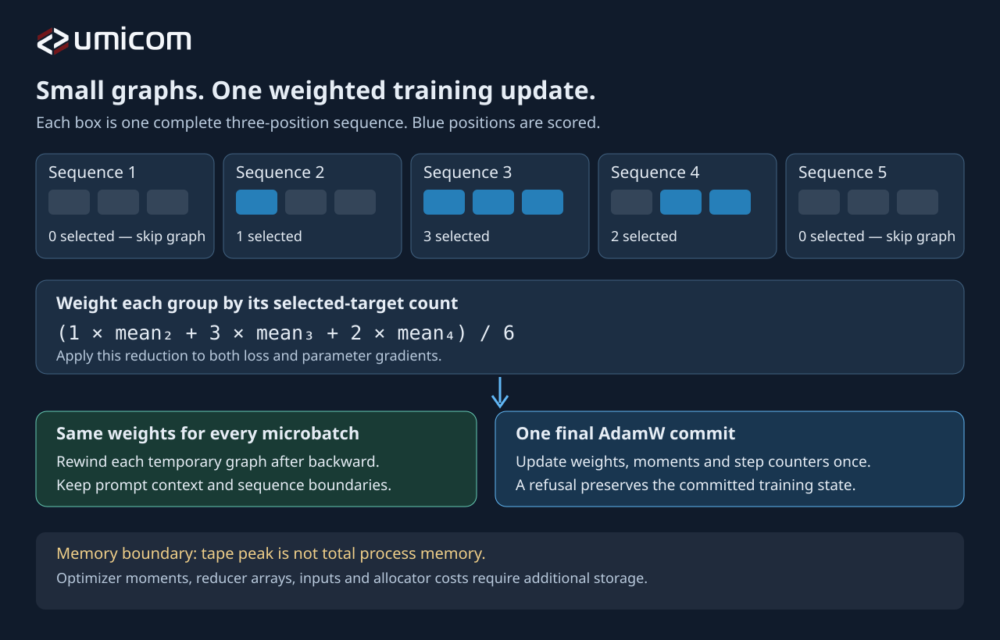

<!--
Umicom Bits2Banking
File: content/lessons/05-ai/preparing-llm-training-data/24-accumulate-uneven-selected-microbatches.md

PURPOSE:
Accumulate uneven selected microbatches without changing their weight

AUTHOR AND ORGANISATION:
Sammy Hegab
Umicom Foundation

LICENCE:
MIT
-->

# Accumulate uneven selected microbatches without changing their weight

[Course contents](index.md)

## Begin with the job that the computer must remember

A training example supplies inputs and desired answers. During a forward calculation the model turns those inputs into predictions. The loss measures how far the predictions are from the desired answers. Backward propagation follows the calculation in reverse and finds gradients: numbers describing how a small change to each model weight would change the loss. Many intermediate values must remain available until that backward calculation finishes. These saved values are called activations. More examples processed together usually require more activation memory. The model's weights must also remain in memory, but splitting examples into smaller groups does not make those weights smaller. This distinction is the starting point for understanding microbatches.

## Separate a batch from an update

A batch is the group of examples whose gradients will contribute to one weight update. A microbatch is a smaller group processed as one temporary calculation graph. Gradient accumulation means collect contributions from several microbatches before changing any weights. For example, five sequences can form one effective batch while the computer processes one sequence at a time. The first four calculations do not update the weights. Every calculation therefore sees the same starting model. After the fifth group is accounted for, the optimizer receives the combined gradient once. Taking five independent optimizer steps is a different experiment. AdamW would then advance its step counter and moment history five times, and later sequences would see already changed weights.

## Read the example one row at a time

Our laboratory contains fifteen invented input token IDs. Context length is three, so the IDs form five independent sequences. A token ID is an integer that names a vocabulary entry; these small integers are teaching data, not meaningful sentences. Targets have already been aligned with their predictions. Each position has two additional bytes. An attention byte of one allows that input position to participate in attention. An objective byte of one includes its prediction in the loss. An attended prompt may have an objective byte of zero. Every selected target must also be attended. The first and last sequences in this experiment have no selected targets.

| Sequence | Objective bytes | Selected targets | Contribution |
| --- | --- | --- | --- |
| 1 | 0 0 0 | 0 | No objective graph needed |
| 2 | 1 0 0 | 1 | One selected prediction |
| 3 | 1 1 1 | 3 | Three selected predictions |
| 4 | 0 1 1 | 2 | Two selected predictions |
| 5 | 0 0 0 | 0 | No objective graph needed |

## Calculate the denominator before writing code

A denominator is the number below a division sign. The denominator here is six selected predictions: 0 + 1 + 3 + 2 + 0. It is not fifteen input positions and it is not three nonempty sequences. Suppose the three nonempty sequence losses are 2, 4 and 1. These are already means within their own sequence. Sequence two represents one prediction, sequence three represents three, and sequence four represents two. Recover their totals by multiplying each mean by its selected count. The batch mean is (1 × 2 + 3 × 4 + 2 × 1) / 6 = 16 / 6, approximately 2.666667. Averaging the three means directly gives approximately 2.333333 and incorrectly makes a one-target sequence as important as a three-target sequence.

~~~text
weighted_sum = 1 * 2 + 3 * 4 + 2 * 1
selected_count = 1 + 3 + 2
batch_mean = weighted_sum / selected_count
~~~

## Apply the same weights to gradients

The objective's derivative must follow the same averaging rule as the displayed loss. Framework multiplies each microbatch mean gradient by that microbatch's selected-target count, adds the results in double-precision temporary storage, and divides by the total selected count. It then converts the reduced values to finite single-precision gradients for the optimizer. Double precision has more representable detail than single precision; it helps accumulation but does not make all floating-point addition exact. The temporary reducer contains one double and one float per parameter element, plus a float scratch array for the largest parameter. Those arrays are additional host memory. Reducing the graph size therefore trades some memory for gradient-reduction storage and repeated graph construction.

## Keep sequence boundaries intact

The microbatch size is expressed in complete sequences, not arbitrary tokens. With context length three, a setting of one means three input positions per graph. A setting of two means up to six positions, with a final shorter group if necessary. Do not compact the six selected targets into a new six-token sequence. That would remove prompt context, change absolute positions and allow formerly independent examples to affect each other. Padding exclusion also does not renumber positions. The existing sequence layout is part of the experiment's meaning. An all-zero objective is allowed for an individual microbatch because it contributes nothing to the combined objective; an all-zero objective across the whole effective batch is refused.

## Create the model and its optimizer in the correct order

The laboratory's Experiment structure stores two handles. A handle is a value through which code refers to an object owned by the library. First create the decoder with its geometry and seed. Then create AdamW bound to that decoder. The optimizer borrows the decoder's parameter handles and owns its own moment storage. When cleaning up, destroy the optimizer first and the decoder second. A single cleanup path runs after success or any failure. The program uses two independent experiments: one evaluates a complete-batch update, and the other accumulates microbatches. Their initialization is the same so the first losses can be compared. They do not share optimizer state.

## Follow the public call

Include the gradient_accumulation.h header from the matching Framework checkout. The token count is fifteen, the maximum number of sequences per microbatch is one, and both mask lengths are fifteen. The learning rate is 0.02. This is a step size for the small fixed experiment, not a recommended learning rate for every model. The function returns a status. Only read loss as a new result if that status is UMI_STATUS_OK. The loss describes the model before the successful update. A later call's loss comes from a different weight state.

~~~c
#include "umicom/ai/training/gradient_accumulation.h"

float loss = 0.0F;
UmiStatus status = UmiAiTrainingDecoderTrainAdamWPaddedAccumulated(
    model, optimizer,
    input, target, 15, 1,
    attention, 15, objective, 15,
    0.02F, &loss);
~~~

## Build and run the complete teaching program

The source is labs/framework/masked-language-loss/microbatches.c in Bits2Banking. Open PowerShell at the Bits2Banking repository root. Use a C23 toolchain, CMake and Ninja that are already installed. Replace the source path if your matching Framework checkout is elsewhere. Configure checks the sources and produces build instructions. Build compiles and links the executables. CTest runs the laboratory assertions. Run each command separately and stop if it reports an error. No command below downloads a model, starts a server or requests a hosted API.

~~~powershell
cmake -S labs/framework/masked-language-loss -B build/masked-language-loss -G Ninja -DUMICOM_FRAMEWORK_SOURCE=../Umicom-Applications/framework
cmake --build build/masked-language-loss --parallel 2
ctest --test-dir build/masked-language-loss -R lesson.training.selected-microbatches --output-on-failure
& ".\build\masked-language-loss\umicom-selected-microbatches.exe"
~~~

1. Open the complete repository rather than copying only one C file.
2. Configure against the matching Framework source checkout.
3. Build the small learning targets with two compiler jobs.
4. Run the selected-microbatch test, then run the executable to read its measurements.

## Interpret the printed result precisely

Expect sequences=5, scored_targets=6, microbatch_sequences=1 and updates=41. The program first takes one compared update and then takes forty more accumulated updates. Its first loss must agree closely with the complete-batch calculation, and its last pre-update loss must be lower on this repeated fixture. The microbatch tape peak must be smaller than the full-batch tape peak in this experiment. Retained tape storage must return to the same value after every call. Exact loss decimals and byte totals can vary with the build. A lower training loss on five repeatedly used invented sequences is not evidence that a model understands language or performs well on unseen examples.

## Understand what the memory numbers exclude

The native program also prints planned_reducer_payload=2912 for this geometry on the demonstrated float/double representation. Its planner reports at most five graphs, although the two empty-objective groups are skipped. The planner allocates no model and reports logical array payload, not a process peak. A larger requested group is capped by the effective sequence count for graph-shape planning; both requested counts must still obey the accumulated-token contract.

A peak is the largest measured amount during an observation. The tape records its own committed graph storage, not total memory used by the process or computer. The program prints optimizer-state storage separately. Reducer arrays, temporary optimizer work, checkpoint buffers, input arrays, runtime libraries and allocator bookkeeping also consume memory. GPU memory is outside this CPU experiment. A process can therefore use much more memory than the printed tape peak. A stable retained count checks one ownership boundary; it is not a complete leak proof. Compare repeated process-level observations under the same workload when investigating real memory growth, and keep the model, operation, build identity and measurement tool with the observations.

## Make failed work leave the committed state intact

Framework validates all token IDs, lengths and binary mask values before skipping an unscored microbatch. A bad ID in the final unscored sequence is still an error. If a graph exceeds its memory budget, temporary graph storage is rewound and the accumulated arrays are released. The final optimizer update validates candidate state before committing it. On refusal, weights, optimizer moments, completed-step counters and the caller's loss variable retain their previous values. Leaf gradients are scratch data and are not part of this persistence promise. Callers must serialize access to a model and optimizer; a transaction here is not a permission to use the same handles concurrently from several threads.

## Save the policy as well as the checkpoint

The combined model-and-AdamW checkpoint stores weights, moment arrays and step counters. It does not store the dataset, ordering, tokenizer, attention policy, objective policy or microbatch size. Save those experiment settings alongside the checkpoint. Addition can occur in a different order when microbatch boundaries change, so two mathematically equivalent reductions can differ slightly in floating-point results. Exact continuation requires the same relevant policy and environment. The existing checkpoint laboratory demonstrates continuation under an unchanged policy. This lesson does not add an imported-model loader, distributed optimizer, sparse tensor engine or automatic dataset shuffler.

## Investigate a failure without weakening the check

If the compiler cannot find the accumulated function, verify that the header and decoder source come from the same Framework revision. Do not invent a declaration to silence the compiler. An invalid-argument status means inspect sequence alignment, binary masks, selected-count rules, vocabulary bounds and learning rate first. A binding error means the optimizer does not belong to the current model or its step history is inconsistent. Capacity errors may require smaller microbatches, a different approved graph budget or a smaller geometry. Increasing a graph budget does not reserve physical RAM. If the expected peak comparison fails, check that you did not run a full-batch graph on the microbatch experiment before recording its peak.

## Practice with predicted outcomes

Before changing code, write down what you expect. Change microbatch_sequences from one to two. The selected denominator remains six and one call still commits one optimizer update, but the graph peak and floating-point order may change. Set every objective byte to zero: the whole operation should be refused and the output loss sentinel preserved. Place an out-of-vocabulary target in an excluded row: it should still be refused. Change a padded input to another valid ID: selected predictions should remain invariant under the established attention policy. Restore the original fixture before comparing results. Keep each experiment small enough that you can explain the difference.

## Where this helps Umicom applications

A future training screen can expose effective-batch size and microbatch size as separate settings, show selected-target counts, and explain what each memory measurement covers. Framework owns the actual decoder, reducer, optimizer and checkpoint rules so Media, LLM or Studio clients need not implement their own versions. An application still needs cancellation policy, progress reporting, dataset provenance, resource admission and recovery controls before it can safely offer a complete trainer. This laboratory provides a reusable native operation and a worked example; it does not establish that those complete application workflows are implemented or qualified.

[Previous: Keep optimizer memory when training selected tokens](23-keep-optimizer-memory-for-selected-tokens.md)

[Next: Shuffle an epoch without changing the split](25-shuffle-an-epoch-without-changing-the-split.md)
