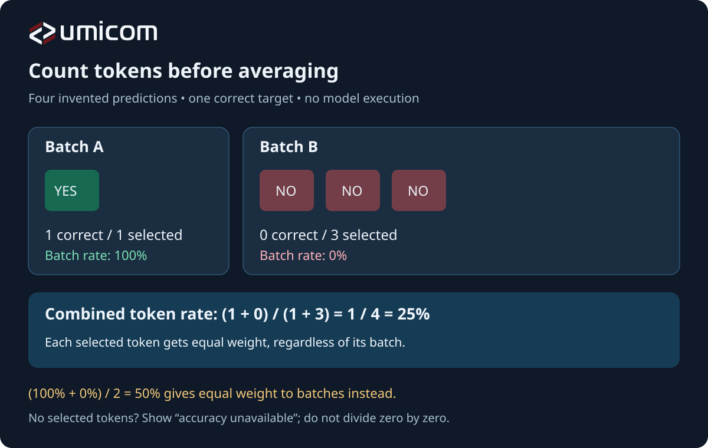

<!--
Umicom Bits2Banking
File: content/lessons/05-ai/preparing-llm-training-data/26-count-selected-predictions-before-percentages.md

PURPOSE:
Count selected predictions before calculating percentages

AUTHOR AND ORGANISATION:
Sammy Hegab
Umicom Foundation

LICENCE:
MIT
-->

# Count selected predictions before calculating percentages

[Course contents](index.md)

## Start with four guesses and four answers

Evaluation means measuring what a model does on examples chosen for assessment. Before trusting a percentage, define what one observation is. In this lesson one row is one prediction of the next token. A token is a unit from a model’s vocabulary, such as a word fragment or a byte. The vocabulary is the set of possible token identifiers. Our miniature vocabulary contains identifiers 0, 1, 2 and 3. Each row contains four scores, one per identifier. The target is the identifier we wanted the model to predict. We use invented scores so every arithmetic step is visible. No model is trained or loaded by the exercise.

1. Open labs/framework/prediction-metrics/main.c in the Bits2Banking checkout. Locate the array named logits. An array is a sequence of values stored together.
2. Group its sixteen numbers into four rows of four numbers. These groups are consecutive in memory: this is row-major storage.
3. Locate targets. Every row’s target is identifier 0, but the score assigned to that identifier changes between rows.

## Read scores as an ordering, not as probabilities

A logit is an unnormalized model score. Unnormalized means the scores are not required to sum to one. Larger scores rank earlier in this exercise. Scores may be negative; their relative values are what ranking uses. A softmax operation can convert a finite score row into a probability distribution, but this ranking function does not need that conversion. The target has rank zero when no candidate comes before it, rank one when one candidate comes before it, and so on. Rank zero is the first position because C counts positions starting at zero.

| Row | Scores for token IDs 0, 1, 2, 3 | Target rank | Top-one correct? | Top-two correct? |
| --- | --- | --- | --- | --- |
| 0 | 4, 3, 2, 1 | 0 | Yes | Yes |
| 1 | 3, 4, 2, 1 | 1 | No | Yes |
| 2 | 2, 3, 4, 1 | 2 | No | No |
| 3 | 1, 2, 3, 4 | 3 | No | No |

## Define top-one, top-K and the denominator

Top-one accuracy asks whether the target is the single highest-ranked candidate. Top-K accuracy asks whether it appears among the first K candidates. K is a positive whole number no larger than the vocabulary size. For these four rows, top-one has one correct answer and top-two has two. The numerator is the correct count above the fraction bar. The denominator is the evaluated count below it. Thus top-one is 1/4, or 25%, and top-two is 2/4, or 50%. Multiply a fraction by 100 to express it as a percentage. These are token-level counts, not complete-answer correctness, factual accuracy or user satisfaction.

1. Circle the rows whose target rank is zero. Count one circle.
2. For K=2, circle ranks smaller than two. Count two circles.
3. Write each count over the number of included rows before calculating a percentage.

## Make tie handling part of the contract

Two tokens can receive equal scores. A deterministic rule is needed to choose their order. The shared Framework scorer puts the lower token identifier first when scores are equal. For a row [5, 5, 5, 5], the order is 0, 1, 2, 3. A target of 2 therefore has rank two and does not count as top-two correct. Positive zero and negative zero compare equal and follow the same rule. Another evaluator may use another tie policy; comparing its percentages with ours requires recording that difference. The rule is reproducible, but it does not turn tied scores into a confident model prediction.

## Select answer positions without hiding invalid data

A selection array contains one byte per row: one includes the row, zero excludes it. This is useful when an evaluation should score answer tokens but not prompt tokens or padding. Padding means extra positions added to satisfy a fixed shape. Selection does not remove those positions from model computation and is not an attention mask. An attention mask determines which positions the model can attend to. Dataset partition membership is different again: it decides which examples belong to training or evaluation. Our selection [1, 1, 1, 0] includes three rows. It gives top-one 1/3 and top-two 2/3. Changing the selection changes the question being measured, so record the policy with the result.

~~~c
const uint8_t selected[4] = {1U, 1U, 1U, 0U};
UmiAiTrainingPredictionCounts counts;
UmiStatus status = UmiAiTrainingPredictionScore(
    logits, 4U, 4U, targets, selected, 4U, 2U, &counts);
if (status != UMI_STATUS_OK) {
    return 1;
}
~~~

## Understand the C call and its ownership

The first pointer borrows the score array; the next two sizes describe rows and vocabulary columns. The targets pointer supplies one identifier per row. The optional selection pointer and selection count describe exactly one byte per row, or use NULL and zero to include all rows. The following number is K. The final pointer names caller-owned output storage. Borrowing means the function may read the inputs during the call but does not keep them afterward. The caller must provide valid, stable arrays of the declared lengths and separate output storage. The function allocates no memory, creates no sorted copy and changes no weights. It counts how many candidates precede each target, validates every row, then publishes the complete result once.

1. Check the returned UmiStatus before using counts. A failed call leaves the old output unchanged; unchanged output is not a new measurement.
2. Keep rows multiplied by vocabulary within the bounded training limit of 16,384 scores. The implementation checks the bound through division to avoid overflow in the multiplication.
3. Keep every target in range and every score finite, including excluded rows. NaN means “not a number”; positive or negative infinity is also refused. A zero selection must not conceal a numerical failure.
4. Do not write the arrays concurrently while this call reads them. Native C still requires correct lifetimes and access ownership.

## Aggregate counts across unequal batches

A batch is a group of rows processed together. Imagine the first batch contains only row 0 and the second contains rows 1 through 3. Their top-one rates are 1/1=100% and 0/3=0%. The simple average of those two percentages is 50%. But one token out of four was correct, so the token-weighted result is 25%. The simple average gave the one-token batch as much influence as the three-token batch. For one common token-level question, add the correct counts and selected counts across compatible batches, then divide once. If instead you intentionally want to weight each complete example equally, define and report that distinct policy.

~~~c
combinedCorrect = first.topOneCorrect + tail.topOneCorrect;
combinedSelected = first.selectedRows + tail.selectedRows;
/* In this bounded example: (1 + 0) / (1 + 3) = 1 / 4. */
~~~

## Treat an empty selection as unavailable

If every selection byte is zero, the scorer succeeds with zero selected rows and zero correct counts. That is a valid empty measurement, not a fraction you can divide. Dividing zero by zero does not define an accuracy. The laboratory prints “accuracy unavailable”. A user interface should show that explanation, not a green 100% badge or an unexplained 0%. An empty answer region may indicate a preprocessing error. Inspect the prompt/answer boundary, tokenization and padding policy before claiming the evaluation covered anything.

## Keep accuracy separate from loss and perplexity

A model can rank the same token first with probabilities 0.51 or 0.99. Top-one correctness is identical in those two cases, but a loss based on the true token’s probability differs. Cross-entropy measures the negative logarithm of that probability, averaged according to a defined reduction policy. The logarithm is the inverse of exponentiation; for now, use the intuition that a smaller probability assigned to the true answer gives a larger penalty. Perplexity is the exponential of mean token cross-entropy when natural logarithms and a compatible evaluation definition are used. The new scorer returns counts, not loss or perplexity. The existing Framework model-audit path keeps its existing loss calculation and reuses this scorer for rank counts. Do not compare perplexities across different tokenizers, selected positions or datasets as if they measured the same units.

## Build the small laboratory step by step

Use a PowerShell terminal. CMake reads the build description, Ninja runs the compiler commands, and CTest runs registered checks. The commands below assume the two checkouts shown. Replace their paths if yours differ. Set the UCRT64 tool directory for this terminal if GCC, Ninja or Windows resource compilation is unavailable. Each command must succeed before the next. The executable uses actual Framework source through a narrow learning build; this is not a complete installed SDK qualification.

~~~powershell
$env:Path = "C:\msys64\ucrt64\bin;$env:Path"
Set-Location "C:\umicom\Umicom-Bits2Banking"
cmake -S labs/framework/prediction-metrics -B build/learning-prediction-metrics -G Ninja -DCMAKE_C_COMPILER=C:/msys64/ucrt64/bin/gcc.exe -DUMICOM_FRAMEWORK_SOURCE=C:/umicom/Umicom-Applications/framework
cmake --build build/learning-prediction-metrics
ctest --test-dir build/learning-prediction-metrics --output-on-failure
& ".\build\learning-prediction-metrics\umicom-prediction-metrics.exe"
~~~

## Check expected results and recover from mistakes

The program verifies the counts before printing the output below. If the source header or implementation is missing, point CMake at a matching Framework checkout containing both. If a compiler error occurs, correct it and rebuild before running the executable: an older executable can remain in a build folder after failure. If you deliberately change the target identifiers or selection, recompute the expected fractions on paper and update the exercise assertions. Never change expected results solely to make a failed check disappear.

~~~text
all rows: top-one=1/4 top-two=2/4
unequal batches: 1/1 and 0/3; combined 1/4
selected answers: top-one=1/3 top-two=2/3
no selected rows: accuracy unavailable
~~~

## Extend the exercise with a recorded evaluation policy

Useful evaluation records identify the dataset and split, tokenizer, model parameters or checkpoint identity, included positions, tie policy, K, raw counts and any numerical refusals. These details make a result interpretable and repeatable. They do not guarantee that a model is useful or safe. Add task-specific checks, reviewed examples and human assessment for the intended application. In a long-running application, check integer additions before aggregating unbounded numbers of batches; the small single-call limit does not automatically bound a lifetime total.

1. Set K=4 and predict the top-K count before changing the code. All four finite target rows should count, which illustrates why a large K is an easier measure.
2. Exclude row 0 and include the other three. Predict top-one 0/3 and top-two 1/3.
3. Use equal scores for one row and target identifier 2. Explain why lower-ID tie order places that target third.
4. Describe why an empty selected region and a numerical refusal must be reported separately.
5. Write one sentence explaining why 25% token accuracy on these invented rows is not evidence of a usable chatbot.

[Previous: Shuffle an epoch without changing the split](25-shuffle-an-epoch-without-changing-the-split.md)

[Next: Prepare a byte pair without shifting twice](27-prepare-a-byte-pair-without-shifting-twice.md)
